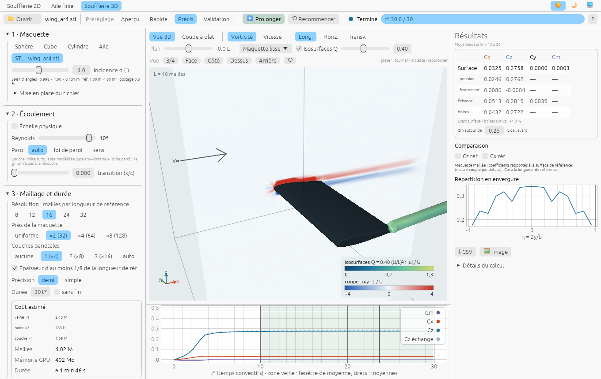
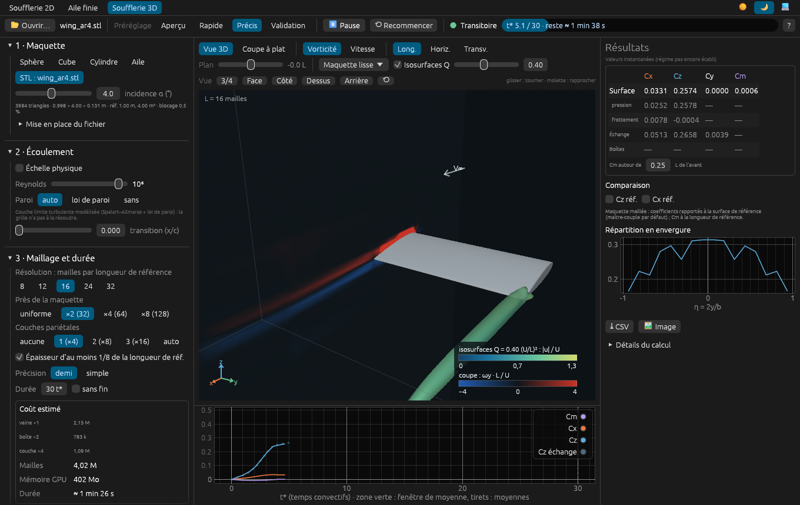

# Soufflerie de poche — version native (Rust)

Fork natif de l'application web [`soufflerie-lbm`](../soufflerie-lbm) : même
soufflerie numérique 2D Lattice Boltzmann (D2Q9), aile finie et soufflerie
3D (D3Q19 sur GPU), en Rust, pour ordinateur (Linux, Windows, macOS).
Interface graphique et ligne de commande.

**Documentation** : [présentation](docs/presentation.md) (usage, validations
en bref), [méthode scientifique](docs/methode_scientifique.md) (équations,
validation chiffrée, forces et limites), [fonctionnement
technique](docs/technique.md) (code, GPU, stockage, raffinement, tests). Ce
README reste le journal détaillé des essais.


## Pourquoi une version native ?

Le moteur processeur de l'application web tourne sur un seul cœur, en
JavaScript. Ici, la même boucle est compilée, vectorisée (SSE, AVX2,
AVX-512) et répartie sur tous les cœurs. Mesures sur le même cas (NACA 0012,
α = 4°, Re = 1000, 32 mailles par corde, grille 768 × 384), sur un serveur à
4 cœurs :

| Moteur | Millions de mailles par seconde | Rapport |
| --- | --- | --- |
| Application web, CPU (JavaScript, 1 cœur) | 16,5 | 1 |
| Rust, 1 fil | 78 | ×4,7 |
| Rust, 4 fils | 236 | ×14 |
| Rust, 1 fil, `-C target-cpu=native` (AVX-512) | 121 | ×7,3 |
| Rust, 4 fils, `-C target-cpu=native` | 309 | ×19 |

Sur un portable à 8 cœurs, compter de l'ordre de 400 à 800 millions de
mailles par seconde. La polaire (`soufflerie polar`) calcule en plus les
incidences en parallèle : 5 points (NACA 0012, Re = 1000, 16 mailles) en
11 s.

**Moteur GPU natif** (wgpu : Vulkan, Metal, DirectX 12) : mêmes équations, en
« compute shaders ». Il donne les mêmes efforts que le moteur processeur à
10⁻⁵ près (test `gpu`). Sur GPU, c'est la bande passante mémoire qui limite,
comme dans le navigateur : le gain attendu par rapport au moteur WebGL2 de
l'application web est modeste (×1,5 à 2, sans les limites mémoire du
navigateur). Je n'ai pu le mesurer que sur un GPU logiciel (SwiftShader),
sans signification pour la vitesse.

## Ce qui est porté

- D2Q9, collision régularisée récursive (Malaspinas 2015) ou BGK ;
  sous-maille de Smagorinsky amortie près de la paroi (Van Driest) ; entrée
  et sortie de Guo ; bandes absorbantes ; zone éponge ; mise en vitesse
  progressive ; paroi interpolée de Bouzidi, y compris les parois plus
  minces qu'une maille et la paroi mobile (cylindre tournant) ; efforts par
  échange de quantité de mouvement ; moyennes sur un nombre entier de
  périodes et Strouhal.
- Maquettes : cylindre (rotation), carré, ellipse, plaque, profil NACA à 4
  chiffres, triangle ; bord de fuite recalé sur le réseau.
- **Turbulence de Spalart–Allmaras et loi de paroi de Spalding** (Re de
  5·10⁴ à 10⁷), sur les deux moteurs : viscosité turbulente ajoutée au temps
  de relaxation, glissement de paroi qui transmet le frottement de la loi,
  ν̃ = κu_τy au premier nœud, sous-maille conservée loin de la paroi.
- **Méthode des panneaux et couche limite intégrale** (tourbillons
  linéaires, Thwaites, transition eᴺ, Head, Squire–Young, décrochage
  approché de Kirchhoff, correction de compressibilité) : référence Cz, Cx,
  Cm en écoulement attaché, et **couplage hybride** : en transition libre,
  la paroi du calcul LBM reste laminaire en amont de la transition prédite.
- **Distributions pariétales** Cp et Cf du calcul LBM, moyennées dans le
  temps, comparées aux panneaux (profils) ou à l'écoulement potentiel
  (cylindre).
- Interface : veine zoomable (molette, glisser, double-clic pour recadrer),
  vorticité, vitesse, pression ou viscosité turbulente, traceurs en filets
  ou en **fronts** (lignes de temps, couleurs alternées), force résultante,
  coefficients, référence « panneaux + couche limite », historique et
  distributions pariétales, copie CSV. Reynolds de 10 à 10⁷, résolutions
  jusqu'à 192 mailles par longueur (13 millions de mailles).


Validation (`cargo test --release`) : mêmes cas que l'application web, mêmes
valeurs à 10⁻³ près.

| Cas | Rust | Application web |
| --- | --- | --- |
| Cylindre, Re = 20, L = 16 | Cx = 2,373 | 2,373 |
| Cylindre, Re = 100, L = 16 | Cx = 1,496, St = 0,176, Cz' = 0,376 | 1,496, 0,176, 0,375 |
| NACA 0012, α = ±4°, Re = 500, L = 12 | Cz = ±0,1972 | ±0,1972 |
| NACA 0012, α = 0, Re = 1000, L = 16 | Cx = 0,1454 | 0,1454 |
| Cylindre tournant ΩR/U = 1, Re = 100 | Cz = 2,642 | 2,642 |
| SA, NACA 0012, Re = 10⁶, α = 4°, transition libre, L = 16 | Cz = 0,490, Cx = 0,0536 | 0,491, 0,0536 |
| SA, NACA 0012, Re = 10⁷, α = 8°, turbulent, L = 16 | Cz = 0,931 | 0,934 |
| SA, NACA 0012, Re = 10⁶, L = 32 : α = 0 turbulent / libre, α = 4° libre | Cx = 0,0126 / 0,0091, Cz = 0,505 | 0,0125 / 0,0091, 0,505 |
| Panneaux, NACA 0012 non visqueux, α = 4° | Cz = 0,4797 | 0,4797 |
| Panneaux + couche limite, Re = 6·10⁶ turbulent : α = 0, α = 10° | Cx = 0,00816 ; Cz = 1,168, Cx = 0,01285 | identiques |
| Cylindre, Re = 40 : Cp au point d'arrêt | 1,145 | (≈ 1,14 publié) |
| Aile finie A = 6, profil 2π, α = 4° | CL = 0,29376, e = 0,9955 | identiques |
| Aile NACA 2412, A = 8, λ = 0,5, Re = 10⁶, α = 4° / 12° / 16° | CL = 0,5056 / 1,1236 / 1,3659 | identiques |
| 3D, sphère Re = 100, D = 8 / 12 mailles | Cx = 1,259 / 1,175 | 1,26 / 1,18 |
| 3D, sphère Re = 100, D = 12, simple / demi-précision | Cx = 1,178 / 1,175 | écart 0,3 % |

Le moteur GPU donne les mêmes efforts que le processeur avec Spalart–Allmaras
(écart ≤ 7·10⁻⁵ sur un profil à Re = 10⁶ et un cylindre tournant à 10⁵).
Spalart–Allmaras coûte environ 45 % de la vitesse sur processeur (131 au lieu
de 239 millions de mailles par seconde sur 4 cœurs), un peu moins sur GPU.

Comme dans l'application web, la portance et le décollement sont
qualitatifs à ces résolutions, et la traînée LBM d'un profil mince reste
approximative : la référence « panneaux + couche limite » est la bonne
valeur de traînée en écoulement attaché. À Re = 10⁶, la traînée LBM d'un
NACA 0012 à 4° vaut 0,006 à L = 32 et 0,020 à L = 48 (0,008 attendu) : elle
dépend de la finesse du bord d'attaque, pas d'un défaut de convergence.

**Traînée retenue.** Elle ne converge pas non plus en affinant la grille
(NACA 2412, Re = 10⁶, α = 4°, panneaux : 0,0078) :

| L (mailles par corde) | 32 | 48 | 64 | 96 |
| --- | --- | --- | --- | --- |
| Cx LBM | 0,022 | 0,018 | 0,021 | 0,016 |

Le bilan de quantité de mouvement sur un volume de contrôle donne les mêmes
valeurs que l'échange aux parois : c'est l'écoulement calculé lui-même qui
porte cette traînée. Le bord d'attaque tient dans une maille, la loi de paroi
impose le frottement, et quelques dixièmes de degré d'erreur sur la direction
de la résultante basculent de la portance (Cz ≈ 1) dans une traînée de
l'ordre de 0,01. Pour un profil attaché sous loi de paroi, l'interface
affiche donc le Cx LBM comme non fiable et retient la traînée « panneaux +
couche limite » (lecture, Cz/Cx, polaire Cz(Cx), colonne `Cx_retenu` du
CSV). Dès que les panneaux prédisent un décollement, la traînée de pression
domine et le Cx LBM est de nouveau retenu.

**Ce qui porte l'excès.** En séparant frottement (∫Cf dx) et pression, la
loi de paroi donne le bon frottement (0,0050 contre 0,0053 pour la couche
limite intégrale) : l'excès est une traînée de pression, qui décroît quand
le bord d'attaque, le bord de fuite et la couche limite sont mieux résolus
(0,017 à L = 64, 0,007 à 128, 0,005 à 192 ; panneaux 0,0025).

**Raffinement local (GPU).** Plutôt que d'affiner toute la veine (coût en
L³), `--raff 1|2` (interface : « Près de la maquette ») ajoute autour de la
maquette une ou deux grilles imbriquées, chacune deux fois plus fine en
espace et en temps que la précédente (emprise : 0,9 corde en amont, 1,9 en
aval, ±0,75 ; puis 0,65, 1,5, ±0,58). Le couplage passe par les moments
(ρ, u, partie hors équilibre de Π remise à l'échelle de chaque grille) :
interpolation cubique le long du bord de la grille fine et linéaire en
temps, recopie filtrée sur 3 × 3 nœuds vers la grille parente (Lagrava
et al., 2012). ν̃ suit la même voie. Efforts et distributions pariétales
viennent de la grille la plus fine, l'affichage de la veine. NACA 2412,
Re = 10⁶, α = 4°, Cx moyen une fois le tourbillon de démarrage sorti :

| Près du corps | Grille | Cx | Calcul (34 t*) |
| --- | --- | --- | --- |
| 128 | L = 128 uniforme | 0,0121 | ≈ 3 min |
| 128 | L = 64 + ×2 | 0,0115 | 23 s |
| 128 | L = 32 + ×4 | 0,0115 | 8 s |
| 192 | L = 48 + ×4 | 0,0088 | 21 s |
| 256 | L = 128 + ×2 | 0,0108 | 241 s |
| 256 | L = 64 + ×4 | 0,0106 | 50 s |

À résolution égale près du corps, les grilles imbriquées retrouvent la
grille uniforme à quelques pour cent, 5 à 20 fois plus vite. La traînée
reste toutefois au-dessus des panneaux (0,0078) et ne décroît plus
au-delà de 192 : elle dépend de la viscosité de sous-maille près de la
paroi, nécessaire à la stabilité à τ ≈ 0,5 (une longueur d'amortissement
pariétal de 4 mailles au lieu de 2 la ramène à 0,008, mais le calcul
devient instable). Trois niveaux (×8) divergent de même dans la couche
limite laminaire, et ne sont pas proposés.

Le moteur GPU 2D choisit désormais Vulkan (ou Metal) avant DirectX 12, comme
la soufflerie 3D : sous DirectX 12 (pilote NVIDIA), il divergeait dès le
premier pas, ce qui touchait l'interface, dont la fenêtre est en DirectX 12.
`SOUFFLERIE_GPU2D=dx12|vulkan|gl` impose un pilote.

**Blocage de la veine.** La veine 2D ne fait que 12 longueurs de haut :
l'écoulement accélère autour de la maquette et de son sillage, ce qui
surestimait la traînée d'un cylindre de 14 % à Re = 20 et de 8 % à Re = 100,
quelle que soit la résolution. Les coefficients (interface, `run`, `polar`)
sont désormais corrigés par la méthode d'Allen et Vincenti (vitesse effective
U(1 + ε), ε = blocage de volume + blocage de sillage) ; `--paroi 0` ou la case
de l'interface rendent les valeurs brutes :

| Cylindre, L = 32 | brut | corrigé | référence (veine infinie) |
| --- | --- | --- | --- |
| Re = 20, Cx | 2,347 | 2,077 | 2,05 à 2,09 |
| Re = 100, Cx | 1,442 | 1,331 | 1,33 à 1,35 |
| Re = 100, St | 0,175 | 0,170 | 0,164 à 0,167 |

La soufflerie 3D n'a pas encore cette correction.

**Lecture des efforts sans attente.** Le moteur GPU relève les efforts par
copies asynchrones au lieu de vider la file de calcul à chaque relevé : un
calcul de cylindre à L = 32 passe de 750 à 1 630 millions de mailles par
seconde (GTX 1070), à résultats identiques.

L'aile finie (onglet « Aile finie », commande `wing`) reprend la surface
portante de Weissinger non linéaire de l'application web : polaires de
section par la méthode des panneaux au Reynolds local (emplanture et bout,
interpolées en log Re), décambrage, traînée induite dans le plan de Trefftz ;
flèche, dièdre, effilement et vrillage. Une polaire complète prend 0,3 s.

La soufflerie 3D (onglet « Soufflerie 3D », commande `run3d`) reprend le
solveur D3Q19 WebGPU de l'application web : le WGSL est engendré à
l'identique (propagation et collision fusionnées, collision régularisée,
populations en demi-précision, rebond de Bouzidi, efforts accumulés sur le
GPU) ; sphère, cube, cylindre, aile NACA 0012 d'allongement 4, de 8 à
32 mailles par longueur de référence. Sur une GTX 1070 non bridée : environ
850 millions de mailles par seconde (sphère, 0,75 M mailles), soit 30 t* en
5 s. Le calcul 3D préfère Vulkan (ou Metal) : sous DirectX 12, ce gros shader
est environ 100 fois plus lent ; `SOUFFLERIE_GPU3D=dx12|vulkan|gl` impose un
pilote. Les soumissions sont courtes (≈ 3·10⁷ mises à jour de maille) pour
ne pas déclencher la réinitialisation du pilote Windows (2 s). Affichage :
vue 3D orbitale calculée sur le GPU par lancer de rayons dans le champ
(maquette ombrée, plan de coupe en vitesse ou vorticité, isosurfaces du
critère Q translucides teintées par la vitesse, cadre de la veine), comme
la version web ; Q est annulé à moins de deux mailles du corps, où la
couche limite mal résolue donne des valeurs parasites. Une coupe « à plat »
(vitesse, vorticité, Q) reste disponible.

L'interface 2D a aussi la polaire automatique (balayage d'incidence ou de
rotation, stabilisation puis mesure adaptatives, onglet « Polaire », copie
CSV) et l'échelle physique (air ou eau, longueur de référence : vitesse,
durées, efforts par mètre d'envergure, alerte de Mach réel). Le moteur GPU
2D peut stocker ses populations en demi-précision (`--half 1`, ou
« Précision GPU » dans l'interface) : deux fois moins de mémoire, écarts de
0,1 à 0,2 % sur les efforts moyens (cylindre Re = 100, NACA 0012 Re = 10⁶
avec Spalart–Allmaras), 3 % sur l'amplitude de Cz'.

## Loi de paroi en 3D

Comme en 2D, la soufflerie 3D passe à Spalart–Allmaras avec loi de paroi dès
Re = 5·10⁴ (`--turb auto|sa|off`) : ν_t = ν̃ f_v1 s'ajoute à la viscosité
de la collision, ν̃ est transporté par une seconde passe (advection décentrée
amont, diffusion, production et destruction de Spalart–Allmaras, ν̃ = κ u_τ y
au premier nœud), et la paroi glisse : chaque maille pariétale tire u_τ de la
loi de Spalding à partir de sa vitesse tangentielle et de sa distance à la
paroi, puis le rebond de Bouzidi la traite en paroi mobile à la vitesse de
glissement (efforts avec le terme correspondant). Distance à la paroi :
exacte à moins de 3 mailles du corps (triangles ou formes analytiques),
propagée au-delà par une transformée de chanfrein ; normales par gradient de
la distance exacte. La couche limite est supposée turbulente dès l'avant
(pas de transition en 3D).

| L = 16 mailles, Re = 10⁶ | Sous-maille seule | Spalart–Allmaras + loi de paroi | Référence |
| --- | --- | --- | --- |
| Sphère, Cx | 0,594 | 0,254 | ≈ 0,2 (après la crise de traînée) |
| Aile NACA 0012, allongement 4, α = 8°, Cz | 0,153 | 0,494 | ≈ 0,56 (ligne portante) |

À Re = 10⁵, la sphère réelle a une couche limite laminaire (Cx ≈ 0,47) :
Spalart–Allmaras, turbulent partout, donne alors le régime d'après la crise
(0,28). Test `loi_de_paroi_3d`.

A320 (STL) en approche : 70 m/s au niveau de la mer, α = 8°, Re = 1,7·10⁸,
L = 48 mailles (0,75 m), coefficients rapportés à la surface alaire
(122,6 m²) : CL = 0,22 et CD = 0,54 sans modèle de paroi, CL = 0,72 et
CD = 0,31 avec (ordre de grandeur réel en lisse : CL ≈ 0,9, CD de quelques
centièmes, davantage train sorti). La traînée reste trop forte à cette
résolution, et la coupe de vorticité garde un bruit en damier à τ ≈ 0,5.
Avec la collision régularisée d'ordre 3, les bandes absorbantes et une
grille fine ×2 (L = 32 + ×2, soit 64 mailles près de l'avion, 3,5 min) :
CL = 0,63, CD = 0,27, champ sans bruit.

## Stabilité et raffinement local en 3D

**Collision et bords.** La collision D3Q19 est régularisée récursivement
(ordre 3, Malaspinas 2015 : moments d'ordre 3 tirés de ρ, u et de la partie
hors équilibre d'ordre 2), comme en 2D. Aux Reynolds de maille élevés
(sous-maille active), des bandes absorbantes rappellent l'écoulement vers
l'amont près des bords latéraux périodiques, de l'entrée et dans la zone
éponge de sortie : les ondes de pression de la mise en vitesse ne rebondissent
plus dans la veine. Sphère à Re = 10⁶ (D = 16, loi de paroi) : vorticité
résiduelle en amont 2,63 → 0,004 U/L, fluctuation rapide de Cx
0,014 → 0,0006, Cx 0,254 → 0,214. Sans loi de paroi, la sous-maille est
amortie près de la paroi (Van Driest, longueur 8 L/√Re bornée à [1, 4]
mailles, comme en 2D) ; avec elle, elle reste entière : c'est elle qui
stabilise les premiers nœuds à τ ≈ 0,5.

**Raffinement local** (`run3d --raff 1|2`, interface : « Près de la
maquette »). Une ou deux grilles imbriquées autour de la maquette, deux fois
plus fines en espace et en temps (emprise : 0,6 L en amont, 1,5 L en aval,
0,6 L de côté, puis 0,35 / 0,7 / 0,4 L), couplées comme en 2D : moments
(ρ, u, Π hors équilibre remis à l'échelle, ν̃) interpolés en cubique sur
l'enveloppe de mailles fantômes et en linéaire dans le temps, recopie vers
la veine sous la zone raffinée ; efforts de la grille la plus fine.

| Cas | Veine uniforme | Raffinée | Calcul |
| --- | --- | --- | --- |
| Sphère, Re = 100 : D = 16 contre D = 8 + ×2 | 1,1472 | 1,1504 (+0,3 %) | 31 s contre 3 s |
| Aile, Re = 300, α = 8° : L = 32 contre 16 + ×2 (même calage) | Cx 0,2620, Cz 0,2628 | 0,2618, 0,2634 | 74 s contre 30 s |
| Aile, Re = 10⁶ : idem | Cx 0,0858, Cz 0,5600 | 0,0858, 0,5444 | — |

« Même calage » : la maquette d'une grille fine tombe à une demi-maille près
d'un nœud là où la veine la place à un quart ; à L = 32, l'aile (4 mailles
d'épaisseur) y est sensible (Re = 10⁶ : Cx 0,057 ou 0,086 selon le calage),
ce qu'atténue justement le raffinement (×4 : Cx 0,056, Cz 0,600).

**Transition** (`run3d --xtr 0.3`, interface : curseur « transition (x/c) »
quand la loi de paroi est active). Couche limite laminaire du bord d'attaque
jusqu'à la fraction xtr de la corde locale, mesurée dans chaque tranche
d'envergure comme l'étendue en x du corps : frottement de Blasius
(0,664/√Re_x) à la paroi et pas de production de Spalart–Allmaras autour,
comme la zone laminaire du 2D. Aile d'allongement 4 à 8°, Re = 10⁶,
L = 16 : Cx 0,1163 turbulente, 0,1107 laminaire partout (écart de frottement
attendu ≈ 0,006, test `transition_3d`) ; sur une grille plus grossière, le
glissement laminaire réduit aussi la traînée de pression. Le décollement
laminaire des corps épais n'est pas capturé (sphère à Re = 10⁵ : 0,25
turbulente, 0,21 laminaire, au lieu de 0,47) : pour ce régime sous-critique,
couper la loi de paroi (« Paroi : sans », `--turb off`) donne une couche
limite épaisse qui décolle tôt (sphère à Re = 10⁶ : Cx = 0,46).

## Comparaison avec VSPAERO et la mesure

VSPAERO 7.2.2 (OpenVSP 3.56, NASA, méthodes des tourbillons et des
panneaux, traînée de profil estimée) sur deux ailes publiques, contre la
soufflerie 3D avec loi de paroi et raffinement local. Données complètes :
`validation/comparaison_vspaero.csv`. FlightStream (commercial) n'a pas pu
être utilisé.

**Aile NACA TR-1208** (Schneider, 1951 : flèche 45°, allongement 8,02,
effilement 0,45, NACA 63A012, Re = 4·10⁶ sur la corde moyenne ; géométrie
du tutoriel OpenVSP exportée en STL, `--unite in --lref 16.672
--sref 2024.35 --marge 0.4`, L = 8 + ×4, soit 32 mailles par corde moyenne) :

| α | Mesure (figure 2, ±0,01) | VSPAERO VLM | Soufflerie |
| --- | --- | --- | --- |
| 2° | CL 0,136 | 0,132 | 0,161 |
| 4° | CL 0,257, CD ≈ 0,011 | 0,266, CD 0,015 | 0,314, CD 0,042 |
| 6° | CL 0,378 | 0,399 | 0,460 |
| 8° | CL 0,499, CD ≈ 0,021 | 0,531, CD 0,026 | 0,575, CD 0,052 |

**Aile rectangulaire NACA 0012, allongement 4**, Re = 10⁶ (pas de mesure ;
ligne portante d'Helmbold : CL ≈ 0,27 à 4°) :

| α | VSPAERO VLM | VSPAERO panneaux | Soufflerie L = 16 + ×2 | + ×4 |
| --- | --- | --- | --- | --- |
| 4° | 0,251 (CD 0,021) | 0,265 | 0,306 (CD 0,059) | 0,306 (0,032) |
| 8° | 0,500 (0,039) | 0,529 | 0,545 (0,086) | 0,600 (0,056) |
| 12° | 0,747 (0,070) | 0,787 | 0,958 (0,143) | 0,839 (0,100) |

Ce que cela montre :

- VSPAERO suit la mesure de TR-1208 à 5 % près sur la pente de portance
  (0,066 contre 0,060 par degré, le surcroît habituel d'une méthode non
  visqueuse).
- La soufflerie porte trop : +20 à 30 % sur la pente, au-dessus même de la
  méthode non visqueuse. Ce n'est pas le confinement de la veine (même aile
  en STL : Cz = 0,295 dans une veine serrée, 0,306 dans une veine 2,5 fois
  plus large) ; c'est la loi de paroi : à y⁺ de l'ordre de 10³, le
  glissement de Spalding devient presque total et le bord de fuite tient mal
  la condition de Kutta (déjà +7 % sur le NACA 2412 en 2D). Piste : une loi
  de paroi qui impose la contrainte pariétale sans laisser glisser la paroi
  au bord de fuite. *Dépassé* : ces chiffres datent d'avant le calage du
  bord de fuite sur le réseau ; avec le code actuel, ni la veine ni la loi
  de paroi n'expliquent l'excès (voir « Comparaison aux références : état
  actuel »).
- La traînée est 2 à 4 fois trop forte et dépend de la taille de la veine
  (0,042 ou 0,062 selon la marge) : en 3D, seule la portance se compare
  aujourd'hui, et la traînée reste qualitative.

## Suites de la comparaison

**Outils ajoutés.**

- `run3d --envergure fichier.csv` : répartition de la portance en
  envergure (c·cl/c_ref par tranche, efforts de la grille la plus fine sur
  deux temps convectifs de plus). Maquette maillée : l'effort de chaque
  triangle est réparti sur son étendue en envergure selon la densité d'aire
  du triangle (`span_distribution`). Posé au centre du triangle, il faisait
  apparaître des creux et des bosses parasites : sur l'aile AR 4, maillée
  par stations de 0,087 m, chaque tranche de 1/32 m recevait une ou deux
  rangées de triangles (aire par tranche de 1 à 1,5). La répartition est
  maintenant lisse (écart à la moyenne glissante < 0,002 hors des saumons).
- Moment de tangage Cm des maquettes STL (et avec `--xref`), autour du
  point situé à xref longueur de référence de l'avant (quart de corde par
  défaut), positif à cabrer.
- `--sol <garde au sol>` : sol mobile (plancher qui défile à la vitesse
  amont, plafond glissant) pour les véhicules ; pas encore avec le
  raffinement local.
- `--marge` : veine resserrée autour d'une maquette très allongée.
- Raffinement 3D jusqu'à ×8 (`--raff 3`, interface « ×8 ») : aile
  d'allongement 4 à 4°, L = 8 + ×8 → Cz 0,298, Cx 0,032, contre L = 16 + ×4
  (même résolution près de l'aile) → 0,306, 0,032. À L = 16 + ×8 (128
  mailles par corde), le calcul dépasse 30 min sur une GTX 1070.
- `tools/comparaison_vspaero.sh` : construit l'aile de TR-1208 dans
  OpenVSP (`tools/vsp/`), lance VSPAERO, exporte le STL, lance la soufflerie
  à 0–8° et écrit le tableau mesure / VSPAERO / soufflerie.

**Répartition en envergure** (TR-1208, α = 4,7°,
`validation/tr1208_envergure.csv`) : l'excès de portance de la soufflerie
est réparti sur toute la mi-envergure (c·cl/(CL·c̄) ≈ 1,2 entre 25 et 50 %
de la demi-envergure, contre 1,1 mesuré et 1,07 pour VSPAERO), pas
concentré au saumon ni à l'emplanture. Les efforts par maille sont bruités
par l'escalier des bords : il faut des tranches d'environ 0,13 demi-envergure.

**Loi de paroi : ce qui a été essayé** (aile d'allongement 4, α = 4°,
référence ≈ 0,26 à 0,27) :

| Variante | Cz |
| --- | --- |
| Glissement de Spalding à la première maille (actuel) | 0,306 |
| Sans glissement dans les 2 ou 4 dernières mailles (bord de fuite) | 0,299 / 0,288 |
| Vitesse échantillonnée à 2 ou 3 mailles de la paroi | 0,391 / 0,345 |
| Sans glissement du tout (Spalart–Allmaras gardé) | 0,147 |

Le glissement encadre la bonne valeur mais en fait trop, et la cause n'est
ni le bord de fuite seul ni une rétroaction de la première maille. Une
paroi adhérente avec une force tangentielle qui rend au fluide l'excédent
de frottement du rebond diverge (la composante tangentielle des liens d'une
paroi en escalier mêle pression et frottement) ; plafonnée, elle donne
Cz 0,205 et une traînée de 0,17 : un réglage, pas un modèle. Aucune de ces
variantes n'est gardée.

Les efforts eux-mêmes sont justes : un bilan de quantité de mouvement sur
une boîte autour de l'aile (flux de ρuu + p à travers les faces, champ de
la veine) donne Cz 0,314 à 0,321 contre 0,308 par l'échange aux parois à
Re = 10⁶, et 0,212 à 0,216 contre 0,213 à Re = 1000 (`Gpu3D::macros`).
L'excès de portance est donc dans l'écoulement calculé ; il existe aussi
sans loi de paroi (Re = 1000, sous-maille seule : +19 % sur la correction
d'allongement), ce qui oriente vers la résolution du bord de fuite et du
sillage près de l'aile plutôt que vers la seule loi de paroi.

**Aile infinie : le 3D contre le 2D.** Une aile NACA 0012 qui occupe
toute la largeur périodique de la veine 3D (veine haute de 12 cordes,
L = 32, Re = 10⁶, α = 4°) porte Cz 0,547 contre 0,505 pour la soufflerie
2D au même maillage (panneaux et couche limite : 0,471). Avec la
sous-maille amortie près de la paroi comme en 2D, elle porte exactement
0,505. L'aile d'allongement 4 porte alors 0,321, soit 0,63 fois l'aile
infinie, le rapport de la ligne portante d'Helmbold (0,62) : le passage
du 2D au 3D est juste, et l'excès par rapport à VSPAERO et à la mesure
vient du profil lui-même, qui porte déjà 7 % de trop en 2D avec la loi de
paroi (épaisseur de couche limite et décambrage visqueux mal rendus par
le glissement). Cet amortissement n'est pas gardé par défaut : sans
plancher, il diverge (aile finie, L = 32, 8°) ; avec un plancher, il
augmente la portance de l'aile finie (0,621 → 0,655). Prochaine étape :
corriger la portance du profil en 2D (comparaison panneaux + couche limite
déjà en place), le 3D suivra. Dans ce montage, la traînée de l'aile
infinie (0,041 à 0°, contre 0,009 en 2D, une fois les bandes latérales
retirées) reste à comprendre.

**Traînée et taille de la veine.** Sur l'aile d'allongement 4, la traînée
est établie dès t* = 5 et ne bouge plus jusqu'à t* = 40, mais vaut 0,042
dans une veine serrée et 0,062 dans une veine 2,5 fois plus large : un biais
de domaine stable, à l'opposé d'un effet de blocage (la veine plus large
traîne plus). Expliqué depuis : c'est la place du bord de fuite dans la
maille (voir « Traînée 3D » ci-dessous).

**Sphère à travers la crise de traînée** (D = 16 + ×2) :

| Re | Loi de paroi | Sans loi de paroi | Achenbach (mesure) |
| --- | --- | --- | --- |
| 10⁵ | 0,151 | 0,334 | ≈ 0,47 |
| 3·10⁵ | 0,136 | 0,336 | ≈ 0,1 (crise) |
| 10⁶ | 0,123 | 0,334 | ≈ 0,13 |
| 3·10⁶ | 0,114 | 0,339 | ≈ 0,18 |

La loi de paroi donne le bon ordre de grandeur au-delà de la crise, mais
ni la crise ni la remontée ; sans elle, la sphère reste sous-critique.

**Corps d'Ahmed à 25° sur sol mobile** (60 m/s, Re = 4,3·10⁶, garde au sol
50 mm, sans pieds ; mesure : Cx = 0,285) : Cx 0,78 à L = 32 (garde au sol
d'une maille et demie : soubassement bouché, Cz = 1,5), 0,60 à L = 64
(Cz = 1,0, lâcher périodique). Hors de portée sans raffinement près du sol. Cas repris avec la maquette complète
(pieds, Re = 2,78·10⁶) : voir « Corps d'Ahmed » dans la validation 3D.
Une sphère à un diamètre du sol garde une portance faible (Cz = 0,03) :
la condition de sol elle-même est saine.

**Transition sur TR-1208** (α = 4°, laminaire jusqu'à 30 % de la corde) :
Cz 0,317 au lieu de 0,314, Cx 0,0396 au lieu de 0,0415 : effet faible,
l'excès de portance ne vient pas de là.

**Moment de tangage.** Le point par défaut (quart de la longueur de
référence depuis l'avant de la maquette) n'est pas le quart de la corde
moyenne d'une aile en flèche : pour comparer à une mesure, donner `--xref`
(TR-1208 à 4° : Cm = −0,58 autour de ce point par défaut, très en avant du
foyer).

**Non fait.** Ailes de Sivells : les géométries et mesures sont dans des
rapports NACA scannés, non extraits.

## Traînée 3D : placement et intégration sur la surface

**Placement dans la maille.** Sur l'aile d'allongement 4 (STL, L = 32 sans
raffinement, Re = 10⁶, α = 4°), déplacer la maquette d'une fraction de
maille en x fait varier Cz de 0,21 à 0,44 et Cx de 0,032 à 0,059, avec un
écoulement établi et stationnaire dans chaque cas. C'est l'erratique
« biais de domaine » noté plus haut : changer la longueur de la veine
déplaçait en fait la maquette dans la maille. L'effet est périodique d'une
maille, existe aussi à Re = 2000, sans loi de paroi, en simple précision,
sans parois minces et sur l'aile analytique : il vient de la place du bord
de fuite par rapport aux nœuds. Quand il tombe juste avant un nœud, deux
rangées de mailles pariétales disparaissent en envergure et la portance
chute d'un quart : à 32 mailles par corde, une marche d'une maille au
bord de fuite agit comme un volet Gurney. La portance est stable (plateau)
quand le bord de fuite est entre 0,4 et 0,8 maille après un nœud, et le
raffinement ×2 converge vers ce plateau. Le point le plus en aval des
maquettes (et le bord de fuite de l'aile analytique) est donc calé à
0,7 maille après un nœud, fraction qui reste dans le plateau sur les grilles
fines (×2 : 0,4 ; ×4 : 0,8 ; ×8 : 0,6). Même aile, veine allongée de 0,6 à
2 fois vers l'amont : Cz 0,300 à 0,303 au lieu de 0,21 à 0,44.
`MeshSetup::offset` (`run3d --decalage dx`) décale la maquette pour
mesurer cette sensibilité. Une aile en flèche ou effilée, dont le bord de
fuite coupe les nœuds à toutes les fractions, y est peu sensible.

**Efforts par intégration sur la surface.** L'échange de quantité de
mouvement aux parois surestime nettement la traînée avec la loi de paroi.
Sur l'aile AR 4 à 0° (L = 16 + ×2), il donne Cx = 0,064 alors que la
surface donne 0,018 ; relevé maille par maille, l'excès n'est pas réparti
le long de la corde mais concentré sur trois rangées en envergure, aux
marches de l'escalier, là où la surface coupe un plan de la grille sous un
angle rasant. Les liens presque parallèles à la paroi y renvoient la
pression et la quantité de mouvement longitudinale dans leur propre
direction : une marche d'une maille agit comme une petite rugosité, que
l'écoulement ressent réellement (le bilan de quantité de mouvement sur une
boîte donne la même traînée). L'excès décroît avec le raffinement (0,064,
0,041, 0,034 à ×2, ×4, ×8) sans disparaître. Pour les maquettes STL, les
efforts sont donc intégrés sur les triangles du maillage
(`Gpu3D::surface_forces`, grille la plus fine) : −p_p n dA, plus τ_p dA avec
τ_p = ρ u_τ² de la loi de Spalding sur la vitesse tangentielle relevée à
une maille le long de la normale. `run3d` en fait la moyenne sur la fenêtre
de moyenne (un relevé par demi-temps convectif), en tire aussi Cm et la
répartition en envergure (`--envergure`), et affiche l'échange pour
comparaison ; l'interface trace ces coefficients pour les maquettes STL.
Les formes analytiques gardent l'échange.

**Problèmes connus de la méthode et remèdes retenus.** La littérature sur
les lois de paroi en LBM sur grille cartésienne signale :
- *Le décalage de la zone logarithmique* (Kawai et Larsson, *Phys. Fluids*
  24, 2012) : au premier nœud, l'erreur numérique et de sous-maille fausse
  la vitesse qui alimente la loi de paroi. Remède retenu : la loi de paroi
  lit la vitesse une maille plus loin le long de la normale (interpolation
  trilinéaire, repli sur le nœud si un voisin est solide), comme le variant
  « ESG » d'Asmuth et al. (*Phys. Fluids* 33, 2021). Cz baisse de 4 à 5 %,
  vers la mesure.
- *La pression lue hors de la paroi* : relevée à une maille, la forte
  dépression du bord d'attaque est atténuée et sa succion manque. Remède
  retenu : p_p extrapolée linéairement depuis les relevés à une et deux
  mailles. La traînée baisse de 10 à 20 %.
- *L'incohérence entre la vitesse de glissement et la viscosité au premier
  nœud* : la vitesse de glissement suppose ν + κ u_τ y, alors que la maille
  y ajoute Spalart–Allmaras et Smagorinsky. Calculer le glissement avec la
  viscosité effective du nœud diverge (rétroaction entre glissement,
  cisaillement et sous-maille).
- *L'échange de quantité de mouvement inverse* (Asmuth et al. 2021), qui
  choisit la vitesse de paroi pour que l'effort tangentiel cédé par la
  maille vaille τ_p A (A = 6 Σ w_i |c_i·n|, aire exacte en moyenne pour un
  plan quelconque) : essayé, il ne réduit pas l'excès des marches, qui
  vient de la pression statique renvoyée par les liens rasants, et le
  compenser aussi exige des vitesses de paroi instables.
- *La reconstruction du premier nœud* (Malaspinas et Sagaut, *J. Comput.
  Phys.* 275, 2014 ; Degrigny et al., *Comput. Fluids* 227, 2021), qui
  impose vitesse et contrainte du modèle au nœud : essayée avec le rebond
  de Bouzidi gardé pour les liens, elle n'est pas conservative ici (le
  rebond retire à chaque pas la quantité de mouvement que le nœud remet) et
  fausse le champ de pression (Cx de pression négatif).

| Cas | Échange Cz / Cx | Surface Cz / Cx (pression + frottement) | Référence |
| --- | --- | --- | --- |
| Aile AR 4, 4°, L = 16 + ×2 | 0,309 / 0,062 | 0,263 / 0,030 (0,023 + 0,007) | VSPAERO 0,251 à 0,265 / 0,021 à 0,022 |
| Aile AR 4, 4°, L = 16 + ×4 | 0,314 / 0,044 | 0,289 / 0,030 (0,023 + 0,008) | id. |
| TR-1208, 4°, L = 8 + ×4 | 0,314 / 0,041 | 0,261 / 0,021 (0,016 + 0,006) | mesure 0,257 / 0,011 ; VSPAERO 0,266 / 0,015 |
| TR-1208, 8°, L = 8 + ×4 | 0,581 / 0,053 | 0,489 / 0,053 (0,048 + 0,005) | mesure 0,499 / 0,021 ; VSPAERO 0,531 / 0,026 |

Ces valeurs (pression relevée à une maille, loi de paroi alimentée au
premier nœud) sont celles de la première version. Avec la loi de paroi
alimentée une maille plus loin et la pression extrapolée à la paroi :

| Cas | Échange Cz / Cx | Surface Cz / Cx (pression + frottement) | Référence |
| --- | --- | --- | --- |
| Aile AR 4, 4°, L = 16 + ×4 | 0,308 / 0,048 | 0,288 / 0,024 (0,017 + 0,007) | VSPAERO 0,251 à 0,265 / 0,021 à 0,022 |
| TR-1208, 4°, L = 8 + ×4 | 0,304 / 0,045 | 0,275 / 0,018 (0,013 + 0,005) | mesure 0,257 / 0,011 ; VSPAERO 0,266 / 0,015 |
| TR-1208, 8°, L = 8 + ×4 | 0,551 / 0,056 | 0,506 / 0,047 (0,042 + 0,005) | mesure 0,499 / 0,021 ; VSPAERO 0,531 / 0,026 |
| TR-1208, 8°, L = 8 + ×8 | 0,593 / 0,043 | 0,570 / 0,041 (0,035 + 0,006) | id. |

La traînée baisse de 10 à 20 % et rejoint VSPAERO à 4° sur l'aile AR 4 ; la
portance reste à quelques pour cent de VSPAERO à ×4. Le frottement (0,005
à 0,008) a l'ordre de grandeur d'une plaque plane turbulente. Restent deux
écarts, qui sont dans l'écoulement calculé et non dans la mesure des
efforts (l'échange les porte aussi) :
- *Traînée de pression à 8°*, encore double de la mesure. Elle décroît
  avec le raffinement (0,042 à ×4, 0,035 à ×8) : le rayon du bord
  d'attaque ne couvre qu'une à deux mailles, et la succion qu'il porte
  (∝ CL²) n'est pas résolue.
- *Portance à 8° et ×8*, 14 % au-dessus de la mesure et au-dessus de
  VSPAERO non visqueux, et qui croît avec le raffinement. Cause trouvée et
  corrigée depuis : voir « Loi de paroi 3D : couche pariétale cohérente ».

Le moment de tangage et la répartition en envergure des maquettes STL
viennent aussi de l'intégration sur la surface (effort de chaque triangle).
Pour les formes analytiques, ils viennent de l'échange aux parois, dont les
efforts par maille retirent la part de la pression de référence (ρ₀ c_s²,
nulle en somme mais pas maille par maille), ce qui supprime les pics
parasites aux saumons.

## Loi de paroi 3D : couche pariétale cohérente

**Le défaut, vu en 2D.** NACA 0012, Re = 6·10⁶, α = 10°, couche limite
turbulente (référence NASA TMR : mesure de Ladson CL ≈ 1,08, Spalart–Allmaras
sur grille fine CL = 1,09, CD = 0,0123). Avec la loi de paroi d'origine, la
soufflerie 2D donne CL = 1,12 à 64 mailles par corde, 1,29 à 128 (au-dessus
de la solution non visqueuse, 1,19), puis un écoulement décollé et
instationnaire à 256 (CL ≈ 0,95, CD = 0,045) : la solution s'éloigne de la
référence quand la grille s'affine. Le Cp pariétal montre pourquoi : un pic
de pression suivi d'une dépression, à intervalles réguliers, là où la paroi
traverse une rangée de nœuds sous un angle rasant. Ce sont les marches de
l'échange de quantité de mouvement relevées plus haut en 3D ; sur
l'intrados, elles agissent comme de petits volets Gurney. Elles
disparaissent en laminaire (paroi adhérente) : elles viennent de la loi de
paroi.

**La cause.** Le glissement u_s = u_n − u_τ² y_n / (ν + κ u_τ y_n) vaut
u_n − u_τ/κ à peu près quelle que soit la distance y_n du nœud à la paroi :
deux nœuds pariétaux voisins, l'un à 0,05 maille et l'autre à 1 maille de
la paroi, en déduisent des vitesses de paroi qui diffèrent de tout l'écart
de vitesse résolu entre ces deux hauteurs (≈ u_τ ln(20)/κ). La vitesse
extrapolée à la paroi saute donc à chaque traversée d'une rangée de nœuds.

**Le remède retenu** (`gpu3d.rs`, shader de propagation) :
- la loi de paroi est alimentée par la vitesse relevée à une hauteur fixe
  h = 2 mailles au-dessus du pied de la normale (Kawai et Larsson 2012),
  avec repli sur le nœud si le relevé touche une maille solide ou ne tombe
  pas à la hauteur h de la paroi la plus proche (bords minces, coins) ;
- la couche [0, h] a la viscosité turbulente uniforme κ u_τ h : profil
  linéaire de pente τ_p / (ν + κ u_τ h), et chaque nœud glisse à
  u_n − pente · y_n. La vitesse extrapolée à la paroi ne dépend plus de la
  place du nœud dans la maille, et la contrainte transmise est τ_p partout ;
  le premier nœud reçoit la même viscosité (collision) et ν̃ = κ u_τ h
  (Spalart–Allmaras) ;
- le frottement intégré sur la surface est relevé à la même hauteur h.

**Stabilité.** Près de la paroi, ce glissement devient presque libre, et
une paroi qui suit la vitesse de son propre nœud n'a pas de rappel : le
calcul diverge à 64 mailles par corde. Trois mesures, sans effet sur les
efforts en régime établi :
- La vitesse de glissement est relaxée sur une dizaine de pas
  (u_w ← u_w + 0,1 (u_s − u_w)). En régime établi, sans effet : 0,1 ou
  0,02 donnent les mêmes efforts à 0,3 % près.
- Le glissement est borné par celui que donne aussi la vitesse relevée à h
  (profil monotone ; d'abord u_s ≤ u_h − pente · h, désormais
  u_s ≤ min(u_n, u_h) − pente · y_n, voir « Couche limite de la plaque
  plane »). Les
  deux estimations coïncident quand le profil est établi ; sans la borne,
  un nœud du bord d'attaque de TR-1208 à 8° s'emballait lentement (vitesse
  maximale stable à 1,37 U jusqu'à t* = 6,5, puis multipliée par trois en
  3 t*).
- Aux arêtes (saumon plat, bord de fuite mince), la normale d'une maille
  n'est celle d'aucune des faces que touchent ses liens, et sa vitesse
  « tangentielle » traverse ces faces : la paroi soufflait. Chaque lien
  garde désormais la normale de la face qu'il touche (triangle du maillage,
  ou gradient de la distance juste devant la paroi pour les formes
  analytiques), et la vitesse de paroi est projetée dans le plan de cette
  face.

- Aux arêtes vives (faces touchées par les liens d'une maille à plus de
  60° l'une de l'autre : saumon plat, bord de fuite), l'écoulement décolle et
  la loi de paroi, faite pour une couche limite attachée le long d'une face,
  ne s'applique pas : la paroi y reste adhérente, avec la viscosité de
  Spalart–Allmaras et de la sous-maille. Sans cela, la vitesse de
  contournement de l'arête (singulière en non visqueux) croissait jusqu'à
  la divergence (aile AR 4 à 8°, coin bord d'attaque / saumon). Les facettes
  d'une surface lisse font quelques degrés entre elles, une arête vive 90° à
  165° : tout seuil entre 30° et 80° classe les mêmes mailles.

**Essayés et écartés.**
- Faire glisser la paroi à la vitesse relevée à h (u_h − u_τ/κ) : stable,
  mais la paroi entraîne alors le fluide plus vite que le nœud ne va
  (Cz 0,35 à 0,37 contre 0,30 en glissement libre sur l'aile AR 4).
- ν̃ du premier nœud non imposé (Spalart–Allmaras seul) : la turbulence ne
  s'établit pas sur ces grilles, la couche limite décolle. Plafonné par la
  valeur de Clauser 0,0168 U_e δ* : sans effet sur la portance.

**Contrôle non visqueux.** Paroi en glissement libre (vitesse du nœud), aile
analytique AR 4 à 4°, L = 16 + ×2, échange aux parois : Cz = 0,299 ; la
nouvelle loi de paroi donne 0,301 (+ ×2) et 0,310 (+ ×4) : elle n'ajoute
plus de portance au glissement libre (l'ancienne en ajoutait à mesure que la
grille s'affinait).

**Résultats** (efforts intégrés sur la surface ; « avant » : loi de paroi
de la section précédente) :

| Cas | Avant Cz / Cx | Couche pariétale cohérente Cz / Cx | Référence |
| --- | --- | --- | --- |
| Aile AR 4, 4°, L = 16 + ×2 | 0,263 / 0,030 | 0,235 / 0,023 | VSPAERO 0,251 à 0,265 / 0,021 à 0,022 |
| Aile AR 4, 4°, L = 16 + ×4 | 0,288 / 0,024 | 0,262 / 0,022 | id. |
| Aile AR 4, 8°, L = 16 + ×4 | 0,600 / 0,056 (aile analytique, échange) | 0,528 / 0,040 | VSPAERO 0,501 à 0,529 / 0,039 à 0,045 |
| TR-1208, 4°, L = 8 + ×4 | 0,275 / 0,018 | 0,258 / 0,015 | mesure 0,257 / 0,011 ; VSPAERO 0,266 / 0,015 |
| TR-1208, 4°, L = 8 + ×8 | — | 0,268 / 0,015 | id. |
| TR-1208, 8°, L = 8 + ×4 | 0,506 / 0,047 | 0,493 / 0,044 | mesure 0,499 / 0,021 ; VSPAERO 0,531 / 0,026 |
| TR-1208, 8°, L = 8 + ×8 | 0,570 / 0,041 | 0,526 / 0,036 | id. |

La portance de TR-1208 est à 1 % de la mesure à ×4 et à 4 à 5 % à ×8, au
niveau de VSPAERO non visqueux ; celle de l'aile AR 4 tombe dans la
fourchette VSPAERO (tourbillons / panneaux). Elle croît encore un peu avec
le raffinement (+4 à 7 % de ×4 à ×8, contre +13 % avant) : à 64 mailles par
corde, la couche limite du bord de fuite ne couvre qu'une à deux mailles, et
son décambrage visqueux (5 à 6 % ici : mesure contre VSPAERO) n'est pas
encore rendu. À ×2 (32 mailles par corde), le bord de fuite mince, couvert
de mailles d'arête adhérentes, décambre au contraire un peu trop (0,235).

La traînée est juste à 4° (0,015 : VSPAERO, et la mesure à 0,004 près, la
couche limite étant supposée turbulente dès le bord d'attaque) mais reste
trop forte à 8° (0,036 à ×8 contre 0,021 à 0,026). Le relevé de Cx par
tranche de corde (TR-1208, 8°, ×4) la situe : sur les 20 premiers pour cent,
la succion de l'extrados ne donne qu'une poussée de −0,015 (Cp ≈ −0,3 juste
derrière le bord d'attaque à mi-envergure, au lieu d'un pic de −2 à −3),
et l'arrière de l'extrados, qu'elle devrait compenser, ajoute +0,026. Le
rayon du bord d'attaque du NACA 63A012 (≈ 1 % de la corde) tient dans moins
d'une maille à ×8 : c'est une limite de résolution, qui décroît en affinant
(traînée de pression hors traînée induite : 0,028 à ×4, 0,019 à ×8), et non
plus un défaut de la loi de paroi.

**Correction.** Les portances de ce tableau sont sous-estimées de 5 à 10 % :
la pression pariétale y était relevée à une ou deux mailles de la paroi,
trop loin pour la dépression du bord d'attaque. Le bilan de quantité de
mouvement sur une boîte donne une portance plus forte de 6 à 12 % que les
références ; voir la section suivante.

La soufflerie 2D (processeur et GPU) garde pour l'instant la loi de paroi
d'origine, identique à celle de l'application web : le défaut décrit
ci-dessus y reste au-delà d'environ 64 mailles par corde. Un essai sur le
GPU 2D (u_τ et glissement tirés de la vitesse relevée à h) ramène le
NACA 0012 à 10° de CL = 1,29 à 1,12 (128 mailles par corde) et supprime le
décollement à 256 (CL = 1,13 à 1,17), mais c'est la variante qui entraîne
le fluide en 3D ; la formulation retenue en 3D (glissement depuis le nœud,
relaxé, arêtes adhérentes) reste à porter sur les deux moteurs 2D.

## Bord d'attaque, pression pariétale et bilans de quantité de mouvement

Cinq pistes pour la traînée trop forte à 8° (TR-1208), examinées une à une.

**Arêtes vives au bord d'attaque : non.** Une maille du bord d'attaque dont
les liens touchent des faces à plus de 60° l'une de l'autre perd la loi de
paroi (arête vive) ; avec un rayon de moins d'une maille, on pouvait le
craindre. Relevé : 1 maille sur 46 à ×4, aucune sur 57 à ×8 dans les
premiers 0,5 % de corde. Les mailles d'arête sont au bord de fuite.

**Demi-précision : non.** Le même calcul en simple précision (TR-1208, 8°,
×4) donne les mêmes Cp à 0,006 près et la même traînée par tranche de corde
à 0,0001 près.

**Pression pariétale : relevée trop loin.** Le champ contient la dépression
du bord d'attaque, mais près de la paroi : à 2 % de corde sur l'extrados,
Cp = −0,66 à un quart de maille et −0,27 à une maille (×4). L'intégration
sur la surface relevait la pression là où les huit nœuds voisins sont
fluides, soit à une à trois mailles. Elle extrapole désormais depuis ½ et
1 maille, interpolée sur les seuls nœuds fluides du côté de la paroi (pas
ceux de l'autre face d'une paroi mince). Le résultat dépend du choix des
hauteurs, et c'est la portance qui bouge le plus :

| TR-1208, 8°, Cz / Cx | ×4 | ×8 |
| --- | --- | --- |
| relevés à ½ et 1 maille (retenu) | 0,551 / 0,044 | 0,575 / 0,039 |
| ¾ et 1½ | 0,519 / 0,038 | 0,548 / 0,033 |
| 1 et 2 | 0,496 / 0,042 | 0,528 / 0,034 |
| ancien relevé (voisinage entièrement fluide) | 0,493 / 0,044 | 0,526 / 0,036 |
| bilan sur une boîte (ci-dessous) | 0,545 / 0,049 | 0,554 / — |

Essayée et écartée : la correction de courbure de l'équilibre normal
(dp/dn = ρ u_t² κ, κ courbure du maillage dans la direction de
l'écoulement, p_p = p(½) − ρ u_t² ln(1 + κ/2)). Elle ramène la portance à
0,510 quand le bilan sur une boîte donne 0,545 : le modèle d'écoulement
concentrique ne vaut pas quand le rayon tient dans une maille.

**Bilan sur une boîte : la portance de référence du calcul.**
`Gpu3D::box_forces_vol` intègre −∮ (ρ u u·n + p n) dA sur une boîte autour
de la maquette, dans la grille la plus fine qui l'entoure, indépendamment
du traitement des parois. La portance ne dépend ni de la taille de la boîte
(0,5446 à 0,5457 de 0,05 à 0,25 longueur de marge) ni du temps. La traînée
croît linéairement avec le volume de la boîte (0,058 à 0,064) : la veine a
un léger gradient de pression longitudinal qui pousse aussi le fluide de la
boîte. `run3d` affiche ce bilan pour deux boîtes (0,1 et 0,15 longueur) et
la traînée extrapolée à volume nul (0,048 contre 0,044 sur la surface à
×4, 8°).

**Raffinement du bord d'attaque (`--ba 1`).** Une grille deux fois plus
fine encore, limitée aux faces tournées vers l'amont (n_x < −0,5), avec 10 %
de longueur de référence vers l'aval. Les efforts de la surface viennent,
triangle par triangle, de la grille la plus fine qui l'entoure ; l'échange
aux parois combine les deux grilles. Sur TR-1208, 8°, ×4 : la traînée de
pression passe de 0,0387 à 0,0332, celle du raffinement complet ×8 (0,0335) :
la baisse de ×4 à ×8 vient du bord d'attaque. La portance (boîte) passe de
0,545 à 0,549. Une seule boîte alignée sur les axes couvre toutefois le
bord d'attaque d'une aile en flèche sur presque toute sa corde : 9,4 M
mailles à ×8 (la grille ×4 en a 2,5 M), 54 M à ×16, au-delà de la mémoire du
GPU ; `--ba` refuse au-delà de quatre fois la grille parente.
*Correction :* une grille partielle qui coupe la maquette fausse
l'écoulement (section « Grilles des bords » plus bas) ; l'accord de
TR-1208 et la conclusion sur la traînée du bord d'attaque ne tiennent pas.

**Traînée en champ lointain (`--sillage 1`).** `Gpu3D::wake_drag` décompose
la traînée dans un plan transversal (Betz, Maskell) : perte de pression
totale dans le sillage visqueux (ν̃ > 10 ν), perte hors du sillage
(dissipation numérique de l'écoulement extérieur), énergie de l'écoulement
transversal (traînée induite). La pression totale de référence est la
médiane du même plan hors du sillage : les ondes de pression de la veine,
uniformes sur la section, s'annulent. Le bilan complet entre deux plans
n'est pas exploitable : les bandes absorbantes des bords latéraux, qui
ramènent l'écoulement vers l'amont, exercent leurs propres efforts (la
portance du plan ne vaut que 0,28 à 0,37 au lieu de 0,55). TR-1208, 8° :
traînée induite 0,011 à ×4, 0,015 à 0,019 à ×8 (CL²/(πA) = 0,012 pour un
allongement 8) ; profil (perte dans le sillage) 0,054 à ×4, 0,034 à 0,037 à
×8 ; hors sillage ±0,005, sans signe constant. Deux vérifications : la
même intégration sur la seule grille de la veine donne les mêmes
composantes à 0,005 près (le résultat ne vient pas du raccord des grilles) ;
avec la pression totale de référence prise dans le plan amont, la perte
« hors sillage » allait de 0 à +0,028 selon le plan et le calcul, et le
bilan complet de 0,03 à 0,14 d'un relevé à l'autre (ondes de pression de la
veine), d'où la référence prise dans le plan lui-même.

**Ce que disent les bilans.** Avec les trois mesures de la portance qui
s'accordent (boîte, échange aux parois, surface), le calcul porte 6 à 12 %
de plus que les références :

| Cas | Surface Cz / Cx | Échange Cz | Boîte Cz / Cx (volume nul) | Référence |
| --- | --- | --- | --- | --- |
| Aile AR 4, 4°, L = 16 + ×2 | 0,288 / 0,025 | 0,271 | 0,268 / 0,076 | VSPAERO 0,251 à 0,265 / 0,021 à 0,022 |
| Aile AR 4, 4°, L = 16 + ×4 | 0,274 / 0,033 | 0,276 | 0,272 / 0,044 | id. |
| Aile AR 4, 8°, L = 16 + ×4 | 0,545 / 0,046 | 0,569 | 0,563 / 0,059 | VSPAERO 0,501 à 0,529 / 0,039 à 0,045 |
| TR-1208, 4°, L = 8 + ×4 | 0,289 / 0,016 | 0,290 | 0,286 / 0,044 | mesure 0,257 / 0,011 ; VSPAERO 0,266 / 0,015 |
| TR-1208, 4°, L = 8 + ×8 | 0,299 / 0,018 | 0,291 | — | id. |
| TR-1208, 8°, L = 8 + ×4 | 0,551 / 0,044 | 0,550 | 0,545 / 0,049 | mesure 0,499 / 0,021 ; VSPAERO 0,531 / 0,026 |
| TR-1208, 8°, L = 8 + ×8 | 0,574 / 0,039 | 0,560 | 0,554 / — | id. |

(« — » : boîte trop grande pour la grille ×8 dans ces calculs ; `run3d`
utilise maintenant 0,1 et 0,15 longueur.) La portance dépasse VSPAERO non
visqueux : le décambrage visqueux de la couche limite (5 à 6 % ici) manque,
et un peu plus. La traînée reste mal déterminée : la surface et l'échange
donnent 0,016 à 0,046, la boîte 0,044 à 0,076, au-dessus des références dans
tous les cas. Hypothèse pour la suite : la loi de paroi, qui fait glisser
l'écoulement au premier nœud, rend une couche limite trop mince pour
décambrer le profil ; la résolution du bord d'attaque n'explique qu'une
partie de la traînée.

### D'où vient l'excès de portance

Trois pistes écartées, une confirmée.

- *Interférence de la veine : non.* Bords latéraux périodiques : la veine
  simule une rangée d'ailes, voisines à 2 envergures environ avec
  `--marge 0.4`. Une somme sur le réseau des tourbillons en fer à cheval
  images prévoit +4 % de portance sur l'aile AR 4 si rien ne les amortit.
  Calculée (AR 4, 4°, ×2) avec `--marge` 0,4, 0,8 et 1,2 (2, 13 et 39 M
  mailles), la portance du bilan vaut 0,2682, 0,2683 et 0,2693 : les bandes
  absorbantes effacent les images.
- *Écoulement amont : non.* Vitesse et masse volumique moyennes sur les
  sections de la veine à 0,2 % de l'entrée près (`freestream3d`). Le
  nombre de Mach du réseau (u = 0,1, Ma = 0,17) ajoute environ 1 % à la
  portance d'une aile d'allongement 4 (Prandtl–Glauert).
- *Résolution : non.* La portance croît encore de ×2 à ×4 (0,268, 0,272)
  et de ×4 à ×8 (TR-1208 8° : 0,545, 0,554).
- *Décambrage visqueux absent : oui.* En glissement libre, l'aile AR 4
  porte autant qu'avec la loi de paroi (0,299 et 0,301, échange, ×2) :
  la couche limite du calcul ne retire rien à la portance. Dans
  l'écoulement réel, elle lui retire 6 à 10 % (NACA 0012, Re = 6·10⁶,
  10° : Ladson 1,08 contre 1,19 non visqueux). À ces résolutions, la couche
  limite tient presque entière sous la hauteur de raccord de la loi de
  paroi (2 mailles, 3 % de la corde à ×8) : son épaisseur de déplacement,
  qui grandit vers le bord de fuite de l'extrados, n'existe pas dans le
  calcul. La loi de paroi locale ne peut pas la rendre : à hauteur fixe,
  son défaut de débit (∝ u_τ h) diminue vers le bord de fuite au lieu de
  croître. *Correction :* les profils de vitesse relevés depuis montrent
  une couche déficitaire résolue au-dessus de WM_H, de déplacement plus
  fort que celui d'une couche limite réelle (section suivante) ; cette
  explication ne tient pas. Avec la couche pariétale cohérente, la loi de
  paroi retire désormais 6 à 8 % de portance au glissement libre (voir
  « Comparaison aux références : état actuel »).

Il faudrait un couplage visqueux–non visqueux : épaisseur de déplacement
tirée d'une couche limite intégrale le long de la surface, imposée par
transpiration (vitesse normale d(u_e δ*)/ds aux parois). La référence 2D
elle-même ne le fait pas assez : la méthode des panneaux + couche limite
(couplage par profil épaissi, refermé sur la position moyenne des deux
faces au bord de fuite) ne retire que 1 % de portance (`decamber2d` :
1,182 contre 1,193 à Re = 6·10⁶, 10°, 20 itérations ; le test garde
1,168 à une itération, valeur de l'application web). Essayé : couplage par
sources équivalentes sur le profil et le sillage (Lighthill, Lock), condition
de Kutta par égalité des vitesses au bord de fuite. Stable seulement avec la
vitesse de la couche limite figée au-delà de 95 % de corde (sinon la
décélération vers le bord de fuite fermé du contour fait diverger δ*), il
ne retire alors que 1,2 % (4°) et 1,7 % (10°) : la croissance de δ* sur les
derniers pour cent de l'extrados, qui fait l'essentiel du décambrage, est
perdue. Un couplage simultané (Newton, comme XFOIL) était nécessaire : il
est décrit ci-dessous et retire bien 8,5 % de portance à 10°.

### Couplage simultané (Newton) en 2D

`PanelOptions { coupling: Coupling::Newton, .. }` (`lbm/src/vii.rs`),
`soufflerie panel --couplage newton` ; par défaut, le couplage faible reste
celui de l'application web (`PanelOptions::free` et `tripped` inchangés).
Méthode de XFOIL (Drela & Giles 1987, Drela 1989) :

- *Écoulement potentiel* : mêmes panneaux tourbillons (Kuethe & Chow,
  80 panneaux par face), plus des sources de transpiration σ = d(ue δ*)/ds
  sur le profil et sur un sillage d'une corde, tracé le long de la ligne de
  courant non visqueuse issue du bord de fuite (bissectrice sur les deux
  premiers centièmes). La condition de glissement est écrite du côté
  intérieur de la nappe : l'intérieur reste au repos et la vitesse normale
  extérieure vaut σ. ue = ue_inv + D·m, m = ue δ*, D matrice d'influence
  (sources → tourbillons par le glissement et la condition de Kutta →
  vitesse aux stations). Sources à densité linéaire, continues aux nœuds,
  valeurs nodales par différences compactes de m entre stations voisines
  (des sources uniformes par panneau, vues aux points de contrôle, ne voient
  pas un m en dents de scie : il apparaissait dans les zones décollées
  laminaires). Vérifié sur une bosse de δ* : la transpiration rend la
  portance du corps épaissi géométriquement à 2 % près de l'écart (essai
  `transpiration_contre_corps_epaissi`).
- *Couche limite* : intégrales de quantité de mouvement et d'énergie
  cinétique, différences logarithmiques de XFOIL (BLDIF), décentrement selon
  Hk. Fermetures de Drela & Giles (laminaire : H*, Cf, dissipation) et de
  Drela (turbulent : H* , frottement de Swafford, dissipation
  Cf/2·Us + Cτ(1 − Us), équation de retard de Green pour √Cτ, K_C = 5,6,
  G–β A = 6,7, B = 0,75 ; frottement et dissipation bornés par leurs valeurs
  laminaires aux faibles Re_θ, comme XFOIL). Sillage : Cf = 0, dissipation
  doublée, constante de retard 0,9. Point d'arrêt : similitude de Hiemenz.
- *Transition* : enveloppe eᴺ de Drela & Giles (N_crit = 9) avec la rampe
  de XFOIL autour du Re_θ critique ; point de transition interpolé dans
  l'intervalle, N₂ implicite (TRCHEK2), √Cτ initial
  1,8 e^(−3,3/(Hk−1)) √Cτ_éq ; transition imposée par `x_trip`.
- *Newton* : inconnues θ, m et N ou √Cτ à chaque station du profil et du
  sillage (600 inconnues), jacobienne par différences finies locales
  (vérifiée contre une différentiation du système complet), y compris la
  sensibilité de l'abscisse curviligne au déplacement du point d'arrêt.
  Comme XFOIL, ue est une variable dont l'écart à ue_inv + D·m est résorbé
  par le pas de Newton ; pas limités (variations relatives entre −50 % et
  +150 %). Départ : marche directe à ue non visqueuse, inverse (Hk imposé)
  au décollement. Rien n'est figé au bord de fuite. Si Newton échoue, il
  repart de 0° par pas de 2° au plus. Convergence en 5 à 25 itérations,
  0,3 à 2 s par incidence.
- *Traînée* : Squire–Young au bout du sillage.

Validation (`decamber2d`, Cz/Cz_inv : rapport à la portance non visqueuse
des mêmes panneaux) :

| Cas | α | Cz | Cz/Cz_inv | Cx | Référence |
| --- | --- | --- | --- | --- | --- |
| NACA 0012, Re = 6·10⁶, déclenchée | 0° | 0 | — | 0,00826 | TMR (SA) 0,00809 |
| | 4° | 0,4462 | 0,930 | 0,00879 | |
| | 10° | 1,0924 | 0,915 | 0,01222 | TMR 1,0909 / 0,01231 ; Ladson ≈ 1,08 |
| | 15° | 1,5526 | 0,874 | 0,01958 | TMR 1,5461 / 0,02124 |
| NACA 0012, Re = 10⁶, libre | 0° | 0 | — | 0,00523 | transition 0,70 / 0,70 |
| | 2° | 0,2074 | 0,864 | 0,00564 | transition 0,49 / 0,87 |
| | 4° | 0,4251 | 0,886 | 0,00709 | transition 0,27 / 0,96 |
| | 6° | 0,6768 | 0,942 | 0,00943 | transition 0,09 / 0,99 |
| | 8° | 0,9273 | 0,969 | 0,01187 | transition 0,04 / 1,00 |
| NACA 2412, Re = 3·10⁶, libre | −2° | 0,0186 | — | 0,00569 | |
| | 0° | 0,2361 | 0,931 | 0,00531 | |
| | 2° | 0,4504 | 0,912 | 0,00493 | |
| | 4° | 0,6639 | 0,906 | 0,00548 | |
| | 8° | 1,1154 | 0,923 | 0,00959 | |
| | 10° | 1,3074 | 0,906 | 0,01155 | |

À Re = 6·10⁶, la perte de portance visée est atteinte : 8,5 % à 10° (TMR et
Ladson : 8,6 à 9,5 % sous la valeur non visqueuse 1,193), à 0,1 % de la
portance TMR ; 12,6 % à 15°. La traînée est à 2 % de TMR à 0° et 10°, 8 %
en dessous à 15°. Le résultat ne dépend ni du nombre de panneaux (rapport
0,916, 0,915 et 0,914 avec 60, 80 et 120 panneaux par face) ni de la
longueur du sillage (½, 1 et 2 cordes : 1,0855 à 1,0858 avant le passage
aux sources linéaires). Pour le NACA 2412, α₀ ≈ −2,2° et la pente
0,107 par degré entre 0 et 4° ; Cm ≈ −0,05. Abbott & von Doenhoff donnent
α₀ ≈ −2° et une pente voisine (valeurs lues sur les courbes, à revérifier
avant d'en faire un critère) ; la traînée minimale calculée (0,0049) est
plus basse que leur 0,006 environ, la transition libre calculée tombant
plus en arrière que sur la maquette.

Le couplage faible, lui, ne retire que 1 à 2 % ; il reste l'option par
défaut (valeurs de l'application web).

Limites :

- *Transition libre aux faibles Re* : à Re = 10⁶, la perte relative de
  portance diminue avec l'incidence (14 % à 2°, 3 % à 8°). Elle ne dépend pas
  du maillage (13,5 et 13,6 % à 2° avec 60 et 120 panneaux) : c'est la
  réponse du modèle à une transition très dissymétrique (extrados turbulent
  bien avant l'intrados, qui décolle en laminaire près du bord de fuite).
  Faute de polaire XFOIL de référence sous la main, elle n'est pas validée.
- *Convergence* : Newton échoue (Cz et Cx vides, `NaN`) quand la transition
  tombe sur les toutes dernières stations du bord de fuite (NACA 2412,
  Re = 3·10⁶, 6°) et au-delà de 10° environ à Re = 10⁶ et de 12° pour le
  2412 (bulbe laminaire au bord d'attaque). La continuation en incidence
  ne suffit pas toujours. Le point de transition ne se déplace que d'une
  station par itération.
- Pas de bord de fuite épais (profils refermés), pas de compressibilité
  dans la couche limite, pas de décrochage au-delà de ce que la couche
  limite intégrale décrit (la correction de Kirchhoff n'est pas appliquée
  au couplage simultané).

### Décambrage par transpiration : essayé, et ce qu'il révèle

Essai du couplage proposé ci-dessus (`--transpiration 1`, `lbm/src/ibl3d.rs`,
`Gpu3D::enable_transpiration` et `couple_transpiration`). Résultat : il ne
corrige pas l'excès de portance, et la mesure faite en chemin contredit
l'hypothèse du « déplacement manquant ».

**Méthode.** Tous les demi-temps convectifs, à partir de t* = 6 :
- vitesse extérieure u_e de chaque triangle du maillage, relevée sur la
  grille entière la plus fine à la hauteur de raccord WM_H le long de la
  normale (plus loin si un nœud voisin est solide), projetée dans le plan ;
- couche limite intégrale marchée sur le graphe des triangles voisins, en
  volumes finis décentrés amont sur les équations en lignes de courant sans
  écoulement transversal (∇·(u_e² θ ê) + δ* u_e ê·∇u_e = τ_p/ρ, et
  ∇·(u_e θ H₁ ê) = u_e C_E), ce qui compte la divergence des lignes de
  courant ; Thwaites en laminaire, Head et Ludwieg–Tillmann en turbulent
  (fermetures copiées de `panel.rs`) ; turbulente dès le triangle qui suit
  la source, sauf `--xtr` ; ordre topologique (un triangle après tous ses
  amonts, boucles de flux rompues au plus tôt atteint) ; sans amont, la même
  équation avec Thwaites donne Hiemenz au point d'arrêt (θ² ≈ 0,09 ν/a) et
  Blasius au bord d'une plaque ; H plafonné à 2,4 (décollement signalé) ;
- v_n = ∇·(u_e δ* ê) par les mêmes flux (Lighthill 1958), le déplacement
  quittant la surface par les arêtes vives convergentes (bord de fuite),
  moyenné par l'aire sur chaque triangle et ses voisins (même débit, sans
  valeur démesurée sur un triangle effilé) ;
- à chaque maille pariétale, v_n du triangle le plus proche dont la face
  la regarde, sous-relaxée (ω = 0,5), ajoutée selon la normale de la face
  à la vitesse de la paroi mobile de Bouzidi (débit injecté, efforts
  d'échange cohérents). Grille entière la plus fine et grilles du bord
  d'attaque.

Tests unitaires de la couche limite (`ibl3d`) : plaque laminaire contre
Blasius (θ à 4 %), plaque turbulente contre la loi en puissance 1/7 (à
15 %), point d'arrêt contre Hiemenz, débit injecté égal au débit qui quitte
la surface.

**Résultats** (bilan sur une boîte pour Cz, ligne `Cx =` de `run3d` pour Cx ;
sans transpiration : section précédente) :

| Cas | Sans | Avec transpiration | Référence |
| --- | --- | --- | --- |
| AR 4, 4°, L = 16 + ×2 | 0,268 | 0,235 / 0,024, stable | VSPAERO 0,251 à 0,265 ; ligne portante 0,251 |
| AR 4, 4°, L = 16 + ×4 | 0,272 | divergence à t* = 9,8 | id. |
| AR 4, 8°, L = 16 + ×4 | 0,563 | divergence à t* = 7,3 | VSPAERO 0,501 à 0,529 ; ligne portante 0,498 |
| TR-1208, 4°, L = 8 + ×4 | 0,286 | divergence à t* = 6,3 ; avec la moyenne par voisinage : 0,321 / 0,017 | mesure 0,257 / 0,011 |
| TR-1208, 8°, L = 8 + ×4 | 0,545 | divergence à t* = 6,3 (avant la moyenne par voisinage) | mesure 0,499 / 0,021 |

À ×2, l'aile AR 4 perd 12 %, un peu sous les références ; à ×4, le calcul
diverge ; sur TR-1208, la portance monte au lieu de baisser, avec des v_n
locales absurdes (jusqu'à 450 u∞ avant la moyenne d'un triangle à l'autre,
δ* de l'intrados au bord de fuite à 5 % de la corde). Les ×8 n'ont pas été
lancés.

**Pourquoi : le champ contient déjà une couche déficitaire épaisse.**
Profils de vitesse tangentielle le long de la normale (aile AR 4, 4°,
mi-envergure, exemple `ibl3d`) :

| Extrados, u_t/u∞ à h mailles | h = 1 | 2 | 3 | 4 | 6 | 10 |
| --- | --- | --- | --- | --- | --- | --- |
| ×2, x/c = 0,90 | 0,76 | 0,87 | 0,97 | 1,01 | 1,01 | 1,02 |
| ×2, x/c = 0,95 | 0,73 | 0,81 | 0,93 | 1,00 | 1,00 | 1,01 |
| ×4, x/c = 0,90 | 0,68 | 0,76 | 0,87 | 0,95 | 1,02 | 1,02 |
| ×4, x/c = 0,96 | 0,59 | 0,69 | 0,81 | 0,90 | 0,99 | 1,00 |

Au bord de fuite, la vitesse n'atteint l'extérieur qu'à 4 mailles (×2) ou
6 (×4) de la paroi, soit 9 à 12 % de la corde, quand la couche limite réelle
en fait 3 à 4 %. Hors de la couche [0, WM_H] de la loi de paroi, le calcul
résout donc lui-même une couche déficitaire (Spalart–Allmaras sur ces
grilles, mailles d'arête adhérentes au bord de fuite). Son épaisseur de
déplacement ∫(1 − u_t/u_e) dh, jusqu'au premier maximum de u_t au-dessus de
WM_H (vitesse à la paroi extrapolée linéairement depuis 1 et 2 mailles),
comparée à celle de la couche limite intégrale marchée avec u_e pris à ce
maximum (aile AR 4, 4°, ×2, mi-envergure, derniers 5 % de corde) :

| δ*/c au bord de fuite | extrados | intrados | différence |
| --- | --- | --- | --- |
| couche limite intégrale (u_e au bord de la couche résolue) | 0,005 | 0,0035 | 0,0015 |
| déjà dans le champ du calcul | 0,022 à 0,026 | 0,012 à 0,014 | 0,010 |

Le calcul décambre donc déjà, par le déplacement, plus qu'une couche limite
réelle (quatre fois l'épaisseur sur l'extrados, six fois la dissymétrie).
L'hypothèse de la section précédente (couche limite sous la hauteur de
raccord, donc sans déplacement) ne tient pas au bord de fuite. Deux
conséquences :
- Le couplage essayé (u_e à WM_H, δ* entier) relève u_e au fond de cette
  couche : 0,80 u∞ au bord de fuite de l'extrados à ×2 au lieu d'environ
  1,0 au-dessus, 0,69 à ×4. Le gradient adverse, trop fort, épaissit la
  couche limite intégrale (δ*/c = 0,013 au lieu de 0,005), d'autant plus
  que la grille est fine (décollement sur 4 % de la surface à ×4, 11 % à 8°)
  ; le déplacement s'ajoute en outre à celui du champ. La baisse de 12 % à
  ×2 vient de ce double compte, pas d'un décambrage physique.
- Le couplage cohérent (vitesse extérieure équivalente : u_e au bord de la
  couche résolue, et seul le déplacement qui manque au champ,
  δ*_intégrale − δ*_calcul) donne une transpiration surtout négative
  (aspiration), qui augmenterait la portance. Essayé dans l'exemple `ibl3d`
  (mode 2) : le bord de la couche résolue, premier maximum du profil, saute
  d'un triangle à l'autre, et sa dérivée donne |v_n| jusqu'à 3 u∞ ; la
  portance oscille entre 0,19 et 0,24. Non retenu dans `run3d`.

**Ce qui reste.** L'excès de portance de 6 à 12 % ne vient pas d'un
déplacement manquant : le champ en a déjà trop. Pistes : ce qui fixe la
circulation au bord de fuite (mailles d'arête adhérentes, glissement de la
loi de paroi juste en amont, épaisseur du bord de fuite voxelisé), et
pourquoi une couche déficitaire aussi épaisse décambre si peu (en
glissement libre, la portance est la même : vérifier si la couche existe
aussi sans loi de paroi, auquel cas elle est numérique). La couche limite
intégrale et sa mesure restent utiles pour ces diagnostics.
`--transpiration 1` reste disponible pour reproduire l'essai, mais ne doit
pas servir aux calculs.

### Bord de fuite : une erreur de placement d'ordre un

L'excès de portance existe déjà en glissement libre (aile AR 4, 4°,
×2 : 0,299 contre 0,265 pour VSPAERO en panneaux épais) : il n'est pas
visqueux. Il dépend de la place du bord de fuite dans la maille.
`run3d --decalage d` décale la maquette de d mailles de la veine ; la
fraction f du bord de fuite dans la maille de la grille fine en découle
(`te_snap` la cale à 0,7 sur la veine, soit 0,4 à ×2, 0,8 à ×4, 0,6 à ×8).
Portance du bilan sur boîte, aile AR 4, 4°, L = 16 :

| f (×2) | 0,15 | 0,28 | 0,40 | 0,53 | 0,65 | 0,78 | 0,90 | 0,03 |
| --- | --- | --- | --- | --- | --- | --- | --- | --- |
| loi de paroi, ×2 | 0,252 | 0,269 | 0,268 | 0,277 | 0,283 | 0,291 | 0,294 | 0,279 |

| f (×4) | 0,80 | 0,05 | 0,30 | 0,55 |
| --- | --- | --- | --- | --- |
| loi de paroi, ×4 | 0,273 | 0,275 | 0,275 | 0,260 |

En glissement libre (×2), même dent de scie : 0,287 et 0,299 pour f = 0,4,
0,322 et 0,323 pour f = 0,9. La portance croît pendant que le bord de fuite
avance vers le nœud suivant, puis retombe quand il le passe : la condition
de Kutta discrète reste attachée aux nœuds pendant que la géométrie se
déplace. L'écart (±8 % à ×2, ±3 % à ×4) est d'ordre un en maille ; la
moyenne sur le placement passe de 0,276 à 0,271, et son extrapolation
(Richardson, ordre un) donne 0,266, la valeur de VSPAERO en panneaux
épais. L'« excès de portance » des sections précédentes est donc pour
l'essentiel cette erreur de discrétisation au bord de fuite, plus ou moins
forte selon où tombe le bord de fuite (le calage de `te_snap` place la
grille ×4 près du haut de la dent). La traînée du bilan sur boîte varie
plus encore avec le placement (0,032 à 0,070 à ×4). Le frottement retire
7 à 9 % de portance à placement égal (0,287 → 0,268 ; 0,322 → 0,294) : le
décambrage visqueux existe bien.

### Grilles des bords (`--ba 1`, `--bf 1`) : essai

Pour réduire cette erreur sans tout raffiner, les grilles partielles
suivent maintenant les bords : plusieurs boîtes sœurs au même niveau
(`Refinement::parent`, `depth`, `core`), qui suivent en envergure le bord
d'attaque (faces tournées vers l'amont) et le bord de fuite (arêtes vives
saillantes orientées en envergure, `geom3d::feature_edges`) ; sur
TR-1208, 9 boîtes par bord au lieu d'une boîte qui couvrait presque toute
l'aile. Chaque boîte ne compte, pour les efforts, que dans son domaine
propre (pas de double compte entre sœurs). Une boîte qui entoure toute
l'aile (diagnostic `SOUFFLERIE_BOITE_ENTIERE=1`) redonne le calcul ×4
(0,2733 contre 0,2734) : le mécanisme fonctionne.

Mais une boîte qui coupe la maquette fausse l'écoulement : aile AR 4, 4°,
×2, portance 0,2685 sans boîte, 0,189 avec la boîte du bord d'attaque,
0,174 avec celle du bord de fuite ; avant cette refonte déjà, la boîte
unique du bord d'attaque donnait 0,318. Le Cp à mi-envergure montre une
succion plus faible dans toute la boîte, jusqu'à 6 mailles de la paroi, et
un saut là où la face de la boîte coupe l'extrados : la circulation
change. Deux défauts du couplage près d'une paroi ont été corrigés (sans
effet sur les grilles qui entourent toute la maquette) :
- remplissage des mailles fantômes : les populations tirées d'un nœud
  solide de la grille parente sont remplacées par le rebond du nœud
  lui-même, et l'interpolation (linéaire près d'une paroi) ne lit plus
  les nœuds solides ;
- recopie vers la grille parente : une maille pariétale de la grille fine
  rend ses moments avec leur partie hors équilibre (la contrainte), et non
  un équilibre.

Le défaut reste (0,189 avec ces corrections). Cause probable : le couplage
par les moments n'est pas conservatif là où une paroi traverse la face
d'une grille (couche limite et loi de paroi à deux résolutions de part et
d'autre). Il faudrait un raccord conservatif (volumique, à la Rohde) ou
des boîtes qui ne coupent pas la maquette. Jusque-là, `--ba` et `--bf`
affichent un avertissement et ne doivent pas servir aux calculs ;
l'incertitude de placement (±3 % à ×4 sur la portance) est à garder en
tête, ou à moyenner en calculant plusieurs `--decalage`.

**TR-1208, 8°, ×16 au bord d'attaque.** La flèche faisait de la boîte
unique de `--ba` une boîte de presque toute l'aile : 34 M mailles à ×16,
hors de la mémoire du GPU. En tronçons, `--raff 3 --ba 1` tient sur une
GTX 1070 de 8 Go : grille ×8 de 13,5 M mailles, plus 19 boîtes ×16 de
6,5 M mailles en tout (`soufflerie geom` estime 4,7 M en huit tronçons
égaux ; le solveur coupe selon l'étendue en x et z, d'où plus de boîtes).
Re = 4·10⁶, L = 8, t* = 20, `--avg 8` :

| | `--raff 3` | `--raff 3 --ba 1` |
|---|---|---|
| Cz, bilan sur boîtes | 0,559 | 0,430 |
| Cz, surface | 0,581 | 0,453 |
| Cx, surface (pression + frottement) | 0,0390 (0,0330 + 0,0060) | 0,0361 (0,0316 + 0,0045) |
| Cx, bilan sur boîtes | 0,039 | 0,089 |
| Cx, échange aux parois | 0,031 | −0,060 |
| Cm (0,25 L) | −1,056 | −0,781 |
| durée | 15 min | 30 min |

Le défaut de l'aile AR 4 se retrouve : −23 % de portance, et des bilans
qui ne s'accordent plus (échange aux parois négatif, bilan sur boîtes
doublé) : là où une boîte coupe l'aile, le couplage perd de la quantité
de mouvement. La traînée de surface baisse peu (−7 %) et ne dit donc
rien de l'effet propre du bord d'attaque. La mémoire n'est plus le
verrou ; le raccord l'est (conservatif, ou boîtes qui ne coupent pas la
maquette). `--ba` reste un essai.

**Refait (novembre 2026)**, après la correction du raccord qui coupe la
paroi (le tirage refait le pas pariétal de la grille parente), la
propagation en place et la couche de la loi de paroi ; même cas, surface :

| | `--raff 3` | `--raff 3 --ba 1` | Mesure |
| --- | --- | --- | --- |
| Cz | 0,512 | 0,536 | 0,499 |
| Cx (pression + frottement) | 0,0277 (0,0216 + 0,0061) | 0,0294 (0,0229 + 0,0065) | 0,021 |
| Cm (0,25 L) | −0,922 | −0,984 | |
| Durée | 6,4 min | 12,3 min | |

Les boîtes ×16 du bord d'attaque ne retirent plus de portance (+5 % au
lieu de −23 %) : le raccord tient.

### Couche pariétale fine (`--bande D`)

Plutôt que des boîtes, une grille deux fois plus fine sur une couche
d'épaisseur D (mailles fines) autour de toute la surface, comme les
régions de résolution décalées de la paroi des codes Boltzmann
commerciaux. Les faces de raccord avec la grille parente sont parallèles à
la paroi, dans le fluide : elles ne coupent jamais la maquette (le défaut
des grilles des bords). Première étape : la grille fine reste une boîte
qui entoure la maquette, mais les mailles fluides à plus de D de la paroi
sont des mailles fantômes, remplies depuis la grille parente et non
calculées. Seules les fantômes voisines d'une maille active sont remplies
(`band_fill`), et seules les mailles actives à plus de 2 MARGIN + 1 de
toute fantôme sont recopiées vers la grille parente (`band_deep` ; la
recopie suit désormais une liste de nœuds, boîte ou couche).

Aile AR 4, 4°, L = 16, grille ×2 et couche ×4, contre la grille ×4
complète (même placement du bord de fuite) :

| D (mailles ×4) | 8 | 12 | 16 | ×4 complet |
| --- | --- | --- | --- | --- |
| Cz (boîte) | 0,257 | 0,2775 | 0,2732 | 0,2734 |
| Cx (boîte, volume nul) | 0,062 | 0,0421 | 0,0422 | 0,0421 |
| Cz (échange) | 0,292 | 0,280 | 0,279 | — |
| durée | 1,0 min | 1,2 min | 1,4 min | ≈ 10 min |

À 8 mailles, la couche est trop mince : le raccord tombe dans la couche
limite et la zone de la loi de paroi, et l'échange et la boîte se
contredisent. À 16 mailles (un quart de corde à ×4), la couche redonne le
×4 complet, sept fois plus vite. TR-1208, 8°, grille ×4 et couche ×8
(D = 16) : Cz 0,558 (boîte), 0,564 (échange), Cx 0,0388 (surface), contre
0,5545, 0,561 et 0,0393 pour le ×8 complet ; 4,6 min au lieu d'environ
30.

Erreur de placement du bord de fuite avec la couche ×8 (aile AR 4, grille
×4 et couche D = 16) :

| f (×8) | 0,60 | 0,85 | 0,10 | 0,35 | moyenne |
| --- | --- | --- | --- | --- | --- |
| Cz (boîte) | 0,2685 | 0,2767 | 0,2677 | 0,2626 | 0,269 |

La moyenne sur le placement converge (0,276 à ×2, 0,271 à ×4, 0,269 à ×8,
vers environ 0,267 ; VSPAERO en panneaux épais : 0,265), et l'écart diminue
(±8 %, ±3 %, ±2,6 % sur quatre placements seulement).

**Stockage creux par blocs.** La couche est rangée par blocs de 8³
mailles : seuls les blocs qui contiennent une maille active ou une
fantôme à remplir sont gardés (`SparseMap`), plus un bloc vide de mailles
fantômes qui reçoit toute lecture hors des blocs. Les shaders trouvent le
rang d'une maille par une table des blocs (`id_of`) et la position d'un
rang par les coordonnées du bloc (`pos_of`) ; le raccord des grilles lit la
position des fantômes dans une liste et la grille fine par la même table ;
les relevés sur le processeur (surface, échange, sillage) passent par la
même correspondance. Mêmes résultats que la boîte : aile AR 4, Cz 0,2733
(boîte : 0,2732), 1,34 M mailles gardées au lieu de 2,88 M ; TR-1208, 8°,
couche ×8, Cz 0,5582 (0,5583), 2,6 M mailles au lieu de 16 M, 3,6 min.

La couche ×16 devient possible (8,3 M mailles ; la boîte en ferait plus
de 50 M) :

| TR-1208, 8° | Cz boîte | Cz échange | Cx surface |
| --- | --- | --- | --- |
| ×4 | 0,545 | 0,550 | 0,044 |
| ×8 complet | 0,5545 | 0,561 | 0,039 |
| ×4 + couche ×8 | 0,558 | 0,564 | 0,039 |
| ×8 + couche ×16 (26 min) | 0,562 | 0,568 | 0,0375 |
| mesure / VSPAERO | 0,499 / 0,531 | | 0,021 / 0,026 |

La traînée continue de baisser en affinant ; la portance converge vers
environ 0,565, 13 % au-dessus de la mesure et 6 % au-dessus de VSPAERO
non visqueux. Sur TR-1208, l'excès de portance ne se résorbe donc pas
avec la résolution près de la paroi, contrairement à l'aile AR 4 où la
moyenne sur le placement rejoint VSPAERO.

**Couches imbriquées (`--bande 16,16,…`, `--bande auto`).** Chaque couche
est deux fois plus fine que la précédente et n'existe qu'à moins de son
épaisseur (en ses propres mailles) de la paroi ; une couche est la grille
parente de la suivante (remplissage et recopie lisent la couche parente
par sa table de blocs). La mise en place est elle aussi creuse : les blocs
sont choisis par la distance de leur centre au maillage, puis classés
maille par maille (solide, active à moins de D de la paroi, fantôme), et
seuls sont gardés ceux qui contiennent une maille active ou une fantôme à
remplir ; mémoire et temps de mise en place suivent la surface. Les
efforts d'une couche comptent hors des couches plus fines (échange aux
parois sans la part de la pression de référence, qui ne s'annule que sur
une surface fermée). `--bande auto` choisit le nombre de couches pour
mettre au moins 2 mailles dans le plus petit rayon de bord d'attaque des
coupes (au plus 4 couches de 16 mailles) et prévient si le bord d'attaque
est à facettes (coin de plus de 60° : le rayon mesuré est celui des
facettes, `--lisser 1` le rend). Au-delà de 4 Go de mailles en tout
(≈ 66 M mailles en demi-précision avec la propagation en place, 40 M à deux
jeux), la mise en place s'arrête.

Aile AR 4, 4°, grille ×2 :

| couches | mailles des couches | Cz boîte | Cz échange | Cz surface | Cx boîte | durée |
| --- | --- | --- | --- | --- | --- | --- |
| aucune | — | 0,2684 | 0,2715 | — | 0,073 | 0,4 min |
| ×4 (16) | 1,4 M | 0,2714 | 0,2783 | — | 0,043 | 1,8 min |
| ×4, ×8 (16, 16) | 7,0 M | 0,2694 | 0,2692 | — | 0,046 | 10,5 min |
| ×4, ×8, ×16 (`auto`) | 21,2 M | 0,2797 | 0,2820 | 0,2712 | 0,033 | 55 min |

Avec deux couches, le calcul rejoint la grille ×4 complète plus une couche
×8 (0,2685). La troisième couche n'est pas encore sûre : les trois mesures
de la portance s'écartent (0,271 à 0,282) et la tendance s'inverse. Seize
mailles ×16 ne font que 6 % de la corde, moins que la couche de 8 mailles
×4 (12 %) déjà trop mince : l'épaisseur nécessaire est sans doute physique
(couche limite, zone de la loi de paroi, écoulement du bord de fuite), pas
un nombre de mailles. À vérifier avant de s'y fier.

`--bande-corde f` impose à chaque couche une épaisseur d'au moins f fois
la longueur de référence (en ses mailles). Premier essai, f = 0,125 :
épaisseurs 16, 16 et 32 mailles, 34 M mailles, 100 min ; écoulement faux
dès t* = 5 (Cz 0,03 à 0,06). La couche ×16 de 32 mailles atteignait toute
l'épaisseur de sa couche parente (16 mailles ×8) : ses fantômes étaient
remplies depuis des mailles que la couche parente ne calcule pas.
`nested_bands` impose désormais D_parent ≥ D/2 + 2 MARGIN + 3 (16, 16, 32
devient 19, 23, 32) ; l'essai à trois couches de 16 mailles respectait
déjà cette règle, son incohérence a une autre cause.

Essai refait avec la règle (19, 23 et 32 mailles, 36 M mailles, 86 min) :

| Aile AR 4, 4°, ×2 + couches ×4, ×8, ×16 | Cz boîte | Cz échange | Cz surface | Cx boîte | Cx surface |
| --- | --- | --- | --- | --- | --- |
| 16, 16, 16 mailles (×16 : 6 % de corde) | 0,2797 | 0,2820 | 0,2712 | 0,033 | 0,030 |
| 19, 23, 32 mailles (×16 : 12,5 % de corde) | 0,2724 | 0,2809 | 0,2702 | 0,023 | 0,030 |

Avec la couche la plus fine épaisse de 12,5 % de corde, la boîte et la
surface s'accordent à 0,8 % près (3 % avec 16 mailles) ; l'échange reste
3 % au-dessus. La portance (0,270 à 0,272, un seul placement du bord de
fuite) prolonge la suite 0,276, 0,271, 0,269 des moyennes à ×2, ×4, ×8 ;
VSPAERO en panneaux épais donne 0,265, la ligne portante à polaires
visqueuses 0,251. La traînée de surface descend à 0,030 (0,042 à ×4 ;
VSPAERO 0,021 à 0,022). Règle retenue : `--bande auto --bande-corde 0.125`.

Le rangement des triangles pour la distance au maillage utilisait des
cases d'une maille quelle que soit la grille : sur une couche ×16, chaque
recherche parcourait des dizaines de milliers de cases. Les cases ont
maintenant la longueur médiane des arêtes (au moins une maille).

### Raffinement automatique (`--raff-auto N`)

Un seul paramètre, N mailles par longueur de référence à la paroi
(N = L · 2ⁿ), remplace `--raff` et `--bande` ; options identiques dans
`run3d`, `banc3d`, `trainee3d` et `aile_infinie` (`lbm::raff_auto`).
Comme les régions décalées des codes commerciaux, le niveau k (×2ᵏ) couvre
les points à moins de d_k de la surface, plus un sillage balayé vers
l'aval sur W_k = d_k (`--raff-auto-sillage s` : W_k = s · d_k). Décalages,
sans réglage nouveau, tirés des règles déjà établies :
- couche de paroi : d_n = max(16 mailles ×2ⁿ, 0,125 L), épaisseur sous
  laquelle le raccord tombe dans la couche limite (« Couche pariétale
  fine », `--bande-corde`) ;
- niveaux plus grossiers : d_k = d_{k+1} + m mailles ×2ᵏ, marge du raccord
  (pochoir cubique ±2 et zone non recopiée : m = 4 sous une boîte ; m = 7
  sous une couche, règle de `nested_bands`). Le décalage croît donc avec
  la taille de maille, chaque raccord restant à nombre de mailles à peu
  près constant de la paroi.

La structure imbriquée n'accepte que des boîtes et des couches creuses
(blocs de 8³) : les niveaux 1 à n − 1 sont l'enveloppe exacte de leur
région (maquette ± d_k, + W_k vers l'aval), le niveau de la paroi une
couche creuse avec son sillage (`LayerSpec::wake`, mailles balayées depuis
la dernière maille de la couche de chaque rangée ; mailles recopiées vers
la grille parente choisies par érosion du masque, la distance à la paroi ne
suffisant plus). Les niveaux intermédiaires restent des boîtes parce que le
bilan sur boîte s'intègre sur la grille entière la plus fine.
`--raff-auto-creux 1` les met en couches dès que la boîte dépasse deux fois
le volume de la région (le stockage creux garde 1,6 fois les mailles
actives). `--raff-auto-bords 1` ajoute un niveau limité aux arêtes vives
(angle dièdre ≥ 60°) et aux arêtes de rayon de courbure inférieur à deux
mailles de la paroi (bord d'attaque) ; cette région coupe la surface comme
les grilles des bords : essai, pas de défaut.

Règle obtenue sur TR-1208 (L = 8, N = 64) : boîtes ×2 de 0,625 L (aval
1,25 L) et ×4 de 0,375 L (aval 0,75 L), couche ×8 de 16 mailles avec
16 mailles de sillage, à comparer aux emprises manuelles (0,6 / 1,5 / 0,6
et 0,35 / 0,7 / 0,4 L, couche de 16 mailles sans sillage) : la règle
retrouve presque le réglage manuel.

Comparaison à résolution de paroi égale (N = 64 ; `--t 20 --avg 8` ;
TR-1208 L = 8, STL lissé, manuel `--raff 2 --bande 16` ; AR 4 L = 16, 4°,
manuel `--raff 1 --bande 16`). Cz et Cx du bilan sur boîte (Cx extrapolé à
volume nul), mises à jour de maille par pas de la veine (le coût) :

| Cas | Raffinement | Mailles | Mises à jour / pas | Cz | Cx boîte | Cz surface / échange |
| --- | --- | --- | --- | --- | --- | --- |
| TR-1208, 4° | manuel | 9,59 M | 34,6 M | 0,2824 | 0,0146 | 0,2727 / 0,2832 |
| | auto | 9,95 M | 37,4 M | 0,2791 | 0,0085 | 0,2681 / 0,2785 |
| | auto sans sillage | 9,43 M | 34,0 M | 0,2823 | 0,0168 | 0,2725 / 0,2832 |
| | auto creux | 9,11 M | 33,8 M | 0,2843 | −0,011 | 0,2595 / 0,2696 |
| TR-1208, 8° | manuel | 10,29 M | 37,1 M | 0,5457 | 0,0262 | 0,5284 / 0,5495 |
| | auto | 10,49 M | 39,4 M | 0,5395 | 0,0209 | 0,5163 / 0,5372 |
| | auto creux | 9,29 M | 34,3 M | 0,5462 | 0,0067 | 0,5008 / 0,5213 |
| AR 4, 4° | manuel | 4,27 M | 9,10 M | 0,2914 | 0,0179 | 0,2832 / 0,2982 |
| | auto | 3,93 M | 8,58 M | 0,2899 | 0,0150 | 0,2837 / 0,2960 |
| | auto + bords | 5,90 M | 24,4 M | 0,2739 | 0,0210 | faux |

Mesure TR-1208 : 0,257 / 0,011 à 4°, 0,499 / 0,021 à 8° ; VSPAERO 0,266 /
0,015 et 0,531 / 0,026.

- **TR-1208** : la règle donne presque les emprises manuelles ; sans
  sillage, elle redonne le calcul manuel (0,2823 contre 0,2824). Le sillage
  ×8 (16 mailles derrière le bord de fuite et les saumons) baisse la
  portance de 1,1 à 1,2 % et la traînée de la boîte de 20 à 40 %, dans le
  même sens sur les trois mesures : à 8°, Cx 0,0209 contre 0,021 mesuré.
  Coût : +2 à 4 % de mailles, +6 à 8 % de mises à jour.
- **AR 4** : la région décalée remplit 76 % de sa boîte : le niveau ×4 est
  une boîte entière (comme le ×4 complet du tableau de validation, 0,2898 /
  0,015), 8 % de mailles en moins que boîte ×2 plus couche.
- **Variante creuse** : ×4 en couche, le bilan sur boîte passe sur la grille
  ×2 et n'est plus exploitable (Cx négatif ou trop faible) ; la surface et
  l'échange baissent de 5 %. D'où les boîtes jusqu'au niveau n − 1.
- **Bords** : portance −5,5 % et efforts de surface faux (le niveau des
  bords compte comme domaine propre toute sa boîte) : le raccord qui coupe
  la paroi garde le défaut des grilles des bords. Non retenu.

`--raff-auto` reste une option ; le défaut ne change pas.

Ces mesures précèdent la correction du sillage balayé (« Raffinement de
paroi par zones ») : l'effet du sillage ×8 sur TR-1208 (−20 à −40 % de
traînée) est à refaire. Vérifié depuis : `banc3d ahmedr --raff-auto 128`
(Ahmed sans sol) est inchangé au bit près ; `aile_infinie … --raff-auto
128` diverge, avant comme après ; avec `--raff-auto 64`, le bilan de
l'aile infinie dépend de la marge (0,008 à 0,002 avant, 0,021 à 0,027
après), comme celui d'Ahmed (0,309 / 0,331 à 0,05 / 0,1 L) : la grille
entière la plus fine est une boîte serrée dont les faces passent dans la
couche de la paroi, en partie recopiée de la grille fine (même recopie
non conservative que dans le sillage). Le bilan y reste inexploitable.

**Corrigé (novembre 2026).** `Gpu3D::box_forces_vol` repousse vers
l'extérieur (pas de 0,025 L, au plus +0,5 L) toute marge dont une face
traverse des nœuds recopiés depuis une grille plus fine ; les marges
restent croissantes et distinctes, le volume rendu est celui de la boîte
utilisée. `SOUFFLERIE_BILAN_RECOPIE=1` (diagnostic) rend l'ancien bilan.
Aile AR 4 avec couche ×4 (`banc3d ar4b`, t* = 20, moyenne 8), Cz / Cx par
marge 0,05 / 0,1 / 0,15 / 0,2 / 0,3 L : avant 0,2909 / 0,0199 ·
0,2907 / 0,0225 · 0,2881 / 0,0251 · 0,2880 / 0,0250 · 0,2880 / 0,0250 ;
après 0,2881 / 0,0252 · 0,2881 / 0,0251 · 0,2881 / 0,0250 · 0,2880 /
0,0250 · 0,2880 / 0,0250. Les bilans des cas à couches publiés plus haut
(marges 0,1 et 0,15 extrapolées à volume nul) sous-estiment donc Cx,
jusqu'à 20 %.

### Normales lisses et relevés multiples sur la surface

Le maillage d'une maquette ne décrit qu'une surface plane par facettes ;
deux corrections la rapprochent de la surface réelle sans rien changer à
la grille :
- **normales lisses** : chaque coin de triangle reçoit la moyenne des
  normales des faces voisines de son groupe lisse, sans traverser d'arête
  vive (`geom3d::corner_normals`, seuil de 60°), et la normale en un point
  du triangle est l'interpolation de ses coins (Phong). Elle sert au point
  où un lien coupe la paroi (normale de la face touchée : plan de la
  vitesse de glissement, critère d'arête vive des mailles) et aux relevés
  de la surface. Sur une sphère facettée, l'écart à la normale radiale
  passe de 1 − cos = 1,5·10⁻² à zéro (test `normale_lisse_sphere`) ;
- **relevés multiples** : un triangle plus grand qu'une maille de la grille
  où il est relevé est découpé en m² sous-triangles (m ≤ 8), chacun relevé
  en son centre le long de sa normale lisse, au lieu d'un seul relevé au
  centre le long de la normale plate.

Le bilan sur boîte, indépendant de la surface, sert d'arbitre :

| Cas | Cz surface / boîte avant | après | Cx surface avant → après |
| --- | --- | --- | --- |
| TR-1208, 8°, L = 8 + ×4 | 0,5510 / 0,5446 | 0,5394 / 0,5394 | 0,0441 → 0,0387 |
| TR-1208, 8°, ×4, STL lissé (`--lisser 1`) | — | 0,5556 / 0,5550 | 0,0431 |
| Aile AR 4, 4°, L = 16 + ×2 | 0,2897 / 0,2685 | 0,2859 / 0,2675 | 0,0244 → 0,0164 |

Sur TR-1208, la surface et la boîte coïncident désormais (écart 0 à 0,1 %,
contre 1,2 %) ; l'échange aux parois de l'aile AR 4 rejoint lui aussi la
boîte (0,2679). Les normales lisses des liens changent un peu l'écoulement
(portance de la boîte −1 % sur TR-1208) : la vitesse de glissement suit la
surface réelle et non la facette. Sur l'aile AR 4 à ×2 (32 mailles par
corde), la surface reste 7 % au-dessus de la boîte : le bord de fuite y
tient dans une à deux mailles. Le STL lissé de TR-1208 porte 3 % de plus
(rayon du bord d'attaque rendu).

### Comparaison aux références : état actuel

Recalculé avec le code actuel (normales lisses, couches pariétales), les
références vérifiées à leur source.

**2D, NACA 0012, couplage Newton** (Re = 6·10⁶) :

| | Soufflerie | Référence | Écart |
| --- | --- | --- | --- |
| CL à 10° | 1,0924 | TMR, Spalart–Allmaras extrapolé : 1,0912 à 1,0913 | +0,1 % |
| CD à 10° | 0,01222 | TMR : 0,01221 à 0,01222 | 0 % |
| Cm à 10° | 0,0025 | TMR : 0,00677 à 0,00679 | faux, à corriger |
| CD à 0° | 0,00826 | Ladson, transition déclenchée : 0,0080 à 0,0081 | +2 à 3 % |
| CL à 15° | 1,5526 | Ladson (15,25°) : 1,513 à 1,528 | +2 à 3 % |
| Cz max | non atteint (Newton diverge au-delà de 17,7° ; 1,6626) | TMR/SA : 1,69 à 18° ; Ladson : 1,61 à 1,63 à 17,1–17,2° | voir « Décrochage » |

**3D** (Cz et Cx du bilan sur boîte, extrapolé à volume nul, avec Cx
intégré sur la surface entre parenthèses ; L = 16 pour l'aile AR 4, L = 8
pour TR-1208, STL lissé ; mesure de TR-1208 lue sur la figure à ±0,01
près). Recalculé après le plancher du glissement (voir « Glissement des
nœuds posés sur la paroi »), entre parenthèses la valeur précédente
(normale de paroi corrigée, sans plancher) :

| Cas | Cz | Cx boîte (surface) | Avant le plancher | Mesure Cz / Cx | VSPAERO Cz / Cx |
| --- | --- | --- | --- | --- | --- |
| AR 4, 4°, ×4 (non lissé) | 0,2898 | 0,015 (0,016) | 0,2878 / 0,020 | — | 0,251 à 0,265 / 0,021 à 0,022 |
| TR-1208, 4°, ×4 | 0,2794 | 0,018 (0,008) | 0,2808 / 0,022 | 0,257 / 0,011 | 0,266 / 0,015 |
| TR-1208, 4°, ×4 + couche ×8 | 0,2824 | 0,015 (0,009) | 0,2846 / 0,016 | id. | id. |
| TR-1208, 8°, ×4 | 0,5336 | 0,031 (0,036) | 0,5322 / 0,034 | 0,499 / 0,021 | 0,531 / 0,026 |
| TR-1208, 8°, ×4 + couche ×8 | 0,5457 | 0,026 (0,030) | 0,5478 / 0,027 | id. | id. |

La portance dépasse la mesure de 9 à 10 % et VSPAERO de 3 à 6 %. La
traînée de la boîte, mesure de référence (l'intégration sur la surface la
sous-estime aux faibles incidences, voir « Traînée : où est l'excès »),
est 1,3 fois la mesure avec la couche ×8 (0,015 à 4°, 0,026 à 8°), contre
3 fois avant la correction de la normale ; elle décroît encore en
affinant. Celle de l'aile AR 4 passe sous l'estimation de VSPAERO (dont la
traînée de frottement est une formule de plaque plane).

**Automobile, corps d'Ahmed** (sol mobile, Re = 2,78·10⁶, L = 136,
grille la plus fine qui tient sur la carte ; détail dans « Corps d'Ahmed ») :

| Cas | Cx boîte (surface) | Mesure | Écart |
| --- | --- | --- | --- |
| Lunette 25° | 0,323 (0,335) | 0,285 | +13 % (+17 %) ; lunette et soubassement justes, culot ×1,6 à 2 |
| Lunette 35° | 0,324 (0,347) | ≈ 0,26 | +25 % (+33 %) ; lunette décollée, culot trop aspirant |

(Arêtes vives sans loi de paroi et sol glissant, novembre 2026 ; avant :
0,340 (0,373) et 0,613 (0,588).)

**Deux causes écartées** (contrôles refaits avec le code actuel) :

| Contrôle | Cz boîte | Cz surface | Cz échange |
| --- | --- | --- | --- |
| TR-1208, 4°, ×4, `--marge 0.4` | 0,2856 | 0,2841 | 0,2910 |
| id., veine 2,5 fois plus large (`--marge 1.0`) | 0,2868 | 0,2846 | 0,2915 |
| AR 4, 4°, ×2, loi de paroi | — | 0,2865 | 0,2686 |
| id., glissement libre (`--essai 16`) | — | 0,3043 | 0,2921 |

- *Blocage de la veine : non* (+0,4 % dans la veine large). Le bord de
  fuite étant calé sur le réseau, changer la marge ne déplace plus la
  maquette dans la maille, contrairement à l'essai de la comparaison
  VSPAERO plus haut.
- *Loi de paroi : non.* Elle retire 6 à 8 % de portance au glissement
  libre, l'ordre du décambrage visqueux réel (Ladson contre non visqueux :
  6 à 10 %) ; ce n'était pas le cas avant la couche pariétale cohérente
  (0,301 contre 0,299). Sans couche limite du tout, l'aile porte déjà
  environ 15 % de plus que VSPAERO : l'excès est dans l'écoulement non
  visqueux lui-même. Restent la résolution du bord d'attaque et du bord de
  fuite, le placement du bord de fuite (±8 % à ×2) et le nombre de Mach du
  réseau (+1 %). Un couplage visqueux–non visqueux 3D ne le corrigerait pas.
  Le glissement libre diverge à ×4 (vitesse non bornée aux arêtes) : le
  contrôle n'existe qu'à ×2.

Sources : [TMR, NACA 0012 Spalart–Allmaras avec tourbillon
ponctuel](https://tmbwg.github.io/turbmodels/naca0012numerics_val_sa_withpv.html),
[TMR, validation NACA 0012](https://tmbwg.github.io/turbmodels/naca0012_val.html),
[données de Ladson](https://tmbwg.github.io/turbmodels/NACA0012_validation/CLCD_Ladson_expdata.dat).

#### Décrochage (NACA 0012, Re = 6·10⁶)

Balayage reproductible : `tools/decrochage.sh [dossier] [incidences] [64|128]`
(2D `decrochage2d`, puis `aile_infinie 16 2|3 6e6 α 12 - 60`, 64 ou 128
mailles par corde). Au-delà de 14°, l'écoulement est instationnaire : Cz
et Cx sont moyennés sur 4 cordes (16 relevés, 11 cordes d'établissement),
écart type des relevés donné. Références : Ladson (TM-4074, grains
80/120/180 : Cz max 1,61 à 1,63 à 17,1–17,2°, chute à 1,0–1,2 à 18°) et
TMR, CFL3D SA (897×257 ; au-delà de 15°, valeurs lues sur la figure
« near CLmax », ±0,01) : Cz 1,546 / 1,62 / 1,67 / 1,69 / 1,60 et Cx 0,021 /
0,025 / 0,030 / 0,039 / 0,060 à 15 / 16 / 17 / 18 / 19°.

**2D, couplage Newton** (`decrochage2d 0012 6e6 0:20:0.5`, puis pas de
0,1° à 0,25° au-delà de 15°) :

| α | Cz | Cx | Cm | Décoll. extrados | Ladson Cz (80 grit) | TMR SA Cz / Cx |
| --- | --- | --- | --- | --- | --- | --- |
| 10° | 1,0924 | 0,01222 | 0,0025 | attaché | 1,0707 (10,12°) | 1,0909 / 0,01231 |
| 14° | 1,4741 | 0,01756 | 0,0088 | attaché | 1,4365 (14,22°) | — |
| 15° | 1,5526 | 0,01958 | 0,0120 | attaché | 1,5129 (15,26°) | 1,546 / 0,0212 |
| 16,4° | 1,6257 | 0,02348 | 0,0203 | 0,97 | 1,5739 (16,30°) | ≈ 1,62 / 0,025 (16°) |
| 17° | 1,6466 | 0,02611 | 0,0232 | 0,91 | 1,6116 (17,13°) | ≈ 1,67 / 0,030 |
| 17,7° | 1,6626 | 0,03050 | 0,0247 | 0,83 | décroché à 18° (0,997) | ≈ 1,69 / 0,039 (18°) |

Jusqu'à 17,7°, Cz suit TMR/SA à −1,5 à +0,5 % et dépasse Ladson de 2 à 3 %
(écart du modèle SA lui-même, du même ordre). Cx est 8 à 13 % sous SA à
15–17°. **Défaut : Newton ne converge plus au-delà de 17,7°** (décollement
avancé à plus de 17 % de corde) : ni Cz max ni décrochage ne sont obtenus
(TMR/SA : 1,69 vers 18°). Échecs isolés aussi à 9,0°, 16,0–16,2° et 17,3°
(voisins à ±0,1° convergés), quand le point de transition ou le début du
décollement change de station ; la continuation depuis 0° n'y suffit pas.
Pistes : continuation depuis l'incidence convergée voisine, mode inverse
dans Newton (comme XFOIL), déplacement de la transition de plus d'une
station par itération.

**3D, aile infinie** (bilan sur boîte, plus grande marge valide ; Cm
intégré sur la surface, quart de corde, cabreur positif ; ± : écart type
des relevés) :

| α | 64 : Cz | Cx | Cm | 128 : Cz | Cx | Cm | Ladson Cz | TMR SA Cz / Cx |
| --- | --- | --- | --- | --- | --- | --- | --- | --- |
| 0° | −0,013 | 0,0153 | 0,001 | −0,013 | 0,0142 | 0,001 | 0 | — |
| 4° | 0,458 | 0,0159 | −0,007 | 0,458 | 0,0141 | −0,009 | 0,43–0,44 | — |
| 8° | 0,971 | 0,0284 | −0,030 | 0,899 | 0,0226 | −0,010 | 0,87–0,89 | — |
| 10° | 1,115 | 0,0312 | −0,014 | 1,112 | 0,0285 | −0,012 | 1,07–1,08 | 1,091 / 0,0123 |
| 12° | 1,311 | 0,0360 | −0,010 | 1,317 | 0,0338 | −0,009 | 1,26–1,27 | — |
| 14° | 1,534 | 0,0603 | −0,021 | 1,517 | 0,0511 | −0,003 | 1,44–1,45 | — |
| 15° | 1,491 | 0,0670 | 0,004 | 1,591 ± 0,006 | 0,0480 | −0,004 | 1,51–1,53 | 1,546 / 0,021 |
| 16° | 1,621 ± 0,005 | 0,0467 | 0,012 | 1,710 ± 0,005 | 0,0555 | 0,000 | 1,57–1,58 | 1,62 / 0,025 |
| 17° | 1,641 ± 0,014 | 0,0698 | −0,004 | **1,790 ± 0,020** | 0,0824 | −0,025 | 1,61–1,63 | 1,67 / 0,030 |
| 18° | **1,706 ± 0,031** | 0,1065 | −0,008 | 1,714 ± 0,016 | 0,0926 | 0,000 | 1,0–1,2 | **1,69** / 0,039 |
| 19° | 1,693 ± 0,018 | 0,1159 | −0,002 | 1,765 ± 0,009 | 0,1046 | 0,001 | — | 1,60 / 0,060 |
| 20° | diverge | | | diverge | | | — | — |

**Cz max** : 1,71 à 18° (64 mailles), 1,79 à 17° (128) ; TMR/SA 1,69 à
18°, Ladson 1,61–1,63 à 17,1–17,2°. **Séparer les erreurs** : SA lui-même
(TMR, et notre 2D qui le suit à 1,5 % près) dépasse Ladson de 3 à 4 % au
voisinage du maximum et décroche 1° plus tard, c'est l'erreur du modèle.
La soufflerie ajoute +2 % à 10° (1,112 contre 1,091), +4 à 7 % de 15 à 17°
et, surtout, **aucune chute de portance après le maximum** : à 19°, Cz
reste à 1,69–1,77 quand SA tombe à 1,60 et Ladson à 1,0–1,2. Sa courbe
plafonne (oscillation de ±0,02 à 0,03 d'un relevé à l'autre, écart des
moyennes de 0,08 entre 17 et 18° à 128) au lieu de décrocher. Le Cx de 64
à 128 mailles reste 2,3 fois SA à 10° (excès de traînée de pression, voir
« Traînée : où est l'excès ») et croît vers 0,10 à 18–19°, mais par
épaississement du sillage, pas par décollement. 64 et 128 mailles
diffèrent de 5 à 9 % entre 15 et 19° : pas de convergence en maillage au
voisinage du maximum (15° à 64 mailles, sous 14°, en est le signe).

**Point de décollement : aucun.** Ni à la paroi (vitesse tangentielle
moyenne du nœud pariétal et glissement de la loi de paroi), ni au-dessus
(minimum de u·t sur la normale jusqu'à 0,08 c, `AILE_DECOL=1`), sur
l'extrados comme l'intrados, jusqu'à 19°. Au dernier 40e de corde de
l'extrados, ce minimum vaut encore 0,63 U∞ à 18° (128 mailles ; 0,58 U∞ à
64), 0,67 U∞ à 16° ; il est au premier nœud, la vitesse croît ensuite
partout le long de la normale. Ladson (décrochage de bord de fuite) et
SA (décollement remontant à 17 % de corde à 17,7° dans notre 2D) ont un
retour d'écoulement étendu.

**Diagnostic** (le solveur n'est pas modifié ici ; essais et cause
établie dans « Pourquoi la soufflerie ne décolle pas » : la couche
limite n'est pas résolue au-dessus de h, ni le signe du glissement ni ν̃
n'y sont pour quelque chose) :
- *Loi de paroi d'équilibre* (Spalding, sans terme de gradient de
  pression) : elle impose un glissement dans le sens de u_τ, toujours
  positif ; la couche pariétale ne peut pas s'inverser, et le frottement
  imposé ne s'annule pas sous un gradient de pression adverse. C'est la
  cause première du décollement manquant (voir la tâche « paroi-gradp »).
- *Couche limite sous-résolue* : le premier nœud fluide est à h = 2
  mailles, soit 1,6 % de corde à 128 mailles, dans une couche limite de
  bord de fuite de quelques pour-cent de corde : 2 à 4 nœuds. Le
  ralentissement près du bord de fuite n'est pas capté au-dessus non plus.
- *Viscosité turbulente* : ν̃/ν ≈ 2700 quelques mailles au-dessus du bord
  de fuite (64 mailles), qui énergise la couche limite et retarde encore
  le décollement.
- *Divergence à 20°* (64 et 128 mailles, NaN pendant l'établissement) :
  non diagnostiquée ; sans décollement à la paroi, le sillage très
  chargé est la cause probable.
- *Cm* : ni le signe ni l'ordre (TMR : +0,0068 à 10° ; ici −0,012 à 128
  mailles, −0,014 à 64 ; 2D : +0,0025) ; il suit la sensibilité du bord de
  fuite au placement et n'est pas exploitable au voisinage du décrochage.

Coût : 1 à 7 min par incidence à 64 mailles, 4 à 12 min à 128 (12 à 15
cordes), sur la GTX 1070 ; la recherche du décollement le long de la
normale est négligeable.

### Traînée : où est l'excès

**Décomposition dans le sillage** (TR-1208, 8°, STL lissé, `--sillage 1`) :
la traînée induite vaut 0,011 à 0,012 à toutes les résolutions, soit
CL²/(πA) pour un allongement 8 : juste. Le frottement (0,005 à 0,006) a
l'ordre d'une plaque plane turbulente. Tout l'excès est une traînée de
pression de profil, qui décroît avec la résolution près de la paroi :

| Grilles | 32 mailles par corde (×4) | + couche ×8 | + couches ×8, ×16 |
| --- | --- | --- | --- |
| Cx pression (surface) | 0,0377 | 0,0312 | 0,0276 |
| Cz (boîte) | 0,555 | 0,566 | 0,569 |

**Aile d'envergure infinie** (`aile_infinie`, NACA 0012, Re = 6·10⁶, veine
périodique en y, sans traînée induite) : même excès qu'en 3D, et même
excès dans la soufflerie 2D (`cp2d`, 64 mailles par corde, 8° : Cx 0,048,
Cz 0,95 ; panneaux et couche limite : 0,011). Ce n'est donc ni la traînée
induite ni le passage au 3D. La hauteur de veine (6, 12 ou 24 cordes) ne
change Cx que de 10 %. Efforts relevés sur la tranche centrale de 4 mailles :
les bords en envergure des grilles fines, non périodiques, faussent les
tranches voisines (de là un faux écart entre couche pariétale et grille
entière ; au centre, les deux donnent le même Cx à 0,0002 près). Cx intégré sur la surface, qui sous-estime à 0° et 4° (voir plus bas).

| α | Ladson (80 à 180 grit) Cz / Cx | 64 mailles Cz / Cx | 128 | 256 |
| --- | --- | --- | --- | --- |
| 0° | 0 / 0,0081 | −0,024 / 0,0027 | −0,021 / 0,0122 | −0,032 / 0,0153 |
| 4° | 0,43 à 0,44 / 0,0081 à 0,0088 | 0,404 / 0,0192 | 0,429 / 0,0119 | 0,495 / 0,0140 |
| 8° | 0,87 à 0,89 (8,1° à 8,3°) / 0,0099 à 0,0105 | 0,955 / 0,0463 | 0,904 / 0,0309 | 0,923 / 0,0250 |
| 10° | 1,07 à 1,08 / 0,0117 à 0,0120 | 1,028 / 0,0493 | 1,031 / 0,0440 | 1,085 / 0,0251 |

(Grilles entières : L = 16 + ×4, 16 + ×8, 32 + ×8. Le placement de la
maquette dans la maille fait varier Cx de ±0,002 et Cz de ±3 % à 128
mailles. À 256 mailles, l'écoulement près de la paroi devient
instationnaire et tridimensionnel : Cx varie de 0,019 à 0,039 d'une tranche
à l'autre, et un seul passage de corde ne suffit pas à le moyenner.)

**Mesure de la traînée : la surface sous-estime aux faibles incidences.**
Le tableau ci-dessus est intégré sur la surface (pression extrapolée à la
paroi, frottement de la loi de paroi). Deux mesures indépendantes de cette
reconstruction le contredisent : l'échange de quantité de mouvement aux
parois des seules mailles de la tranche centrale, et un bilan sur une boîte
3D autour de l'aile dans la grille la plus fine (faces x, z et faces y de
la tranche, flux ρ(u − U)u·n + p n, débit net fermé à 0,3 % près ; Cx
indépendant de la marge, 0,05 à 0,2 corde, à 0,001 près, Cz égal à celui
de la surface à 1 %). Un premier bilan plan, sans les faces y, trouvait
deux fois moins de traînée : les bords non périodiques de la grille fine
entretiennent un écoulement transversal qui emporte de la quantité de
mouvement hors de la tranche.

| α | Cx surface (64 / 128 mailles) | Cx échange | Cx boîte | Ladson |
| --- | --- | --- | --- | --- |
| 0° | 0,003 / 0,012 | 0,021 / 0,025 | 0,032 / 0,023 | 0,0081 |
| 4° | 0,019 / 0,012 | 0,033 / 0,022 | 0,034 / 0,024 | 0,0081 à 0,0088 |
| 8° | 0,046 / 0,031 | 0,042 / 0,027 | 0,042 / 0,033 | 0,0099 à 0,0105 |

L'échange et la boîte s'accordent ; la surface les rejoint à 8° mais en
donne la moitié ou moins à 0° et 4°. L'excès de traînée est donc de 3 à 4
fois la mesure à toutes les incidences, et pas seulement aux fortes. Même
écart sur TR-1208 à 4° (×4) : surface 0,011, échange 0,028, boîte 0,028.

**Essai : contrainte pariétale imposée comme force** (`--essai 16384`).
Au lieu d'un glissement et d'une viscosité du premier nœud qui doivent
ensemble transmettre τ_p, la paroi glisse librement (vitesse du nœud,
relaxée) et le nœud pariétal cède ρ u_τ² A le long de sa vitesse
tangentielle, A = 6 Σ w_i |c_i·n| sur ses liens de paroi (aire exacte en
moyenne pour un plan quelconque) ; le corps reçoit l'opposé, conservatif
par construction. Variante 49152 : viscosité du premier nœud nulle en plus.
Bilan sur boîte, aile infinie, 64 / 128 mailles par corde :

| α | Loi de paroi actuelle | Force imposée | Glissement libre (`--essai 16`) |
| --- | --- | --- | --- |
| 0° | 0,032 / 0,023 | 0,026 / 0,021 | 0,017 / 0,011 |
| 4° | 0,034 / 0,024 | 0,029 / 0,020 | 0,022 / 0,017 |
| 8° | 0,042 / 0,033 | 0,033 / 0,028 | 0,040 / 0,038 (instationnaire) |

La force imposée retire 15 à 25 % de la traînée, mais la portance monte de
2 à 4 % (à 128 mailles, 0,449 à 4° et 0,926 à 8°, contre 0,431 et 0,890 ;
Ladson 0,43 à 0,44 et 0,87 à 0,89), et le calcul diverge sur TR-1208
(×4, t* = 6 à 10), comme le glissement libre en 3D : rien ne retient un
nœud pariétal qui glisse librement. Non retenue. Surtout, **le glissement
libre, sans aucun frottement, a déjà 1,5 à 2 fois la traînée mesurée**
(0,011 à 0,017 à 0° et 4°, 128 mailles) : l'essentiel de l'excès est une
perte numérique de l'écoulement non visqueux près de la paroi, pas la
couche limite. La sous-maille de Smagorinsky, non nulle dans une
déformation pure comme celle du bord d'attaque, n'en est qu'une petite
part : sa constante divisée par 2 retire 15 % de la traînée (0,023 à
0,020 à 0°), et sans elle le calcul diverge.

**Mécanisme.** Les profils de couche limite de la soufflerie 2D (64 mailles,
8°) montrent une épaisseur de quantité de mouvement θ/c de 0,0025 dès 5 %
de corde sur l'extrados (environ dix fois une couche limite réelle), puis
0,006, 0,011 et 0,019 à 30, 60 et 90 % : l'excès est acquis au bord
d'attaque (la perte de pression totale numérique du nez, voir « Couche
limite de la plaque plane ») et amplifié par le gradient de pression
adverse, θ variant comme u_e^−(H+2). Plus la succion du bord d'attaque est
forte, plus l'amplification l'est : la traînée de pression croît avec
l'incidence. En affinant toute la grille, θ/c à 5 % de corde passe à
0,0009 puis 0,0005 (128 et 192 mailles).

**Bilan.** La traînée décroît en affinant (boîte : 0,042 puis 0,033 à 8°,
0,032 puis 0,023 à 0°), mais reste 2,5 à 3 fois la mesure à 128 mailles par
corde ; la portance à 4° croît de 0,40 à 0,49 (+14 % sur la mesure) de 64 à
256 mailles, comme sur les ailes 3D. Imposer la contrainte pariétale comme
force au premier nœud retire 15 à 25 % de la traînée mais diverge en 3D.
La plus grande part de l'excès existe sans frottement (glissement libre) :
c'est elle qu'il faudrait trouver ensuite (perte de pression totale
au bord d'attaque, rebond interpolé, arêtes adhérentes du bord de fuite).

### Normale de paroi des nœuds posés sur la surface

**Localiser la perte.** `aile_infinie` mesure désormais (`AILE_P0=1`) la
perte de pression totale, déficit de l'invariant de Bernoulli isotherme
H = c_s² ln ρ + u²/2 (exact pour l'écoulement non visqueux stationnaire du
schéma), intégrée sur des verticales à x fixé, puis au premier rang de
mailles fluides par tranche de corde. En glissement libre comme avec la loi
de paroi, la perte du premier rang saute brutalement (de 0,03 q à 0,4 q en
glissement libre) en quelques points de la corde. Ces points se
déplacent quand on décale l'aile verticalement d'une fraction de maille
(`AILE_DZ`) : ce sont les endroits où la paroi, presque horizontale,
traverse une rangée de nœuds. La perte qui y naît part ensuite dans le
sillage.

**Cause.** Au point de traversée, un nœud fluide se trouve à moins de 0,2
maille de la paroi. Les profils (`AILE_COL=a,b`, avec u_τ et glissement de
chaque maille pariétale) le montrent arrêté (u = 0,003 contre 0,11 au
large, déficit 1,5 q), avec u_τ = 0,0003 contre 0,0043 chez ses voisins.
`Body3D::wall_normal` prenait la normale comme gradient de la distance
**non signée** par différences centrées de ±0,2 maille : à moins de 0,2
maille de la paroi, ces différences enjambent la surface, et la composante
normale du gradient s'annule. La normale de ce nœud était donc fausse.
Le relevé de la loi de paroi à h = 2 tombait dans le corps et la loi se
rabattait sur la vitesse du nœud lui-même. Le glissement u_s ≤ u_n le
gardait alors arrêté, piège stable puisque rien d'autre n'entraîne un
nœud posé sur la paroi. Le défaut touche toutes les formes, analytiques ou
maillées.

**Correction.** Gradient de la distance signée (négative dans le corps,
`Body3D::inside`). Ce n'est pas un réglage : la normale est celle de la
géométrie. Le nœud repart (u = 0,088).

**Résultats**, aile infinie (bilan sur boîte, 64 / 128 mailles par corde,
ny = 20 : envergure trop étroite, voir « Aile infinie : envergure trop
étroite, placement et bord de fuite » pour les valeurs avec ny = 60) :

| α | Cx avant | Cx après | Cz après (128) | Ladson Cx / Cz |
| --- | --- | --- | --- | --- |
| 0° | 0,032 / 0,023 | 0,019 / 0,0175 | −0,039 | 0,0081 / 0 |
| 4° | 0,034 / 0,024 | 0,026 / 0,021 | 0,446 (avant 0,431) | 0,0081 à 0,0088 / 0,43 à 0,44 |
| 8° | 0,042 / 0,033 | 0,033 / 0,026 | 0,885 (avant 0,890) | 0,0099 à 0,0105 / 0,87 à 0,89 |

Sur TR-1208, la traînée de la boîte passe de 0,036 à 0,016 à 4° et de 0,037
à 0,027 à 8° (×4 + couche ×8), la portance baisse de 3 % (tableau de
« Comparaison aux références »). Il reste sur l'aile infinie 2 à 2,5 fois
la traînée mesurée à 128 mailles.

**Essais écartés.** Prendre le glissement libre à la vitesse relevée à h
(`--essai 65552`), ou ancrer le profil de la couche pariétale à h seulement
(`--essai 131072`, u_s = u_h − pente · h) : gain à 64 mailles mais nul à
128, et la portance monte.

### Aile infinie : envergure trop étroite, placement et bord de fuite

**Cz à 0° dépendait du placement.** Le profil symétrique à 0° donnait
Cz = −0,04 (128 mailles par corde). Décalé verticalement d'une fraction de
maille (`AILE_DZ`), il donnait entre −0,115 et +0,113 à 64 mailles, en dent
de scie (rampe de +0,035 par 1/32 de maille de la veine, puis chute). Les
placements symétriques donnent bien 0, et des placements miroirs des
**toutes** les grilles donnent des Cz opposés : le solveur est symétrique.
Mais à géométrie fine identique (mêmes mailles pariétales), Cz changeait
avec la position de la grille de la veine. Ni la durée de démarrage, ni la
simple précision, ni l'étendue des grilles fines vers l'aval ou sur les
côtés ne changent le résultat.

**Cause : la grille fine ne couvre pas toute l'envergure.** Les marges de
raccord la limitent à y ∈ [3, ny − 4]. Avec ny = 20, l'aile n'existe sur 30 %
de l'envergure périodique que sur la grille de la veine (16 mailles par
corde), avec sa propre circulation, sensible au placement, qui se propage à
la tranche centrale. C'est un défaut du banc, pas du solveur : `aile_infinie`
affiche désormais la part de l'envergure couverte. Avec ny = 40 ou 60
(10 à 17 % non couverts), à 128 mailles par corde, Cz à 0° reste entre 0 et
0,026 selon le placement, et la traînée baisse de 15 %.

**Aile infinie refaite** (ny = 60, bilan sur boîte, 64 / 128 mailles par
corde) :

| α | Cx | Cz | Ladson Cx / Cz |
| --- | --- | --- | --- |
| 0° | 0,0166 / 0,0152 | −0,013 / −0,011 | 0,0081 / 0 |
| 4° | 0,0238 / 0,0186 | 0,451 / 0,463 | 0,0081 à 0,0088 / 0,43 à 0,44 |
| 8° | 0,0306 / 0,0231 | 0,967 / 0,888 | 0,0099 à 0,0105 / 0,87 à 0,89 |

La traînée est 1,9 à 2,2 fois la mesure à 128 mailles, la portance à 8° est
juste, celle de 4° 5 % au-dessus.

**Reste du placement : le bord de fuite.** Une part de la dispersion vient
de la grille fine elle-même : Cz est impair dans la position verticale du
bord de fuite par rapport aux rangées de nœuds (±0,08 à 64 mailles avec
ny = 60, moins de 0,03 à 128). La pointe, plus mince qu'une maille, ne
touche jamais les deux faces dans une même maille : aucune maille n'y est
classée arête vive, et la condition de Kutta n'y est imposée que par la
forme en escalier. Rendre adhérentes les mailles à portée de lien de l'arête
(`AILE_ARETE=1` donne l'arête au banc) aggrave l'écart (±0,13) et la traînée.

**Autres essais, sans effet utile** (aile infinie, 128 mailles) :

- loi de paroi aux arêtes vives (`--essai 262144`) : aucune maille d'arête
  sur ce profil, résultat identique ;
- ν̃ du premier nœud κ u_τ y_n au lieu de κ u_τ h (`--essai 524288`) :
  traînée −5 % à −8 %. La viscosité turbulente au-dessus de la paroi reste
  environ 8 fois trop forte et 5 fois trop épaisse (ν̃ = 1 600 ν au premier
  nœud, 300 ν à 5 mailles, contre environ 150 ν sur 1,2 maille pour la couche
  limite réelle à mi-corde) : le relevé à h = 2 mailles tombe hors de la
  couche limite, et la couche épaisse s'entretient elle-même ;
- advection de ν̃ de Lax–Wendroff au lieu du décentrage amont d'ordre un
  (`--essai 1048576`) : la couche de ν̃ s'arrête plus net, la traînée ne
  change pas.

### Glissement des nœuds posés sur la paroi

**Constat** (`aile_infinie`, 4°, 128 mailles, relevé paroi par paroi
`AILE_PAROI=i`) : sur l'intrados, là où la paroi croise une rangée de nœuds
(x/c = 0,59, 0,84, 0,97), le nouveau premier nœud est presque sur la paroi
(y_n = 0,003 à 0,015) et ne va qu'à 0,047 contre 0,089 pour ses voisins. La
couche lente d'une maille qui en résulte est advectée vers l'aval (vitesse
du premier rang encore 15 % sous celle d'avant la marche au rang suivant),
et la perte de pression totale du premier rang y triple ou quintuple : la
perte intégrée du profil passe de 0,006 à mi-corde à 0,015 à x/c = 0,7.

**Cause.** Ce nœud est dans le coin d'une marche de l'escalier (liens vers
la paroi dessous et vers l'amont, `AILE_TE=1 AILE_CARTE=0.588`) :
l'interpolation de Bouzidi lui donne la vitesse de la paroi. Or le
glissement était tiré de sa propre vitesse (u_s = min(u_n, u_h) − pente · y_n) :
rien d'autre ne le fixe, et il dérive vers le bas, freinant le fluide au-
dessus bien plus que la contrainte pariétale ρu_τ². Le plancher de 0,1
maille sur y_n dans la pente n'y est pour rien (distance vraie : résultat
identique).

**Correction : le profil ancré à h devient un plancher du glissement**,
u_s ≥ u_h − pente · h (vitesse relevée à h, qui ne dépend pas du nœud). Là
où le nœud donne plus (paroi convexe, couche limite plus mince que h,
gradient adverse), rien ne change ; c'est ce qui distingue le plancher de
l'ancienne borne u_s ≤ u_h − pente · h, qui freinait le nez de la plaque
plane. Ancrer le glissement à h partout (`--essai 131072`) ou pondérer les
deux ancrages par la distance du nœud baisse la traînée à 0° et 4° mais
l'augmente de 5 à 10 % à 8° : sur l'extrados en gradient adverse, le profil
calculé entre le nœud et h est plus plat que la couche linéaire.

| Aile infinie, 64 / 128 mailles | Cx avant | Cx plancher | Cz plancher | Ladson Cx / Cz |
| --- | --- | --- | --- | --- |
| 0° | 0,0166 / 0,0152 | 0,0145 / 0,0138 | −0,013 / −0,013 | 0,0081 / 0 |
| 4° | 0,0238 / 0,0186 | 0,0157 / 0,0140 | 0,458 / 0,458 | 0,0081 à 0,0088 / 0,43 à 0,44 |
| 8° | 0,0306 / 0,0231 | 0,0286 / 0,0224 | 0,971 / 0,898 | 0,0099 à 0,0105 / 0,87 à 0,89 |

La traînée de profil reste 1,6 à 2,2 fois la mesure à 128 mailles. Plaque
plane (`plaque3d`, L = 64) : θ inchangé au calage 0,05, −5 % au calage 0,3.
TR-1208 et aile AR 4 : traînée −3 à −26 %, portance à ±0,8 % (tableau de
« Comparaison aux références : état actuel »).

**Essai écarté : viscosité turbulente de la couche externe.** Plafonner la
viscosité du premier nœud et de la couche pariétale à celle de la couche
externe réelle (≈ 140 ν à mi-corde, `--essai 1024` avec `AILE_NUCAP`) rend
la traînée deux fois plus forte (Cx = 0,039 à 4°) : u_τ chute de moitié, la
couche lente s'étend sur 5 mailles. Comme sur la plaque plane, le premier
nœud doit garder une viscosité de l'ordre de κ u_τ h pour transmettre ρu_τ²
à travers une couche limite plus mince qu'une maille.

### Gradient de pression dans la loi de paroi : essai écarté

**Modèle** (`--essai 8388608`, `WALL3_WGSL`, `mellor_utau` côté CPU pour
le frottement intégré). Loi de Townsend (1961) et Mellor (1966) : couche
interne d'équilibre de contrainte τ(y) = u_τ² + P y, P = (1/ρ) dp/ds le long
de la vitesse tangentielle relevée à h, longueur de mélange κ y. Intégrée
et raccordée à la loi logarithmique, elle ajoute à Spalding
Δ = (2/κ)[√τ − u_τ + u_τ ln(2u_τ/(√τ + u_τ))] : nulle sans gradient,
P y/(2κu_τ) aux faibles gradients, (2/κ)√(P y) au décollement (Stratford).
u_τ est la racine de u_τ = u_τ,Spalding(u_h − Δ(u_τ)) (fausse position
encadrée). dp/ds vient de la dérivée de l'interpolation trilinéaire de ρ au
point relevé (p = ρ/3). La couche pariétale [0, h] porte la même contrainte
(bornée à 0 en gradient favorable) : u(y) = u_s + ∫₀^y τ/(ν + ν_t), avec
ν_t = κ h √τ(h) (viscosité de la loi à h, aussi ν̃ du premier nœud).
Variantes : 16777216, ν_t = κ u_τ h gardé ; 33554432, u_τ de Spalding, le
gradient ne sert qu'au profil de la couche pariétale (compatibilité
∂τ/∂y = dp/ds, exacte à la paroi).

**Résultat** (aile infinie, 64 mailles par corde, bilan sur boîte, marges
0,05 à 0,2 corde) : toutes les variantes dégradent la solution.

| α | Actuel Cz / Cx | Mellor complet | Profil seul, κu_τh (58720256) | Profil seul, κh√τ(h) (41943040) | Ladson |
| --- | --- | --- | --- | --- | --- |
| 0° | −0,014 / 0,014 | — | −0,010 / 0,04 à 0,08 | −0,003 / 0,09 à 0,13 | 0 / 0,0081 |
| 4° | 0,456 / 0,016 | 0,28 / 0,10 à 0,13 | 0,33 à 0,36 / 0,03 à 0,05 | 0,28 / 0,10 à 0,13 | 0,43 à 0,44 / 0,0081 à 0,0088 |
| 8° | 0,970 / 0,029 | — | 0,71 à 0,74 / 0,03 à 0,07 | 0,58 / 0,12 à 0,14 | 0,87 à 0,89 / 0,0099 à 0,0105 |

(Mellor complet avec κ u_τ h gardé, 4° : 0,35 à 0,37 / 0,04 à 0,06. Une
première version, sans borne de la contrainte en gradient favorable,
divergeait : la paroi glissait plus vite que le nœud et entraînait le
fluide.) La couche limite décolle : u_τ s'effondre (frottement intégré
0,0015 au lieu de 0,006) et le bilan dépend de la marge (instationnaire).

**Pourquoi.** h = 2 mailles vaut ici δ ou plus (θ/c ≈ 0,0025 dès 5 % de
corde, voir « Traînée : où est l'excès ») : le relevé n'est pas dans la
couche interne où τ = τ_p + y dp/ds tient. Plus haut, le gradient de
pression est en grande partie équilibré par l'advection ; ne garder que lui
fait pire que la loi d'équilibre, comme le notent Hickel et al. (2013) et
Larsson et al. (2016, *Mech. Eng. Rev.* 3) pour les lois de paroi de
simulation des grandes échelles. Ordre de grandeur dans la couche
pariétale : P h²/2 / (κ u_τ h) vaut environ dix fois u_τ/κ, la part du
frottement. Le gradient domine donc le profil au lieu de le corriger.
L'excès de traînée reste une perte numérique près de la paroi (le
glissement libre a déjà 1,5 à 2 fois la traînée mesurée), pas un défaut de
la loi de paroi en gradient adverse. Défaut inchangé (bit à 0 : code
identique, `cargo test --release` passe ; `plaque3d` inchangé).

**À 128 mailles** (4°) : Mellor complet Cz 0,31, Cx 0,08 à 0,09 (actuel
0,458 / 0,014) ; le profil seul (58720256) diverge.

**Plaque plane** (`plaque3d`, L = 64, gradient moyen presque nul : U_e/U
entre 1,06 et 1,08) : bit à 0, résultats identiques à l'actuel ; avec
8388608, θ à x/L = 0,6 passe de 0,21 à 0,95 maille (théorie 0,10), Cf de
la loi de 0,0036 à 0,0016, et le frottement transmis par l'échange aux
parois vaut 14 fois ρu_τ² (0,029 contre 0,0021). Le gradient relevé à une
maille près (dérivée de l'interpolation de ρ) est dominé par les
fluctuations de pression du réseau, et le terme P y²/2 de la couche
pariétale les transmet au premier nœud. Le gradient moyen n'y est pour
rien.

**Pistes non essayées.** Gradient lissé le long de la paroi (pression
pariétale moyennée sur plusieurs mailles et dans le temps), et loi de paroi
hors équilibre qui garde aussi l'advection (Park et Moin 2014). Mais la
part du gradient de pression ne peut corriger qu'une couche limite
résolue au-dessus de h, ce qui n'est pas le cas ici avant 256 mailles par
corde.
La soufflerie 2D (`d2q9.wgsl` ; `wall.rs` ne fait que relever les profils)
n'est pas modifiée.

### Pourquoi la soufflerie ne décolle pas

Trois validations le montrent : NACA 0012 sans décrochage (Cz plafonne
vers 1,7 à 1,8 au-delà de 17°, voir « Décrochage »), corps d'Ahmed à
lunette collée (35° : Cx 0,70 pour 0,26 mesuré), et gradient de pression
dans la loi de paroi qui décolle tout (section précédente). Essais menés
derrière des bits de `set_essai` (aile infinie, 64 mailles par corde,
bilan sur boîte, 18° : 4 cordes de moyenne, sinon 1 ; script
`tools/essais_decol.sh`).

**Constat.** Sur tout l'extrados, le glissement imposé vaut 0,97 fois la
vitesse du premier nœud (moyenne sur la corde, 18° à 64 mailles comme 4°
à 128), et la vitesse relevée à h ne s'annule nulle part : 0,6 U∞ au bord
de fuite à 18°. La paroi est presque glissante : u_s = u_h − u_τ²h/(ν + κu_τh)
≈ u_h − u_τ/κ, soit 0,9 u_h à y⁺ ≈ 4000 (h = 2 mailles). Le fluide du
premier nœud se comporte comme un filet non visqueux qui ne perd que le
frottement ρu_τ² ; le gradient de pression adverse le ralentit comme
Bernoulli, sans l'arrêter.

**Pistes instruites** (18°, 64 mailles ; base : Cz 1,706, Cx 0,106, pas de
décollement) :

| Essai | Bit | Cz | Cx | Décollement |
| --- | --- | --- | --- | --- |
| Base | 0 | 1,706 | 0,106 | aucun |
| Glissement signé, porté par u_h (piste 1) | 67108864 | 1,702 | 0,104 | aucun |
| Idem sans plancher (le nœud peut refluer seul) | 201326592 | 1,662 | 0,119 | aucun |
| ν_t de SA retirée hors premier nœud | 1 | 1,644 | 0,106 | aucun |
| ν̃ plafonnée à 300 ν (piste 3) | 2048, `AILE_NUCAP=300` | 1,655 | 0,111 | aucun |
| ν_t = max(ν_SA, ν_Smagorinsky) au lieu de la somme | 2097152 | 1,679 | 0,108 | aucun |

- *Piste 1* (u_τ signé) : sans effet, puisque u_h ne s'inverse jamais ;
  le signe du glissement ne peut pas créer le reflux qui le déclencherait.
- *Piste 3* (ν̃/ν ≈ 2700 au bord de fuite) : écartée. Retirer toute la
  viscosité de Spalart–Allmaras hors du premier nœud ne fait pas décoller
  non plus ; ν_t ≈ 2000 à 3000 ν est d'ailleurs l'ordre de la couche
  externe réelle (0,0168 U_e δ*, Clauser) à ce Reynolds. Smagorinsky
  s'ajoutait à SA dans la couche limite (double compte, de l'ordre de
  1000 ν) : le maximum des deux n'y change rien non plus.

**Piste 2 : gradient de pression filtré** (bit 536870912, avec la loi de
Townsend–Mellor 8388608 ; différence centrée de ρ interpolé à h, à ±2
mailles le long de u_h, au lieu de la dérivée de l'interpolation sur une
maille). Variante 1073741824 : gradient de la pression totale à h,
d(p/ρ + |u|²/2)/ds, qui vaut (1/ρ) ∂τ/∂y le long d'une ligne de courant
(nul si l'écoulement à h est non visqueux).

| Essai (64 mailles) | Bits | 4° Cz / Cx | 8° Cz / Cx | 18° Cz / Cx | Décollement à 18° |
| --- | --- | --- | --- | --- | --- |
| Base | 0 | 0,458 / 0,016 | 0,971 / 0,028 | 1,706 / 0,106 | aucun |
| Mellor filtré | 545259520 | 0,420 / 0,090 | — | 1,355 / 0,167 | aucun |
| Mellor filtré, κu_τh gardé | 562036736 | 0,369 / 0,044 | 0,806 / 0,046 | **0,883** / 0,202 | x/c = 0,30 |
| Profil seul, filtré | 578813952 | 0,397 / 0,074 | — | 1,235 / 0,181 | aucun |
| Pression totale à h | 1619001344 | 0,302 / 0,083 | — | 0,718 / 0,256 | x/c = 0,28 |
| Ladson | | 0,43–0,44 / 0,008 | 0,87–0,89 / 0,010 | 1,0–1,2 | |

Le filtrage réduit bien le bruit (Mellor complet à 4° : Cz 0,42 au lieu
de 0,28 sans filtre), et le gradient fait enfin décrocher à 18°. Mais
toutes les variantes dégradent l'écoulement attaché (Cz −8 à −34 %, Cx ×3
à ×6 à 4°), et pas moins en affinant : Mellor filtré à 128 mailles, 4° :
Cz 0,317 ; 18° : 1,627 (attaché). Balayage de Mellor filtré à 64 mailles,
Cz de 14 à 19° : 1,218 / 0,589 / 1,181 / 1,439 / 1,355 / 0,682 (décollement
à x/c = 0,23 à 15°, 0,13 à 19°, sinon aucun). Le décrochage obtenu n'est ni monotone ni convergé en maillage.
Corps d'Ahmed 35°, L = 64 : base Cx (surface) 0,670, C_S 0,348, pas de
bulle de culot ; 562036736 : Cx 0,533, C_S 0,187 (la lunette se décharge,
bulle de 196 mm), mais C_K passe de 0,109 à 0,180 ; 545259520 : Cx 0,617,
C_S 0,213 (Cx boîte : 0,681 / 0,617 / 0,770). Mesure : 0,26. Résultats
dans `validation/decollement/`.

**Cause.** Elle tient à la résolution, pas à un terme de la loi. h = 2
mailles vaut 1,6 % de corde à 128 mailles (3 % à 64), soit δ ou plus sur
l'essentiel de l'aile : y⁺(h) ≈ 2000 à 5000, et P h / u_τ² ≈ 10 en
gradient adverse modéré (déjà à 4°). La loi d'équilibre (Spalding) ignore
le gradient de pression : la couche [0, h], qui porte tout le déficit de
quantité de mouvement d'une couche limite réelle, devient un filet presque
glissant que le gradient adverse ne peut pas arrêter. La loi de
Townsend–Mellor l'ajoute, mais elle ne vaut que dans la couche interne
(y ≲ 0,1 à 0,2 δ) : relevée à h ≥ δ, elle prête au gradient tout l'effet
qu'il aurait sur la couche interne, alors qu'il est en grande partie
équilibré par l'advection dans la couche externe. Elle décroche donc
partout où le gradient adverse est notable, y compris à 4°. Un terme
intermédiaire (gradient de pression totale à h) suit les pertes
numériques du champ résolu (couche lente de 3 à 4 mailles, voir « Couche
limite de la plaque plane ») et fait pire. Le décollement de bord de fuite
est une réponse de la couche externe au gradient adverse ; il faut la
résoudre au-dessus de h, soit une dizaine de mailles dans la couche
limite (de l'ordre de 500 mailles par corde au voisinage du bord de fuite,
par raffinement local de paroi), ou un modèle de couche limite intégrale
hors équilibre (Park et Moin 2014 ; mais il suppose aussi h dans la
couche limite). L'arête de toit d'Ahmed à 35° relève du même défaut :
le glissement de la lunette laisse l'écoulement contourner l'arête
(précisé depuis : le glissement des deux ou trois mailles qui suivent
l'arête, voir « Décollement aux arêtes vives »).

**Décision.** Défaut inchangé : toutes les variantes restent derrière des
bits (`Gpu3D::set_essai`, `ahmed --essai`). Aucune n'est sans régression
à 0–8°.

**Non-régression du défaut.** La fusion de la branche du gradient de
pression change le code compilé de la passe de paroi sans changer son
calcul à bit nul, mais pas les résultats au bit près : aile infinie à 64
mailles, 4° : Cz 0,4562 contre 0,4580 ; à 128 mailles, 0 / 4 / 8° :
−0,013 / 0,462 / 0,899 et Cx 0,0147 / 0,0143 / 0,0222 (avant :
−0,013 / 0,458 / 0,899 et 0,0142 / 0,0141 / 0,0226). Ce sont des écarts
d'arrondi amplifiés par l'écoulement instationnaire : décaler la maquette
de 10⁻⁶ maille avec l'ancien programme donne Cz 0,4598 à 128 mailles, 4°
(+0,3 %) et Cx −3 % à 64. Corps d'Ahmed 35°, L = 64 : Cx 0,670 ici
contre 0,606 sur sa branche (instationnaire, 4 t* de moyenne). Plaque plane (`plaque3d 64`) : frottement de
l'extrados 0,00434 / 0,00433 (échange), loi de paroi 0,00407 des deux
côtés ; θ instantané à ±7 % selon la station. Sans la fusion, les bits
67108864 à 1073741824 et 2097152 ajoutés ici redonnent l'ancien résultat au bit près
(64 mailles, 4° : 0,4580).

### Loi de paroi hors équilibre à équations de couche limite 1D (TBLE)

**Modèle** (`lbm/src/tble.rs`, `Gpu3D::set_paroi_tble`, variable
`SOUFFLERIE_TBLE=eq|gp|gpc` lue par `aile_infinie`, `plaque3d` et `ahmed` ;
absente : Spalding, défaut inchangé). Balaras, Cabot et Moin (1996), Kawai
et Larsson (2012), Park et Moin (2014) : sous chaque nœud pariétal, une
grille 1D de 33 points géométriquement étirée entre la paroi (y₁⁺ = 1 pour
u_τ = 0,1 U, rapport 1,2 à 1,3) et h = `WM_H` = 2 mailles résout

∂u/∂t + F = ∂/∂y [(ν + ν_t) ∂u/∂y],  u(0) = 0,  u(h) = u_h,

le long de la vitesse tangentielle relevée à h, avec ν_t = κ y u_τ
(1 − e^{−y⁺/A})², κ = 0,41, A = 17 (Kawai et Larsson), u_τ tiré du profil
courant. Un pas implicite (Thomas) par pas de la grille, dans la passe
`wall3d`. Le frottement τ_p = ν ∂u/∂y|₀ (borné à 0 en retour) remplace le
u_τ de Spalding ; glissement, couche pariétale et ν̃ du premier nœud sont
ceux de la loi par défaut. F, constant le long de la normale, vient du
champ au point relevé : `eq` F = 0 ; `gp` F = (1/ρ) ∂p/∂s (différence
centrée de ρ à ±2 mailles le long de u_h, comme l'essai 536870912) ;
`gpc` F = (1/ρ) ∂p/∂s + u_h ∂u/∂s + v_n ∂u/∂n (mêmes relevés, ±1 maille
le long de la normale). Aucune constante hors κ et A. Pendant la mise en
vitesse (accélération imposée non nulle), le profil est remis au profil
d'équilibre de u_τ de Spalding : parti d'un fluide au repos, il restait
laminaire (ν_t ∝ u_τ s'annule avec le frottement, et h²/ν ≈ 10⁶ pas), et
u_τ valait 0 sur toute l'aile au premier essai.

**Équilibre contre Spalding** (test `tble::tests`, régime établi) : u_τ
TBLE / Spalding = 0,962 à y⁺(h) = 34 (zone tampon, formes différentes),
0,991 à 245, 0,998 à 1900, 1,000 à 6800, 1,003 à 30 000. Gradient adverse
F h / u_τ² = 0,5 : τ_p −9 % ; 20 : τ_p < 0 (retour près de la paroi).

**Aile infinie** (NACA 0012, Re = 6·10⁶, bilan sur boîte à 0,2 corde ;
`tools/essais_tble.sh`, résultats dans `validation/tble/tble.csv`) :

| Mailles | α | Spalding Cz / Cx | `eq` | `gp` | `gpc` | Ladson |
| --- | --- | --- | --- | --- | --- | --- |
| 64 | 0° | −0,014 / 0,0149 | −0,013 / 0,0154 | −0,013 / 0,0118 | −0,010 / 0,0160 | 0 / 0,0081 |
| 64 | 4° | 0,456 / 0,0158 | 0,458 / 0,0159 | 0,474 / 0,0038 | 0,437 / 0,0177 | 0,43–0,44 / 0,0081–0,0088 |
| 64 | 8° | 0,971 / 0,0290 | 0,972 / 0,0283 | 0,949 / 0,0304 | 0,953 / 0,0274 | 0,87–0,89 / 0,0099–0,0105 |
| 128 | 0° | −0,013 / 0,0147 (\*) | −0,012 / 0,0141 | −0,013 / 0,0109 | −0,015 / 0,0158 | |
| 128 | 4° | 0,462 / 0,0143 (\*) | 0,463 / 0,0151 | 0,474 / 0,0089 | 0,449 / 0,0167 | |
| 128 | 8° | 0,899 / 0,0222 (\*) | 0,899 / 0,0225 | 0,876 / 0,0199 | 0,916 / 0,0372 | |

(\*) section « Pourquoi la soufflerie ne décolle pas », même code par défaut.

Décrochage, 64 mailles (4 cordes de moyenne), Cz / Cx :

| α | Spalding | `gp` | `gpc` |
| --- | --- | --- | --- |
| 14° | 1,534 / 0,061 | 1,478 / 0,059 | 1,508 / 0,061 |
| 16° | 1,622 / 0,047 | 1,599 / 0,053 | 1,619 / 0,050 |
| 18° | 1,706 / 0,106 | 1,613 / 0,117 | 1,678 / 0,107 |
| 19° | 1,693 / 0,116 | 1,495 / 0,129 | 1,692 / 0,108 |

À 128 mailles, 18° : Spalding 1,711 / 0,092 ; `gp` 1,605 / 0,096 ;
`gpc` 1,716 / 0,101.

Aucun décollement relevé (vitesse des nœuds pariétaux ni le long de la
normale jusqu'à 0,08 c), dans aucune variante. Ladson : décrochage vers
16 à 17°, Cz max 1,5 à 1,6 (voir « Décrochage »).

**Plaque plane** (`plaque3d 64`) : frottement de l'extrados entre 0,3 et
0,7 L, échange / loi : Spalding 0,00433 / 0,00407 ; `eq` 0,00431 /
0,00407 (inchangé) ; `gp` 0,00430 / 0,00393 ; `gpc` 0,00493 / 0,00406.
θ à x/L = 0,6 : 0,212 / 0,206 / 0,243 / 0,202 maille (théorie 0,097).

**Ce que montrent les relevés.** À 18° et 64 mailles (u_τ par dixième de
corde de l'extrados, `AILE_PAROI=e`) : avec `gp`, la TBLE décolle d'elle-même
(τ_p ≤ 0) sur tout l'extrados dès x/c = 0,1, mais le champ LBM reste
attaché : u_τ = 0 n'est qu'une paroi glissante, et le nœud pariétal garde
0,05 à 0,16 U, comme avec Spalding. Avec `gpc`, u_τ baisse de 10 à 35 %
vers le bord de fuite (0,0016 contre 0,0025 à x/c > 0,9), sans s'annuler.
Le couplage par le seul frottement ne peut pas transmettre un décollement :
un frottement plus faible accélère la couche [0, h] au lieu de la freiner,
et le défaut de quantité de mouvement que la TBLE porte (son profil sous h)
n'existe pas dans le champ résolu, puisque [0, h] y est la couche limite
entière. À 4°, `gp` annule le frottement sur l'essentiel de l'extrados
(Cx 0,004 au lieu de 0,016, en dessous du frottement seul) et relève Cz ;
`gpc` corrige dans l'autre sens (Cz −4 %, Cx +12 %). Comme pour
Townsend–Mellor, le terme source domine : à h, u_h ∂u_h/∂s et ∂p/∂s
valent chacun une vingtaine de fois u_τ²/h et se compensent presque
(Bernoulli) ; leur reste, que la TBLE amplifie, est surtout la perte
numérique de pression totale de la couche lente, pas la physique de la
couche limite.

**Relever le point d'échange plus haut ?** Kawai et Larsson placent h à
plusieurs mailles pour que le relevé échappe à l'erreur du premier nœud,
mais dans une couche limite résolue (h ≈ 0,1 δ, une dizaine de mailles
au moins dans δ). Ici h = 2 mailles vaut déjà δ ou plus sur l'essentiel
de l'aile (1,6 à 3 % de corde). Relevé à 4 ou 6 mailles, h serait dans
l'écoulement extérieur : F de `gpc` y tend vers 0 (loi d'équilibre), et
celui de `gp` y applique le gradient extérieur à toute l'épaisseur [0, h],
ce que fait déjà Townsend–Mellor relevé à h ≥ δ. L'essai n'est pas
pertinent tant que la couche limite n'est pas résolue au-dessus de h ; il
le devient vers 500 mailles par corde près du bord de fuite. Une TBLE qui
tiendrait lieu de couche limite entière devrait calculer sa convection
avec son propre profil u(y) ∂u/∂s + v ∂u/∂y (dérivée le long de la paroi
entre nœuds voisins : solveur de couche limite 2D sur la surface) et
rendre au champ son épaisseur de déplacement (transpiration, voir
`enable_transpiration`), pas seulement le frottement.

**Décision.** Défaut inchangé (Spalding). `eq` redonne Spalding (Cz à
0,5 % près, Cx à 4 %, plaque inchangée) ; `gp` et `gpc` ne font pas
décrocher l'aile et dégradent l'attaché (Cz ±4 %, Cx −75 % ou +12 à
+68 %). Corps d'Ahmed non essayé : rien ne laisse attendre un décollement
de lunette que l'aile n'obtient pas.

### Raffinement de paroi par zones (`aile_infinie --raff-paroi n`)

But : résoudre la couche externe là où la loi d'équilibre est fausse, par
des niveaux de plus en couches creuses qui épousent la surface
(`LayerSpec::zone`, `lbm::raff_paroi`), sous les boîtes de la grille de
base. Défaut inchangé : sans l'option, aucun chemin de calcul ne change
(le seul changement hors option : les relevés sur la surface évitent les
mailles fantômes d'une couche creuse, ce qui ne touche que les couches
limitées à des bords ou des zones).

**Critère (physique, sans réglage).** La couche interne porte
τ(y) = τ_p + y dp/ds (Townsend, Mellor) ; la loi d'équilibre, qui suppose
τ(h) = τ_p, est fausse au raccord dès que

  β_h = h · (dp/ds)⁺ / τ_p > 1.

Un premier calcul de la grille de base (6 cordes, 4 relevés sur la
dernière) donne par triangle la pression pariétale et la contrainte de la
loi de paroi moyennées ; dp/ds est la pente, par moindres carrés à une
dimension le long de la contrainte, de la pression des triangles voisins
à moins de 2h (faces de même côté d'une arête vive). Le niveau j couvre
les triangles où β à la hauteur de raccord du niveau j − 1 dépasse 1
(β₀ > 2ʲ⁻¹) : on raffine tant que la loi est fausse au raccord. Épaisseur
du niveau le plus fin : règle de `raff_auto`, max(16 mailles, 0,125 L)
(32 mailles ×16 ici), puis `nested_bands`. β est mis en cache
(`AILE_BETA=fichier`) ; `AILE_ZONE_Y=w` limite les zones à w mailles de
la veine autour de la tranche centrale (coût) ; `AILE_ZONE_TOUT=1` prend
toute la surface.

**Ce que dit le critère** (128 mailles par corde, h = 2 mailles = 1,6 %
de corde) : β vaut 4 à 26 sur tout l'extrados dès 4° (2 au bord
d'attaque, 26 au dernier 20e), 7 à 72 à 16° ; à 4°, 95 % de l'extrados
et 59 % de l'intrados de la tranche centrale sont retenus, à 16° 99 % et
8 %. Il faudrait 3 à 6 niveaux de plus (×2³ à ×2⁶) pour ramener β sous 1
au bord de fuite : le critère confirme le diagnostic de « Pourquoi la
soufflerie ne décolle pas » (h hors de la couche interne partout en
gradient adverse), mais il ne localise rien ; la zone est l'extrados
entier.

**Deux défauts des couches creuses trouvés en chemin, corrigés** (aile
infinie, 4°, `aile_infinie 16 2 6e6 4 12 - 60 --raff-paroi 1` : base 64
mailles par corde, couche ×8 de 16 mailles, 12 cordes, moyenne sur la
dernière ; Cx du bilan sur boîte aux marges 0,05 / 0,1 / 0,15 / 0,2 c) :

| Couche ×8 | Avant : Cx selon la marge | Après : Cx selon la marge | Cz (0,2 c) avant / après |
| --- | --- | --- | --- |
| toute la surface, sillage = épaisseur | 0,0135 / 0,0240 / 0,0604 / 0,0836 | 0,0126 / 0,0125 / 0,0124 / 0,0125 (1,6 %) | 0,431 / 0,471 |
| toute la surface, sans sillage | 0,0136 / 0,0137 / 0,0137 / 0,0140 | 0,0133 / 0,0133 / 0,0133 / 0,0134 (0,8 %) | 0,469 / 0,473 |
| zone β > 1 (coupe la paroi le long de la corde, extrados dès x/c 0,06) | 0,0271 / 0,0289 / 0,0289 / 0,0293 | 0,0172 / 0,0174 / 0,0173 / 0,0176 | 0,489 / 0,468 |
| zone β > 1 plus x/c < 0,1 (coupe l'intrados) | 0,0132 / 0,0133 / 0,0133 / 0,0134 | 0,0132 / 0,0133 / 0,0131 / 0,0132 (1 % de la surface entière) | 0,469 / 0,471 |
| base 64 sans couche | 0,0157 / 0,0156 / 0,0156 / 0,0158 | 0,0155 / 0,0153 / 0,0155 / 0,0157 | 0,456 / 0,458 |

- *Sillage balayé* (`LayerSpec::wake`, celui de `--raff-auto`) : les
  blocs de 8³ ajoutés pour le sillage ne contenaient que les mailles du
  sillage, pas leurs voisines ; une maille active au bord d'un bloc lisait
  alors le bloc vide 0, jamais rempli : source parasite de masse et de
  quantité de mouvement (traînée de la surface négative, débit à travers
  la boîte ×3), d'où la traînée six fois trop forte des grandes boîtes.
  Les blocs voisins sont maintenant ajoutés, et la mise en place d'une
  couche s'arrête en erreur si une maille active a une voisine hors des
  blocs. Restait 5 % d'écart entre marges : les nœuds du sillage étaient
  recopiés vers la grille parente, et la frontière de cette recopie (non
  conservative : l'état parent y est remplacé par celui de la grille fine)
  coupait le sillage, où les deux grilles diffèrent le plus ; la recopie
  est limitée à la bande pariétale, comme sans sillage (la grille fine du
  sillage garde son rôle : éloigner de la couche ses propres fantômes).
  Le sillage baisse alors la traînée de 6 % (0,0125 contre 0,0133) sans
  dépendance à la boîte.
- *Raccord qui coupe la paroi* : le tirage des mailles fantômes
  (`refine3d`, `pre_at`) prenait les populations venues de la paroi par
  rebond à mi-chemin sur paroi fixe, alors que la grille parente applique
  Bouzidi avec le glissement de la loi de paroi et la viscosité de sa
  couche pariétale ν_w : les fantômes voisins de la paroi recevaient une
  paroi adhérente (vitesse trop faible, contrainte trop forte). Le tirage
  refait maintenant le pas pariétal de la grille parente (mêmes liens,
  même glissement u_w, ν_w dans τ). Effet là où un raccord coupe la paroi
  (zones, grilles des bords, bouts d'envergure des grilles fines de
  l'aile infinie) ; aucun ailleurs. Coupée sur l'intrados, la zone
  retrouve la couche entière à 1 % près. L'écart restant de la zone β > 1
  (+30 %) n'est pas le raccord : elle laisse grossier le bord d'attaque de
  l'extrados (x/c < 0,06), et la traînée suit la résolution de cette
  région (zone x/c 0,3–1 : 0,0153, celle de la base 64 ; zone 0–0,7 :
  0,0096). `SOUFFLERIE_RACCORD_PAROI=0` rend l'ancien tirage ; un relevé
  de la loi de paroi fine sur les fantômes, essayé aussi, n'apportait
  presque rien (0,0169 contre 0,0174) et faussait `--raff-auto 64` :
  écarté.

Les zones du critère sont donc utilisables, à condition d'y ajouter le
bord d'attaque. Les calculs ci-dessous, antérieurs à ces corrections,
prennent toute la
surface sur une corde d'envergure autour de la tranche centrale
(`AILE_ZONE_TOUT=1 AILE_ZONE_Y=16 --raff-paroi 1`, 128 mailles par corde
de base, 256 à la paroi), sans sillage.

**Résultats** (bilan sur boîte de la tranche centrale, plus grande marge
valide ; au-delà de 14°, 4 cordes de moyenne, ± écart type des relevés ;
base : 128 mailles par corde partout, même programme) :

| α | Base Cz / Cx | ×16 à la paroi Cz / Cx | Ladson Cz | TMR SA Cz / Cx |
| --- | --- | --- | --- | --- |
| 4° | 0,462 / 0,0143 | **0,442** / 0,0122 | 0,43–0,44 | — |
| 8° | 0,899 / 0,0222 | **0,897** / 0,0198 | 0,87–0,89 | — |
| 14° | 1,504 / 0,045 | 1,501 / 0,038 | 1,44–1,45 | — |
| 15° | 1,591 ± 0,007 / 0,049 | 1,608 ± 0,008 / 0,039 | 1,51–1,53 | 1,546 / 0,021 |
| 16° | 1,672 ± 0,003 / 0,042 | 1,762 ± 0,006 / 0,063 | 1,57–1,58 | 1,62 / 0,025 |
| 17° | 1,794 ± 0,020 / 0,082 | diverge (NaN pendant l'établissement) | 1,61–1,63 | 1,67 / 0,030 |
| 18° | 1,711 ± 0,016 / 0,092 | 1,751 ± 0,018 / 0,078 | 1,0–1,2 | 1,69 / 0,039 |
| 19° | 1,789 ± 0,008 / 0,107 | 1,778 ± 0,008 / 0,095 | — | 1,60 / 0,060 |

Suite en maillage à la paroi (16° et 18°, base 64 mailles par corde,
puis couches ×8 et ×8 + ×16 sur la même corde d'envergure ; base 128 et
128 + ×16 du tableau) :

| Paroi (mailles par corde) | 64 | 64 → 128 | 64 → 256 | 128 | 128 → 256 |
| --- | --- | --- | --- | --- | --- |
| 16° Cz / Cx | 1,622 / 0,047 | 1,700 / 0,048 | 1,731 / 0,056 | 1,672 / 0,042 | 1,762 / 0,063 |
| 18° Cz / Cx | 1,706 / 0,106 | 1,715 / 0,087 | 1,755 / 0,082 | 1,711 / 0,092 | 1,751 / 0,078 |

- *Écoulement attaché (4°, 8°)* : la couche ×16 améliore. À 4°, Cz passe
  de 0,462 à 0,442 (dans la fourchette de Ladson pour la première fois sur
  l'aile infinie) et Cx de 0,0143 à 0,0122 (mesure 0,008) ; à 8°, Cz reste
  juste (0,897) et Cx baisse de 11 %. Bilan indépendant de la marge
  (Cx à 1,3 % près, Cz à 0,1 %).
- *Décrochage : non.* Aucun décollement, ni à la paroi ni le long de la
  normale, jusqu'à 19° ; au dernier 40e de l'extrados, le minimum de u·t
  vaut encore 0,7 à 0,9 U∞. La portance *augmente* quand la paroi est
  affinée (16° : 1,62 → 1,70 → 1,73 à base 64, 1,67 → 1,76 à base 128),
  au lieu de baisser vers SA (1,62) et Ladson (1,57) ; pas de maximum
  marqué (1,76 à 16°, 1,75 à 18°, 1,78 à 19°), divergence à 17°, aucune
  convergence en maillage. Le défaut de fond n'est donc pas levé par
  deux fois plus de résolution à la paroi : avec h = 2 mailles à 256
  mailles par corde (0,8 % de corde, y⁺ ≈ 800 à 2000), β (moitié de
  celui relevé à 128) reste de 2 à 36 sur l'extrados, la couche [0, h] reste un filet glissant, et le
  gradient adverse ne l'arrête pas. Le critère dit qu'il faudrait 3 à 6
  niveaux de plus ; ×32 sur une corde d'envergure ferait environ 65 M
  mailles à l'épaisseur de règle (0,125 L), hors de portée de la carte.
- *Corps d'Ahmed* : non essayé. Le raffinement local refuse le sol mobile
  (`Gpu3D::with_plan`), seule condition au sol de la soufflerie, et le
  calcul de référence (L = 136) prend déjà 5,7 Go ; il faudrait d'abord
  des couches sans boîtes rattachées directement à la veine.

### Paroi mobile : masse volumique du nœud (défaut depuis novembre 2026)

**Diagnostic des divergences à forte incidence** (`AILE_MACH=dt` :
relevé toutes les dt cordes, sur la grille la plus profonde, du Mach du
réseau maximal, dans le fluide et hors des mailles pariétales, de ρ
minimal, de leur lieu et du premier NaN ; `Gpu3D::deepest_cells`). Cas
court : `aile_infinie 16 2 6e6 20 15 - 60` (64 mailles par corde, 20°)
diverge en 50 s. Le NaN naît à t = 1,66 corde, pendant la mise en
vitesse, dans **une seule maille pariétale**, au même point sur toute
l'envergure : l'extrados au pic d'aspiration (x/c = 0,044). Sa vitesse
passe de Mach 0,31 à 0,53 en 0,08 corde, quand le fluide voisin plafonne
à 0,33 ; ρ y vaut 0,83, et le glissement de la loi de paroi 0,84 à 0,93
fois la vitesse du nœud. Couche ×32 à 17° (64 mailles de base, ×8, ×16,
×32 sur un quart de corde d'envergure, 32 M mailles) : même scénario au
nœud du bord d'attaque (x/c = 0,004), Mach 0,70 au nœud (Cp ≈ −15) contre
0,51 dans le fluide (Cp ≈ −8), divergence entre 3 et 4 cordes. Ce n'était
donc pas la limite de Mach du D3Q19 (section « Vitesse du réseau ») : le
fluide reste stable à Mach 0,5, c'est la condition de paroi qui emballe
un nœud.

**Cause.** Le lien de paroi de Bouzidi ajoute le terme de paroi mobile de
Ladd, 6 w_i ρ_w (c_i · u_w), avec ici ρ_w = 1. Or une paroi qui glisse à
u_w le long d'un fluide de masse volumique ρ ≠ 1 ne conserve même pas un
écoulement uniforme : chaque lien rend (1 − ρ) 6 w_i (c_i · u_w) de trop,
et la paroi accélère le fluide où la pression est basse, le freine où
elle est haute. Le calcul dépendait du niveau absolu de la pression. Au
pic d'aspiration, ρ ≈ 0,84 : la paroi, qui glisse à 0,84–0,93 fois la
vitesse du nœud, agit comme une paroi 1/ρ ≈ 1,19 fois plus rapide, donc
plus rapide que le nœud. Elle l'accélère, ρ baisse encore : rétroaction
sans rappel. L'erreur pèse partout ailleurs aussi. Le glissement vaut
O(U) et le frottement O(u_τ²) ; un écart de 1 à 3 % de ρ sur l'extrados à
4° y fait une poussée du même ordre que le frottement, dans le sens de
l'écoulement.

**Correction** (`SOUFFLERIE_RHO_PAROI=0` rend l'ancien calcul). ρ_w est
la masse volumique du nœud, écrite par la collision qui a produit les
populations rebondies (même instant), dans les deux propagations et dans
le tirage des mailles fantômes qui refait le pas pariétal de la grille
parente (`refine3d`, somme des populations du nœud). Aucun paramètre :
c'est la forme exacte du terme. Variantes essayées et écartées (patch
`validation/essais/rho_paroi_variantes.patch`) :

| Variante de ρ_w | Aile 20°, 64 | Marche : mode rang 2 | Plaque θ (0,6 L) |
| --- | --- | --- | --- |
| 1 (ancien) | diverge | 0,026 | 0,207 |
| **nœud (retenue)** | **stable** | 0,118 | 0,225 |
| relevé à h (∂p/∂n ≈ 0) | diverge | 0,358 | 0,212 |
| moyenne relaxée du nœud (taux 0,1 de ū_s) | diverge | 0,131 | 0,187 |
| ρ_w = 1 et glissement total borné par u_h − pente · y_n | stable (Mach 0,48 au pic) | — | — |

ρ relevé à h suppose ∂p/∂n ≈ 0, faux au nez très courbe, où la pression
remonte en s'éloignant de la paroi : la correction n'y est que partielle.
La moyenne relaxée retarde la correction pendant la mise en vitesse. La
borne du glissement (essai `SOUFFLERIE_BORNE_GL`) ne traite pas la cause
et ne joue pas là où le relevé à h se replie sur le nœud (bord d'attaque
du ×32 : divergence encore).

**Décrochage** (aile infinie, 64 mailles par corde, bilan sur boîte à
0,2 corde, 15 cordes dont 4 de moyenne au-delà de 4° ; « avant » : même
programme avec `SOUFFLERIE_RHO_PAROI=0` à 4, 16, 18 et 20°, sinon
tableau de « Décrochage ») :

| α | Avant Cz / Cx | Après Cz / Cx | Ladson Cz | TMR SA Cz / Cx |
| --- | --- | --- | --- | --- |
| 4° | 0,457 / 0,0156 | 0,452 / 0,0181 | 0,43–0,44 | — |
| 8° | 0,971 / 0,0284 | 0,962 / 0,0321 | 0,87–0,89 | — |
| 10° | 1,115 / 0,0312 | 1,095 / 0,0349 | 1,07–1,08 | 1,091 / 0,0123 |
| 12° | 1,311 / 0,0360 | 1,293 / 0,0422 | 1,26–1,27 | — |
| 14° | 1,534 / 0,0603 | 1,452 / 0,0668 | 1,44–1,45 | — |
| 15° | 1,491 / 0,0670 | 1,321 / 0,0759 | 1,51–1,53 | 1,546 / 0,021 |
| 16° | 1,613 / 0,0480 | 1,560 / 0,0584 | 1,57–1,58 | 1,62 / 0,025 |
| 17° | 1,641 / 0,0698 | **1,611** / 0,0880 | 1,61–1,63 | 1,67 / 0,030 |
| 18° | 1,694 / 0,1060 | 1,518 / 0,1149 | 1,0–1,2 | 1,69 / 0,039 |
| 19° | 1,693 / 0,1159 | 1,432 / 0,1263 | — | 1,60 / 0,060 |
| 20° | diverge | 1,422 / 0,1316 | — | — |

Pour la première fois la portance a un maximum : **Cz max 1,61 à 17°**,
celui de Ladson (1,61–1,63 à 17,1–17,2°), puis elle baisse, de 6 % à 18°
et de 11 % à 19°. Le plateau de 1,69 à 1,71 de 17 à 19° a disparu, et 20°
ne diverge plus. La chute reste plus douce que la mesure (1,0–1,2 à 18°),
comme chez SA lui-même (TMR : 1,69 à 18°, 1,60 à 19°). En dessous du
décrochage, Cz baisse de 1 à 2 % et s'approche de Ladson (10° : 1,095
contre 1,07–1,08 ; TMR SA 1,091). Reste le creux de 15° à 64 mailles,
déjà présent avant (1,32 sous 14°), signe d'une résolution insuffisante.
Le relevé de décollement (vitesse moyenne du nœud pariétal, et minimum
de u·t sur la normale jusqu'à 0,08 c) ne trouve toujours pas de reflux :
la vitesse du nœud au dernier 40e de l'extrados tombe à 0,28 U∞ à 18°
(0,6 U∞ avant), mais le glissement de Spalding garde le signe de u_τ.
La perte de portance vient d'une couche limite qui s'épaissit fortement
au bord de fuite (Cx 0,115 à 18°), pas d'un reflux à la paroi.

**Prix : la traînée en attaché.** Cx monte de 10 à 16 % de 4 à 12° (4° :
0,0181 contre 0,0156 ; Ladson 0,008), entièrement en pression (surface à
4° : 0,0079 contre 0,0069 ; frottement de la loi inchangé, 0,0062).
L'ancien terme poussait l'extrados (ρ < 1) et amincissait la couche lente
numérique : l'accord à 4° tenait en partie à cette compensation.

**Autres cas** (même programme) :

| Cas | Avant | Après | Référence |
| --- | --- | --- | --- |
| Plaque (`plaque3d 64`) : frottement échange / loi | 0,00417 / 0,00404 | 0,00454 / 0,00401 | théorie 0,00389 |
| Plaque : θ à 0,6 L (mailles) | 0,207 | 0,225 | 0,097 |
| Marche n = 16, amont 80 h : mode rang 1 / 2 à −10 h | 0,0004 / 0,026 | 0,0012 / 0,118 | — |
| Marche : δ₉₉ / h, H, Re_θ | 1,09, 1,20, 4 210 | 1,22, 1,22, 4 922 | 1,5, ≈ 1,3, 5 000 |
| Marche : x_r/h (1er nœud / frottement) | 6,30 / 10,7 | 6,33 / 10,51 | 6,26 |
| Marche : Cf 10 h / 20 h (échange) | −0,0002 / 0,0012 | −0,0002 / 0,0012 | ≈ 0,001 / 0,002 |
| Ahmed 25°, L = 64 : Cx boîte ±0,1 L / extrapolée, profils | 0,645, 0,121 | 0,622 / 0,641, 0,120 | 0,30 |
| Ahmed 35°, L = 64 : Cx boîte ±0,1 L / extrapolée, profils | 0,617, 0,087 | 0,605 / 0,634, 0,086 | 0,26 |

La plaque passe à +13 % entre l'échange et la loi (+3 % avant), même
mécanisme qu'à 4° (U_e/U = 1,06 au-dessus de la plaque, donc ρ < 1). La
marche (parois à q = ½) retrouve une couche amont plus épaisse, plus
proche de la mesure (Re_θ 4 922 contre 5 000), mais le mode pair-impair
reprend au deuxième rang (0,12 U ; recollement et frottement aval
inchangés). Ahmed (instationnaire, ±0,04 sur Cx d'un tirage à l'autre)
est inchangé.

**Couches fines : stables.** Couche ×32 à 17° (64 mailles de base,
couches ×8, ×16, ×32, cette dernière sur un quart de corde d'envergure ;
32 M mailles, 512 mailles par corde à la paroi ; 10 cordes, 3 de moyenne,
55 min) : elle divergeait entre 3 et 4 cordes. Elle tient maintenant, le
nœud pariétal du bord d'attaque suit le fluide (Mach 0,60 contre 0,57
dans le fluide à 7 cordes). **Cz 1,624 ± 0,007**, Cx 0,067 ; bilan
indépendant de la marge (Cz 1,616 à 1,624, Cx 0,065 à 0,067 de 0,05 à
0,2 c). La portance ne monte plus quand la paroi est affinée : 1,611 à
64 mailles, 1,624 à 512 (avant : 1,62 → 1,73 de 64 à 256 à 16°, puis
divergence). Toujours aucun reflux relevé.

### Programmes de diagnostic

Les essais décrits dans ce document se refont avec les programmes de
`lbm/examples` (`cargo run --release -p lbm --example <nom> -- <arguments>`,
arguments en tête de chaque fichier) :

| Programme | Ce qu'il mesure |
| --- | --- |
| `cp3d` | Cp pariétal d'une tranche d'envergure, traînée par tranche de corde, profils de pression le long de la normale ; dernier argument 0 : simple précision |
| `edge3d` | mailles d'arête vive (loi de paroi coupée) par tranche de corde |
| `pwh3d` | portance et traînée de surface selon les hauteurs de relevé de la pression, contre le bilan sur une boîte |
| `box3d` | bilan sur des boîtes de tailles croissantes, traînée extrapolée à volume nul |
| `wake3d` | traînée en champ lointain dans cinq plans aval, relevé par relevé |
| `bilan3d` | bilan sur une boîte dans le champ de la veine (aile analytique) |
| `surface3d`, `trainee3d` | efforts intégrés sur la surface ; gradient de pression le long de la veine |
| `blow`, `probe` | où et quand un calcul 3D (STL) ou raffiné diverge |
| `te_map`, `voxel_check`, `wing_vox`, `wing_offset`, `link_sum` | voxelisation : bord de fuite, volume conservé, décalage d'une demi-maille, poussée de la pression de référence |
| `refine3d_check`, `sa3d_check`, `transition3d`, `noise3d`, `time_mesh` | raffinement contre grille uniforme, Spalart–Allmaras 3D, transition imposée, bruit, coût de mise en place |
| `cp2d`, `split` | 2D : Cp et Cf pariétaux, part frottement / pression, contre les panneaux |
| `freestream3d` | vitesse et masse volumique réellement vues par la maquette, le long de la veine et par section |
| `ibl3d` | couche limite intégrale sur le maillage (θ, H, δ*, v_n par triangle, CSV), profils de vitesse le long de la normale, couplages de transpiration (mode 1 : u_e à WM_H ; mode 2 : déplacement manquant au champ) |
| `decrochage2d` | balayage d'incidence 2D jusqu'au décrochage (couplage Newton) : Cz, Cx, Cm, décollement turbulent, transition ; `decrochage2d 0012 6e6 0:20:0.5` ; balayage 2D et 3D complet : `tools/decrochage.sh` (voir « Décrochage ») |
| `decamber2d` | décambrage visqueux 2D : couplage faible (1 et 20 itérations) contre couplage simultané (Newton), traînée, transition ; `decamber2d 0012 6e6 0 0:15:1`, `decamber2d 2412 3e6 libre -2:12:2` |
| `geom3d_check`, `geom_edges` | géométrie d'une aile maillée : rayon du bord d'attaque, facettes, parois minces, mailles d'arête vive loin des arêtes du maillage ; angles dièdres |
| `edge_boxes`, `te_map` | boîtes des grilles des bords (étendue, domaine propre) ; mailles autour du bord de fuite selon `--decalage` |
| `te3d` | écoulement autour du bord de fuite d'une aile STL à mi-envergure (grille la plus fine) : place du bord de fuite dans la maille, carte des nœuds, Cp, u/U et w/U, portance du bilan sur une boîte ; décalages x et z de la maquette (`run3d --decalage dx --decalage-z dz`) |
| `plaque3d` | couche limite turbulente d'une plaque plane d'envergure périodique contre la théorie (δ*, θ, H, Cf, profil de Coles), perte de pression totale le long de x, variantes de diagnostic de la loi de paroi (`Gpu3D::set_essai`) ; efforts d'échange du nez par maille et Cx d'échange nez / partie plane / queue (`PLAQUE_NEZ=1`), u et ν̃ au-dessus du nez et de la partie plane (`PLAQUE_NUT=1`), sans modèle de turbulence (`SOUFFLERIE_RANS=laminaire`, aussi pour `aile_infinie`, `ahmed`) |
| `aile_infinie` | aile NACA 0012 d'envergure infinie (veine périodique en y) contre Ladson et TMR : traînée de profil sans traînée induite (surface, échange et bilan sur boîte de la tranche centrale ; relevés du bilan : `AILE_BILAN=1`, nombre de relevés : `AILE_NREL`), Cz et Cx par tranche d'envergure (`AILE_BANDES=1`), décalage de la maquette (`AILE_DX`, `AILE_DZ`), perte de pression totale le long de la corde (`AILE_P0=1`), profils pariétaux avec u_τ, glissement et ν̃ (`AILE_COL=a,b`, x/c), carte du bord de fuite (`AILE_TE=1`, ou centrée sur l'intrados à x/c avec `AILE_CARTE=x`), mailles pariétales de la tranche centrale (`AILE_PAROI=i` ou `e` : x/c, y_n, u_τ, glissement, perte de p₀), plafond de viscosité des essais 1024 et 2048 (`AILE_NUCAP`, multiple de ν), Cz par dixième de corde (`AILE_CORDE=1`), Cx d'échange par dixième de corde (`AILE_XBINS=1`), vitesse verticale moyenne de la veine (`AILE_W=1`), arête vive du bord de fuite (`AILE_ARETE=1`), simple précision (`AILE_F32=1`), temps par passe (`AILE_PROFIL=n`, n pas ; fausse les relevés suivants), modèle k-ε RNG (`SOUFFLERIE_RANS=keps`, aussi pour `plaque3d`) ou VLES (`SOUFFLERIE_RANS=vles`, aussi pour `plaque3d`, `ahmed`, `cylindre3d`) ; toujours : Cm au quart de corde, moyenne et écart type des relevés, abscisse du décollement (vitesse tangentielle moyenne des nœuds pariétaux, et minimum le long de la normale jusqu'à 0,08 c ; détail par 40e de corde `AILE_DECOL=1`), durée de moyenne `AILE_MOY` (cordes), relevés un à un `AILE_SERIE=1` ; raffinement de paroi par zones `--raff-paroi n` (`--raff-paroi-t`, `--raff-paroi-bande`, `--raff-paroi-sillage`, `AILE_BETA`, `AILE_ZONE_Y`, `AILE_ZONE_TOUT`, zone par tranche de corde `AILE_ZONE_XC=a,b` ou ajoutée à celle du critère `AILE_ZONE_PLUS=a,b`, bilan détaillé par faces `AILE_BILAN=2`, voir « Raffinement de paroi par zones ») |
| `tools/essais_decol.sh` | variantes de `set_essai` sur l'aile infinie à une liste d'incidences (une ligne CSV par calcul : Cz, Cx, Cm, décollement) ; voir « Pourquoi la soufflerie ne décolle pas » |
| `tools/essais_tble.sh` | loi de paroi TBLE (`SOUFFLERIE_TBLE` : base, eq, gp, gpc) sur l'aile infinie, même CSV ; voir « Loi de paroi hors équilibre » |
| `marche` | marche descendante de Driver et Seegmiller (canal extrudé d'envergure périodique) : couche limite amont à −4 h, recollement x_r/h (premier nœud et frottement), Cf(x), Cp(x) ; `--n`, `--amont`, `--essai` (voir « Décollement aux arêtes vives ») |
| `banc3d` | banc de mesure de la vitesse 3D (voir « Vitesse de calcul 3D ») : durées de mise en place, de calcul et de relevé, profil par passe, résultats à temps fixé comparés à une référence ; `--perturbe e` (viscosité × (1 + e) : divergence naturelle de deux calculs qui ne diffèrent que par l'arrondi), `--pas n` (n pas en tout) |

L'essai d'aile d'envergure infinie (section « Aile infinie ») reposait sur
une option de maquette retirée depuis ; son programme n'est pas conservé.

## Couche limite de la plaque plane : la couche lente est numérique

Le couplage par transpiration avait montré que le champ des ailes porte au
bord de fuite une couche lente de 4 à 6 mailles, d'épaisseur de déplacement
environ 4 fois celle d'une vraie couche limite. Cas canonique pour en
trouver l'origine : `plaque3d`, plaque d'épaisseur ≈ L/16 à bords d'attaque
et de fuite demi-elliptiques 4:1, alignée sur l'écoulement, d'envergure
périodique (elle traverse les bords y de la veine, où `Gpu3D::periodic_span`
retire les bandes absorbantes latérales) : écoulement plan, couche limite
turbulente dès le bord d'attaque. Profils u(y) de l'extrados moyennés sur
l'envergure, rapportés à l'écoulement extérieur (droite ajustée entre 0,1 et
0,2 L et prolongée jusqu'à la paroi : la plaque épaisse a sa propre
survitesse potentielle, qui décroît en s'éloignant de la paroi) ; sous le
premier nœud, profil de Spalding du u_τ de la loi de paroi. Épaisseur ajustée
pour que le premier nœud soit à la même distance (« calage », 0,3 maille
ici) des deux faces : sinon les deux faces n'ont pas la même couche lente et
la plaque symétrique porte (±10 % de vitesse extérieure).

**Constat** (borne de glissement d'origine, voir plus bas ; x = 0,5 L,
Re_L = 10⁶ sauf mention ; δ* et θ en mailles de la
veine ; théorie : δ* = 0,046 x Re_x^−0,2, θ = 0,036 x Re_x^−0,2,
Cf = 0,026 Re_x^−1/7, H ≈ 1,3) :

| Cas | δ* | θ | H | Cf (loi de paroi) | δ* / théorie |
| --- | --- | --- | --- | --- | --- |
| théorie, L = 64 | 0,107 | 0,083 | 1,29 | 0,00399 | 1 |
| L = 32 | 0,319 | 0,254 | 1,26 | 0,00307 | 6,0 |
| L = 64 | 0,271 | 0,212 | 1,28 | 0,00359 | 2,5 |
| L = 128 | 0,381 | 0,297 | 1,28 | 0,00392 | 1,8 |
| L = 32 + ×2 | 0,174 | 0,136 | 1,28 | 0,00347 | 3,3 |
| L = 64, Re = 10⁷ | 0,226 | 0,190 | 1,19 | 0,00242 | 3,4 |
| L = 64, calage 0,7 | 0,366 | 0,286 | 1,28 | 0,00344 | 3,4 |

(théorie en mailles : × L/64.) La couche lente est numérique :
- elle couvre toujours 3 à 4 mailles de la grille la plus fine (u/U_e =
  0,87, 0,92, 0,97, 1,00 aux nœuds 0,3, 1,3, 2,3, 3,3 à L = 64), quand le
  profil de Coles atteint U_e à 0,65 maille ; δ* reste de 0,2 à 0,4 maille
  quels que soient L et Re : δ*/L ne converge qu'en 1/L ;
- elle dépend de la place de la paroi dans la maille (calage 0,3 ou 0,7 :
  δ* de 0,27 à 0,37) ;
- la forme du profil est juste (H ≈ 1,27), et le frottement aussi : Cf de la
  loi de paroi à 10 % de la théorie, frottement transmis par la paroi
  (échange de quantité de mouvement) égal à ρu_τ² sur la partie plane, et θ
  croît vers l'aval au rythme Cf/2. L'excès de θ (0,13 à 0,2 maille) est
  acquis là où la loi de paroi commence, au bord d'attaque.

**Où naît l'excès.** La perte de pression totale de la colonne au-dessus de
la plaque (∫ (1 − p₀/p₀∞) dz) passe de 0,03 à 0,26 maille sur le nez, entre
2 et 4 mailles du bord d'attaque, puis ne croît plus que du frottement ; en
théorie, θ vaut 0,02 maille à cet endroit. Les efforts des mailles pariétales
du nez sont pourtant ceux du glissement libre : la perte est une dissipation
dans le fluide, pas une traînée de paroi. Le nez en glissement libre et la
loi de paroi seulement sur la partie plane : la perte apparaît au raccord, là
où commence la loi de paroi.

**Causes écartées**, un facteur à la fois (`set_essai`, L = 64, θ à
mi-plaque 0,21 à 0,22 dans tous les cas sauf mention) :
- viscosité turbulente de Spalart–Allmaras hors du premier nœud retirée :
  couche plus mince (2,5 mailles) mais même θ ;
- sous-maille de Smagorinsky : amortie près de la paroi (Van Driest), −5 à
  −10 % ; constante divisée par 2 ou par 4, sans effet ; sans sous-maille,
  le calcul diverge ;
- viscosité du premier nœud (κ u_τ h ou celle de Spalart–Allmaras), hauteur
  de raccord h = 1,5 ou 3 mailles, relaxation du glissement, demi-précision :
  sans effet ;
- forme du nez : plus émoussé, pire (nez demi-circulaire : θ = 0,30) ; plus
  effilé (10:1), sans gain ;
- viscosité du premier nœud réduite (κ u_τ y_n, ou plafond de Clauser
  0,0168 U δ*) : la paroi transmet alors 2,5 à 4,5 fois ρu_τ² ; avec le
  rebond, le premier nœud doit garder une viscosité de l'ordre de κ u_τ h ;
- glissement libre (témoin non visqueux) : il reste un défaut de 2 à 3 % sur
  3 mailles (δ* ≈ 0,05 à 0,1 maille), perte numérique au bord d'attaque.

**Cause retenue : la borne de monotonie du glissement.** Elle imposait
u_s ≤ u_h − pente · h : le profil linéaire de la couche pariétale, prolongé
jusqu'à h, ne devait pas dépasser la vitesse relevée à h. C'est supposer que
la couche pariétale atteint h. Quand la couche limite est plus mince que h
(au bord d'attaque, et partout aux résolutions courantes : 0,65 maille ici
contre h = 2), u_h ≈ u_n et la borne retranche au glissement pente · (h − y_n)
≈ 2 u_τ, soit 9 % de U ; sur une paroi convexe, où la vitesse potentielle
décroît en s'éloignant de la paroi (u_n > u_h), davantage. Le premier nœud
est freiné sans frottement correspondant ; la quantité de mouvement perdue
reste dans la couche lente. La borne porte désormais sur le profil à la
hauteur du nœud : u_s ≤ min(u_n, u_h) − pente · y_n. Elle arrête toujours un
nœud qui s'emballe (u_n ≫ u_h), raison pour laquelle elle avait été
introduite.

| x = 0,5 L | Borne à h : δ* / θ | Borne au nœud : δ* / θ | Théorie |
| --- | --- | --- | --- |
| L = 32 | 0,319 / 0,254 | 0,314 / 0,250 | 0,053 / 0,042 |
| L = 64 | 0,271 / 0,212 | 0,245 / 0,192 | 0,107 / 0,083 |
| L = 128 | 0,381 / 0,297 | 0,304 / 0,232 | 0,213 / 0,167 |
| L = 64, Re = 10⁷ | 0,226 / 0,190 | 0,182 / 0,151 | 0,067 / 0,053 |

L'écart à la théorie passe de 1,8 à 1,4 fois à L = 128 ; la perte de
pression totale du nez baisse d'un tiers.

**Ce qui reste.** Le premier nœud doit garder la viscosité κ u_τ h pour que
le rebond transmette ρu_τ², et cette viscosité fait passer le frottement aux
nœuds 2 à 4, au-dessus de la vraie couche limite : la couche lente garde
3 mailles. La corriger demanderait d'imposer la contrainte pariétale
directement (populations reconstruites au premier nœud) plutôt que par un
glissement et une viscosité.

**Damier au calage ½.** Paroi à mi-chemin entre deux rangées de nœuds
(q = 0,5 à ±0,05 près) : un mode pair–impair de période 2 mailles s'installe
au premier nœud (δ* de 0,8 à 1,3 maille d'une maille à l'autre), en
glissement libre comme avec la loi de paroi. C'est le rebond à mi-chemin, où
l'interpolation de Bouzidi n'amortit plus rien, à τ ≈ 0,5. Sur une paroi
courbe, seules quelques mailles ont q ≈ 0,5 ; non corrigé.

**Effet sur les ailes** (même code, borne à h contre borne au nœud ; bilan
sur une boîte, traînée extrapolée à volume nul) :

| Cas | Borne à h : Cz / Cx | Borne au nœud : Cz / Cx | Référence |
| --- | --- | --- | --- |
| Aile AR 4, 4°, L = 16 + ×4 | 0,272 / 0,044 | 0,274 / 0,042 | VSPAERO 0,251 à 0,265 / 0,021 à 0,022 |
| TR-1208, 4°, L = 8 + ×4 | 0,287 / 0,044 | 0,288 / 0,040 | mesure 0,257 / 0,011 |
| TR-1208, 8°, L = 8 + ×4 | 0,544 / 0,049 | 0,548 / 0,045 | mesure 0,499 / 0,021 |

La traînée du bilan baisse de 5 à 9 % (échange aux parois : 2 à 9 %), la
portance ne bouge pas (+0,5 %), et TR-1208 à 8° reste stable. L'excès de
portance ne vient donc pas de la couche lente : en l'amincissant, on ne le
réduit pas. La part de la traînée qu'elle porte (perte de quantité de
mouvement au bord d'attaque) n'en explique qu'une petite fraction.

## Interface de la soufflerie 3D



L'onglet suit le déroulement d'un essai, de gauche à droite :

- **Barre du haut** : ouvrir une maquette (« Ouvrir… », Ctrl+O, ou glisser
  un `.stl` / `.sgeo` sur la fenêtre), **préréglages** du maillage et de la
  durée, ▶ Lancer / ⏸ Pause / Prolonger (Espace), Recommencer (Ctrl+R),
  état du calcul (point coloré) et **progression** en temps convectifs avec
  le **temps restant**.
- **Réglages** (à gauche), en trois groupes repliables : *1 · Maquette*
  (forme ou STL, incidence, dimensions, blocage, diagnostic du maillage ;
  « Mise en place du fichier » : axes, unité, dérapage, références, **marge
  de la veine**, lissage, arêtes vives), *2 · Écoulement* (Reynolds ou
  échelle physique, paroi, transition ; une ligne dit si la couche limite est
  résolue ou modélisée), *3 · Maillage et durée* (résolution, grilles ×2 à
  ×8, couches pariétales avec l'épaisseur minimale d'1/8 de corde,
  **contour** de la maquette STL, précision, durée) et le **coût estimé** : mailles de chaque grille, mémoire du GPU,
  durée. Les infobulles disent l'effet physique de chaque réglage.
- **Vue** (au centre) : vue 3D ou coupe à plat (V), vorticité, vitesse ou
  critère Q, plan et position, maquette lisse, avec la grille ou en mailles
  du calcul, isosurfaces Q (touche Q) ; **vues prédéfinies** 3/4, face, côté,
  dessus, arrière (touches 1 à 5, 0 ou double clic : vue par défaut), avec
  un glissement de la caméra ; **échelles de couleur** de la coupe et des
  isosurfaces, trièdre des axes, flèche du vent.
- **Résultats** (à droite) : coefficients Cx, Cz, Cy, Cm selon chaque
  mesure, comme `run3d` : intégration sur la surface (pression et
  frottement), échange de quantité de mouvement aux parois, bilan sur deux
  boîtes (Cx extrapolé à volume nul, Cz : référence de portance), écart
  surface / boîtes ; Cm autour d'un point réglable (quart de corde par
  défaut) ; **répartition en envergure** (c·cl/c_ref, 16 tranches) ;
  comparaison à des valeurs saisies (mesure, VSPAERO) ; efforts en newtons
  à l'échelle physique ; **exports** CSV (historique et résumé des mesures,
  Ctrl+E) et PNG de la vue avec son échelle (Ctrl+S) ; « Détails du calcul »
  (mailles de chaque grille, τ, modèles, débit, durées).
- **Convergence** (en bas) : Cx, Cz, Cm et Cz de l'échange en direct, fenêtre
  de moyenne (zone verte) et moyennes (tirets), fin du calcul.

| Préréglage | Maillage | Durée | Coût (aile AR 4 du banc, GTX 1070) |
| --- | --- | --- | --- |
| Aperçu | L = 12, uniforme | 15 t* | quelques secondes |
| Rapide | L = 16, grille ×2 | 25 t* | 2,9 M mailles, 24 s |
| Précis | L = 16, ×2 et une couche ×4 (1/8 de corde au moins) | 30 t* | 4,0 M mailles estimées (4,3 M réelles), 100 s |
| Validation | L = 16, ×2 et couches automatiques (1/8 de corde au moins), comme `--raff 1 --bande auto --bande-corde 0.125` | 40 t* | 36 M mailles, une heure et plus |

**Réglages et calcul.** Le calcul ne démarre pas tout seul : le GPU est
souvent partagé. Les réglages de l'affichage s'appliquent tout de suite ;
ceux de la physique (maquette, écoulement, maillage) s'appliquent d'eux-mêmes
tant que rien n'a été calculé et que la mise en place reste légère (moins de
8 M mailles). Sinon un bandeau « Réglages modifiés » propose Appliquer
(Ctrl+Entrée) ou Annuler, et le bouton principal devient « Appliquer et
lancer » : un résultat n'est jamais perdu par un clic. Le calcul s'arrête à
la durée choisie (« sans fin » possible) ; « Prolonger » ajoute la moitié de
la durée.

**Coût estimé.** Les grilles boîtes reprennent l'emprise de
`Gpu3D::with_refinement_edges` (2,93 M mailles estimées pour l'aile AR 4 à
L = 16 et ×2, 2,91 M réelles ; test `estimation_des_grilles`) ; les couches
pariétales, creuses, sont estimées par la surface mouillée (±25 % ; 35,6 M
pour le préréglage Validation, 36 M réelles). La durée vient du débit mesuré
au dernier calcul de l'interface (environ 500 M mises à jour de maille par
seconde avant toute mesure). Au-delà de 4 Go de mailles (≈ 66 M mailles en
demi-précision, 41 M en simple avec la propagation en place ; 40 M et 20 M à
deux jeux), limite du calcul, ou de 6,5 Go, le lancement demande
« Lancer quand même ». Quand la veine fait l'essentiel des mailles d'une
maquette allongée, l'estimation conseille de réduire la marge de la veine.
La durée de mise en place est estimée à part : 0,3 s plus 0,4 s par
million de mailles sur la GTX 1070 (`banc3d` : sphère 1,8 M → 0,75 s,
`ar4c3` 24 M → 9,2 s), puis au prorata des mailles de la dernière mise en
place mesurée.

**Progression.** Pendant la mise en place, la barre d'état montre l'étape
en cours (préparation de la maquette, ouverture du GPU, puis pour chaque
grille : voxelisation et liens, couche, tampons du GPU, compilation des
calculs, état initial, raccord à la grille parente), la durée écoulée et
le reste estimé au prorata de la part faite, chaque grille pesant sa
durée estimée (0,3 s + 0,4 s par million de mailles, comme « Coût
estimé ») : la couche la plus fine fait souvent l'essentiel. L'étape est
aussi écrite au centre de la vue. Vérifié par capture (aile AR 4,
préréglage Validation, 35,6 M mailles) : grille 2/5 à 3 s, 3/5 à 8 s, 4/5
à 12 s ; le reste estimé ne se stabilise qu'une fois la plus grosse grille
commencée. Les étapes
viennent de `lbm::progress`, que `Gpu3D::with_plan` alimente aux mêmes
points que les durées de `SOUFFLERIE_TEMPS`. Pendant le calcul, la barre
montre t* atteint sur t* demandé, le reste estimé et la vitesse en t* par
seconde ; à la fin, le résumé donne la durée de mise en place et de calcul.

**Vitesse.** Pendant le calcul, l'image n'est refaite qu'environ 8 fois par
seconde (tout de suite si la vue change) et les lots de pas visent 40 à
70 ms : l'aile AR 4 en préréglage Rapide (25 t*) prend 24 s dans l'interface
contre plus d'une minute auparavant, et 15 s en ligne de commande.

**Ligne de commande.** Les options de mise en place de `run3d` (`--unite`,
`--ecoulement`, `--haut`, `--alpha`, `--beta`, `--lref`, `--sref`,
`--marge`, `--lisser`) et `--re` règlent aussi l'interface, avec
`--prereglage apercu|rapide|precis|validation` et `--lancer 1` :

```bash
cargo run --release -- --stl banc/wing_ar4.stl --unite m --lref 1 --sref 4 --marge 0.4 --alpha 4 --re 1e6 --prereglage rapide --lancer 1
```

**Raccourcis** (F1 ou « ? ») : Espace lancer / pause, Ctrl+R recommencer,
Ctrl+Entrée appliquer, Ctrl+O ouvrir, Ctrl+E CSV, Ctrl+S image de la vue,
F12 capture de la fenêtre, V vue 3D / coupe, Q isosurfaces, 1 à 5 vues, 0
vue par défaut.

**Captures et essais sans souris.** `SOUFFLERIE_CAPTURE=f.png` (avec
`SOUFFLERIE_CAPTURE_T=secondes`) enregistre la fenêtre puis la ferme,
`SOUFFLERIE_TOUCHES="3:espace;8:v;9:2"` presse des touches à ces instants,
`SOUFFLERIE_THEME=clair|sombre` impose le thème : les captures de ce README
en viennent.



## Maquettes STL (3D)

Dans l'interface, onglet Soufflerie 3D (voir ci-dessus) : « Ouvrir… » (ou
glisser le fichier sur la fenêtre, ou `soufflerie --stl fichier.stl` au
lancement). Les mêmes réglages qu'en ligne de commande y figurent (axes,
unité, incidence, dérapage, références, marge de la veine), avec les
dimensions, le maître-couple et le blocage ; « Échelle physique » fixe le
Reynolds par la vitesse et donne les efforts en newtons.
« Couches pariétales » (avec au moins une grille ×2 « Près de la
maquette ») ajoute 1 à 3 couches de 16 mailles, chacune deux fois plus
fine, ou « auto » comme `--bande auto`, d'au moins 1/8 de la longueur de
référence (`--bande-corde 0.125`) si la case est cochée : les mêmes couches
creuses et les mêmes optimisations qu'en ligne de commande ; « Détails du
calcul » donne les mailles de chaque grille et la vitesse sur toutes les
grilles.
« Contour » choisit la représentation de la paroi de la maquette STL :

| Contour | Ce qu'il fait | Quand l'utiliser |
| --- | --- | --- |
| liens (défaut) | chaque lien du réseau coupé par la surface rebondit à la distance exacte de la paroi (Bouzidi), avec la loi de paroi | toujours pour mesurer : le plus juste (aile 4° : Cz 0,452, Cx 0,018), seul compatible avec les couches pariétales |
| surfels | paroi volumique à la PowerFLOW (Chen et al. 1998) : la surface est découpée en facettes qui rassemblent et réémettent les populations des mailles coupées | comparer les deux approches : masse conservée exactement, mais perte de pression d'arrêt au bord d'attaque et traînée trop forte (aile 4° : Cz 0,40, Cx 0,043), voir « Perte à l'arrêt et bord de fuite des surfels » |
| surfels + miroir | surfels dont le rebond renvoie chaque particule là où la paroi la réfléchit (`SOUFFLERIE_SURFELS_MIROIR=1`) | même usage : un tiers de perte d'arrêt en moins (Cx 0,042), préparation 2,3 fois plus longue, instable sans modèle de turbulence à grand Reynolds |


En ligne de commande :
`soufflerie run3d --stl fichier.stl --l 32 --re 5000` étudie une maquette
maillée (STL binaire ou ASCII, volume fermé, ou fichier `.sgeo` qui porte
aussi sa mise en place). `soufflerie geom --stl fichier.stl` en fait le
contrôle géométrique. Mise en place :

| Option | Rôle | Défaut |
| --- | --- | --- |
| `--unite mm\|cm\|m\|in` | unité des coordonnées du fichier | mm |
| `--ecoulement +x` | axe du fichier dans le sens de l'écoulement (de l'avant vers l'arrière) | +x |
| `--haut +z` | axe du fichier vers le haut | +z |
| `--alpha 6` | incidence (°), avant vers le haut | 0 |
| `--beta 10` | dérapage (°), vent venant de la droite de la maquette | 0 |
| `--lref 250` | longueur de référence (unités du fichier) : `--l` mailles | longueur hors tout selon l'écoulement |
| `--sref 4.2e4` | surface de référence (unités du fichier²) | maître-couple calculé |
| `--vitesse 30` | vitesse (m/s) : fixe Re sur la longueur de référence, efforts en newtons | — |
| `--fluide air\|eau` | fluide de l'échelle physique | air |
| `--lisser 1` | facettes raffinées sur une surface lisse, arêtes vives gardées (voir « Prétraitement géométrique ») | 0 |
| `--aretes maillage\|mailles` | loi de paroi coupée aux arêtes vives du maillage, ou par le critère par maille | mailles |

La veine s'ajuste à la maquette : 3,5 M en amont, 7,5 M en aval et 2,5 M de
part et d'autre (M : la plus grande de L et des dimensions de la maquette),
au moins 6 L de large et de haut ; le blocage (maître-couple sur section de
veine) est affiché, avec un avertissement au-delà de 5 %. L'appartenance
d'une maille vient de la parité des traversées d'un rayon selon x, les
fractions de lien de Bouzidi d'une bisection, et l'affichage d'une distance
signée aux triangles. Une icosphère de 5 120 triangles donne la même
voxelisation que la sphère analytique et une traînée à 1 % près (test
`sphere_stl`) ; un même fuseau décrit avec d'autres axes (écoulement selon
−y, haut selon +x) donne des coefficients identiques.

**Parois minces.** Les liens du réseau qui traversent la surface du maillage
reçoivent une fraction de Bouzidi par intersection exacte avec les triangles,
y compris entre deux mailles fluides : une aile, une dérive ou une plaque plus
minces qu'une maille restent des parois (moins précises qu'à une résolution
qui les résout). Une plaque carrée face au vent de 0,08 maille d'épaisseur,
sans aucune maille solide, donne la traînée d'une plaque de 2 mailles
(Cx = 1,829 contre 1,831, test `paroi_mince_stl`) ; sur un A320 à 8°
(L = 32 mailles, Re = 2000), la portance passe de Cz = 0,10 à 0,24. À
l'affichage, les maillages sont épaissis de 0,6 pas de la grille de distance
pour que ces parois restent visibles.

**Voir le maillage.** Vue 3D, « Maquette » : *lisse* (forme exacte),
*grille* (forme exacte, grille du calcul tracée dessus), ou *mailles du
calcul* (ce que voit le solveur : mailles solides en cubes, et en orange les
mailles qui ne portent que des liens de paroi mince). En ligne de commande :
`--maquette lisse|grille|mailles` avec `--image`.

**Maillages imparfaits et gros fichiers.** À la lecture, les sommets sont
soudés (à 10⁻⁷ de la diagonale près), les triangles dégénérés et en double
retirés, et les arêtes comptées : trous (arêtes ouvertes), arêtes partagées
par plus de deux faces, orientations incohérentes. Un maillage ouvert est
signalé et l'appartenance y est votée à la majorité sur trois rayons (x, y,
z) au lieu de la parité d'un seul : une sphère privée d'un triangle sur 500
donne la même traînée que la sphère fermée (1,1470 contre 1,1472, D = 16
mailles). Quand plus de 20 % du volume du maillage disparaît à la
voxelisation (parties plus fines qu'une maille), un avertissement invite à
augmenter la résolution. Une sphère de 327 680 triangles se prépare en 4 s
(D = 16 mailles) ; dans l'interface, l'aperçu de mise en place d'un gros
maillage attend que le réglage soit stable.

## Prétraitement géométrique des maquettes STL

Examen des défauts géométriques de la soufflerie 3D (escalier, place du bord
de fuite, parois minces, rayon du bord d'attaque sous la maille, facettes
grossières, arêtes vives détectées maille par maille, boîte du bord
d'attaque alignée sur les axes) : ce que l'on mesure, ce qu'un prétraitement
y change. Module `lbm/src/geom3d.rs`, commande `soufflerie geom`.

**Contrôle de résolution (`soufflerie geom`).** Pour une aile (envergure
selon y), coupe en tranches d'envergure dans la grille la plus fine : corde,
épaisseur, rayon du bord d'attaque (ajusté sur y² = 2Rs + c s^1,5 entre 0,2
et 2 % de corde, sur le polygone des facettes, c'est-à-dire ce que voit le
solveur ; NACA 0012 finement facetté : 1,588 pour 1,587), longueur et plus
grand angle des facettes du bord d'attaque, épaisseur du culot, longueur où
l'épaisseur passe sous 1 et 2 mailles ; arêtes vives du maillage ; coût du
raffinement du bord d'attaque. Sur les deux maquettes de validation, grille
×4 :

| | Aile AR 4 (L = 16, ×4) | TR-1208 (L = 8, ×4) |
| --- | --- | --- |
| Triangles | 3 984 | 2 984 |
| Corde (mailles) | 64 | 22 à 40 |
| Rayon du bord d'attaque exact | 1,02 maille | ≈ 0,2 à 0,4 |
| Rayon du polygone des facettes | 0,69 | 0,03 à 0,05 |
| Facettes du bord d'attaque | 0,4 à 0,5 maille, 48° entre elles | 0,2 à 0,3 maille, 59° (78° en coupe selon l'écoulement) |
| Épaisseur < 1 maille / < 2 mailles | 3,5 / 7,5 dernières mailles | 4 / 8 dernières mailles |
| Culot du bord de fuite | fermé | 0,01 à 0,02 maille |
| Arêtes vives (> 60°) | bord de fuite (165°), saumons (90°) | culot du bord de fuite (81°), saumons (67° à 95°) |

Les maillages exportés d'OpenVSP décrivent le bord d'attaque par des
facettes de la taille de son rayon : le polygone inscrit tronque le rayon de
32 % sur l'aile AR 4 et en fait presque un coin sur TR-1208. La paroi mince
du bord de fuite occupe toujours 3,5 à 4 mailles (angle du dièdre de fuite),
une part de corde qui diminue de moitié à chaque raffinement : rien à
prétraiter. Le culot de TR-1208 (0,02 maille) et la place du bord de fuite
(déjà calée par `te_snap`, et sans objet pour un bord de fuite en flèche)
non plus.

**Raffinement lisse des facettes (`--lisser 1`).** Chaque face est découpée
en n² sous-faces placées sur la surface de Phong qui passe par les sommets du
fichier et leurs normales (moyennes des faces voisines, pondérées par
l'angle, sans traverser d'arête vive) ; facteur ½, qui rend un arc de cercle
entre deux sommets à normales radiales (le ¾ de Boubekeur et Alexa,
choisi pour l'aspect, gonfle les arêtes de 50 %). Les arêtes vives restent
droites, le maillage reste fermé (points d'arête partagés), n est choisi
pour que les sous-facettes fassent moins de 10° entre elles (5 sur l'aile
AR 4, 6 sur TR-1208, 100 000 triangles). Icosaèdre subdivisé (80 faces) :
volume à −2,4 % de la sphère au lieu de −12,7 %. Rayon du bord d'attaque vu
par le solveur : 0,97 maille au lieu de 0,69 sur l'aile AR 4 (exact 1,02),
0,16 à 0,25 au lieu de 0,04 sur TR-1208 ; angle entre facettes 19° et 36°.
Effet sur les efforts (grille ×4) :

| Cas | Boîte Cz : brut / lissé | Surface Cz / Cx : brut | lissé | Référence |
| --- | --- | --- | --- | --- |
| Aile AR 4, 4° | 0,2720 / 0,2853 | 0,2735 / 0,0330 | 0,3012 / 0,0218 | VSPAERO 0,251 à 0,265 / 0,021 à 0,022 |
| Aile AR 4, 8° | 0,5630 / 0,5619 | 0,5452 / 0,0455 | 0,5658 / 0,0517 | VSPAERO 0,501 à 0,529 / 0,039 à 0,045 |
| TR-1208, 4° | 0,2862 / 0,2889 | 0,2888 / 0,0155 | 0,2877 / 0,0149 | mesure 0,257 / 0,011 |
| TR-1208, 8° | 0,5444 / 0,5551 | 0,5509 / 0,0441 | 0,5551 / 0,0438 | mesure 0,499 / 0,021 |

Décaler la maquette d'un quart de maille change la portance de la boîte de
0,2 % (aile AR 4, 4° : 0,2715 contre 0,2720 ; lissée, 0,2849 contre 0,2853) : l'effet du lissage
n'est pas un effet de placement. La géométrie lissée est plus juste, mais
elle ne rapproche pas des références : la portance monte de 0 à 5 % (la
dépression du bord d'attaque arrondi est mieux rendue), la traînée de
surface baisse fortement à 4° sur l'aile AR 4 (succion du bord d'attaque
retrouvée, au niveau de VSPAERO) mais monte à 8°, et bouge de 1 à 3 % sur
TR-1208. Les facettes grossières ne sont donc pas la cause de l'excès de
portance ; elles en masquaient plutôt une petite part. Le lissage reste une
option (`--lisser 1`, case « Lisser les facettes » de l'interface), à
réserver aux fichiers dont `soufflerie geom` montre un bord d'attaque
nettement plus anguleux que le profil, et à réévaluer une fois le
décambrage visqueux rendu.

**Arêtes vives tirées du maillage (`--aretes maillage`).** Le solveur coupe
la loi de paroi aux mailles dont les liens touchent des faces à plus de 60°
l'une de l'autre. Comparé aux arêtes vives du maillage (angle dièdre > 60°,
bords ouverts), ce critère par maille est juste sur l'aile AR 4 : les 97
mailles d'arête de la grille ×4 sont toutes à moins de 1,5 maille d'une
arête du maillage. Sur TR-1208, 14 des 30 sont à plus de 4 mailles de toute
arête : ce sont des mailles du bord d'attaque, plus fin qu'une maille, dont
les liens touchent les deux faces ; avec le lissage, 36 sur 65. L'option ne
coupe la loi de paroi qu'à portée de lien (√2 maille) d'une arête du
maillage. Effet : nul (TR-1208, boîte Cz 0,2864 contre 0,2862 à 4°, 0,5458
contre 0,5444 à 8°, traînée inchangée ; lissage et arêtes ensemble :
0,2888 et 0,5574, comme le lissage seul). Pas de divergence non plus au bord
d'attaque. Gardée en option ; le critère par maille reste le défaut.

**Raffinement du bord d'attaque suivant la flèche : non fait, chiffré.**
Une boîte unique alignée sur les axes couvre presque toute une aile en
flèche. Découpée en tronçons d'envergure qui suivent le bord d'attaque, la
grille fine coûterait sur TR-1208 :

| Grille du bord d'attaque | Une boîte | 4 tronçons | 8 tronçons | 16 tronçons |
| --- | --- | --- | --- | --- |
| ×8 (sur ×4) | 6,2 M mailles | 2,5 M | 1,2 M | 0,6 M |
| ×16 (sur ×8) | 33,9 M | 11,9 M | 4,7 M | 2,0 M |

Huit tronçons rendraient `--raff 3 --ba 1` possible sur TR-1208 (4,7 M
mailles au lieu de 34 M, au-delà de la mémoire du GPU). Mais les grilles
fines forment une chaîne (chaque grille n'a qu'une grille fille) : des
grilles sœurs demandent de reprendre le couplage (`refine3d.rs`) et la
répartition des efforts entre grilles (`gpu3d.rs`). À faire séparément ;
c'est la seule piste géométrique qui attaque la résolution du bord
d'attaque, première cause de la traînée de pression excessive à 8°.

**Écartés sans calcul.** Champs de distance signée et de normales
précalculés : la distance exacte aux triangles (rangés par cases) sert déjà
à la voxelisation, aux fractions de Bouzidi et aux normales, et rien ne
s'en trouverait plus juste. Courbure par triangle pour corriger la pression
pariétale : essayée plus haut (équilibre normal), elle ne vaut pas quand le
rayon tient dans une maille. Remaillage à l'échelle de la grille (facettes
d'une maille) : sans objet, les fractions de Bouzidi sont exactes quelle
que soit la taille des triangles ; seule compte la forme, d'où le lissage.

**Format `.sgeo`.** Un STL ne porte ni unité, ni axes, ni références, ni
incidence : chaque calcul les redemande (`--unite in --lref 16.672 --sref
2024.35`), et une erreur d'unité ou de surface passe inaperçue. Il n'a pas
non plus de connectivité (sommets répétés en simple précision) ni de moyen
de dire quelles arêtes sont vives. Le format `.sgeo` (`lbm/src/sgeo.rs`) est
un fichier texte : en-tête `soufflerie-geometrie 1`, puis `nom`, `unite`,
`ecoulement`, `haut`, `lref`, `sref`, `alpha`, `beta`, `sol` (tous
facultatifs), les sommets en double précision, les faces (orientées vers
l'extérieur) et les arêtes vives (paires de sommets, calculées à l'export
d'après l'angle dièdre et modifiables à la main). La ligne de commande et
l'interface le lisent comme un STL (`--stl fichier.sgeo`, « Charger un
STL… », glisser-déposer) ; ses valeurs servent de défaut, les options les
remplacent ; avec `--aretes maillage`, ses arêtes vives remplacent celles de
l'angle dièdre. Export :

```
soufflerie geom --stl TR1208.stl --unite in --lref 16.672 --sref 2024.35 --alpha 4 --exporter TR1208.sgeo
soufflerie run3d --stl TR1208.sgeo --l 8 --raff 2 --re 4e6 --marge 0.4
```

`--exporter fichier.stl` écrit les triangles nettoyés (lissés avec
`--lisser 1`). Tests : aller-retour au bit près, défauts signalés avec leur
ligne (`sgeo::tests`), même voxelisation qu'avec le STL et arêtes placées
avec la maquette, y compris dans les grilles fines (`bodies3d::tests::
pretraitement_stl`), raffinement lisse fermé et arêtes vives conservées
(`geom3d::tests`).

**Bilan.** Ce qui aide : le contrôle de résolution, qui chiffre ce que voit
le solveur (rayon du bord d'attaque en mailles, facettes, parois minces) et
annonce un bord d'attaque sous la maille, et le format `.sgeo`, qui fixe la
mise en place. Ce qui rend la géométrie plus juste sans rapprocher des
références : le lissage des facettes. Ce qui ne change rien de mesurable :
les arêtes vives tirées du maillage. Ce qui aiderait le plus, et reste à
faire : un raffinement du bord d'attaque en tronçons qui suivent la flèche.

## Parois à surfels : géométrie (première brique)

Base de la condition limite volumique de Chen et al. (1998), celle de
PowerFLOW, qui conserve exactement masse et quantité de mouvement là où le
rebond de Bouzidi dépend de la place de la paroi dans la maille. Module
`lbm/src/surfel.rs`, côté processeur ; branchée dans le solveur GPU en
option (section suivante).

- **Découpe.** Chaque triangle du STL est coupé par les plans i + ½ de la
  grille (Sutherland–Hodgman) ; chaque morceau, dans un seul voxel (cube
  centré sur un nœud), est un surfel : voxel, aire, normale sortante,
  centre, polygone.
- **Volumes balayés.** Pour chaque direction D3Q19, Pᵢ = |cᵢ·n| A
  (Δt = 1) ; le parallélépipède (surfel poussé de 0 à c côté fluide) sert au
  rassemblement de cᵢ entrant et à la dispersion de −cᵢ sortant. Ses parts
  dans chaque voxel (poids) sont exactes : découpe d'un polyèdre convexe par
  le voxel.
- **Fractions solides** exactes des voxels coupés, à partir des seuls
  surfels (divergence de (x − xᵢ₋½) eₓ le long des colonnes en x) ;
  maillage fermé.
- **Raffinement imbriqué** (`Level` : échelle, nœud 0 et domaine propre en
  mailles de la veine, comme `refine3d`) : un morceau appartient au niveau
  le plus fin dont le domaine propre le contient (découpe exacte par les
  plans des domaines), ses surfels sont dans la grille de ce niveau.

Tests (`cargo test --release surfel`) : Σ aires = aire du STL et Σ A n = 0
(à 10⁻¹⁰ près, y compris réparties sur trois niveaux) ; cube aligné
(fraction solide de chaque voxel et poids de la direction +x exacts), cube
tourné et sphère (volume exact par les fractions) ; somme des poids d'un
parallélépipède = Pᵢ ; sur un corps convexe, pour chaque direction, la
somme des poids d'un voxel ne dépasse pas son volume fluide.

Bilans (`cargo run --release --example surfels_check -- TR1208.stl 8 2`,
grille ×4 autour de la maquette, α = 4°) :

| | TR-1208 (L = 8, ×4) | NACA 0012 extrudée (L = 16, ×4) |
| --- | --- | --- |
| Surfels (par voxel coupé) | 59 854 (3,3) | 62 588 (3,3) |
| Écart d'aire, \|Σ A n\|/A | 2·10⁻¹⁵, 8·10⁻¹⁷ | 3·10⁻¹⁴, 1·10⁻¹⁵ |
| Volume par les fractions | 3·10⁻¹⁴ | 4·10⁻¹⁵ |
| max \|Σ poids − Pᵢ\| | 1·10⁻¹³ | 2·10⁻¹³ |
| Volume balayé hors fluide | 1,2·10⁻⁷ de Σ Pᵢ | 0 |
| Volume balayé dans des voxels à nœud solide | 14 % | 18 % |

La dernière ligne compte pour la suite : avec la voxelisation actuelle par
nœuds, un voxel coupé dont le nœud est dans le corps n'a pas de
populations. La condition limite à surfels devra garder des populations
dans ces voxels partiellement fluides (fraction fluide > 0), ou rendre leur
part du volume balayé aux voxels voisins.

## Paroi volumique par surfels sur GPU (option, désactivée par défaut)

Condition limite de Chen, Teixeira et Molvig (1998), celle de PowerFLOW,
branchée dans le solveur : `Body3D::surfels = true` (bancs `aile_infinie`,
`plaque3d`, `ahmed` : `SOUFFLERIE_SURFELS=1`) remplace le rebond de Bouzidi
sur toutes les grilles boîtes (veine et grilles fines imbriquées) ; maquette
maillée seulement, sans couche pariétale creuse ; sol mobile accepté (z non
périodique, populations venant de sous la grille fournies par le plancher).
Défaut inchangé. Modules : `lbm/src/surfel3d.rs` (tables, sur le
processeur), passe `surfel3d` et variante de la collision pariétale
(`gpu3d.rs`). `SOUFFLERIE_SURFELS_O1=1` rend le schéma d'origine (ordre 1,
colonne « avant » des tableaux).

**Schéma.** Les mailles sont les voxels de volume fluide V > 0 (fractions
de `surfel.rs`) : un voxel coupé dont le nœud est dans le corps est
calculé. Chaque pas, avant la collision :

- *rassemblement* : chaque surfel reçoit, pour chaque paire de directions,
  Γⁱⁿ = Σ w f* (parts w de son parallélépipède dans les voxels, populations
  après collision) ;
- *réflexion* : rebond Γᵒᵘᵗ = Γⁱⁿ dans la direction opposée (masse et
  pression renvoyées exactement ; au repos, effort −p A n exact), puis une
  perturbation de forme d'équilibre δⱼ = Pⱼ wⱼ (λ₀ + Λ·cⱼ), sans masse ni
  quantité de mouvement normale, qui ramène l'effort tangentiel du rebond à
  l'effort visé (pseudo-inverse de la matrice de Gram, singulière pour une
  normale d'axe ; positivité des populations sortantes gardée) ;
- *propagation* : la maille x reçoit dans la direction i la part transmise
  de la maille amont, Tᵢ f*, avec Tᵢ = V_amont − Σ w (ce qui n'a frappé aucun
  surfel), plus les parts émises Σ w Γᵒᵘᵗ / Σ w, divisées par
  Dᵢ = Tᵢ + Σ w. Géométrie exacte : Dᵢ = V_x et la masse Σ V f est conservée ;
  le diviseur Dᵢ garde une combinaison convexe là où la géométrie discrète
  s'en écarte.

**Paroi à sa place (ordre 2).** Dans sa forme d'origine, l'effort
tangentiel était celui du rebond : les voxels coupés, supposés homogènes,
placent alors la paroi au centre du volume rassemblé, de 0,2 à 0,35 maille
vers le fluide sauf à mi-maille (ordre 1 : Poiseuille incliné −10 % de
débit, sphère +19 % de traînée). L'effort tangentiel est maintenant tiré
d'un relevé de vitesse au-dessus de chaque surfel, qui ne dépend que de la
place exacte du surfel et non de la découpe des voxels :

- *relevé* (`surfel3d::probe_fit`, tables préparées une fois) : nœuds
  entièrement fluides (V = 1) à une hauteur η ∈ [0,5 ; 3] au-dessus du plan
  du surfel et à moins d'une maille de sa normale (7 en moyenne) ;
  moindres carrés du profil u = η (a + d·ξ) + b η², nul à la paroi (ξ : le
  long de la paroi, pente variable d'un bord à l'autre du relevé) ; la pente
  à la paroi a et la vitesse à h = 2 mailles, u_h = a h + b h², sont des
  combinaisons linéaires fixes des vitesses du pas précédent. Le profil de
  Poiseuille est exactement de cette forme ; un profil courbe le long de la
  paroi (conduite) laisse une erreur d'ordre 2. Moins de 6 nœuds : profil
  a η + b η² ; moins de 3 (0,8 % des surfels de l'aile, coins du bord de
  fuite) : loi de paroi de la maille pariétale comme avant ;
- *effort visé* : laminaire, ρ ν a A (contrainte visqueuse à la paroi) ;
  turbulent, ρ u_τ² A le long de u_h, u_τ de la loi de Spalding à
  h = 2 mailles, la même hauteur de raccord que la loi de paroi de Bouzidi
  (`WM_H`) ; en sous-couche visqueuse elle se réduit à ν u_h / h. L'effort
  n'est plus borné par celui du rebond ;
- *arêtes vives* : aucune exception. La paroi adhérente (rebond seul) des
  mailles d'arête de la loi de Bouzidi touchait tout nez arrondi : un
  voxel coupé dont le nœud est dans le corps a des liens vers le solide
  dans presque toutes les directions et passe pour une arête (plaque :
  couche lente de 4 mailles dès le nez, δ* ×2). Le rebond limité aux arêtes
  du maillage (angle dièdre > 60°) dégrade aussi : aile, bord de fuite seul,
  Cx 0,043 → 0,062 ; Ahmed, bilan 0,78 → 0,87.

Le relevé lit les vitesses de tous les pas : en laminaire, la collision les
écrit désormais à chaque pas quand les surfels sont actifs (elle le faisait
déjà avec un modèle de turbulence).

**Bord de fuite.** Les voxels traversés par les deux faces (normales à plus
de 120°) sont comptés (`Stats::thin` : 120, 321 et 603 sur les trois
grilles de l'aile à 64 mailles) mais pas dédoublés : un second jeu de
populations par voxel demande des mailles hors grille dans toutes les
passes (collision, ν̃, raccords, briques), hors de portée de ce travail.
Essai écarté : rendre ces voxels solides coupe les liens de leurs voisins
(fuite de masse de 3 800 volumes de maille sur la grille fine, Cx −1,3).

**Validation** (`cargo test --release --test surfels`) :

| Cas | Avant (ordre 1) | Après (relevé) | Bouzidi | Commentaire |
| --- | --- | --- | --- | --- |
| Tables, sphère maillée périodique | max \|V − Dᵢ\| 5·10⁻¹⁴, masse d'un pas à 2·10⁻⁶ | inchangé | — | `tables_conservatives` ; relevé exact pour u = η(a + d·ξ) + bη² (`releve_exact`) |
| Masse Σ V ρ, sphère, 4 000 pas | dérive −4·10⁻⁶ par rapport à la veine vide | −4·10⁻⁶ | +1,0·10⁻⁴ | |
| Poiseuille, parois droites à mi-maille (H = 12) | débit −0,3 %, profil 0,4 % | débit +0,35 %, profil < 0,01 % | — | |
| Poiseuille incliné, normale (0, −1, 2)/√5 (H = 10,7) | débit −9,9 %, profil 7,1 % | débit +0,71 %, profil 0,05 % | — | |
| Sphère Re = 100, 8 mailles par diamètre, Cx | 1,471 (bilan 1,475) | 1,248 (bilan 1,249) | 1,236 (bilan 1,244) | |

**Convergence en maillage** (`surfels_convergence`, laminaire, ν = 0,1 ;
moyenne quadratique sur 4 places de la paroi dans la maille ; canal
incliné : normale (0, −1, 2)/√5, H = 5,4 / 10,7 / 21,5 mailles ; conduite
circulaire d'axe x : R = 5 / 10 / 20 ; débit Σ V u_x et profil des nœuds
entièrement fluides, L2 rapporté à u_max). Ordre mesuré entre résolutions
successives :

| Cas | Avant : écarts (débit / profil) | Avant : ordre | Après : écarts | Après : ordre | Bouzidi (conduite) : écarts (ordre) |
| --- | --- | --- | --- | --- | --- |
| Canal, H = 5,4 | 19 % / 15 % | | 2,9 % / 0,15 % | | |
| Canal, H = 10,7 | 10 % / 7,1 % | 0,94 / 1,05 | 0,74 % / 0,065 % | **1,99** / 1,22 | |
| Canal, H = 21,5 | 5,1 % / 3,5 % | 0,97 / 1,03 | 0,20 % / 0,030 % | **1,89** / 1,09 | |
| Conduite, R = 5 | 15 % / 8,7 % | | 4,6 % / 1,1 % | | 13 % / 4,5 % |
| Conduite, R = 10 | 7,4 % / 4,0 % | 0,99 / 1,11 | 1,2 % / 0,30 % | **2,01** / 1,93 | 5,5 % / 2,4 % (1,27 / 0,92) |
| Conduite, R = 20 | 3,7 % / 1,9 % | 0,99 / 1,05 | 0,29 % / 0,079 % | **1,97** / 1,91 | 2,5 % / 1,2 % (1,15 / 1,03) |

L'ordre mesuré du débit est 2 (1,89 à 2,01) sur les deux cas, celui du
profil de la conduite 1,9. Le profil du canal est déjà au niveau de
l'erreur de compressibilité et de régime établi (10⁻⁴ à 10⁻³ de u_max) :
son ordre n'est pas significatif. Bouzidi, dans les mêmes conduites,
compte le débit par Σ u des nœuds (quadrature d'ordre 1), d'où son ordre
apparent ≈ 1.

**Écoulements turbulents** (Spalart–Allmaras, loi de Spalding) :

| Cas | Avant | Après | Bouzidi | Référence |
| --- | --- | --- | --- | --- |
| `aile_infinie 16 2 6e6 α 12 - 60` (64 mailles), bilan Cz / Cx, 0° | 0,009 / 0,103 | 0,005 / 0,033 | — | 0 / 0,0081 |
| idem, 4° | 0,249 / 0,109 | 0,400 / 0,043 | 0,456 / 0,016 | Ladson 0,43–0,44 / 0,0081–0,0088 |
| idem, 8° | 0,384 / 0,139 | 0,731 / 0,068 | — | Ladson 0,87–0,89 |
| idem, 4°, échange (tranche centrale) | 0,250 / 0,109 | 0,399 / 0,043 | 0,463 / 0,0025 | |
| `plaque3d 64`, x/L = 0,6 : δ* (mailles), Cf loi, frottement d'échange | 1,31, 0,00189, 0,00209 | 0,62, 0,00292, 0,00365 | 0,27, 0,00360, 0,00433 | δ* 0,12, Cf 0,00389 |
| idem, u/U_e au premier nœud (y = 1,3) ; Cx d'échange | 0,57 ; 0,090 | 0,79 ; 0,055 | 0,93 ; 0,018 | |
| Ahmed 25°, L = 64, 12 t* (moyenne 4 t*) : Cx surface, C_K | non pris en charge (sol mobile) | 0,428, 0,029 | 0,479, 0,114 | 0,285, 0,020 |
| idem : Cx d'échange ; bilan sur boîtes ±0,1 / 0,2 / 0,3 L | — | 0,90 ; 0,84 / 0,64 / 0,56 | 0,56 ; 0,46 / 0,53 / 0,50 | 0,285 |

**Bilan.** Acquis : conservation exacte de la masse ; effort d'échange égal
au bilan sur boîte (aile, 0,5 %) ; ordre 2 en position de paroi pour le
frottement (débit des écoulements laminaires) ; frottement turbulent
transmis juste sur la plaque (0,00365 contre 0,00389) ; l'aile retrouve la
plus grande part de sa portance (4° : 0,25 → 0,40 ; 8° : 0,38 → 0,73) et sa
traînée est divisée par 2,5 ; l'avant du corps d'Ahmed est juste (C_K 0,029
contre 0,114 pour Bouzidi, mesure 0,020). Ce qui ne va pas encore : avec le
modèle de turbulence, une perte de pression totale naît au point d'arrêt et
au bord d'attaque (aile à 4° : perte de p₀ intégrée à x/c = 0 de 0,050 q c
contre 0,011 avec Bouzidi, 0,76 q au premier rang contre 0,24), y compris
avec une paroi glissante (effort tangentiel nul : Cx 0,035) : elle ne vient
pas du frottement. Le rassemblement et la dispersion restent uniformes sur
chaque parallélépipède (valeur moyenne affectée à tout le volume balayé) :
la distribution des populations, et non plus la place de la paroi, est
d'ordre 1 là où le gradient normal est fort. Conséquences : couche limite
deux fois trop épaisse sur la plaque, Cx de l'aile 2,7 fois celui de
Bouzidi, corps d'Ahmed dont l'échange (0,90) et les boîtes (0,56 à 0,84)
s'écartent de la surface (0,43). Sans modèle de turbulence, la plaque est
au niveau de Bouzidi ou mieux (Re = 2000 : δ* 2,05 contre 2,10 ; Re = 10⁶ :
0,51 contre 0,92). Option laissée désactivée.

Reste à faire, dans l'ordre : (1) reconstruction linéaire des populations
dans le rassemblement et la dispersion (gradient le long de la normale,
masse rendue par λ₀) ; (2) voxels dédoublés au bord de fuite (mailles hors
grille) ; (3) retirer les surfels des grilles grossières dont toutes les
mailles sont recouvertes par une grille fine (travail inutile) ; (4)
ensuite seulement, raffinement et Ahmed à L = 136.

### Perte à l'arrêt et bord de fuite des surfels (travail 5)

**Mesures** (`AILE_P0=1` de `aile_infinie`, nouvelles lignes) : Cp des
nœuds fluides près du nez et au bord de fuite, Cp pariétal extrapolé
(`surface_forces`, même méthode pour les deux parois) et, pour les surfels,
pression de chaque surfel tirée de son effort, p − p_réf = −F·n/A (exacte
pour le rebond, sans extrapolation ; contrôle : Σ redonne le Cz d'échange à
10⁻³ près). Aile 4°, `aile_infinie 16 2 6e6 4 t - 60` (64 mailles par
corde), Spalart–Allmaras :

| t = 4 cordes | Bouzidi | Surfels | Surfels + miroir |
| --- | --- | --- | --- |
| Cp max pariétal extrapolé (Bernoulli sans perte : 1,0075) | 1,07 | 0,73 | 0,72 |
| Effort normal des surfels du nez (x/c < 0,003), moyenne, en q | — | 1,65 | 1,70 |
| Perte de p₀ intégrée à x/c = 0, à 1 (∫/(q c)) | 0,011 ; 0,039 | 0,049 ; 0,072 | 0,033 ; 0,063 |
| Perte de p₀ au premier rang, x/c ≈ 0,1 (extrados / intrados), en q | 0,24 / 0,09 | 0,76 / 0,29 | 0,71 / 0,21 |
| Cp au bord de fuite : premier rang (extr. / intr.), sillage | 0,08 / 0,14, 0,14 | 0,06 / 0,04, 0,05 | 0,07 / 0,09, 0,07 |
| Cp au bord de fuite, extrapolé (extr. / intr.) | 0,10 / 0,21 | 0,12 / −0,03 | 0,13 / 0,06 |

(Référence visqueuse au bord de fuite : Cp ≈ +0,1 à +0,15 des deux côtés.)
Le Cp max des nœuds fluides dépend de leur place : Bouzidi en a un à
0,08 maille du nez (Cp 1,11, surpression de 0,1 q), les surfels n'en ont
qu'à 1 maille (0,81) ; le rayon du bord d'attaque vaut une maille fine.

**Diagnostic.** Les efforts intégrés des surfels sont exacts (masse
conservée, échange = bilan sur boîte), mais leur répartition locale ne
l'est pas : les surfels du nez poussent en moyenne avec 1,65 q, au-delà de
toute pression d'arrêt, et ceux des 3 derniers % de corde tirent (≈ −0,45 q),
avec des sauts de 0,6 q d'un voxel coupé à l'autre (surfels voisins de même
normale : 1,17 et 0,57 q). Le corps freine trop le fluide devant le nez :
c'est cette quantité de mouvement retirée qui fait la perte de p₀ qui naît
au bord d'attaque. Ce qui ne l'explique pas :

- *Spalart–Allmaras* : sans modèle (Re = 6·10⁶ laminaire), Cp max
  extrapolé 0,73 contre 1,12 pour Bouzidi, perte à x/c = 0 de 0,063 contre
  0,025 ;
- *mode pair-impair non amorti des voxels coupés* (ω ≈ 2, la collision
  retourne leur non-équilibre à chaque pas) : à Re = 200 (τ = 0,69) et
  2 000, l'effort du nez reste à 1,72 et 1,54 q et le Cp max extrapolé à
  0,82 et 0,76 (Bouzidi 1,19 et 1,08) ; en aval, les pertes visqueuses
  sont celles de Bouzidi à 1 % (Re = 200) et 5 % (2 000) près ;
- *géométrie* : recouvrements, fuites et écarts V − Dᵢ nuls à 10⁻¹³ sur
  les trois grilles de l'aile ;
- *répartition uniforme du rebond sur le parallélépipède* : seulement en
  partie (ci-dessous, un tiers de la perte du bord d'attaque).

Reste la représentation par une valeur par voxel coupé, qui mélange à
chaque pas des particules venues de régions distinctes (part transmise de
la maille amont et part émise, dans la même maille), comme un schéma de
volumes finis décentré d'ordre 1 à nombre de Courant fractionnaire : au nez,
dont le rayon tient dans une maille, ce mélange ne laisse pas le fluide
s'arrêter dans les voxels coupés.

**Rebond miroir (`SOUFFLERIE_SURFELS_MIROIR=1`, option des surfels,
désactivée).** Une particule entrante partie à la hauteur η au-dessus du
surfel le frappe au temps η/h (h = |c·n|) et revient en sens inverse : au
pas suivant elle est en φ(x) = x + (1 − 2η/h) c, à la hauteur h − η. φ est
une involution affine du parallélépipède ; `surfel::mirror_overlaps` découpe
exactement, pour chaque couple de voxels (y, x) de ses parts, le volume
M_yx des points de y que φ envoie dans x (Σ_x M_yx = w_y, Σ_y M_yx = w_x).
La densité rebondie reçue par x devient Σ_y M_yx f*(y) / w_x au lieu de la
moyenne Γⁱⁿ/P de tout le parallélépipède ; la perturbation de la loi de
paroi reste uniforme. Masse et efforts inchangés par construction ; mise à
mi-maille d'une paroi alignée : la moitié basse du voxel coupé reçoit la
moitié haute du parallélépipède (test `miroir_paroi_plane`). La passe des
surfels calcule ces densités par cible (une case par maille réceptrice et
paire de chaque surfel, après les Γᵒᵘᵗ/P dans `force`) : propagation en
place sans lecture concurrente.

| Cas | Surfels | Surfels + miroir | Bouzidi |
| --- | --- | --- | --- |
| Masse Σ V ρ, sphère, 4 000 pas : dérive | 5,7·10⁻⁵ | 5,7·10⁻⁵ | 1,6·10⁻⁴ |
| Poiseuille incliné (H = 10,7) : débit, profil | +0,71 %, 0,05 % | +0,48 %, 0,01 % | — |
| Sphère Re = 100 : Cx échange / boîte | 1,250 / 1,252 | 1,224 / 1,224 | 1,239 / 1,246 |
| Aile 4°, 12 cordes : bilan Cz / Cx | 0,399 / 0,0432 | 0,414 / 0,0418 | 0,457 / 0,0156 |
| Aile 4°, 4 cordes : perte de p₀ à x/c = 0 | 0,049 | 0,033 | 0,011 |
| `plaque3d 64` : frottement échange / loi ; δ* à 0,6 L ; Cx échange | 0,00365 / 0,00329 ; 0,62 ; 0,055 | 0,00374 / 0,00336 ; 0,59 ; 0,051 | 0,00417 / 0,00404 ; 0,26 ; 0,019 |
| Aile 4°, Re = 6·10⁶ sans modèle de turbulence | stable | diverge | stable |

Gain réel mais partiel : un tiers de la perte du bord d'attaque, le bord de
fuite rapproché de la référence à l'intrados (Cp extrapolé −0,03 → 0,06),
frottement et épaisseur de la plaque un peu mieux ; l'effort excessif du nez
ne bouge pas. Le rebond miroir amortit moins que la moyenne uniforme :
l'écoulement presque non visqueux sans modèle de turbulence diverge. Option
laissée désactivée, comme les surfels ; défaut (Bouzidi) inchangé au bit
près (aile 4 cordes : Cz 0,3514, Cx 0,01543 avant et après ; plaque
0,00417 / 0,00404).

**Bord de fuite.** Les voxels traversés par les deux faces (120, 321 et
603 sur les trois grilles) ne sont toujours pas dédoublés : le Cp du bord
de fuite des surfels reste plus bas que celui de Bouzidi (premier rang
0,06 / 0,04 contre 0,08 / 0,14 ; miroir 0,07 / 0,09). Le dédoublement
demande des mailles hors grille dans toutes les passes (inchangé).

**Suite** (dans l'ordre) : (1) reconstruction linéaire de la part
transmise et du rassemblement dans les voxels coupés, f(y) + g·(r − r_y)
avec g tiré d'une maille voisine entièrement fluide le long de la normale ;
la correction du rassemblement est l'opposée de celle de la part transmise
(masse exacte) et se calcule dans la passe des surfels comme les cibles du
miroir ; c'est le mélange de la maille, et non plus la paroi, qui reste
d'ordre 1 ; (2) voxels dédoublés au bord de fuite.

## Domaine de Mach du D3Q19

**Défaut.** Sur D3Q19, c_α³ = c_α : le moment d'ordre 3 Σ f c_α³ vaut ρ u_α,
et le terme ρ u_α³ de l'équilibre de Maxwell manque. Le développement de
Chapman–Enskog donne alors une contrainte normale 2ρν ∂_α u_α (1 − 4,5 u_α²),
soit une erreur de 1,5 Ma² dans la direction de l'écoulement (c_s² = 1/3).
L'équilibre de la collision porte déjà les moments mixtes xxy, xyy, … (Hermite
d'ordre 3 partiel, régularisation récursive de Malaspinas 2015) : les
contraintes de cisaillement sont justes, sauf le terme ∂_γ(ρ u_x u_y u_z)
(c_x c_y c_z = 0 sur D3Q19), qui n'existe que si les trois composantes de
la vitesse sont non nulles.

**Correction** (`set_essai(MACH3_BIT)`, bit 2²⁸, collision 3D seulement).
Terme source sur le moment d'ordre 2 après collision (Dellar 2014 ; Hosseini,
Darabiha, Thévenin 2020) : s_αα = −(1 − ω/2) ∂_α(ρ u_α³) ≈ −(1 − ω/2) 3ρ u_α²
∂_α u_α. Le gradient est tiré localement de la partie hors équilibre,
∂_α u_α = −3ω Π¹_αα / (2ρ), comme la correction galiléenne du cumulant
(Geier et al. 2015) : ni voisin lu ni tampon ajouté. Le terme u_α³ ∂_α ρ,
d'ordre Ma⁴ à faible Mach, est négligé. Sans le bit, le code de la
correction est retiré du shader (défaut identique à l'octet près, test
`collision_par_defaut_sans_correction`). Non porté au D2Q9 : même défaut
diagonal, même formule, mais la soufflerie 2D n'a pas de veine périodique
pour le valider.

**Validation** (`lbm/tests/mach3d.rs`, veine périodique 64 × 64 × 2 sans
maquette, `set_periodic_x`, `set_state`). Onde de cisaillement advectée
selon x à U = Ma c_s, τ = 0,8, viscosité apparente rapportée à celle de
l'onde au repos. Nombre d'onde selon (1, 1, 0) : le réseau voit des
déformations normales, l'analyse prévoit ν (1 − 2,25 U²). Nombre d'onde selon
x (vitesse selon y) : témoin sans défaut.

| Ma | (1,1) sans | (1,1) avec | prévu sans | témoin sans | témoin avec |
| --- | --- | --- | --- | --- | --- |
| 0,1 | 0,9927 | 1,0002 | 0,9925 | 1,0016 | 1,0016 |
| 0,2 | 0,9704 | 0,9992 | 0,9700 | 1,0017 | 1,0018 |
| 0,3 | 0,9329 | 0,9946 | 0,9325 | 1,0016 | 1,0017 |

Le défaut mesuré suit l'analyse à 1 % près ; la correction en retire 92 à
98 % (reste −0,5 % à Ma 0,3, ordre Ma⁴ du gradient local). Tourbillon
isotherme gaussien (ε = 0,02, R = 6,4, τ = 0,56) convecté d'une période de
veine, écart L2 de u − U au même tourbillon resté au repos : 7,1·10⁻³ →
6,5·10⁻³ à Ma 0,1, 1,27·10⁻² → 0,99·10⁻² à 0,2, 1,76·10⁻² → 1,11·10⁻² à 0,3
(le reste : dispersion du schéma d'advection, indépendante de ce défaut).

**Domaine utilisable** (contrainte visqueuse juste à 1 % près) : avant,
Ma ≲ 0,08 pour les contraintes normales (1,5 Ma²), 0,12 pour une onde de
cisaillement oblique ; les calculs courants (u = 0,1, Ma = 0,17) portent
4 % d'erreur sur la contrainte normale. Après, Ma ≲ 0,3 tant que l'écoulement
n'a pas ses trois composantes de vitesse grandes à la fois (terme xyz
restant). Au-delà, les limites viennent du modèle isotherme (pas d'équation
d'énergie) et du réseau : D3Q27 pour le terme xyz, D3Q39 pour le
compressible (tâches ultérieures).

**Effet sur l'aile infinie** (4°, 64 mailles par corde, L = 16 + ×4,
ny = 40, 12 cordes, bilan sur boîte à 0,05 corde) : Cz 0,4552 → 0,4556,
Cx 0,0156 → 0,0160 ; surface Cz 0,4495 → 0,4499, Cx 0,0130 → 0,0131.
Négligeable comme attendu : le défaut ne touche que la contrainte
visqueuse, en ν (Re = 6·10⁶, sous-maille et loi de paroi près de la
maquette), et au Mach du calcul (u = 0,1) la correction ne change cette
contrainte que de quelques pour cent là où elle compte peu.

## Validation 3D

Résultats bruts dans `validation/` ; `tools/validation3d.sh` refait les
calculs (GTX 1070, une pause entre deux calculs pour limiter l'échauffement).

**Sphère, traînée selon Re** (50 t*, moyenne sur les 20 derniers ; référence
de Schiller–Naumann et Clift) :

| Re | Cx, D = 12 mailles | Cx, D = 16 mailles | Référence | Écart à 16 mailles |
| --- | --- | --- | --- | --- |
| 20 | 2,848 | 2,838 | 2,610 | +8,7 % |
| 50 | 1,665 | 1,648 | 1,539 | +7,1 % |
| 100 | 1,168 | 1,145 | 1,094 | +4,7 % |
| 200 | 0,856 | 0,823 | 0,810 | +1,7 % |
| 300 | 0,739 | 0,695 | 0,691 | +0,5 % |
| 500 | 0,671 | 0,617 | 0,576 | +7,2 % |
| 1000 | 0,580 | 0,533 | 0,466 | +14 % |

(Avant la collision régularisée d'ordre 3 et l'amortissement pariétal de la
sous-maille : +18 % à Re = 500 et +32 % à Re = 1000.)

L'écart diminue partout quand la grille s'affine. Aux faibles Reynolds, il
vient surtout du confinement (veine de 6 D, bords périodiques), qui pèse
plus quand la zone d'influence visqueuse s'étend loin. Au-delà de Re = 300,
la couche limite n'a plus que 2 à 3 mailles à D = 16, et la sous-maille
(active dès τ < 0,51) ajoute de la traînée : il faut D = 24 à 32 pour ces
Reynolds. Au-delà de Re ≈ 210, la portance latérale apparaît comme attendu
(sillage oblique) ; le lâcher périodique à Re = 300 (St ≈ 0,13) n'est pas
encore détecté en 50 t*.

**Aile rectangulaire NACA 0012 d'allongement 4** : portance 3D (corde
16 mailles) comparée à la correction d'allongement de Helmbold appliquée à
la pente 2D du même profil, au même Reynolds, calculée par la soufflerie 2D
(`polar`, L = 16) :

| α | Re = 200, 3D | Helmbold + 2D | Re = 1000, 3D | Helmbold + 2D |
| --- | --- | --- | --- | --- |
| 4° | 0,103 | 0,149 | 0,111 | 0,101 |
| 8° | 0,249 | 0,289 | 0,214 | 0,180 |
| 12° | 0,383 | 0,415 | 0,330 | 0,350 |

À Re = 1000, l'aile 3D porte 10 à 19 % de plus que la correction
d'allongement (elle portait 1 à 7 % de moins avant l'amortissement pariétal
de la sous-maille, qui épaississait la couche limite) ; à 12°, le profil 2D
est déjà instationnaire et la comparaison ne tient plus. À Re = 200, l'aile
3D porte 10 à 30 % de moins que la correction d'allongement : la couche
limite épaisse et les tourbillons marginaux visqueux sortent du cadre de la
ligne portante. La surface portante alimentée par les panneaux n'est valable
qu'à partir de Re = 5·10⁴ (CL = 0,253 à 4°, deux fois et demie plus que
l'aile 3D à Re = 1000) : l'écart mesure l'effet du Reynolds, pas une erreur.
À incidence nulle, l'aile 3D garde un Cz de −0,03 à Re = 1000 (−0,007 à
Re = 200) alors qu'il devrait être nul : à examiner (décalage d'un quart de
maille de la maquette, ou sillage instationnaire).

### Corps d'Ahmed (premier cas automobile)

`cargo run --release --example ahmed -- --phi 25 --l 136 --marge 0.4 --t 16 --moy 8`
(lunette 25° ou 35°). Mesures de Lienhart et Schenk dans `validation/ahmed/`
(`lienhart_*_y0.csv`), résultats dans `validation/ahmed/resultats.csv`
(une ligne par calcul) et `profils_*_L136.csv`.

**Maquette.** `bodies3d::ahmed_tris` : 1044 × 389 × 288 mm, congés avant
de 100 mm, lunette de 222 mm (le long de la pente), garde au sol 50 mm,
quatre pieds de 30 mm (centres à 202 et 672 mm de l'avant, ±163,5 mm en
y ; position latérale non vérifiée à la source). Les coins avant sont des
super-ellipses ajustées sur la géométrie d'origine (fichier ERCOFTAC
`Ahmed_Front_Geo.dat`) : écart médian 1,5 mm. Maillage fermé (test
`ahmed_ferme`).

**Conditions.** U = 40 m/s, Re = 2,78·10⁶ sur la longueur (Lienhart et
Becker ; Ahmed mesurait à 60 m/s, Re = 4,29·10⁶). Veine : marge 0,4 L
autour de la maquette, blocage 3,3 %.

**Sol mobile.** La soufflerie n'a que le sol mobile (z = −½, plafond
glissant), et seulement sur la grille de base : le raffinement local ne le
gère pas encore. Depuis novembre 2026, c'est un sol glissant (réflexion
spéculaire, limite sans frottement d'un tapis qui défile à U∞ ; voir
« Sol mobile : le soubassement freiné » plus bas) ; l'ancien rebond sur une
paroi qui défile reste disponible (`SOUFFLERIE_SOL=mobile`). Les essais ont
un plancher fixe (planche de sol, couche limite de quelques centimètres :
0,86 U à 28 mm, 400 mm devant le nez).

**Mesures de la traînée.**
- *Boîte* : bilan de quantité de mouvement sur trois boîtes (±0,1, ±0,2
  et ±0,3 L), face basse à mi-garde, extrapolé à volume nul ; le haut des
  pieds (au-dessus de cette face) est retiré par son intégrale de surface.
- *Surface* : intégrale des efforts sur la caisse seule (sans les pieds,
  comme la mesure d'Ahmed corrigée de la tare des pieds).
- *Décomposition d'Ahmed* : pression intégrée sur l'avant (x < 100 mm,
  C_K), la lunette (C_S) et le culot (C_B), par rapport à la pression p∞
  relevée sur une section amont (la pression de la veine n'est fixée
  qu'aux populations entrantes) ; C_R = Cx − C_K − C_S − C_B (frottement
  et pression résiduelle).

**Références.**
- Cx à 25° : 0,285 (Ahmed, Ramm et Faltin 1984 ; [décomposition reprise par COMSOL](https://doc.comsol.com/6.1/doc/com.comsol.help.models.cfd.ahmed_body/ahmed_body.html) :
  C_K 0,020, C_S 0,140, C_B 0,070, C_R 0,055 ; SimScale retient 0,2875).
- Cx à 35° : ≈ 0,26 (figure 4 d'Ahmed, lue par d'autres auteurs, non
  vérifiée à la source).
- Le tableau 1 d'Ahmed (SAE 840300) ne décompose que 5°, 12,5° et 30° ; son
  texte donne C_K = 0,016 constant quelle que soit la lunette.
- Profils : [ERCOFTAC AC1-05](https://kbwiki.ercoftac.org/w/index.php/Test_Data_AC1-05)
  (Lienhart et Schenk, LDA, plan de symétrie, x depuis le culot).

**Résultats** (12 à 16 t*, moyenne sur 4 à 8 t*) :

| Cas | L (h) | Cx boîte | Cx surface | C_K | C_S | C_B | C_R | \|ΔU\|/Ub |
| --- | --- | --- | --- | --- | --- | --- | --- | --- |
| 25° | 64 (16 mm) | 0,454 | 0,512 | 0,113 | 0,134 | 0,226 | 0,039 | 0,078 |
| 25° | 96 (11 mm) | 0,434 | 0,395 | 0,072 | 0,132 | 0,144 | 0,047 | 0,062 |
| 25° | 136 (7,7 mm) | 0,340 | 0,373 | 0,028 | 0,128 | 0,165 | 0,052 | 0,062 |
| 25°, mesure | | 0,285 | | 0,020 (0,016) | 0,140 | 0,070 | 0,055 | |
| 35° | 64 | 0,588 | 0,606 | 0,103 | 0,330 | 0,130 | 0,042 | 0,323 |
| 35° | 96 | 0,696 | 0,676 | 0,072 | 0,410 | 0,143 | 0,051 | 0,343 |
| 35° | 136 | 0,613 | 0,588 | 0,029 | 0,415 | 0,087 | 0,057 | 0,337 |
| 35°, mesure | | ≈ 0,26 | | 0,016 | — | — | — | |

L = 136 (43 M mailles, 5,7 Go, 20 min pour 16 t*) est la plus fine grille
qui tient sur la carte (au-delà de 15 M mailles, il a fallu borner les
soumissions en vol : voir « Coût de calcul des modifications »). Doubler la
durée de moyenne change Cx d'environ 1 %.

**Écarts** (sans recalage) :
- *25°* : Cx 1,2 à 1,3 fois la mesure à L = 136 (1,4 à 1,5 à L = 96). La
  lunette est juste (0,128 contre 0,140), l'avant le devient en affinant
  (C_K 0,113 → 0,072 → 0,028 contre 0,020) : la garde au sol de 50 mm n'a
  que 3 à 6 mailles, le soubassement est freiné (à 400 mm devant la
  maquette, z = 28 mm : U = 22,5, 29,5 puis 32,5 m/s contre 34,3 mesurés),
  l'écoulement contourne la caisse et surpresse l'avant. L'excès restant
  est au culot (0,165 contre 0,070), qui ne baisse pas. Sur la lunette,
  l'écoulement reste attaché (35 à 40 m/s à 5 mm de la paroi contre 22 à
  27 mesurés : le décollement partiel de l'essai n'apparaît pas), d'où des
  tourbillons latéraux plus forts et un culot plus aspirant.
- *35°* : régime faux. L'écoulement doit décoller franchement à l'arête
  du toit (au-delà d'environ 30°, Ahmed observe une lunette entièrement décollée et une traînée basse) ; ici il
  reste attaché sur toute la lunette (U ≈ 35 m/s contre −3 mesurés,
  survitesse de 55 contre 41 m/s à l'arête), C_S vaut 0,41 à toutes les
  grilles et Cx 0,61 à L = 136. La loi de paroi (glissement à la
  paroi) et la résolution de l'arête (une maille) laissent l'écoulement
  franchir une arête vive à 35° ; c'est le défaut de fond à corriger
  avant tout cas automobile (voir « Pourquoi la soufflerie ne décolle
  pas » ; `ahmed --essai` passe les variantes de `set_essai`). Cause
  isolée depuis, corrigée en option : voir « Décollement aux arêtes
  vives ».
- *Boîte et surface* : 3 à 11 % d'écart, de signe variable selon la
  grille ; l'échange de quantité de mouvement (0,46 et 0,70 à L = 136)
  surestime nettement, comme sur l'aile.

### Décollement aux arêtes vives (marche descendante, lunette d'Ahmed)

À une arête vive, le décollement est fixé par la géométrie : un logiciel
commercial le prédit sans résoudre la couche limite. Ici, la lunette à 35°
du corps d'Ahmed restait collée (décollement complet à l'arête chez
Lienhart). Résultats dans `validation/marche/` et
`validation/decollement/arete_vive.csv`.

**Cas de validation : marche de Driver et Seegmiller (1985).**
`cargo run --release --example marche -- --n 32 --amont 30` : canal
extrudé d'envergure périodique (8 mailles), 8 h en amont, 9 h en aval
(expansion 1,125), Re_h ≈ 36 000 sur la vitesse d'entrée, parois haute et
basse visqueuses (loi de paroi), couche limite développée depuis l'entrée
sur 30 h, 240 h/U dont 60 de moyenne. Recollement : changement de signe de
u au premier rang de nœuds (½ maille de la paroi) et du frottement
(échange de quantité de mouvement) sur la paroi basse.

| h (mailles) | Re_h (U_ref) | δ₉₉ / h à −4 h | H | x_r/h (u, 1er nœud) | x_r/h (frottement) | Cf min | Durée |
| --- | --- | --- | --- | --- | --- | --- | --- |
| 8 | 43 600 | 1,44 | 1,82 | 5,14 | 6,63 | −0,0081 | 18 s |
| 16 | 42 300 | 1,22 | 1,72 | 5,45 | 6,54 | −0,0069 | 130 s |
| 32 | 41 400 | 1,02 | 1,58 | 5,76 | 6,79 | −0,0051 | 20 min |
| Mesure | 36 000 | 1,5 | ≈ 1,3 | 6,26 ± 0,10 | | | |

- L'arête à 90° est déjà traitée comme arête vive (paroi adhérente, sans
  loi de paroi) : l'écoulement décolle à l'arête à toutes les résolutions
  et x_r est à 8 % près de la mesure (les deux relevés l'encadrent ; celui
  du premier nœud s'en rapproche en affinant). L'écart entre les deux
  relevés vient de la paroi : le premier nœud repart vers l'aval avant que
  la contrainte transmise s'annule.
- Couche amont trop pleine (H 1,6 à 1,8 contre 1,3 ; Re_θ 7 600 à 11 500
  contre 5 000 pour un δ voisin) : c'est la couche lente numérique de la
  plaque plane (voir « Couche limite de la plaque plane »).
- Après le recollement, le frottement par échange (Cf ≈ 0,004 à 0,007 de
  10 à 20 h) est de l'ordre de 2 à 3 fois celui d'une couche limite qui se
  reconstruit (de l'ordre de 0,002 chez Driver et Seegmiller), et 10 à 20
  fois celui de la loi de paroi (2 u_τ²/U², colonne `cf_loi`) : en aval de
  la bulle, la contrainte que reçoit le premier nœud vient de la viscosité
  de Spalart–Allmaras de la couche cisaillée advectée, pas de la loi. Cp
  monte de −0,08 (x ≈ 1,5 h) à 0,17–0,18 (x ≈ 9 h). Les données Cf(x),
  Cp(x) de la NASA (TMR) n'ont pas pu être téléchargées : comparaison sur
  x_r seulement.

**Diagnostic sur Ahmed 35°** (L = 64, 12 t*, moyenne 4 t* ; « écart » :
|ΔU|/U moyen sur les profils de Lienhart au-dessus de la lunette ; bulle :
longueur de la bulle de culot à mi-hauteur) :

| Essai (une variable) | Cx surface | C_S | Écart lunette | Bulle (mm) |
| --- | --- | --- | --- | --- |
| Défaut | 0,598 | 0,312 | 0,442 | 0 |
| Maille d'arête du toit adhérente (`SOUFFLERIE_ARETE_DEG=30`) | 0,607 | 0,309 | 0,443 | 0 |
| ν_t de SA retiré (`--essai 1`) | 0,791 | 0,361 | 0,499 | 0 |
| k-ε RNG / VLES (`SOUFFLERIE_RANS`) | 0,631 / 0,675 | 0,324 / 0,320 | 0,459 / 0,457 | 0 |
| Glissement sans plancher (`--essai 4194304`) / signé (201326592) | 0,545 / 0,544 | 0,284 / 0,278 | 0,424 / 0,421 | 0 |
| Glissement libre (`--essai 16`) | diverge | | | |
| **Sans loi de paroi** (`SOUFFLERIE_SANS_LOI=1`) | 0,630 | **0,145** | **0,236** | 253 |
| Sans loi sur la lunette seule | 0,481 | 0,174 | 0,119 | 237 |
| Sans loi à moins de 3 mailles de l'arête | 0,517 | 0,203 | **0,088** | 237 |
| Sans loi sur la lunette hors de ces 3 mailles | 0,445 | 0,179 | 0,331 | 106 |

Zones par `SOUFFLERIE_SANS_LOI_BOITE=x0,x1,z0,z1` (mailles de la veine ;
`ahmed` imprime la position de l'arête). Ni la turbulence (SA retiré, k-ε,
VLES), ni Bouzidi (la paroi adhérente décolle), ni la seule maille d'arête
ne sont en cause : c'est le **glissement de la loi de paroi sur les deux
ou trois mailles qui suivent l'arête**. Le relevé à h = 2 mailles le long
de la normale y voit l'écoulement rapide du toit (normale radiale depuis
l'arête, puis point relevé à moins de h du toit) ; le glissement qui en
sort porte le fluide de paroi à travers l'arête, et la lunette n'a jamais
de fluide lent à arrêter. Une arête à 35° n'était pas « vive » pour le
solveur (seuil de 60° entre les faces touchées par une maille), et rendre
adhérente la seule maille d'arête ne suffit pas : le glissement reprend
dès la maille suivante.

**Correction** (`SOUFFLERIE_ARETE_CONVEXE=1`, ou l'angle minimal entre
faces en degrés ; désactivée par défaut) : à moins de h = `WM_H` d'une
arête saillante que l'écoulement amont franchit, paroi adhérente sans loi
de paroi, comme aux arêtes à 90°. La loi suppose une paroi plane sous le
nœud et sous le point relevé ; à moins de h d'une arête, ce n'est plus
vrai. Aucun réglage : h est la hauteur de la loi ; l'angle (20°) ne sert
qu'à séparer les arêtes de la géométrie des facettes d'une surface lisse
(5 à 6° pour les congés d'Ahmed à L = 64) ; « franchie » : arête plus
proche de la perpendiculaire à l'écoulement amont que de sa direction (les
arêtes longitudinales de la caisse et les coins avant presque vifs ne sont
pas traversés ; les compter montait C_K de 0,124 à 0,169). Les pieds
(cylindres de deux mailles, facettes à 21°) sont pris aussi.

| Cas | L | Cx surface avant / après | Cx boîte avant / après | C_S avant / après | Écart lunette avant / après | Lunette |
| --- | --- | --- | --- | --- | --- | --- |
| 35° | 64 | 0,598 / 0,542 | 0,594 / 0,680 | 0,312 / 0,220 | 0,442 / 0,087 | collée → décollée (bulle de culot 237 mm) |
| 35° | 96 | 0,664 / **0,476** | 0,666 / 0,498 | 0,393 / 0,217 | 0,506 / 0,134 | collée → décollée (207 mm) |
| 35°, mesure | | ≈ 0,26 | | | | décollée dès l'arête |
| 25° | 64 | 0,468 / 0,493 | 0,468 / 0,664 | 0,119 / 0,159 | 0,070 / 0,137 | collée → trop décollée près de l'arête |
| 25° | 96 | 0,385 / 0,448 | 0,432 / 0,498 | 0,124 / 0,158 | 0,084 / **0,051** | collée → bulle d'arête, recollée |
| 25°, mesure | | 0,285 | | 0,140 | | bulle d'arête puis recollement |

- *35°* : le régime est enfin le bon. La lunette décolle dès l'arête,
  C_S baisse de moitié, une bulle de culot apparaît, les profils de
  Lienhart sont trois à cinq fois mieux suivis ; Cx −28 % à L = 96. Il
  reste 1,8 fois la mesure (C_K et C_B trop forts, voir « Corps d'Ahmed »).
- *25°* : à L = 96, les profils au-dessus de la lunette sont meilleurs
  (bulle près de l'arête, fluide lent en bas de lunette, comme mesuré),
  mais Cx monte de 16 % (C_S 0,158 contre 0,140 mesuré, C_B 0,155) ; à
  L = 64, la zone adhérente (h = 32 mm) est trop large et la lunette se
  décharge trop. La zone rétrécit avec la maille (h = 2 mailles) : il faut
  L = 136 pour juger. **Option non activée par défaut** tant que 25° n'y
  est pas validé.

**Jugée à L = 136 (novembre 2026), activée par défaut.** Propagation en
place (43 M mailles, 3,8 Go au lieu de 5,7), couche de la loi de paroi,
16 t* dont 8 de moyenne ; « profils » : écart |ΔU|/U moyen aux points de
Lienhart, au-dessus de la lunette / partout :

| Cas | Cx surface | C_K | C_S | C_B | Profils lunette / tous | Bulle de culot |
| --- | --- | --- | --- | --- | --- | --- |
| 25°, sans l'option | 0,373 | 0,032 | 0,128 | 0,161 | 0,080 / 0,061 | 146 mm |
| 25°, avec | 0,423 | 0,040 | 0,165 | 0,167 | **0,033** / **0,050** | 150 mm |
| 25°, mesure | 0,285 | 0,016 | 0,140 | 0,089 | | |
| 35°, sans l'option | 0,571 | 0,032 | 0,406 | 0,077 | 0,504 / 0,334 (lunette collée) | 0 |
| 35°, avec | **0,447** | 0,043 | **0,194** | 0,161 | **0,076** / **0,083** | 242 mm |
| 35°, mesure | 0,26 | | | | | décollée dès l'arête |

L'écoulement est juste aux deux angles avec l'option (profils 2,4 et 6,6
fois mieux suivis au-dessus de la lunette, bulle de culot à 35°), au prix
de Cx à 25° (+13 %, surtout la lunette et les pieds, cylindres à facettes
de 21° pris pour des arêtes : 0,035 → 0,060). Sur l'aile infinie, le
bord de fuite (163° entre les normales) était pris aussi : Cz −17 % à 4°
(0,459 → 0,386). L'écoulement ne franchit pas une arête dont la face aval
regarde vers l'arrière : seules comptent désormais les arêtes de moins de
90° (les plus vives le sont déjà par le critère par maille) ; l'aile
retrouve alors son résultat au bit près. Défaut : option active,
`SOUFFLERIE_ARETE_CONVEXE=0` la coupe.

*Arête vive à l'échelle de la loi.* Les pieds (cylindres de 30 mm à
facettes de 21°) passaient aussi pour des arêtes. Une arête n'est retenue
que si son coude est concentré sur elle : les arêtes parallèles à moins de
h (`WM_H`) de part et d'autre tournent moins, en tout, qu'elle. Une
surface courbe à facettes répartit son tournant sur plusieurs arêtes à
moins de h, que la loi de paroi traite bien. Restent sur Ahmed les arêtes
toit–lunette et lunette–culot (43 segments chacune) ; à L = 136 :

| Cas | Cx surface | C_K | C_S | C_B | Pieds | Profils lunette / tous | Bulle de culot |
| --- | --- | --- | --- | --- | --- | --- | --- |
| 25° | 0,387 | 0,029 | 0,157 | 0,149 | 0,036 | 0,038 / 0,059 | 169 mm |
| 35° | 0,402 | 0,031 | 0,168 | 0,153 | 0,035 | 0,063 / 0,058 | 276 mm |

Reste à 25° comme à 35° : le culot (C_B 0,15 contre 0,09 mesuré) et
l'avant (C_K 0,03 contre 0,016) ; voir le paragraphe suivant.
- *Marche* : sans effet (x_r 5,77 / 6,64 contre 5,76 / 6,79 à n = 32) :
  l'arête à 90° était déjà traitée.

### Sol mobile : le soubassement freiné (novembre 2026)

**Décomposition.** `ahmed` relève désormais, outre C_K, C_S, C_B, le
soubassement : U à mi-garde (z = 25 mm, y = 0) le long de la caisse, la
pression totale Cp0 = (p − p∞)/q + |u|²/U∞² et ν̃/ν sur la même ligne, le
débit sous la caisse (rapporté à U∞ · garde · largeur) et, près du sol, U
aux quatre premiers rangs de l'entrée au nez. Ahmed 25°, L = 136, ancien
sol :

| Relevé | Calcul | Mesure (Lienhart) |
| --- | --- | --- |
| Jet de sortie du soubassement (x = 38 mm derrière le culot, z = 28 mm) | 31,4 m/s | 42,8 m/s |
| Débit sous la caisse à x = 450 / 1000 mm | 0,93 / 0,82 | ≈ 1 (jet à 1,07 U) |
| Cp0 à mi-garde : avant / après x = 350 mm | 0,96 / 0,51 (L = 96) | ≈ 1 (Cp culot −0,13, jet 1,07 U) |
| ν̃/ν à mi-garde | 1 500 à 3 000 | ≈ 200 (0,07 u_τ δ, δ = 25 mm) |
| Tourbillon bas du culot (x = 88 mm, z = 88 mm) | −3 m/s | −15 m/s |

Le soubassement perd la moitié de sa pression totale et son débit baisse
avec la maille (sortie 1 / 28 / 36 m/s à L = 64 / 96 / 136) : perte
numérique. Les pieds n'y sont pour rien (sans eux, garde gardée à 50 mm,
L = 96 : même soubassement, C_B 0,146 → 0,153). Les rangs près du sol, de
l'entrée au nez, la localisent : dès 330 mm après l'entrée (L = 64), le
premier rang **reflue** (U = −0,08 U∞) à côté d'une paroi qui défile à
U∞, et ν̃ y monte à 200 puis 4 000 ν. Le rebond sur une paroi qui défile,
posé à mi-maille (q = ½), à la vitesse du fluide et à τ ≈ ½ (sans
viscosité turbulente : la distance de Spalart–Allmaras ignorait le sol), est
exactement le cas du mode pair-impair des parois glissantes à mi-maille
(« Couche de la loi de paroi ») ; le ν̃ démesuré, sans destruction près du
sol, l'amortissait en freinant toute la couche du sol. Compter le sol comme
paroi pour Spalart–Allmaras (distance min(d, z + ½), ν̃ = 0 au sol, couche
de la loi sur la vitesse relative au sol) enlève cet amortissement : rangs
en damier (0,62 / −0,37 / −0,08 U), soubassement en retour, Cx 0,52 → 0,58
(L = 64).

**Correction : sol glissant.** Un tapis qui défile à U∞ n'exerce de
contrainte qu'en proportion de la vitesse relative : nulle en amont,
≈ 0,1 à 0,2 U sous la caisse, soit un frottement de l'ordre du centième de
celui du dessous. Sa limite sans frottement est la réflexion spéculaire,
déjà employée au plafond : le sol renvoie (c_x, c_y, −c_z) au lieu de
−c + 6 w c·U. Aucun réglage. Le sol reste une paroi pour la turbulence
(distance de Spalart–Allmaras, couche de la loi sur la vitesse relative au
sol, `SOUFFLERIE_SOL_PAROI=0` pour l'ôter ; sans effet mesurable sur les
efforts, ν̃/ν ≈ 250 sous la caisse au lieu de 1 000).
`SOUFFLERIE_SOL=mobile` rend l'ancien sol.

Ahmed, L = 136, 16 t* dont 8 de moyenne :

| Cas | Cx surface | Cx boîte | C_K | C_S | C_B | C_R | Pieds | Jet de sortie | Profils lunette / tous |
| --- | --- | --- | --- | --- | --- | --- | --- | --- | --- |
| 25°, ancien sol | 0,391 | 0,403 | 0,032 | 0,158 | 0,149 | 0,053 | 0,035 | 31,4 m/s | 0,032 / 0,054 |
| 25°, sol glissant | **0,335** | **0,323** | −0,013 | 0,152 | 0,142 | 0,054 | 0,026 | **42,9** m/s | 0,033 / 0,057 |
| 25°, mesure | 0,285 | | 0,016–0,020 | 0,140 | 0,070–0,089 | 0,055 | | 42,8 m/s | |
| 35°, ancien sol | 0,402 | | 0,031 | 0,168 | 0,153 | | 0,035 | | 0,063 / 0,058 |
| 35°, sol glissant | **0,347** | **0,324** | −0,012 | 0,163 | 0,145 | 0,052 | 0,026 | | 0,063 / 0,063 |
| 35°, mesure | ≈ 0,26 | | 0,016 | | | | | | |

- Le soubassement est juste : débit 1,0 U∞, Cp0 0,96 à 1,04 tout du long,
  jet de sortie 42,9 m/s (42,8 mesurés). Cx −14 % à 25° comme à 35°, Cx
  boîte à 1,13 fois la mesure à 25° (1,41 avant).
- *Avant* : C_K passe de +0,032 à −0,013, en dessous de la mesure (0,016) :
  sans couche limite du sol, l'écoulement sous le nez est plus rapide
  (Cp −0,77 sous le congé bas) qu'avec le plancher fixe de l'essai (couche
  de 50 mm environ). L'écart restant tient à la condition de sol (tapis
  idéal contre planche de sol), non plus à une perte numérique ; un
  plancher fixe sous loi de paroi reproduirait l'essai (à faire).
- *Culot* : à peine changé (0,149 → 0,142). Diagnostic, profils du sillage
  (25°) : le jet du soubassement est juste, mais le tourbillon bas reste
  absent (x = 138 mm, z = 88 mm : −0,7 contre −10,9 m/s), la bulle est
  centrée trop haut (U = −10 m/s à z = 128 mm contre 0) et la descente de
  l'écoulement de lunette derrière le culot est trop faible (W −1,0 / −5,4
  contre −10,8 / −15,5 m/s à z = 128 / 168 mm). La source du culot est
  donc dans le sillage proche (couche cisaillée de l'arête lunette–culot et
  son mélange), pas dans l'alimentation par le soubassement.
- Plaque, aile et marche n'ont pas de sol mobile, et le code n'agit
  qu'avec lui : plaque échange / loi 0,00417 / 0,00404, aile 4° Cz / Cx
  (bilan) 0,457 / 0,0156, refaits à l'identique ; marche non refaite
  (parois de la maquette seulement).
- Essai écarté, gardé en option : sol paroi de Spalart–Allmaras avec le
  rebond mobile (`SOUFFLERIE_SOL=mobile`, défaut de `SOUFFLERIE_SOL_PAROI`) :
  mode en damier, soubassement en retour (ci-dessus).

### Couche de la loi de paroi (défaut depuis novembre 2026)

La loi de paroi (glissement de Bouzidi, viscosité ν_w = κ u_τ h du premier
nœud) suppose sous la hauteur de raccord h = 2 mailles la longueur de
mélange, ν_t = κ u_τ y. Seul le premier nœud la recevait : les nœuds non
pariétaux à moins de h de la paroi gardaient le ν̃ transporté. En aval
d'un décollement, celui de la couche cisaillée advectée y brassait la
quantité de mouvement jusqu'à la paroi : sur la marche, le frottement
réellement transmis (échange) valait 10 à 50 fois celui de la loi.
Désormais ces nœuds reçoivent ν̃ = κ u_τ y, u_τ de la loi de Spalding à
leur propre distance (vitesse tangentielle, normale ∇d), dans la passe de
ν̃ (`SA3_WGSL`) ; aucun réglage, c'est l'hypothèse même de la loi.
`SOUFFLERIE_COUCHE_LOI=0` rend l'ancien calcul. Spalart–Allmaras
seulement (k-ε : à faire).

| Cas | Avant | Après | Référence |
| --- | --- | --- | --- |
| Aile infinie 128 mailles, 4° : Cz / Cx (bilan) | 0,4635 / 0,0149 | 0,4594 / 0,0147 | Ladson 0,43–0,44 / 0,008 |
| idem 16° | 1,738 / 0,0536 | 1,692 / 0,0458 | Ladson 1,57 ; TMR SA 1,62 / 0,025 |
| Plaque plane (`plaque3d 64`), Cf extrados (échange / loi) | 0,00435 / 0,00406 | 0,00418 / 0,00403 | théorie 0,00389 |
| Marche n = 16 : x_r/h (premier nœud / frottement) | 5,06 / 6,94 | 5,86 / 7,55 | 6,26 |
| Marche : Cf 10–14 h / 16–20 h | 0,0056 / 0,0074 | 0,0044 / 0,0058 | ≈ 0,002 |
| Marche : couche amont H / δ₉₉ | 1,72 / 2,53 h | 1,62 / 2,28 h | ≈ 1,3 / 1,5 h |

Tout va dans le sens de la mesure, sans la rejoindre : à 16°, l'aile reste
attachée, et le frottement en aval du recollement reste 2 à 3 fois trop
fort (la loi seule en donnerait 10 fois moins : l'écart tient maintenant
au nœud pariétal, voir « Pourquoi la soufflerie ne décolle pas »).

*k-ε* : même couche (k = u_τ²/√C_μ, ε = u_τ³/(κ y) sous h). Marche
n = 16 : recollement au premier nœud 4,17 → **6,19 h** (mesure 6,26),
frottement à 10 h / 20 h 0,0095 / 0,0104 → 0,0046 / 0,0072 ; plaque plane
inchangée (0,00415 → 0,00420).

**Mode pair-impair des parois à mi-maille (source du frottement aval).**
Sur la marche, le frottement par échange (0,0066 à 15 h) est bien plus
grand que la contrainte du profil moyen au premier rang, (ν + ν_t) du/dy
≈ 0,0026 (profils `marche_profils_n16.csv`). L'écart vient d'un mode
parasite des deux premiers rangs de toutes les parois sous loi : damier en
x, de période 2 pas en temps, u et w en opposition (au premier rang, u
alterne entre 0,15 et 0,32 U, w = ±0,09 U ; amplitude |u − moyenne des
voisines| ≈ 0,2 U en amont comme en aval, nulle au recollement). Il porte
une contrainte −u′w′ ≈ 0,0086 q vers la paroi : c'est l'excès de frottement,
et en amont la couche « lente numérique » (H 1,6 au lieu de 1,3).

Le mode n'existe que si la paroi est à moins de ≈ 0,03 maille de la
mi-maille (q = ½, rebond pur de Bouzidi) **et** glisse (loi de paroi). Il
est là en simple précision, sans la couche de la loi, en k-ε, avec la
collision d'équilibre au troisième ordre (`SOUFFLERIE_DIAG=1`), avec TRT
(Λ = ¼), en glissement libre (`--essai 16`), sans plancher du glissement,
avec le point relevé à 2,5 mailles. Il disparaît avec la paroi adhérente
(`SOUFFLERIE_SANS_LOI=1`) ou dès que l'interpolation de Bouzidi mêle deux
populations (q = 0,45 ou 0,55) ; un glissement non relaxé (`--essai 8`)
l'éteint sur les parois planes mais pas en aval. Rebond pur, paroi mobile
à la vitesse du fluide et τ ≈ ½ aux premiers nœuds (ν_w = 34 ν) : rien n'y
amortit ce mode de grille. La marche avait ses parois exactement à q = ½.

Marche n = 16, couche amont développée sur 80 h (`--amont 80`, δ ≈ 1,5 h
visé) :

| Paroi | δ₉₉ / h | H | Re_θ | x_r/h (1er nœud / frottement) | Cf 10 h (échange / loi) | Cf 20 h (échange / loi) |
| --- | --- | --- | --- | --- | --- | --- |
| q = ½ (mode) | 2,28 | 1,62 | 13 900 | 5,86 / 7,55 | 0,0035 / — | 0,0063 / — |
| q = 0,45 | 1,10 | 1,21 | 4 440 | 5,65 / 9,70 | 0,0001 / 0,0011 | 0,0014 / 0,0019 |
| q = 0,55 | 1,03 | 1,18 | 4 180 | 5,28 / 9,40 | 0,0002 / — | 0,0014 / — |
| q = 0,45, sans plancher (`--essai 4194304`) | 1,10 | 1,21 | 4 430 | 5,74 / 7,94 | 0,0005 / 0,0010 | 0,0014 / 0,0019 |
| Mesure | 1,5 | ≈ 1,3 | 5 000 | 6,26 | ≈ 0,001 | ≈ 0,002 |

Sans le mode, la couche amont est celle d'une plaque turbulente
(δ ≈ 0,37 x Re_x^−0,2) et approche la mesure, et le frottement aval de la
loi est celui de la mesure (0,0011 à 10 h, 0,0019 à 20 h). Restent :
l'échange transmet 0,0005 de moins que la loi (relèvement après la bulle
plus lent), le recollement au premier nœud tombe à 5,3–5,7 h et celui du
frottement passe à 9,4–9,7 h (plancher du glissement : 7,9 h sans lui).
Les recollements « justes » de la marche à q = ½ (6,2 h en k-ε) tenaient
en partie au mode.

*Essai de correction : paroi virtuelle à q = 1* (`SOUFFLERIE_PAROI_Q1=1`,
désactivé par défaut). Tout lien sous loi de paroi est traité comme si la
paroi passait au nœud solide (Bouzidi à q = 1, qui mêle les deux
populations du nœud), à la vitesse que donne le profil linéaire imposé
entre la paroi et le nœud, (u_t − u_s)/y_n, prolongé de c·n (1 − q) ;
pente bornée par celle de la loi (u_τ²/(ν + ν_w)), sans quoi un nœud tout
près de la paroi amplifie sa propre vitesse de (1 − q)/q et le calcul
diverge (plaque, aile). Le mode disparaît à q = ½ comme à 0,45 (marche
n = 16, amont 80 h : δ₉₉ 1,16 h, H 1,24, Re_θ 4 730 ; recollement 6,5 /
10,9 h ; Cf 20 h 0,0015). Mais le lien à q = 1 ne transmet pas la même
contrainte que le lien à la vraie place, même là où le mode n'existait
pas :

| Cas | Défaut | Paroi virtuelle q = 1 |
| --- | --- | --- |
| Plaque (`plaque3d 64`, q = 0,3) : frottement échange / loi | 0,00418 / 0,00403 | 0,00467 / 0,00401 |
| Aile 4° (`aile_infinie 16 2 6e6 4 12 - 60`) : Cz / Cx (bilan) | 0,457 / 0,0163 | 0,450 / 0,0177 |
| Aile 16° : Cz / Cx (bilan) | 1,604 / 0,0499 | 1,705 / 0,0388 (pente de la loi seule) |
| Ahmed 25°, L = 64 (pente de la loi seule) : Cx surface / boîte, C_K, C_B, profils | 0,532 / 0,603, 0,145, 0,188, 0,113 | 0,559 / 0,747, 0,150, 0,201, 0,102 |
| Ahmed 35°, L = 64 (pente de la loi seule) : Cx surface / boîte, profils | 0,578 / 0,689, 0,086 | 0,584 / 0,756, 0,088 |

Écart de même ordre avec la pente de la loi seule ou celle du profil
imposé : il tient au lien à q = 1 lui-même (profil réel courbe sous le
nœud, extrapolé plus loin), pas au prolongement. Non retenu par défaut ;
la correction reste à trouver (amortir le mode sans déplacer la paroi).

*Où le mode peut jouer* (`SOUFFLERIE_DIAG_Q=1` : répartition des q des
liens de paroi au démarrage, par niveau de grille). Le mode demande des
mailles dont tous les liens sont à ½ ± 0,03 (paroi plane alignée sur une
demi-maille) :

| Cas | Liens à ½ ± 0,03 | Mailles tout à ½ ± 0,03 |
| --- | --- | --- |
| Marche n = 16 | 100 % | 100 % |
| Plaque 64 (q ≈ 0,3) | 1,8 % | 1,4 % |
| Aile 4° (niveaux grossier / moyen / fin) | 5,7 / 16,5 / 5,2 % | 2,6 / 9,3 / 1,4 % |
| Aile 16° | 5,7 / 7,4 / 5,2 % | 0 % |
| Ahmed 25° / 35°, L = 64 | 1,0 / 0,9 % | 0,1 % |

Sur les corps courbes ou inclinés, les q se répartissent à peu près
uniformément et le damier ne trouve pas de paroi plane à mi-maille : il
tient à la marche, dont les parois sont posées exactement à mi-maille.
Une paroi posée exactement à mi-maille reste toutefois possible (plans
alignés sur la grille) : la correction doit tenir à q = ½.

*Correction retenue : glissement moyen relaxé, fluctuations données par la
loi* (défaut ; ancien glissement : `--essai 2147483648`, ou
`SOUFFLERIE_ESSAI=2147483648` sur tous les bancs). Les essais de la marche
courte (amont 30 h) isolent le mécanisme : le mode vit quand la paroi garde
une vitesse lissée (glissement relaxé β = 0,1, ou ancré au point relevé à h
par le plancher), c'est-à-dire adhérente pour les fluctuations de maille ;
il s'éteint au premier rang quand le glissement suit le nœud à chaque pas
(β = 1 sans plancher), mais ce glissement tout instantané dérègle les autres
cas (plaque : échange 0,00308 contre loi 0,00525 ; aile 4° Cx 0,0244 ;
Ahmed 25° profils 0,200). Or une loi de paroi impose une contrainte, pas
une vitesse : la fluctuation de la vitesse de glissement est celle que la
loi donne, u_s′ = u_n′ − y_n g′, avec g = u_τ²/(ν + ν_w) la pente de la
couche pariétale. Le glissement est donc la moyenne relaxée de l'ancien
glissement (la relaxation ne sert qu'à éviter la dérive sans rappel d'un
nœud près de la paroi) plus u_n − ū_n − y_n (g − ḡ), les moyennes ū_n et ḡ
relaxées au même taux. Sans le terme de pente, la paroi est glissante
libre pour les fluctuations et le mode passe au deuxième rang (0,40 U).
Aucun facteur nouveau ; en écoulement stationnaire les fluctuations sont
nulles et rien ne change.

Marche n = 16, amont 80 h, q = ½ :

| Glissement | Mode rang 1 / 2 à −10 h | δ₉₉ / h | H | Re_θ | x_r/h (1er nœud / frottement) | Cf 10 h (échange / loi) | Cf 20 h (échange / loi) |
| --- | --- | --- | --- | --- | --- | --- | --- |
| Relaxé (ancien) | 0,19 / 0,26 | 2,28 | 1,62 | 13 900 | 5,86 / 7,55 | 0,0035 / — | 0,0063 / — |
| Moyenne + fluctuation du nœud | 0,014 / 0,40 | 1,09 | 1,21 | 4 180 | 6,27 / 11,05 | −0,0003 / — | 0,0009 / — |
| **Moyenne + fluctuation de la loi** | 0,0004 / 0,026 | 1,09 | 1,20 | 4 210 | **6,30** / 10,7 | −0,0002 / 0,0009 | 0,0012 / 0,0018 |
| Mesure | — | 1,5 | ≈ 1,3 | 5 000 | 6,26 | ≈ 0,001 | ≈ 0,002 |

Autres cas (même tableau que la paroi virtuelle, L = 64) :

| Cas | Ancien | Fluctuation de la loi |
| --- | --- | --- |
| Plaque : frottement échange / loi | 0,00418 / 0,00403 | 0,00417 / 0,00404 |
| Aile 4° : Cz / Cx (bilan) | 0,457 / 0,0163 | 0,457 / 0,0156 |
| Aile 16° : Cz / Cx (bilan) | 1,604 / 0,0499 | 1,604 / 0,0503 |
| Ahmed 25° : Cx boîte, profils | 0,603, 0,113 | 0,645, 0,121 |
| Ahmed 35° : Cx boîte, profils | 0,689, 0,086 | 0,617, 0,087 |

Ahmed est instationnaire et moyenné sur 4 t* : la variante sans terme de
pente donnait 0,600 / 0,109 et 0,641 / 0,082, de quoi juger de la
dispersion d'un tirage à l'autre (Cx boîte ± 0,04, profils ± 0,008). Le
frottement de la loi en aval de la marche est celui de la mesure ; restent
l'échange, 0,0006 à 0,0011 sous la loi, et le recollement du frottement
(10,7 h).

*Écart entre l'échange et la loi en aval.* Il ferme le bilan de quantité
de mouvement du premier rang : la maille pariétale (h/16) glisse vite et
accélère après le recollement, et ρ u ∂u/∂x sur la maille moins
−∂p/∂x vaut l'écart (Cf, unités de q, `marche_n16.csv`) :

| x/h | Loi − échange | Inertie − pression du premier rang |
| --- | --- | --- |
| 10 | 0,0012 | 0,0011 |
| 15 | 0,0008 | 0,0006 |
| 20 | 0,0008 | 0,0003 (loi : état final bruité) |

La loi d'équilibre ignore cette inertie ; un vrai profil logarithmique sur
la même hauteur (y⁺ ≤ 70) en porte ≈ 86 % (moyenne de u² sur la couche) :
l'échange est donc cohérent, la loi trop forte en couche qui se relève, et
ce n'est pas la condition limite qui perd de la contrainte. Essais :

| Variante (marche, amont 80 h) | Mode rang 2 | x_r/h (1er nœud / frottement) | Cf 10 h (échange / loi) | Cf 20 h (échange / loi) |
| --- | --- | --- | --- | --- |
| Défaut | 0,026 | 6,30 / 10,7 | −0,0002 / 0,0009 | 0,0012 / 0,0018 |
| Sans plancher (`--essai 4194304`) | 0,002 | 6,45 / 8,79 | 0,0003 / 0,0009 | 0,0013 / 0,0018 |
| TBLE gradient (`SOUFFLERIE_TBLE=gp`) | 0,37 | 6,49 / 13,8 | bruité | 0,0013 / 0,0019 |
| TBLE gradient + convection (`gpc`) | 0,29 | 6,41 / 17,8 | 0,0016 / bruité | 0,0020 / 0,0011 |

Le plancher rapproche le recollement du frottement de 2 h mais il est
indispensable ailleurs : sans lui, plaque échange 0,00307 contre loi
0,00525, aile 4° Cx 0,0242, aile 16° Cx 0,0542, Ahmed 25° profils 0,196
(c'était déjà la cause de la dégradation du glissement instantané sans
plancher). La TBLE (`marche` la lit désormais) répond lentement aux
fluctuations : sa pente ne suit pas, le mode revient au deuxième rang et
le frottement devient bruité. Reste donc le relèvement du frottement après
la bulle, 2 à 4 h trop lent, et non la transmission de la contrainte.

*Essai non retenu : glissement asservi à l'échange.* La loi donne la
contrainte à la paroi ; imposer à la place la pente au premier nœud laisse
à la paroi la contrainte moins l'inertie du premier rang. Essai : le
glissement moyen est corrigé (intégrateur au taux 0,1 de la moyenne) pour
que l'échange moyen égale ρ u_τ² A, l'écart étant converti en vitesse par
la sensibilité du rebond mobile, ρ · 6 Σ w_i (c_i·t)² sur les liens de
paroi, et filtré [1 2 1] sur les mailles voisines (numérateur et
dénominateur séparément) ; la correction ne fait que freiner (au-delà, la
paroi tend vers le glissement libre chargé d'une force : mode ×30). Code
gardé en patch (`validation/essais/asservissement_echange.patch`, +12 o par
maille pariétale) :

| Variante | Marche Re_θ / x_r frottement / mode rang 2 | Plaque échange / loi | Aile 4° Cz / Cx | Aile 16° Cz / Cx |
| --- | --- | --- | --- | --- |
| Sans correction | 4 207 / 10,7 h / 0,026 | 0,00417 / 0,00404 | 0,457 / 0,0156 | 1,604 / 0,050 |
| Écart brut | 4 943 / 6,72 h / 0,088 | −0,00162 / 0,00279 | 0,488 / 0,045 | — |
| Pression au repos ρ Σ 2w_i(−c_i) retirée | 5 133 / 7,04 h / 0,145 | 0,00404 / 0,00385 | 0,364 / 0,035 | 1,164 / 0,102 |
| Flux ρ(c_i·u)² et terme galiléen retirés | — | 0,00785 / 0,00355 | 0,452 / 0,025 | 1,441 / 0,080 |
| Leurs parties tangentielles seules | — | 0,00354 / 0,00348 | 0,346 / 0,049 | 0,771 / 0,216 |

Sur la marche (paroi alignée, q = ½) l'idée tient : recollement du
frottement à 7 h au lieu de 10,7. Mais l'échange d'une maille n'est pas
une mesure locale du frottement dès que la paroi est quelconque : la
poussée de pression normale (≈ ρ/3 par maille, 10⁴ fois le frottement)
fuit dans la composante tangentielle au moindre défaut d'orthogonalité
(plaque : 7·10⁻⁵ rad suffisaient), et sur une maille en escalier (liens
asymétriques) le flux d'équilibre ρu² (10³ fois le frottement) aussi ; le
retirer en entier fausse la plaque (le produit u_t u_n est un vrai flux à
travers la paroi transpirante), n'en retirer que la partie tangentielle
effondre l'aile. Les méthodes publiées qui imposent la contrainte par le
glissement du rebond (iMEM, Asmuth et al., *Phys. Fluids* 33, 105111,
2021 ; Ponsin et Lozano, *Phys. Fluids* 37, 095101, 2025) ne traitent que
des parois planes alignées sur la grille.

**Vitesse du réseau et fortes incidences.** La couche ×16 à 17° (et la ×32
à 16°) divergeait. Ce n'est pas le transport de ν̃ (diffusion à centre
implicite essayée : diverge aussi), c'est le nombre de Mach du réseau : à
U = 0,1 (Mach 0,17 à l'entrée), le pic d'aspiration du bord d'attaque
(Cp ≈ −10, |u| ≈ 3,3 U) atteint Mach 0,57, au-delà de la stabilité du
D3Q19 ; les grilles grossières l'étalent, les couches fines le résolvent.
*Diagnostic corrigé depuis* : le fluide tient Mach 0,5 ; c'est un nœud
pariétal du pic d'aspiration que le terme de paroi mobile, pris à ρ_w = 1,
emballait (voir « Paroi mobile : masse volumique du nœud »).
`aile_infinie` prend `AILE_U` (vitesse d'entrée du réseau, 0,1 par défaut) :

| Aile infinie, 128 mailles | U = 0,1 | U = 0,05 | Ladson |
| --- | --- | --- | --- |
| 4° Cz (bilan) | 0,459 | **0,449** | 0,43–0,44 |
| 16° Cz | 1,692 | **1,551** | 1,57–1,58 |
| 17°, couche ×16 (`--raff-paroi 1`) | diverge | 1,478 | 1,61–1,63 |

La portance baisse de 2 à 8 %, bien plus que l'effet physique du Mach
(Prandtl–Glauert : ≈ 1 % entre 0,17 et 0,09). À U = 0,05 l'aile
s'approche de Ladson à 4° comme à 16°, au prix de deux fois plus de pas ;
mais l'écart n'est pas la compressibilité (paragraphe suivant). Toujours pas de décollement relevé à
17° ; le Cx du bilan à 4° dépend alors de la marge (0,018 à 0,022 : 12
cordes ne suffisent plus à amortir les ondes, deux fois plus nombreuses
par temps convectif).

**L'écart n'est pas la compressibilité : erreur d'ordre 3 en 1/U.**
Diagnostic par élimination, aile à 16°, grille uniforme de 32 mailles par
corde (`aile_infinie 32 0 6e6 16 12 - 8 12 [essai]`, Cz du bilan) :

| variante | U = 0,1 | 0,05 | 0,025 |
| --- | --- | --- | --- |
| défaut (SA, loi de paroi) | 1,656 | 1,528 | 1,467 |
| k-ε RNG | 1,664 | 1,531 | |
| ν_t hors collision (essai 1) | 1,692 | 1,524 | |
| Smagorinsky ÷ 4 (128), et sans ν_t (129) | 1,662 / 1,685 | 1,546 / 1,552 | |
| paroi glissante (16) | diverge | 1,614 | 1,581 |
| bandes absorbantes à force constante en temps physique | 1,658 | 1,524 | |
| correction du défaut cubique (`MACH3_BIT`, 128 mailles) | 1,724 (1,692 sans) | | |
| grille uniforme de 64 mailles | 1,789 | 1,690 | |
| laminaire, Re = 1000, 8° | 0,229 | 0,224 | 0,222 |

L'écart est linéaire en U et non en Ma² (−0,128 puis −0,061 en divisant
U par deux), il ne vient ni des raccords, ni du modèle de turbulence, ni
de la sous-maille, ni des bandes absorbantes, ni du défaut cubique, et il
est faible en laminaire résolu. La plaque plane (`plaque3d 64`,
`SOUFFLERIE_U`, θ à x/L = 0,6 en mailles, théorie 0,097) l'isole :

| U | 0,025 | 0,05 | 0,1 | 0,15 | 0,2 |
| --- | --- | --- | --- | --- | --- |
| θ | 0,319 | 0,253 | 0,207 | 0,175 | 0,197 (U_e/U = 0,90) |

θ ≈ θ₀ + c/U : l'erreur **croît** quand la vitesse du réseau baisse. Ni la
demi-précision (même θ en simple précision), ni le glissement relaxé
(essai 8), ni la couche de la loi de paroi n'y sont pour rien ; sans le
ν_t de Spalart–Allmaras hors premier nœud (essai 1), θ ne dépend plus de U
(0,177 / 0,176), alors que ν̃/ν est le même aux deux vitesses à quelques
pour cent près (transport cohérent). Interprétation : le flux de quantité
de mouvement d'un lien vaut ((τ − ½)/3) ∂u plus un terme discret fixe en
unités du réseau, ⅙ (moyenne des gradients des nœuds − différence entre
nœuds), nul en cisaillement uniforme mais pas dans le profil logarithmique
sous-résolu des premiers nœuds (y = 1,3 et 2,3 mailles : 0,013 u_τ, contre
u_τ² pour le flux physique, soit 3 fois ce flux à U = 0,1 et 6 fois à
0,05). C'est l'erreur d'ordre 3 du schéma (facteur τ² − τ + ⅙ du BGK, −1/12
à τ = ½) : avec τ − ½ = 3 ν_t ∝ U, elle pèse en 1/U. Conséquence : U = 0,05
n'est pas plus juste ; l'accord avec Ladson à 0,05 (16° : 1,551) vient
d'une couche limite épaissie qui compense autre chose. La vitesse du
réseau reste 0,1.

Réserve sur ce mécanisme : en cisaillement stationnaire à contrainte
constante, le bilan exact des liens donne Π_neq = τ τ_p/(τ − ½) au nœud et
Δu = −τ_p moy(1/ν) entre nœuds (trapèzes sur 1/ν), indépendant de U. Le
terme en 1/U ne vient donc pas de ce cisaillement seul (convection,
instationnarité ou moments d'ordre 3) ; un contre-terme de flux par
différences finies n'aurait rien de juste à retirer et n'a pas été fait.

Essai de correction : moments d'ordre 3 relaxés à paramètre magique fixe
(TRT, τ⁻ = ½ + Λ/(τ⁺ − ½) borné à τ⁻_max ; a₃ = a₃ᵉ + (1 − 1/τ⁻)(m₃ − a₃ᵉ),
m₃ mesurés ; sur D3Q19 les paires xxy/yzz, xyy/xzz, xxz/yyz ne sont pas
orthogonales, coefficients (4 m₁ + 2 m₂)/3). À Λ fixe la solution
stationnaire ne dépend pas de τ⁺ (similitude de Ginzburg). Gardé en essai
(`SOUFFLERIE_LAMBDA` = Λ, `SOUFFLERIE_TMAX` = τ⁻_max, 1 par défaut ; code
retiré sans Λ). Plaque 64, θ à x/L = 0,6 (théorie 0,097) :

| Schéma | U = 0,05 | U = 0,1 |
|---|---|---|
| régularisé (défaut) | 0,253 | 0,207 |
| Λ = 1/4, τ⁻ ≤ 1 | 0,284 | 0,166 |
| Λ = 1/4, τ⁻ ≤ 2 | 0,375 | 0,385 |
| Λ = 1/4, τ⁻ ≤ 5 | 0,937 | −1,89 (instable) |
| Λ = 1/16, τ⁻ ≤ 2 | 0,087 (C_f 0,00388, théorie 0,00389) | −0,42 (instable) |

Le résultat dépend surtout des moments d'ordre 3 près de la paroi : à
τ⁻ ≤ 2, Λ = 1/4 rend θ indépendant de U mais 4 fois trop grand ; Λ = 1/16
donne la plaque juste à U = 0,05 et diverge à 0,1. Sans borne (essai
précédent), plaque instable pour Λ = 1/4, 1/12, 0,02 et 0,005. Pas de
réglage à la fois stable et indépendant de U : régularisation gardée.

**Source de l'écart : sous-résolution de la couche limite.** À L = 64 et Re = 10⁶, la couche limite turbulente de la
plaque tient dans une maille environ (θ théorique 0,097 maille) : le θ
relevé est surtout une épaisseur numérique, fixée par le traitement des
premiers nœuds. Diagnostics (`SOUFFLERIE_DIAG`, θ à x/L = 0,6, mailles de la
veine ; plafond `nu_cap` désormais à l'échelle de U) :

| Variante | U = 0,05 | U = 0,1 |
|---|---|---|
| défaut | 0,253 | 0,207 |
| moments d'ordre 3 d'équilibre seuls (DIAG 1) | 0,275 | 0,130 |
| ν_t uniforme = `nu_cap` (DIAG 2) | 0,192 | 0,162 |
| ν_t uniforme = 10 `nu_cap` | 0,249 | 0,164 |
| ν̃ plafonné (essai 2048) | 0,201 | 0,177 |

L'écart subsiste à ν_t uniforme : ni Spalart–Allmaras ni la variation de
ν_t n'en sont la cause ; les moments d'ordre 3 de la régularisation le
réduisent (sans eux il triple). Il diminue avec la résolution de la paroi,
et les deux vitesses tendent vers la théorie (populations en f32) :

| Paroi | U = 0,05 | U = 0,1 | écart |
|---|---|---|---|
| sans raffinement | 0,253 | 0,203 | 22 % |
| ×2 | 0,162 | 0,154 | 5 % |
| ×4 | 0,126 | 0,113 | 11 % |

L'écart de portance avec U est donc une erreur de discrétisation de la
couche limite sous-résolue, qui se corrige par le raffinement de paroi, pas
par un changement de schéma.

**fp16 et raffinement : écoulement instationnaire.** En fp16, la grille ×4
s'écarte (0,157 à U = 0,05, U_e 1,081). Ce n'est pas une erreur de
précision des grilles fines : le calcul n'est plus stationnaire. Relevés à
t = 11, 12 et 13 longueurs (×4, U = 0,05) :

| Précision | t = 11 | t = 12 | t = 13 |
|---|---|---|---|
| sans raffinement, fp16 | 0,259 | 0,253 | 0,262 |
| ×4, tout f32 | 0,124 | 0,126 | 0,126 |
| ×4, tout fp16 | 0,121 | 0,157 | 0,137 |
| ×4, veine fp16, grilles fines f32 | 0,152 | 0,102 | 0,134 |
| ×4, veine f32, grilles fines fp16 | 0,122 | 0,132 | 0,143 |

U_e varie avec (1,056 à 1,074). Seul le calcul tout en f32 est stationnaire
avec raffinement ; une précision par niveau (essayée, f32 sur une partie des
grilles) ne suffit pas, d'où son retrait. Les calculs sont reproductibles au
bit près : l'écart vient de l'arrondi des populations qui entretient une
oscillation dès qu'une grille raffinée et sa voisine ne sont pas toutes deux
en f32 (raccord des grilles, non localisé plus finement). Conséquences : les
relevés instantanés des calculs raffinés en fp16 sont à ±15 % sur θ ;
moyenner dans le temps ou passer en f32 (mémoire ×1,6).

**Couche ×32 à la paroi (16°).** La propagation en place permet enfin le
niveau de plus que demandait le critère β (« Raffinement de paroi par
zones ») : 128 mailles par corde de base, couches ×16 et ×32 sur une
demi-corde d'envergure, 53 M mailles (33,8 M pour le ×32), 1 260 M mises à
jour par pas de la veine. Le calcul diverge (54 min), comme le ×16 à 17° :
les couches très fines à forte incidence ne sont pas stables à U = 0,1
(Mach du réseau au pic d'aspiration, voir ci-dessus ; cause réelle : le
terme de paroi mobile à ρ_w = 1, voir « Paroi mobile : masse volumique du
nœud »). Même divergence à deux
jeux attendue : la propagation en place donne le même résultat sur ce
raccord qui coupe la paroi (64 mailles, couche ×16, 4° : Cz 0,4097 /
0,4108).

## Modèle k-ε RNG (3D)

Second modèle RANS, à côté de Spalart–Allmaras (défaut) : k-ε RNG de Yakhot
et Orszag (1986), sous la forme de Yakhot et al. (1992), base du modèle de
turbulence de PowerFLOW. Choix : `Turbulence::KEpsRng` à la construction de
`Gpu3D` (`true`/`false` restent acceptés pour SA/aucun), ou
`SOUFFLERIE_RANS=keps` pour les bancs `aile_infinie` et `plaque3d`.

**Équations** (constantes publiées, aucune retouchée) :

- ν_t = C_μ k²/ε, C_μ = 0,0845 ;
- Dk/Dt = ∇·((ν + ν_t/σ_k)∇k) + P − ε, P = ν_t S², S = √(2 S_ij S_ij) ;
- Dε/Dt = ∇·((ν + ν_t/σ_ε)∇ε) + C_ε1 (ε/k) P − C_ε2* ε²/k ;
- C_ε2* = C_ε2 + C_μ η³ (1 − η/η₀)/(1 + β η³), η = S k/ε (terme R de RNG) ;
- σ_k = σ_ε = 0,7194, C_ε1 = 1,42, C_ε2 = 1,68, η₀ = 4,38, β = 0,012.

**Schéma.** Celui de ν̃ (passe `ke3d` à la place de `sa3d`) : advection
décentrée amont, diffusion conservative avec ν_t moyen aux faces, taux de
déformation par différences centrées des vitesses du pas LBM, destructions
semi-implicites (−ε dans k, −C_ε2* ε²/k dans ε ; partie négative de C_ε2*,
η > η₀, traitée en source). k et ε sont rangés par paires dans les tampons
de ν̃, doublés (8 octets de plus par maille). La collision prend
τ = ½ + 3(ν + ν_t) comme avec SA. ν_t n'est défini qu'en un endroit
(`nu_ke`, dans `KE_FNS`) : point d'accroche de la réduction VLES.

**Paroi.** Loi de paroi inchangée (passe `wall3d`, relevé à h = 2 mailles).
Au premier nœud, équilibre de la zone logarithmique à la hauteur de raccord
h : k = u_τ²/√C_μ, ε = u_τ³/(κ h), d'où ν_t = κ u_τ h, la viscosité de la
couche pariétale que suppose déjà le glissement. h plutôt que la distance du
nœud, pour la même raison qu'avec SA (pas de saut quand la paroi traverse
une rangée de nœuds). Zone laminaire imposée (`set_transition`) : P = 0.

**Amont.** Tu = 0,1 %, ν_t/ν = 0,2 (la viscosité turbulente amont de
ν̃ = 3ν en SA). Termes d'entretien de Spalart et Rumsey (2007) : +ε∞ dans
l'équation de k, +C_ε2 ε∞²/k∞ dans celle de ε, pour que k et ε ne
décroissent pas entre l'entrée et la maquette ; ils s'annulent en écoulement
amont et sont négligeables dans la couche limite.

**Raffinement imbriqué.** Comme ν̃ : valeurs de la grille parente
interpolées (espace et temps) sur les mailles fantômes, recopiées de la
grille fine vers la parente. En unités du réseau (Δt ∝ Δx), k est le même
sur les deux grilles et ε double de la grille fine à la parente.

**Validation** (`SOUFFLERIE_RANS=keps`, même binaire que SA) :

| Cas | Spalart–Allmaras | k-ε RNG | Référence |
| --- | --- | --- | --- |
| Plaque plane L = 64, Re = 10⁶, x = 0,5 L : θ / H / Cf loi | 0,200 / 1,27 / 0,00362 | 0,204 / 1,26 / 0,00360 | θ 0,083, Cf 0,00399 |
| Aile infinie 64 mailles, 0° Cz / Cx boîte | −0,014 / 0,0145 | −0,014 / 0,0146 | 0 / 0,0081 |
| 4° | 0,458 / 0,0157 | 0,458 / 0,0158 | 0,43 à 0,44 / 0,0081 à 0,0088 |
| 8° | 0,971 / 0,0286 | 0,972 / 0,0286 | 0,87 à 0,89 / 0,0099 à 0,0105 |
| Aile infinie 128 mailles, 0° | −0,013 / 0,0138 | −0,012 / 0,0128 | 0 / 0,0081 |
| 4° | 0,458 / 0,0140 | 0,517 / 0,0169 | 0,43 à 0,44 / 0,0081 à 0,0088 |
| 8° | 0,898 / 0,0224 | 0,906 / 0,0195 | 0,87 à 0,89 / 0,0099 à 0,0105 |

À 64 mailles les deux modèles donnent les mêmes efforts à 1 % près : le
premier nœud est fixé par la loi de paroi (ν_t = κ u_τ h dans les deux cas),
et le profil de ν_t à mi-corde est le même (ν_t/ν ≈ 3200 au premier nœud,
u_τ identique). À 128 mailles, k-ε baisse la traînée à 0° (−7 %) et 8°
(−13 %) mais monte portance et traînée à 4° (Cz 0,517, 18 % au-dessus de
Ladson) : pas d'amélioration nette, la traînée reste 1,6 à 2 fois la
mesure. **Spalart–Allmaras reste le modèle par défaut.**

## VLES sur la base k-ε RNG (3D)

Réduction « très grandes échelles » de la viscosité turbulente, dans l'esprit
du VLES de PowerFLOW (Chen et al. 2003, *Science* 301 ; Chen et al. 2004 ;
Fares 2006) : là où la maille résout les tourbillons porteurs, seule la
part non résolue de la turbulence doit être modélisée, sinon le RANS amortit
les structures du sillage. Choix : `Turbulence::Vles`, ou
`SOUFFLERIE_RANS=vles` pour `aile_infinie`, `plaque3d`, `ahmed` et
`cylindre3d` (ces deux derniers lisent désormais aussi la variable ; sans
elle, comportement inchangé). Défaut inchangé (Spalart–Allmaras).

**Formule** (constantes publiées, aucun facteur de réglage) :

- filtre de maille de Johansen, Wu et Shyy (2004, *Int. J. Heat Fluid Flow*
  25) : F = min(1, C₃ Δ ε/k^{3/2}), C₃ = 1, Δ = pas du réseau local (1 en
  unités de chaque grille, donc la moitié de la maille parente sur une
  grille fine) ; loin des corps où k^{3/2}/ε > Δ, ν_t → C_μ Δ √k ;
- protection de la couche limite attachée par la fonction f_d de la DDES
  (Spalart et al. 2006) : r_d = (ν_t + ν)/(κ² d² √(U_ij U_ij)),
  f_d = 1 − tanh((8 r_d)³), ν_t RANS de k-ε dans r_d ;
- ν_t = C_μ (k²/ε) · (1 − f_d (1 − F)) : RANS entier en paroi (f_d = 0),
  filtré au large (f_d = 1).

Sans protection, le filtre couperait la couche limite : dans la zone
logarithmique k^{3/2}/ε = κ y/C_μ^{3/4} ≈ 2,6 y dépasse la maille dès
y ≈ 0,4 Δ, et ν_t tomberait de κ u_τ y à C_μ^{3/4} u_τ Δ (÷ 5 à y = 2).

**Où entre le ν_t filtré.** Dans la collision seulement : comme le τ_turb
de Chen et al., le temps de relaxation filtré n'entre que dans l'équation
de Boltzmann ; k et ε suivent le k-ε RNG complet (production ν_t S²,
diffusion). La passe `ke3d` calcule F et f_d (|S| et ∇u y sont déjà) et
range ν_t filtré dans un troisième tiers des tampons de ν̃ (4 octets de plus
par maille), relu par `nut_cell` (`P.sa = 3`). Les raccords de grilles
(`refine3d.rs`) gardent le ν_t RANS pour le changement d'échelle de la
partie hors équilibre. Variante essayée et écartée (constante `VLES_TR` de
`KE3_WGSL`) : ν_t filtré aussi dans la production et la diffusion de k et ε
(forme de Johansen et al.). Le filtre réduit alors la production, k baisse,
ν_t encore plus : sur le corps d'Ahmed 25°, L = 64, Cx 0,549 (surface) et
0,667 (boîte), 35° : 0,897 et 0,963, écoulement amont perturbé (profils
amont |ΔU|/Ub 0,16 contre 0,04 en SA).

Non retenu : le terme de tourbillonnement de Chen et al. (2003),
τ_turb = C_μ (k²/ε)/(T √(1 + η²)), η = k|S|/ε. Sous sa forme publiée
(sans le recalage de PowerFLOW, non publié), il divise ν_t par 3,6 dans la
zone logarithmique en équilibre (η = 1/√C_μ ≈ 3,4) : il casse la couche
limite attachée que la loi de paroi suppose.

**Validation** (`SOUFFLERIE_RANS=sa|keps|vles`, même binaire) :

| Cas | Spalart–Allmaras | k-ε RNG | VLES | Référence |
| --- | --- | --- | --- | --- |
| Plaque plane L = 64, x = 0,5 L : θ / H / Cf loi | 0,189 / 1,28 / 0,00364 | 0,155 / 1,32 / 0,00368 | 0,206 / 1,26 / 0,00360 | θ 0,083, Cf 0,00399 |
| Aile infinie 64 mailles, 0° Cz / Cx bilan | −0,014 / 0,0149 | −0,014 / 0,0157 | −0,014 / 0,0157 | 0 / 0,0081 |
| 4° | 0,456 / 0,0158 | 0,458 / 0,0151 | 0,458 / 0,0160 | 0,43 à 0,44 / 0,0081 à 0,0088 |
| 8° | 0,971 / 0,0290 | 0,972 / 0,0286 | 0,973 / 0,0282 | 0,87 à 0,89 / 0,0099 à 0,0105 |
| Aile infinie 128 mailles, 0° | −0,013 / 0,0147 | −0,013 / 0,0149 | −0,013 / 0,0143 | 0 / 0,0081 |
| 4° | 0,462 / 0,0143 | 0,460 / 0,0153 | 0,467 / 0,0150 | 0,43 à 0,44 / 0,0081 à 0,0088 |
| 8° | 0,899 / 0,0222 | 0,899 / 0,0230 | 0,899 / 0,0232 | 0,87 à 0,89 / 0,0099 à 0,0105 |
| Ahmed 25°, L = 64 : Cx surface / boîte | 0,479 / 0,457 | 0,437 / 0,475 | 0,454 / 0,433 | 0,285 |
| Ahmed 25°, L = 96 | 0,395 / 0,429 (tableau du corps d'Ahmed) | 0,362 / 0,399 | 0,412 / 0,405 | 0,285 |
| Ahmed 35°, L = 64 | 0,670 / 0,681 | 0,634 / 0,606 | 0,630 / 0,578 | ≈ 0,26 |
| Cylindre Re = 3900, D = 16 : Cd / Cl′ | 1,10 / 0 | 1,10 / 0 | 1,09 / 0 | 0,98 à 1,0 / lâcher St 0,21 |

(Plaque : θ instantané à ±7 % selon la station, comme indiqué plus haut ;
aile : bilan à la plus grande marge, 4 relevés sur une corde, écart type
0,0003 à 0,0008 sur Cx ; Ahmed : 12 t*, moyenne sur 4 t*.)

**Lecture.**
- *Couche limite attachée* : le filtre ne change presque rien, comme
  voulu. Plaque : Cf de la loi de paroi sur 0,3–0,7 L 0,00407 / 0,00405 /
  0,00405 (SA / k-ε / VLES) ; la couche limite y tient dans moins d'une
  maille, θ varie dans sa dispersion instantanée. Aile :
  Cz à 0,5 % près, Cx dans la dispersion des relevés (±5 %).
- *Ahmed* : le filtre agit bien dans le sillage (ν_t ramené en moyenne à
  0,21 fois le ν_t RANS derrière le culot, 90 % des mailles réduites de
  plus de moitié ; 0,18 et 93 % à L = 96), mais il ne fait pas décoller la
  lunette : à 35°, C_S reste 0,33 (attaché, comme en SA) et Cx 0,58–0,63
  contre 0,26. À 25°, VLES est entre SA et k-ε à L = 64, et au-dessus de
  k-ε à L = 96 (0,41 contre 0,36, surpression de l'avant C_K 0,095 contre
  0,063). Écoulement amont dégradé : avec moins de viscosité, le coin
  entrée/sol mobile laisse un retour près du sol (à 400 mm devant le nez,
  z = 28 mm, à une maille de l'entrée : U = 11,5 m/s contre 27 en SA et 34
  mesurés) et p∞ dérive (Cp∞ 0,06–0,07 contre 0,005 en SA, 0,02–0,03 en
  k-ε) ; d'où un écart aux profils plus grand (|ΔU|/Ub 0,12 contre 0,07 en
  SA à L = 64, 0,097 contre 0,066 en k-ε à L = 96).
- *Cylindre Re = 3900* : sans modèle RANS le calcul diverge (Cd NaN, comme
  noté dans EVOLUTIONS.md) ; avec loi de paroi les trois modèles tiennent
  mais donnent un sillage stationnaire symétrique (Cl′ = 0, pas de lâcher),
  Cd 1,09–1,10. La couche limite y est laminaire jusqu'au décollement ; la
  loi de paroi turbulente et le ν_t de paroi (RANS, protégé par f_d) en
  font un cas sous-critique faux, que le filtre du sillage ne corrige pas.

**Conclusion.** Le VLES tient la non-régression en écoulement attaché et
abaisse fortement ν_t dans les sillages, mais n'améliore aucun cas décollé :
le défaut de fond reste le décollement de la lunette (loi de paroi, arête à
une maille ; voir « Pourquoi la soufflerie ne décolle pas »), pas la
viscosité du sillage. Il dégrade le coin entrée/sol. **Spalart–Allmaras
reste le modèle par défaut** ; `Turbulence::Vles` est une option.

## Vitesse de calcul 3D

Le calcul 3D a été accéléré de deux à trois fois sans rien changer au
modèle, au schéma, à la résolution ni à la précision des nombres (la
demi-précision reste la demi-précision).

**Banc de mesure.** `lbm/examples/banc3d.rs` reprend la boucle de
`soufflerie run3d` sur quatre petits cas : `ar4` (aile AR 4 du STL
`banc/wing_ar4.stl`, 4°, Re = 10⁶, L = 16, grille ×2), `ar4b` (idem plus
une couche pariétale ×4 de 16 mailles), `ar4n` (sans raffinement) et
`sphere` (Re = 1000, L = 16, sous-maille sans loi de paroi). Il donne les
durées de mise en place, de calcul et de relevé, les mises à jour de
maille par seconde (Σ n_k 2^niveau par pas de la veine), et à temps fixé
les efforts (échange, surface, boîtes) et des sommes de contrôle du champ
de la grille la plus fine ; `--champs f.bin --champs-ref g.bin` compare
le champ maille par maille, `--profil 1` mesure chaque passe isolément.
`banc/compare.py` rapporte les écarts à la dispersion de plusieurs
références (`banc/ref` : version d'origine, t* = 6), `banc/ab.sh` compare
deux jeux de shaders en lancements alternés (`SOUFFLERIE_WGSL=dossier`
écrit les shaders engendrés dans le dossier, ou les relit s'ils y sont :
essais sans recompiler).

```bash
cargo run --release -p lbm --example banc3d -- ar4b --t 6 --profil 1
```

**Gains** (GTX 1070 seule sur le GPU, t* = 6, 960 pas de la veine ;
ancienne et nouvelle version lancées en alternance) :

| cas | mailles (mises à jour par pas de la veine) | calcul avant | après | gain | mise en place avant | après |
| --- | --- | --- | --- | --- | --- | --- |
| `sphere` | 1,77 M (1,77 M) | 3,18 s | 1,01 s | ×3,1 | 0,75 s | 0,75 s |
| `ar4` | 2,91 M (3,68 M) | 7,65 s | 3,35 s | ×2,3 | 1,3 s | 1,2 s |
| `ar4b` | 4,27 M (9,10 M) | 29,4 s | 8,6 s | ×3,4 | 4,2 s | 2,2 s |
| `ar4r2` (×2 puis ×4) | 5,52 M (14,1 M) | 35 s | 15,2 s | ×2,3 | 2,5 s | 2,5 s |
| `ar4c3` (×2, couches ×4, ×8, ×16), 40 pas | 24,1 M (292 M) | 43,0 s | 11,1 s | ×3,9 | 18 s | 9,2 s |

`ar4c3` reproduit `--bande auto` sur l'aile AR 4 (trois couches de 16
mailles) : c'est le cas qui ressemble le plus aux gros calculs, et celui
qui gagne le plus (la couche la plus fine y fait les deux tiers du pas).
Mises à jour de maille par seconde, toutes grilles : 60 à 530 M avant,
890 à 1 690 M après. Sur un calcul de validation (t* = 20) : `ar4b`
108 s → 31 s, `ar4` ≈ 25 s → 11,6 s (avant les dernières optimisations).

Par optimisation (profil par passe, `ar4` ; durées par lancement) :

| optimisation | passe | avant | après | résultat |
| --- | --- | --- | --- | --- |
| tirage des raccords en deux passes : moments de chaque nœud parent une seule fois (un nœud sert à jusqu'à 64 mailles fantômes), puis interpolation | tirage | 3,9 ms | 0,6 ms | identique au bit |
| index des voisins sans modulo (rangées voisines calculées une fois, début de rangée précalculé) | collision | 11,4 ms | 8,8 ms | identique au bit |
| collision en deux passes : mailles sans lien de paroi, sans le code des liens (recopié dans les 18 directions, il réservait des registres à toutes les mailles), puis mailles pariétales sur leur liste | collision | 8,8 ms | ≈ 6 ms (−24 % en alterné) | identique au bit |
| termes de coefficient nul retirés de la collision (0 · x n'est pas simplifiable en IEEE) | collision | | −3 % | identique au bit |
| voisins de ν̃ sans modulo | ν̃ | 1,2 ms | 0,9 ms | identique au bit |
| shaders de calcul sans les contrôles d'exécution de wgpu (bornes, divisions protégées, compteurs de boucle ; `SOUFFLERIE_CONTROLES=1` les rétablit) | toutes | | faible | identique au bit |
| loi de paroi dans une passe à part (voir ci-dessous) | collision | | faible | reproductible |
| collision par paires de directions opposées : parties paire et impaire calculées une fois pour f_i et f_−i | collision | 1,70 ms | 1,54 ms | arrondi (voir ci-dessous) |
| mailles des grilles parentes recopiées de la grille fine, et dont les six voisins le sont aussi : collision et ν̃ sautés (`SOUFFLERIE_RECOUVERT=0` pour comparer) | toutes, grilles parentes | | 28 % de la grille ×2 sautés sur `ar4r2` (−2 % au total) | identique au bit |
| collision spécialisée par grille : paramètres fixes (SA, sous-maille, bords, diagnostics, stockage) en constantes du shader, pipelines recompilés s'ils changent | collision | | −2 à −7 % selon le cas | identique au bit |
| tirage des raccords et remplissage du premier demi-pas de la grille fine en une passe | raccords | | −1,5 % | identique au bit |
| couches creuses : le cœur de la collision ne lance que les mailles à calculer (un tiers des mailles stockées sont fantômes ou solides) | collision, couche ×16 | 7,2 ms | 6,9 ms | identique au bit |
| collision pariétale : fractions q et codes des normales des 18 liens lus d'un coup au lieu d'un par direction derrière ses branches | collision pariétale, couche ×16 | 2,6 ms | 1,7 ms | identique au bit |
| couches creuses : collision du cœur sans lecture du type des mailles de la liste (toutes fluides sans paroi) | collision, couche ×16 | 6,85 ms | 6,64 ms | identique au bit |
| mise en place des couches : liens de paroi cherchés à moins de 1,5 maille de la surface seulement (un lien de √2 ne peut pas la couper plus loin), fantômes à remplir cherchés en parallèle | mise en place, couche ×16 | 3,9 s | 1,6 s | identique au bit |
| masque d'un bit des mailles fluides ordinaires : collision des grilles boîtes et transport de ν̃ ne lisent le type complet (4 octets) que pour les autres | collision, ν̃ | 1,37 ms, 0,338 ms | 1,35 ms, 0,320 ms | identique au bit |
| mise en place : distance de chaque maille bornée par celle du centre de son bloc (au-delà du plafond sans recherche, recherche arrêtée plus tôt ; test `distance_bornee_exacte`) | mise en place, couche ×16 | 2,7 s | 2,4 s | identique au bit |
| distance à la surface par coques croissantes (même minimum que le parcours complet, test `distance_par_coques_exacte`) | mise en place des couches | 4,3 s | 1,4 s | identique au bit |

**Précision.** Toutes les optimisations sauf deux rendent des champs et des
efforts identiques au bit (comparaison maille par maille des champs de
`ar4`, `ar4b` et `sphere`). L'exception corrige un défaut : la collision
appliquait la loi de paroi en lisant la vitesse des nœuds voisins (relevé à
la hauteur WM_H) pendant que la même passe la réécrivait, tantôt celle du
pas précédent, tantôt celle du pas courant selon l'ordre d'exécution des
groupes. Les calculs avec loi de paroi n'étaient pas reproductibles :
d'un lancement à l'autre, 10⁻⁵ à 10⁻³ d'écart relatif sur les efforts à
t* = 6 (`banc/ref`). La loi de paroi est maintenant une passe sur les
mailles pariétales, avant la collision, sur le champ du pas précédent :
le calcul est reproductible au bit. La seconde, la collision par paires,
calcule la même formule dans un autre ordre : l'arrondi de chaque
population change d'environ 10⁻⁷, ce qui suffit pour que les champs
instantanés divergent ensuite comme d'un lancement à l'autre de l'ancienne
version. Les efforts moyens restent à moins d'une largeur de dispersion
de la moyenne de l'ancienne version (nouvelle version complète,
`banc/long/new2_*`) ; Cz échange et Cz boîte dépassent le plus grand des
six tirages de 3 et 5·10⁻⁵ (10⁻⁴ et 2·10⁻⁴ en relatif) :

| `ar4`, t* = 20, moyenne sur 8 | ancienne version, 6 calculs (min – max) | nouvelle |
| --- | --- | --- |
| Cx échange | 0,05712 – 0,05714 | 0,05713 |
| Cz échange | 0,27212 – 0,27223 | 0,27226 |
| Cx surface | 0,02435 – 0,02435 | 0,02435 |
| Cz surface | 0,28962 – 0,28979 | 0,28969 |
| Cx frottement | 0,00749 – 0,00749 | 0,00749 |
| Cx boîte | 0,07193 – 0,07342 | 0,07332 |
| Cz boîte | 0,26892 – 0,26903 | 0,26908 |

Même constat sur `ar4b` (t* = 20, trois calculs de l'ancienne version,
`banc/long/orig_ar4b_*`) : moyennes à moins d'une dispersion ; seule une
valeur instantanée (Cx au dernier relevé) en sort, de 6·10⁻⁴ en relatif.

**Essais écartés.**

- Bandes absorbantes : `absorb` coûte environ 15 % de la collision, mais
  une sortie anticipée à l'intérieur de la veine n'y change rien (le coût
  vient des 19 branches `sig > 0` intercalées, qui occupent des
  registres) ; regrouper ces 19 branches en une seule change l'arrondi
  (le compilateur du pilote contracte autrement les multiplications-
  additions) sans gain mesurable : écarté.
- Vecteurs AVX2 pour le moteur 2D sur processeur (`target-cpu=native`) :
  +60 % sur un fil, rien sur 12 fils (limité par la mémoire) ; écarté
  (binaire non portable).
- Taille des groupes de travail de la collision (`SOUFFLERIE_WG`, 32 à
  256), GPU libre : 64 à 256 équivalents, 32 plus lent ; 64 gardé.
- Parcours de la veine par tranches de quelques rangées y sur toute la
  hauteur z (voisins en z relus pendant qu'ils sont dans le cache) :
  ≤ 5 %, dans le bruit ; écarté.
- Mailles fantômes des raccords triées par parité de position (pochoirs de
  même taille dans un groupe) : deux fois plus lent (accès dispersés) ;
  écarté.
- Mêmes fantômes rangés par bloc de 8³ puis par parité : plus lent
  aussi. L'interpolation des fantômes (10 % du pas de `ar4c3`) est limitée
  par ses lectures, environ 800 octets par fantôme ; seul un regroupement
  des fantômes d'une même maille parente en mémoire partagée les
  réduirait (de moitié environ), refonte lourde non faite.
- Divisions entières de `pos_of` remplacées par une estimation flottante
  corrigée (quotient exact) : identique au bit, aucun gain.
- Écriture des seules vitesses (sans ρ) dans le champ à chaque pas :
  aucun gain, une écriture partielle de 16 octets coûte autant qu'une
  complète ; il faudrait des tableaux séparés (≈ 1,5 %).
- Voisins dans le même bloc de 8³ sans passer par la table des blocs
  (collision et recopie des couches) : plus lent (branche), la table est
  dans le cache.
- Normales des liens décodées une fois à la mise en place : plus lent
  (lectures dépendantes au lieu de calcul).
- Populations de la maille préchargées dans la collision pariétale : plus
  lent.
- Transport de ν̃ et collision limités aux mailles lues sur les couches
  (sans solides ni fantômes jamais lus) : aucun gain pour ν̃, limité par
  la mémoire des mailles actives.
- Champ de vitesses en plans séparés (u_x, u_y, u_z, puis ρ écrit au
  dernier pas seulement) : ν̃ −6 %, mais collision des couches +5 % (trois
  flux d'écriture au lieu d'un) ; écarté.
- Mailles pariétales lancées par motif de liens (groupes homogènes) :
  collision pariétale 1,5 fois plus lente (localité perdue) ; écarté.
- Boucles de 19 des raccords déroulées à la génération : à peine plus
  rapide, et plus identique au bit (le compilateur replie autrement) ;
  écarté.
- Distance à la surface par listes de triangles par bloc de 8³ : plus
  lent (listes trop longues) ; écarté.
- Conversions demi-précision ↔ simple précision par opérations entières
  sur les bits (au lieu de l'unité de conversion, lente sur Pascal) :
  identiques au bit (le matériel arrondit au plus proche pair), mais 3 %
  plus lentes ; écarté.
- Accès robuste aux tampons de Vulkan (`robustBufferAccess`, que wgpu
  active sans option pour le couper) : copie de wgpu-hal sans lui, aucune
  différence mesurable (< 0,3 %) ; rien à changer.
- Barrières entre lancements (wgpu en place une à chaque passe qui écrit)
  et encodage des commandes : moins de 1 % du pas.
- Listes exactes de triangles par bloc pour la distance (d_centre + deux
  demi-diagonales) : couche ×16 plus rapide, couches ×4 et ×8 plus
  lentes ; écarté.

**Seconde série (banc Ahmed et aile infinie).** Le banc a quatre cas de
plus, proches des calculs de validation : `ahmed` (corps d'Ahmed 25°, sol
mobile, L = 64, 4,5 M mailles, sans raffinement), `ahmedr` (L = 32, sans
sol, que le raffinement ne gère pas : grille ×2 et couche ×4 de 16
mailles), `aile` (aile infinie NACA 0012, 4°, Re = 6·10⁶, envergure 40
mailles, L = 48, 13 M mailles) et `ailer` (`aile_infinie 16 2 6e6 4 t
16,16` : grilles ×2 et ×4, couches ×8 et ×16). `SOUFFLERIE_RANS=keps|vles`
y choisit le modèle. `banc/vitesse.sh avant.exe apres.exe n` lance deux
versions de `banc3d` en alternance, rend la médiane des durées par pas de
la veine et l'écart relatif maximal des efforts et des sommes de contrôle
du champ ; `PAUSE=10` laisse refroidir la carte entre deux lancements (la
GTX 1070 de ce portable est à 87–89 °C au repos et baisse sa fréquence en
charge : sans pause, deux mesures successives d'une même passe diffèrent
de 5 à 10 %).

Avant / après (GTX 1070 seule sur le GPU, médiane de trois lancements
alternés avec pause, ms par pas de la veine ; `banc/vitesse.sh`) :

| cas | mailles (mises à jour par pas de la veine) | avant | après | gain | M mises à jour/s avant → après | écart des efforts et du champ |
| --- | --- | --- | --- | --- | --- | --- |
| `ahmed` (t* = 1) | 4,48 M (4,48 M) | 4,56 ms | 3,50 ms | ×1,30 | 982 → 1 279 | 0 (au bit) |
| `ahmedr` (t* = 1) | 4,09 M (9,00 M) | 9,19 ms | 8,28 ms | ×1,11 | 981 → 1 087 | 0 |
| `aile` (t* = 1) | 13,3 M (13,3 M) | 10,44 ms | 9,29 ms | ×1,12 | 1 272 → 1 429 | 0 |
| `ailer` (t* = 0,5) | 11,0 M (123,5 M) | 122,5 ms | 116,1 ms | ×1,05 | 1 008 → 1 064 | 0 |
| `ar4b` (t* = 1) | 4,27 M (9,10 M) | 9,06 ms | 8,50 ms | ×1,07 | 1 004 → 1 073 | 0 |
| `ar4c3` (t* = 0,25) | 24,1 M (292 M) | 295,3 ms | 279,5 ms | ×1,06 | 990 → 1 046 | 0 |

Mise en place inchangée (`ar4c3` : 13,1 et 13,5 s).

Toutes les optimisations de cette série sont identiques au bit : champs
et efforts égaux, maille par maille (`--champs-ref`), sur tous les cas du
banc, avec Spalart–Allmaras, k-ε RNG et VLES.

| optimisation | passe | avant | après |
| --- | --- | --- | --- |
| populations des grilles boîtes une par case de 16 bits (`array<u16>`, `enable wgpu_int16`, VK_KHR_16bit_storage) au lieu de deux par mot de 32 bits : chaque population tirée d'un voisin est une lecture de 2 octets contiguë d'un fil à l'autre, au lieu d'un mot de 4 octets à moitié utile ; mêmes conversions | collision, veine `ar4` / `ahmed` | 1,33 / 2,98 ms | 1,20 / 2,51 ms |
| interpolation des fantômes par groupes de 128 fantômes consécutifs touchant au plus 256 nœuds parents : moments des nœuds lus une fois dans la mémoire partagée du groupe (12 k octets) au lieu d'une fois par fantôme (16,8 nœuds de 48 octets par fantôme en moyenne) | tirage, raccord ×8 → ×16 (`ar4c3`) | 4,39 ms | 2,8–2,9 ms |
| transport de ν̃ (et de k, ε) des grilles boîtes à plus de 32 k mailles par plan, parcouru par briques (x entier × 4 rangées y × 16 plans z) au lieu de plans entiers : ν̃ et u des plans z ± 1 relus pendant qu'ils sont dans le cache (trois plans de 53 k mailles n'y tiennent plus) | ν̃, veine `ahmed` (SA / k-ε / VLES) | 1,45 / 1,70 / 1,89 ms | 0,82 / 1,03 / 1,21 ms |
| recopie des raccords dans l'ordre de stockage de la grille parente (blocs de 8³) au lieu de l'ordre de la boîte | recopie, raccord ×8 → ×16 | 1,26 ms | 0,90 ms |
| deux populations par mot (couches) : directions appariées selon la rangée x d'où elles sont tirées ((+x, −x), (+x+y, −x+y)…), le mot sert à deux fils voisins | collision ×16, recopie ×16 | 6,72 / 0,90 ms | 6,57 / 0,84 ms |

**Essais écartés (seconde série).**

- Populations une par case de 16 bits sur les couches creuses : collision
  ×16 12 % plus lente (6,7 → 7,45 ms), recopie +25 % ; gardées en mots
  (le rangement est choisi grille par grille).
- Interpolation des fantômes par tuile de 8³ mailles fines (cube de 7³
  nœuds parents, 16,5 k octets de mémoire partagée par groupe) : plus
  lente que l'ancienne (occupation de 320 fils par multiprocesseur) ;
  groupes de 64 fantômes et 64 nœuds : quatre fois plus lents (un pochoir
  cubique de 64 nœuds remplit seul un groupe) ; 64/192, 128/288, 128/320
  à 3–10 % de 128/256.
- Transport de ν̃ par colonnes z (un fil par (x, y) et 4 à 64 plans, ν̃ et u
  des plans voisins gardés en registres) : Ahmed 0,93 à 1,21 ms (briques :
  0,82), et plus lent que l'ordre des plans sur l'aile (plan de 23 k
  mailles : moins de lectures en vol par fil) ; briques sur tous les plans :
  aile +15 %, `ar4` +17 % (plans qui tiennent dans le cache, accès
  dispersés sur 16 plans) : briques au-delà de 32 k mailles par plan.
- Populations par blocs de 512 mailles (10 plans de mots par bloc au lieu
  de plans de N mailles, pour le TLB des grandes couches) : identique au
  bit, collision ×16 de +0 à +5 % ; écarté.
- Nœuds parents des pochoirs dans l'ordre de stockage de la grille
  parente (passe des moments) : aucun gain (0,83 → 0,86 ms, dans le
  bruit) ; écarté.
- Taille des groupes de la collision des couches (`SOUFFLERIE_WG`, GPU
  libre) : 64, 128, 256 équivalents (±2 %), 32 deux fois plus lent.
- Collision pariétale : sans les branches de Bouzidi (liens traités comme
  fluides), 1,64 ms au lieu de 1,79 ; sans les normales (codes lus),
  1,59 ms. Le coût vient des accès dispersés des 0,6 M mailles pariétales
  (2,8 ns par maille contre 0,7 au cœur) : rien de simple à gagner.
- Remplissage du second demi-pas des fantômes dans la passe de tirage (les
  deux instants sont connus) : ≈ 1 % au plus, mais les vitesses des
  fantômes au demi-pas doivent rester celles de l'instant 0 pendant le
  premier pas fin (ν̃, loi de paroi) : passe de plus ; non fait.
- Propagation en place : faite depuis (voir « Propagation en place »).

**Ce qui reste.** Les collisions des grilles boîtes sont à ≈ 175 Go/s
(veine d'Ahmed : 4,48 M mailles en 2,51 ms, ≈ 98 octets par maille), 70 %
de la bande passante de la carte ; sans calcul, 10 % de moins. Sur
`ar4c3`, le pas se répartit en collision de la couche ×16 (cœur 37 %,
mailles pariétales 10 %, loi de paroi 3 %), transport de ν̃ (14 %), raccord
×8 → ×16 (16 %, dont l'interpolation des fantômes 8 %) et le reste. Le cœur
de la collision creuse reste 20 % plus lent par maille que celui des
grilles boîtes : tables des blocs (≈ 8 %, mesuré en lisant les voisins
dans le bloc de la maille), mailles fantômes et solides intercalées.
Pistes non faites : transport de ν̃ dans la collision du pas suivant
(≈ 3 % des octets, second champ de vitesses, décalage d'un pas dans les
raccords) ; blocs des couches munis d'une marge (voisins sans table) ;
listes de liens compactées pour les mailles pariétales (144 octets de
fractions et de normales lus par maille, 5 liens en moyenne).

**Propagation en place (Esoteric Pull, novembre 2026).** Un seul jeu de
populations au lieu de deux, comme FluidX3D (M. Lehmann, « Esoteric Pull
and Esoteric Push: Two Simple In-Place Streaming Schemes for the Lattice
Boltzmann Method on GPUs », *Computation* 10(6), 92, 2022, héritier
d'Esoteric Twist, Geier et Schönherr, *Computation* 5(2), 19, 2017) ; par
défaut, `SOUFFLERIE_EP=0` revient aux deux jeux. Directions par paires
opposées (a positive, a + 1) : au pas de parité P, une maille lit sa
population positive dans sa propre case (plan P ? a : a + 1) et la négative
chez la voisine n + c_a, puis écrit ses sortantes dans ces mêmes cases ;
aucune case n'est touchée par deux mailles dans un pas. Ce qui diffère du
schéma de FluidX3D :

- *Parois.* Le rebond « implicite » d'Esoteric Pull (maille solide jamais
  calculée) rend, d'après les formules de `load_f`/`store_f` de FluidX3D, la
  population sortie de la maille deux pas plus tôt, pas au pas précédent.
  Il n'est pas utilisé : chaque lien de paroi est reconstruit (Bouzidi,
  paroi mobile de la loi de paroi, transpiration) avec les mêmes opérations
  qu'à deux jeux. Les seules lectures hors des cases de la maille sont ses
  propres sortantes du pas précédent (Bouzidi q ≥ 0,5 et rebond, sortie à
  gradient nul, sol mobile, plafond glissant, rebond des surfels) : la
  maille les garde à part, 18 valeurs par maille pariétale et 5 par maille
  des faces de la veine (≈ 72 octets par maille pariétale). C'est l'idée de
  la passe `surface_0` de FluidX3D (valeurs reconstruites rangées là où la
  maille les relira), sans passe de plus.
- *Raccords de grilles* (FluidX3D n'en a pas). Le tirage lit l'état de la
  grille parente d'avant son pas, avec le ν̃ d'après : les moments sont
  relevés juste avant le pas parent (après la loi de paroi), mis à
  l'échelle après. La recopie lit les populations fines avant collision au
  temps t + 1, que le second pas fin écrase : relevées après le premier
  pas fin (48 octets par nœud recopié), recopiées après le second (ν̃ au
  temps t + 1). Fantômes et nœuds recopiés sont écrits comme si la maille
  avait fait le pas (cases de la sortante, parité du dernier pas) ; les
  sortantes gardées des mailles pariétales parentes suivent la recopie.
- *Couches creuses* : une population par case de 16 bits (les mots de deux
  populations seraient écrits par deux mailles différentes).

Contrôle : à deux jeux, champ identique au bit à la version précédente
(`ar4c3`, 3,07 M valeurs). En place, les intérieurs de la veine sont
identiques au bit ; autour des parois et dans la zone éponge, l'arrondi
diffère (le compilateur du pilote fusionne autrement multiplications et
additions dans un code voisin), d'environ 10⁻⁷ par pas. À t* = 2–3, les
coefficients s'écartent autant qu'entre deux calculs à deux jeux dont la
viscosité diffère de 10⁻⁶ (`banc3d --perturbe 1e-6`) :

| cas | Cx surface en place / perturbé | Cz surface en place / perturbé | somme de u_x en place / perturbé |
| --- | --- | --- | --- |
| `ar4` (×2, SA) | −1,4·10⁻³ / −8,3·10⁻⁴ | +3,5·10⁻⁴ / +8,7·10⁻⁴ | +1,1·10⁻⁵ / −3,2·10⁻⁶ |
| `ar4` (×2, k-ε) | −2,1·10⁻³ / −5,5·10⁻⁴ | −2,0·10⁻⁴ / −1,8·10⁻⁴ | +1,9·10⁻⁵ / +8·10⁻⁹ |
| `ar4c3` (couches ×4 à ×16) | −1,8·10⁻³ / −2,3·10⁻⁴ | −1,2·10⁻³ / −1,6·10⁻³ | +2,2·10⁻⁵ / +4,2·10⁻⁶ |
| `ahmedr` (×2, couche ×4) | +1,2·10⁻³ / +4,5·10⁻³ | +4,4·10⁻⁴ / +4,2·10⁻³ | −6,9·10⁻⁶ / +8,8·10⁻⁶ |
| `ahmed` (sol mobile, t* = 3) | −1,5·10⁻³ / −3,9·10⁻³ | −2,3·10⁻² / +8,1·10⁻² | +6,6·10⁻⁵ / +1,4·10⁻⁵ |

Les 83 tests passent dans les deux modes (surfels et `set_state` compris).

**Efficacité par passe (novembre 2026).** Bande passante atteignable sur
la GTX 1070 (exemple `bande_passante` : copie de 256 Mo par un shader) :
200 Go/s en lecture et écriture, 205 Go/s en lecture seule, soit 78 % des
256 Go/s annoncés ; c'est la référence. Profil `banc3d ar4c3 --profil 1`
(GPU libre, 30 lancements) et `ahmed` :

| passe | mailles | ms | octets par maille (estimés) | débit | part de 200 Go/s |
| --- | --- | --- | --- | --- | --- |
| collision, couche ×16 | 15,5 M | 7,25 | ≈ 96 (populations 2 × 38, vitesses 16, ν̃ 4) | 206 Go/s | ≈ 100 % |
| collision, veine d'Ahmed | 4,48 M | 2,61 | ≈ 96 | 165 Go/s | 82 % |
| transport de ν̃, couche ×16 | 15,5 M | 2,71 | ≈ 32 | 183 Go/s | 92 % |
| collision pariétale, couche ×16 | 0,61 M | 1,96 | ≈ 250 (fractions et normales 144) | 78 Go/s | 39 % |
| raccords (4), toutes passes | 2,2 M fantômes | 10,4 | — | 190 à 770 M/s | faible |

Sur `ar4c3` (30,2 ms pour un lancement de chaque passe), les collisions et le
transport de ν̃ (≈ 60 % de cette somme) sont à la bande passante : ni CUDA ni
un autre langage n'y gagneraient, seule une baisse des octets le peut
(vitesses en demi-précision : −8 octets, ≈ −8 %). Les raccords (≈ 34 %)
et la collision pariétale (≈ 9 %) sont loin de la limite : c'est là
qu'est la marge.

Pondérées par leur fréquence (une grille ×2ᵏ fait 2ᵏ pas par pas de la
veine, son raccord tire 2ᵏ⁻¹ fois), les parts du pas d'`ar4c3` (≈ 290 ms)
sont plutôt : collision du cœur de la couche ×16 ≈ 40 %, transport de ν̃
≈ 15 %, collision pariétale ×16 ≈ 11 %, raccord ×8 → ×16 ≈ 17 %, le reste
au-dessous de 5 % chacun.

## Aéroacoustique : cylindre 2D, rayonnement direct et Ffowcs Williams–Hawkings

Premier cas de validation acoustique. Avant cette série, le code n'avait ni
sondes temporelles, ni transformée de Fourier, ni analogie acoustique
(`noise3d` et `pwh3d` sont des diagnostics d'efforts). Ajouts :

- **Sondes GPU 2D** (`GpuSolver::set_probes`, `take_probes`) : ρ et u
  interpolés (bilinéaire) en des points quelconques, écrits sur le GPU tous les
  `every` pas et relus par paquets.
- **Couches absorbantes sur les quatre côtés** (`SolverConfig::absorb =
  Some(w)`, GPU) : le rappel vers l'écoulement amont des bandes haute et basse
  s'applique aussi à l'entrée et à la sortie, sur w mailles (profil
  quadratique, 0,05 par pas au bord). `None` garde la veine ordinaire
  (résultats inchangés : la colonne ajoutée au noyau vaut zéro).
- **`lbm::fwh`** (processeur, post-traitement) : analogie de Ffowcs
  Williams–Hawkings 2D sur surface fixe dans un écoulement uniforme, dans le
  domaine fréquentiel (Lockard 2000, fonction de Green convectée
  −i/(4β)·e^{iMkd₁/β²}·H₀⁽²⁾(kr̄/β²)) ; Curle compact à partir des efforts ;
  transformée de Fourier discrète fenêtrée (Hann). La formulation 1A de
  Farassat est temporelle et tridimensionnelle (un seul temps retardé) ; en
  2D la fonction de Green a une queue et la forme fréquentielle en est
  l'équivalent exact. Tests : la fonction de Green vérifie l'opérateur
  convecté, et une source ponctuelle synthétique (champs linéaires p′, u′)
  intégrée sur un cercle redonne la pression extérieure à 2 % près et zéro à
  l'intérieur.

```sh
cargo run --release -p lbm --example acoustique2d -- --d 16 --rmax 75 --couche 30 --t 300 --rec 120 --sortie re150
cargo run --release -p lbm --example acoustique2d -- --relire re150     # analyse seule
cargo run --release -p lbm --example onde2d -- 0.0123 0.2               # atténuation d'une onde plane
```

**Montage** (Inoue & Hatakeyama 2002) : Re = 150, M = 0,2 (u = 0,1155),
domaine carré de ±(rmax + 5 + couche) D, cylindre au centre, collision
régularisée, Bouzidi. Relevés sur les 120 derniers D/U de 300 (22 périodes),
tous les 8 pas. Cercles de sondes de 5 à 75 D tous les 10°, ligne θ = 90°
tous les D (θ compté depuis l'aval), quatre surfaces FW-H circulaires
(0,75 / 1,5 / 3 / 6 D, 256 points). Amplitudes : |p̂|/(ρ₀c²) à la
fréquence de détachement f₀ (portance) et à 2f₀ (traînée).

**Efforts** (couches absorbantes de 30 D ; Re = 100 sur ±40 D avec couches de 15 D) :

| Cas | D (mailles) | St | Cd moyen | Cd′ (½ crête à crête) | Cl′ (½ crête à crête) |
| --- | --- | --- | --- | --- | --- |
| Re = 100, M = 0,2 | 16 | 0,1651 | 1,366 | 0,0095 | 0,333 |
| Re = 100, M = 0,2 | 32 | 0,1660 | 1,360 | 0,0097 | 0,337 |
| Référence Re = 100 | | 0,164 (Williamson) | 1,33 (Park et al. 1998) | | 0,33 |
| Re = 150, M = 0,2 | 16 | 0,1828 | 1,343 | 0,026 | 0,517 |
| Re = 150, M = 0,2 | 24 | 0,1843 | 1,348 | 0,027 | 0,533 |
| Référence Re = 150 (Inoue & Hatakeyama, cités par Wang et al. 2019) | | 0,183 | 1,39 | | 0,520 |

**Rayonnement** (Re = 150, M = 0,2, 12,4 M mailles, 9,5 min sur GTX 1070,
912 M mailles/s) : |p̂|/(ρ₀c²) × 10⁵ à r = 75 D, f₀ (dipôle de portance).

| θ | direct | FW-H 0,75 D | FW-H 1,5 D | FW-H 3 D | FW-H 6 D | Curle compact |
| --- | --- | --- | --- | --- | --- | --- |
| 30° | 5,56 | 6,04 | 7,87 | 5,21 | 6,75 | 5,74 |
| 60° | 9,66 | 10,45 | 11,68 | 8,80 | 10,16 | 10,10 |
| 90° | 11,65 | 11,84 | 10,53 | 12,85 | 10,68 | 11,75 |
| 120° | 11,01 | 9,88 | 7,33 | 13,95 | 11,17 | 10,10 |
| 150° | 5,57 | 5,49 | 4,01 | 8,94 | 7,55 | 5,74 |

- **Décroissance** selon θ = 90°, de 10 à 68 D : pente log–log −0,518
  (−½ attendu) ; |p̂|√(r/D) constant à ±3 % de 10 à 68 D (98–101 × 10⁻⁵).
- **Directivité** : dipôle de portance, nul en amont et en aval (θ = 0 et
  180°), maximum à θ = 90,5° à 75 D (98,5° à 40 D, encore en champ proche),
  comme Curle (90°) : pour des observateurs liés au corps, la fonction de
  Green convectée donne un diagramme symétrique amont/aval en amplitude.
  Rapport des moyennes quadratiques prédiction/direct sur le cercle de 75 D :
  Curle 1,00, FW-H 0,75 D 1,01, 1,5 D 0,97, 3 D 1,16, 6 D 1,05.
- **Dipôle de traînée (2f₀)**, cinquante fois plus faible : Curle et FW-H
  0,75 D à 12–17 % du direct (moyenne quadratique) ; les surfaces de 1,5 à
  6 D le surestiment de ×1,8 à ×3,2 : le sillage tourbillonnaire les traverse (quadripôles non
  compris dans la surface). Une surface « ouverte » privée de l'arc aval
  (essai) est pire encore (×2,5 à f₀) : le bord libre rayonne. Pour ce
  cas, la surface doit rester serrée autour du corps.

**Atténuation numérique des ondes** (`onde2d`, ligne périodique, collisions
du solveur, ν = 0,0123, M = 0,2) : le LBM isotherme transporte
Navier–Stokes avec une viscosité de volume 2ν/D, d'où une décroissance
théorique exp(−νk²t).

| Points par λ | 4 | 6 | 8 | 16 | 32 | 64 |
| --- | --- | --- | --- | --- | --- | --- |
| γ/(νk²), BGK | 1,07 | 1,01 | 0,98 | 0,95 | 0,94 | 0,94 |
| γ/(νk²), RR | 1,06 | 1,01 | 0,98 | 0,95 | 0,94 | 0,95 |
| célérité / (c + U) | 0,902 | 0,960 | 0,978 | 0,995 | 0,999 | 1,000 |
| perte RR par λ parcourue (dB) | 1,6 | 1,0 | 0,75 | 0,36 | 0,18 | 0,09 |

L'atténuation est la viscosité physique (à 6 % près, 6 % de moins à M = 0,2),
sans dissipation numérique supplémentaire jusqu'à 4 points par λ ; la
dispersion domine en dessous de 8 points par λ (2 % de retard de phase).
Au-delà de 64 points, la simple précision limite la mesure. Dans le cas du
cylindre, λ = 27 D = 440 mailles : perte < 0,01 dB par λ.

**Couches et sorties.** Sans rappel à l'entrée et à la sortie, l'entrée de
Guo (vitesse imposée) réfléchit la pression et la sortie (ρ = 1) la renvoie
inversée. Même domaine (±75 D, D = 16, r ≤ 40 D), avec et sans couches sur
les quatre côtés (`--sans-couche` : bandes haute et basse de ny/8 et éponge
visqueuse de sortie, comme la veine ordinaire) :

| Bords | ondulation de \|p̂\|√r (f₀, 10–36 D) | pente log–log | direct / Curle |
| --- | --- | --- | --- |
| couches de 30 D sur 4 côtés | ±2,8 % | −0,532 | 1,00 |
| veine ordinaire | ±20 % | −0,32 | 1,06 |
| couches de 15 D (½ λ), domaine ±40 D, Re = 100 | ±21 % (D 16), ±29 % (D 32) | −1,24 / −0,93 | 1,26 / 1,71 |

Une couche plus mince qu'une longueur d'onde (λ = D/(St·M) ≈ 27 à 30 D)
réfléchit autant que l'absence de couche : il faut au moins une longueur
d'onde. Les efforts, eux, n'y sont pas sensibles (St à 0,2 % près).
Le rayonnement de traînée (2f₀), cinquante fois plus faible, reste sensible
aux réflexions et au sillage : ondulation ±14 à ±19 % même avec couches.

**Convergence.** De D = 16 à D = 24 (Re = 150, r ≤ 40 D) : St +0,8 %,
Cl′ +2,7 %, et les rapports Curle/direct (1,00) et FW-H/direct (1,01 /
0,96 / 1,15 / 1,05) inchangés au centième.

**Cylindre 3D à Re = 3900 (Parnaudeau 2008) : non fait.** L'exemple
`cylindre3d` (veine 3D existante 16 × 4 × 8 D, sous-maille de Smagorinsky,
sans loi de paroi) diverge avant 12 D/U à D = 16 comme à D = 24
(τ₀ = 0,5012 / 0,5018) ; à Re = 1000, D = 16, il tient mais donne Cd = 2,0
(attendu ≈ 1). La stabilité de la paroi 3D à τ ≈ 0,5 sans loi de paroi et
la veine du cylindre (blocage 1/8, envergure non périodique malgré
l'étiquette « 4D périodique ») sont à reprendre avant ce cas.

## Installation

Installer Rust (<https://rustup.rs>), puis, dans ce dossier :

```sh
cargo run --release                     # interface graphique
cargo run --release -- --shape naca --naca 2412 --alpha 6 --re 1e6 --l 24 --graph cp   # interface réglée
cargo run --release -- run --shape naca --naca 2412 --alpha 6 --re 1000 --l 32
cargo run --release -- run --shape naca --naca 0012 --alpha 4 --re 1e6 --l 32 --turb sa
cargo run --release -- polar --shape naca --naca 0012 --re 2000 --l 24 --alpha -4:12:2 > polaire.csv
cargo run --release -- panel --naca 2412 --re 3e6 --alpha -4:18:1 > panneaux.csv   # instantané
cargo run --release -- wing --naca 2412 --ar 8 --taper 0.5 --re 1e6 --alpha -6:20:1 > aile.csv
cargo run --release -- wing --alpha 12 --span 1      # répartition en envergure
cargo run --release -- --tab wing       # interface, onglet aile finie
cargo run --release -- run3d --shape sphere --re 300 --l 16 --t 40 --coupe sillage.ppm --image vue.ppm
cargo run --release -- --tab 3d         # interface, onglet soufflerie 3D
cargo run --release -- bench --l 32     # vitesse des moteurs
cargo test --release                    # validation
```

Pour le processeur de la machine (AVX2, AVX-512) :
`RUSTFLAGS="-C target-cpu=native" cargo run --release`.

Options de calcul : `--shape cylinder|square|ellipse|plate|naca|triangle`,
`--naca 2412`, `--alpha 4`, `--re 1000`, `--l 32` (mailles par longueur),
`--t 40` (durée en temps convectifs), `--avg 15` (fenêtre de moyenne),
`--engine cpu|gpu`, `--threads 0` (tous les cœurs), `--spin 1`,
`--thickness 0.4`, `--collision rr|bgk`, `--les auto|on|off`, `--u 0.1`,
`--turb auto|sa|off` (auto : Spalart–Allmaras dès Re = 5·10⁴),
`--transition free|turb` (libre : position prédite par la couche limite
intégrale, paroi laminaire en amont ; turb : couche limite turbulente dès le
bord d'attaque). `panel` accepte aussi `--mach 0.5` (Prandtl–Glauert,
Kármán–Tsien, détection de la zone supersonique locale) et `--couplage
newton` (couplage visqueux–non visqueux simultané, voir « Couplage
simultané (Newton) en 2D » ; par défaut `faible`). Sans sous-commande,
les mêmes options règlent l'interface au démarrage, avec `--field
vorticity|speed|pressure|eddy` et `--graph history|cp|cf`.

`polar` ajoute les colonnes de la méthode des panneaux (Re ≥ 2·10⁴) ;
`panel` donne Cz, Cx, Cm (décrochage de Kirchhoff compris), le Cz attaché,
les transitions, le décollement et le Cp minimal, toutes incidences en
quelques millisecondes.

`wing` : `--naca`, `--ar` (allongement), `--taper` (effilement), `--sweep`
(flèche du quart de corde, °), `--dihedral`, `--twist` (vrillage en bout, °),
`--re` (rapporté à la corde moyenne), `--transition free|turb`, `--strips 40`
(bandes par demi-aile) ; CL, CD, CDi, CDp, Cm, Oswald e et finesse par
incidence, ou avec `--span 1` le Cl local, le Cl max et la charge le long de
l'envergure.

`run3d` : `--shape sphere|cube|cylinder|wing`, `--re` (10 à 2000 environ),
`--l 12` (mailles par longueur de référence), `--alpha` (cube, aile), `--t 40`
et `--avg 15` (temps convectifs), `--fp32 1` (simple précision), `--coupe
fichier.ppm` (vorticité ωy dans le plan de symétrie), `--image fichier.ppm`
(vue 3D 960 × 540 avec isosurfaces ; `--az 62 --el 24 --dist 6 --q 0.4`). Affiche Cx, Cz, Cy
(latéral), le Strouhal si l'écoulement est périodique, et la référence de
Schiller–Naumann pour la sphère.

Windows avec la chaîne GNU de Rust : si la compilation réclame `dlltool`,
mettre dans le PATH un dossier contenant `dlltool.exe` et `as.exe` de MinGW
(binutils), sans `gcc`, pour que Rust garde son propre éditeur de liens.

L'interface tourne dans un processus enfant surveillé : si un pilote
graphique la fait planter (souvent sans aucun message), le code d'erreur est
expliqué et un autre rendu est essayé (Windows : wgpu sur DirectX 12, puis
OpenGL, puis wgpu avec tous les pilotes ; ailleurs : wgpu puis OpenGL).
`--rendu glow|dx12|vulkan|wgpu` en impose un.

Linux : l'interface demande `libxkbcommon-x11` et un pilote Vulkan ou
OpenGL. Sans interface :
`cargo build --release --no-default-features --features gpu`.

## Structure

```
soufflerie-rs/
├── lbm/                bibliothèque de calcul
│   ├── src/d2q9.rs     réseau, équilibre, collision (RR, BGK, sous-maille)
│   ├── src/cpu.rs      moteur processeur (rayon, boucles vectorisées)
│   ├── src/gpu.rs      moteur GPU (wgpu) ; d2q9.wgsl, sa.wgsl, macros.wgsl
│   ├── src/sa.rs       Spalart–Allmaras, loi de paroi de Spalding
│   ├── src/panel.rs    méthode des panneaux, couche limite intégrale, Kirchhoff
│   ├── src/wall.rs     distributions pariétales Cp, Cf
│   ├── src/wing.rs     aile finie : surface portante non linéaire, Trefftz, polaires de section
│   ├── src/gpu3d.rs    soufflerie 3D : D3Q19 sur GPU (WGSL engendré), voxelisation, coupes, rendu 3D
│   ├── src/ibl3d.rs    couche limite intégrale sur un maillage triangulé, vitesse de transpiration
│   ├── src/bodies3d.rs maquettes 3D (sphère, cube, cylindre, aile)
│   ├── src/stl.rs      lecture STL, nettoyage, appartenance, distance à la surface
│   ├── src/geom3d.rs   prétraitement géométrique : arêtes vives, raffinement lisse, contrôle par tranche
│   ├── src/surfel.rs   surfels : découpe du STL par voxel, volumes balayés, poids, fractions solides
│   ├── src/surfel3d.rs paroi volumique par surfels : tables du GPU (rassemblement, dispersion, loi de paroi)
│   ├── src/sgeo.rs     format de géométrie .sgeo (maillage indexé, mise en place, arêtes vives)
│   ├── src/geometry.rs mailles solides, liens de Bouzidi, distance et normale à la paroi
│   ├── src/shapes.rs   maquettes
│   ├── src/tunnel.rs   veine d'essai, mise en vitesse, turbulence, transition, coefficients
│   ├── src/stats.rs    moyennes, périodes, Strouhal
│   ├── src/fwh.rs      Ffowcs Williams–Hawkings 2D, Curle compact, Fourier fenêtrée
│   ├── examples/       programmes de diagnostic (voir « Programmes de diagnostic »)
│   └── tests/          validation, panneaux, aile finie, 3D, comparaison GPU/CPU
├── banc/               banc de mesure de la vitesse 3D : maquette, références, comparaisons
├── validation/         résultats de validation 3D (CSV)
├── tools/validation3d.sh  calculs de validation 3D
└── app/                application : interface (egui) et commandes
    ├── src/main.rs     ligne de commande (run, polar, panel, wing, run3d, geom, bench)
    ├── src/gui.rs      interface graphique, onglets
    ├── src/wing_tab.rs onglet aile finie (vue 3D, envergure, polaire)
    ├── src/tab3d.rs    onglet soufflerie 3D (réglages, coût estimé, vue 3D, coupe, résultats, exports)
    ├── src/tab3d_calc.rs  fil de calcul GPU de l'onglet 3D (efforts, boîtes, Cm, envergure)
    ├── src/capture.rs  captures PNG de la fenêtre, essais au clavier sans souris
    └── src/worker.rs   fil de calcul de l'interface (image, traceurs)
```

## Pistes

- Arêtes vives : juger `SOUFFLERIE_ARETE_CONVEXE` sur Ahmed 25° à
  L = 136 avant de l'activer par défaut (voir « Décollement aux arêtes
  vives ») ; frottement en aval du recollement de la marche, 2 à 3 fois
  trop fort.
- Décollement (voir « Pourquoi la soufflerie ne décolle pas ») :
  raffinement local de paroi jusqu'à une dizaine de mailles dans la couche
  limite là où le gradient est adverse (bord de fuite, lunette), puis loi
  de paroi avec gradient de pression relevée dans la couche interne.
Travaux repérés et non faits : [EVOLUTIONS.md](EVOLUTIONS.md) (cylindre 3D à
Re = 3900, suites aéroacoustiques).

Liste de travail à jour, avec l'état de chaque point : [TRAVAUX.md](TRAVAUX.md).

## Coût de calcul des modifications

Durées mesurées sur la GTX 1070 partagée avec d'autres calculs : la durée
totale varie de ±30 % d'un passage à l'autre ; les temps par passe
(`AILE_PROFIL=200`, chaque passe isolée) sont plus sûrs. Deux passages
alternés par modèle, on garde le plus rapide.

### Diagnostic du mode pair-impair (`marche`)

Options et relevés de l'exemple seulement (`--q`, `--fp16`, profils aval,
amplitude du mode) : solveur inchangé, coût nul ; relevé des profils une
fois en fin de calcul.

Diagnostic `SOUFFLERIE_DIAG_Q` : un parcours des liens au démarrage, rien
au calcul.

Glissement moyen + fluctuation de la loi (défaut) : 28 octets de plus par
maille pariétale (ū_n, ū_s, ḡ ; tampon de 36 à 64 octets), quelques
lectures et écritures de plus dans la passe de la loi de paroi : durée
inchangée à la mesure près (marche n = 16, amont 80 h : 1 min 31 s).
`SOUFFLERIE_ESSAI` (bits d'essai ajoutés sur tous les bancs) : lu une fois.

Paroi virtuelle à q = 1 (`SOUFFLERIE_PAROI_Q1`) : désactivée, liens de
paroi identiques au caractère près (constante de compilation) ; résultats
inchangés au bit près (plaque, aile 4°). Mémoire : 12 octets de plus par
maille pariétale (pente du profil imposé), toujours alloués. Activée :
une moyenne de deux populations par lien au lieu de l'interpolation,
non chronométré (essai).

### Essai TRT des moments d'ordre 3 (`SOUFFLERIE_LAMBDA`)

Sans la variable, le bloc est retiré du shader : collision identique au
caractère près, coût nul. Avec elle : six sommes de 19 populations et une
quinzaine d'opérations par maille dans la collision, non chronométré (essai).

### Optimisations du solveur GPU (seconde série)

GTX 1070 seule sur le GPU, médiane de trois lancements alternés avec
pause (`PAUSE=10 banc/vitesse.sh`), ms par pas de la veine ; résultats
identiques au bit.

| Cas | Avant | Après |
| --- | --- | --- |
| `banc3d ahmed` (4,48 M mailles, sans raffinement) | 4,56 ms | 3,50 ms (−23 %) |
| `banc3d aile` (13,3 M mailles, sans raffinement) | 10,44 ms | 9,29 ms (−11 %) |
| `banc3d ahmedr` / `ar4b` (couche ×4) | 9,19 / 9,06 ms | 8,28 / 8,50 ms |
| `banc3d ailer` / `ar4c3` (couches ×8, ×16) | 122,5 / 295,3 ms | 116,1 / 279,5 ms |
| Mise en place (`ar4c3`) | 13,1 s | 13,5 s (bruit ; groupes de l'interpolation calculés sur le processeur) |
| Mémoire | — | inchangée pour les populations ; groupes de l'interpolation ≈ 12 octets par maille fantôme |

### Soumissions en vol bornées (`Gpu3D::run`)

Au plus 8 soumissions de pas
en attente ; au-delà, le processeur attend la plus ancienne. Sans cette
borne, rien n'attendait le GPU avant la première lecture : tous les pas de
la mise en vitesse s'empilaient côté hôte (une soumission par pas au-delà
de 1,5·10⁷ mailles, ≈ 2 Mo chacune), la mémoire de l'hôte atteignait 7 à
9 Go et l'allocation suivante échouait ; le débit affiché, mesuré avant que
le GPU ait fait le travail, était aberrant (30 000 M mailles/s). Le corps
d'Ahmed passe ainsi de 15 M mailles au plus (L = 96) à 43 M (L = 136, 3,7
à 4 Go sur l'hôte). Coût, Ahmed 25°, L = 96, 5 t*, durée totale : 73 à
76 s sans la borne, 74 à 78 s avec 8 en vol, 77 s avec 32 : pas d'écart
mesurable (les écarts entre relevés successifs sont du même ordre).

### Essais du décollement (`set_essai`)

Mesures sur la GTX 1070, minimum de trois passages (GPU partagé).

| Modification | Cas | Avant | Après |
| --- | --- | --- | --- |
| Essais du décollement (bits 67108864 à 1073741824) et gradient de pression (8388608), bits à 0 | `aile_infinie 16 2 6e6 4 12 - 60` (64 mailles, 12 cordes) | 27 s | 28 s (bruit de mesure ; les bits sont des constantes de compilation de la collision) |
| Loi de Townsend–Mellor filtrée, κu_τh (562036736) | idem | 28 s | 98 s (×3,5 : fausse position sur la loi de Spalding dans la passe de paroi) |

### Arêtes convexes sans loi de paroi (`SOUFFLERIE_ARETE_CONVEXE`)

Mise en place seulement (arêtes du maillage et distance de chaque maille
pariétale à l'arête la plus proche, sur le processeur) ; le pas de calcul
n'est pas modifié. Option désactivée : mêmes résultats au bit près
(marche n = 16 : x_r 5,454 / 6,544 avant et après l'ajout des options).
Corps d'Ahmed 35°, L = 64, mise en place et 0,01 t* : 10 à 15 s avec ou
sans l'option (écart dans le bruit du GPU partagé). Nouveau cas `marche` :
n = 16 (1,8 M mailles, 240 h/U) en 130 à 200 s ; n = 32 (7,2 M mailles)
en 20 à 25 min.

### Modèle k-ε RNG

Cas : `aile_infinie 16 2 6e6 4 12 - 60` (64 mailles par corde, 4°,
4,38 M mailles sur toutes les grilles).

| | Spalart–Allmaras | k-ε RNG |
| --- | --- | --- |
| Transport (veine + grille ×2 + grille ×4) | 0,45 + 0,11 + 0,33 = 0,89 ms | 0,52 + 0,16 + 0,45 = 1,13 ms |
| Somme des passes d'un pas | 5,4 ms | 7,6 ms (collision de la veine 2,2 ms contre 1,6 : bruit, même noyau) |
| Durée totale | 53 à 82 s | 53 à 80 s |
| Mémoire | — | +8 octets par maille (k et ε au lieu de ν̃), ≈ +35 Mo |

Surcoût attendu : celui du transport, +0,24 ms par pas, ≈ +4 % ; il n'est
pas séparable du bruit sur la durée totale.

### VLES (filtre de maille sur k-ε RNG)

Cas : `aile_infinie 16 2 6e6 4 2 - 60`, `AILE_PROFIL=200` (64 mailles par
corde, 4,38 M mailles), deux passages alternés, GPU libre.

| | k-ε RNG | VLES |
| --- | --- | --- |
| Transport (veine + grille ×2 + grille ×4) | 0,92 + 0,21 + 0,87 = 2,00 ms | 1,12 + 0,25 + 1,06 = 2,43 ms |
| Collision (veine + grille ×2 + grille ×4) | 2,87 + 0,51 + 2,22 ms | 2,78 + 0,51 + 2,22 ms (lecture directe de ν_t, même coût) |
| Mémoire | — | +4 octets par maille (ν_t filtré), ≈ +18 Mo |

Surcoût : +0,43 ms par pas dans le transport (f_d, F et l'écriture de ν_t),
≈ +4 % de la somme des passes d'un pas (≈ 11 ms ici ; horloges du GPU
plus basses que pour le tableau k-ε ci-dessus). Corps d'Ahmed 25°, L = 96 : 195 s contre
188 s en k-ε (12 t*).

### Raffinement automatique (`--raff-auto 64`)

GTX 1070, demi-précision ; mémoire du GPU ≈ 100 octets par maille.

| Cas | Avant (manuel) | Après (auto) |
| --- | --- | --- |
| AR 4, `banc3d ar4b`, t* = 6, GPU libre | 8,8 à 9,1 s de calcul, 4,27 M mailles (≈ 0,43 Go), 9,10 M mises à jour / pas | 9,4 s, 3,93 M mailles (≈ 0,39 Go), 8,58 M |
| TR-1208 4°, `run3d`, t* = 20 | 9,59 M mailles (≈ 0,96 Go), 34,6 M mises à jour / pas | 9,95 M (≈ 1,0 Go), 37,4 M (+8 %) |
| TR-1208 8°, `run3d`, t* = 20 | 10,29 M (≈ 1,03 Go), 37,1 M | 10,49 M (≈ 1,05 Go), 39,4 M (+6 %) |

Les durées de TR-1208 ont été mesurées sur un GPU partagé avec d'autres
calculs (215 à 560 millions de mailles par seconde selon la charge) : le
coût y est donné par les mises à jour par pas, proportionnelles au temps à
débit égal. Mise en place : +8 s sur TR-1208 (distances à la paroi des
mailles du sillage ×8).

### Raccords neutres (sillage balayé, raccord qui coupe la paroi)

Aile infinie 4°, couche ×8 avec sillage (`aile_infinie 16 2 6e6 4 12 - 60
--raff-paroi 1 --raff-paroi-sillage 1`, `AILE_ZONE_TOUT=1`), GPU partagé.
Sans raffinement et avec des grilles boîtes qui entourent la maquette
(`banc3d ar4n`, `ar4`), champs identiques au bit près.

| | Avant | Après |
| --- | --- | --- |
| Mailles (toutes grilles) | 7,77 M (couche 3,39 M) | 7,85 M (couche 3,47 M : blocs voisins du sillage) |
| Mises à jour par pas de la veine | 37,0 M | 37,6 M (+1,6 %) |
| Durée, 12 cordes | 359 s | 383 s (GPU partagé : dans la dispersion) |
| Mise en place | — | contrôle des voisines des mailles actives : un parcours en parallèle de la couche |
| Tirage des fantômes | — | liens de Bouzidi aux seuls nœuds parents pariétaux des pochoirs (raccords qui coupent la paroi) |

Sans sillage ni coupure de la paroi, coût inchangé.

### Raffinement de paroi par zones (`aile_infinie --raff-paroi 1`)

Aile infinie, 128 mailles par corde de base (`16 3 6e6 α t - 60`), GTX 1070
partagée, demi-précision (≈ 100 octets par maille sur le GPU). Sans
l'option, le calcul est inchangé (un tableau de booléens par maille de
couche creuse sur le processeur pour les relevés de surface).

| Cas | Base 128 | 128 + couche ×16 (1 corde d'envergure) |
| --- | --- | --- |
| Mailles (toutes grilles) | 11,2 à 13,4 M | 19,4 à 21,8 M (couche ×16 : 8,2 à 8,6 M) |
| Mises à jour par pas de la veine | 65 à 77 M | 195 à 208 M (×2,7 à ×3) |
| Mémoire du GPU | ≈ 1,1 à 1,3 Go | ≈ 1,9 à 2,2 Go |
| Mémoire de l'hôte (engagée) | 4,3 Go | 5,4 Go |
| Durée, 12 cordes (4°) | 183 s | 890 s (GPU partagé) |
| Durée, 15 cordes (14° à 19°) | 189 à 302 s | 575 à 708 s (×2,1 à ×3) |
| Mise en place de la couche | — | ≈ 70 s (distances aux triangles retenus) |
| Premier calcul (β, 6 cordes, sans cache) | — | ≈ 210 s |

Pleine envergure (48 mailles de veine au lieu de 16), la couche ×16 ferait
20 M mailles à elle seule (33 M en tout) : c'est la limite pratique de la
GTX 1070 partagée. La mémoire de l'hôte est la contrainte la plus serrée
quand plusieurs calculs tournent (échecs d'allocation de 115 à 130 Mo
observés à 21 M mailles).

### Aéroacoustique : sondes et couches absorbantes

- **Sondes GPU 2D** (`acoustique2d`, D = 16, ±40 D, 1,25 M mailles, 1 400
  sondes relevées tous les 8 pas, 100 D/U) : avec / sans relevés, mesures
  alternées sur GPU partagé, 1 574 / 1 524, 1 234 / 1 358, 1 339 / 1 148 M mailles/s :
  écart dans la dispersion (±10 %), coût non mesurable.
- **Couches absorbantes sur quatre côtés** : un mot de plus lu par maille et
  par pas dans le noyau D2Q9 (coefficient par colonne, nul par défaut),
  contre 72 octets de populations ; non mesuré séparément.

### Surfels : prétraitement géométrique (`lbm/src/surfel.rs`)

Cas : `surfels_check`, grille ×4 autour de la maquette, 12 fils (processeur
partagé avec d'autres calculs pendant la mesure : ordres de grandeur). Le
pas de calcul n'est pas touché ; c'est un coût de préparation, une fois par
calcul.

| Cas | Voxelisation actuelle (nœuds + coupes de Bouzidi) | Surfels, poids et fractions | Mémoire des surfels |
| --- | --- | --- | --- |
| TR-1208, L = 8 + ×4 | 0,5–1,6 s | 8–12 s | 52 Mo (CPU) |
| NACA 0012 extrudée, L = 16 + ×4 | 1,0–1,1 s | 10–11 s | 53 Mo (CPU) |

Le temps va surtout aux poids (≈ 27 parts de parallélépipède par surfel,
chacune une découpe de polyèdre). Pistes si cela gêne : volume nul ou
plein sans découpe quand un voxel est entier d'un côté de tous les plans
(déjà fait), mise en commun des découpes des directions opposées (déjà
fait), poids en f32 sur le GPU.

### Loi de paroi TBLE (`SOUFFLERIE_TBLE`)

Cas : `aile_infinie 16 2 6e6 4 2 - 60` (64 mailles par corde, 4,38 M
mailles, 40 000 mailles pariétales sur les trois grilles), `AILE_PROFIL=200`,
deux passages alternés, GPU partagé à 100 % avec un autre calcul. Sans la
variable, le shader de la passe de paroi est celui d'avant (coût inchangé
par construction).

| | Spalding | `eq` | `gpc` |
| --- | --- | --- | --- |
| Passe de paroi (veine + ×2 + ×4) | 0,27 à 0,42 ms | 0,81 à 0,84 ms | 1,24 à 1,38 ms |
| Somme des passes d'un pas | 11,2 à 12,9 ms | 11,6 à 12,1 ms | 12,4 à 13,1 ms |
| Mémoire | — | +128 octets par maille pariétale (32 valeurs), ≈ +5 Mo | idem |

Surcoût : +0,5 ms par pas (`eq`, `gp`), +1 ms (`gpc`, relevés
supplémentaires), soit 4 à 8 % ; durées totales à 64 mailles (12 cordes)
de 67 à 130 s contre 79 à 109 s, dans la dispersion du GPU partagé.

### Paroi volumique par surfels (`SOUFFLERIE_SURFELS=1`, désactivée par défaut)

Défaut inchangé (Bouzidi) : aucun coût, shaders identiques. Avec l'option,
GPU partagé avec un autre calcul pendant les mesures (dispersion ±20 %) :
somme des passes d'un pas par `AILE_PROFIL=200`, meilleur de deux passages
alternés, et durées totales d'un passage :

| Cas | Bouzidi | Surfels, avant (`SOUFFLERIE_SURFELS_O1=1`) | Surfels, relevé |
| --- | --- | --- | --- |
| `aile_infinie 16 2 6e6 4 … - 60`, somme des passes d'un pas | 14,7 ms | 21,0 ms (×1,43) | 23,3 ms (×1,58) |
| idem, second passage | 17,9 ms | 25,6 ms (×1,43) | 27,9 ms (×1,56) |
| `aile_infinie 16 2 6e6 4 12 - 60`, durée totale | 52 à 90 s | 78 s | 160 à 224 s (GPU partagé) |
| Ahmed 25°, L = 64, 12 t* | 115 s | — | 130 à 180 s |
| `plaque3d 64` | 13 s | 27 s | 18 s |

Le relevé coûte ≈ 10 % de plus que le schéma d'origine : 7 lectures de
vitesse par surfel en moyenne (relevé d'une maille de rayon ; 21 avec un
rayon de 1,5, pour le même ordre et des écarts un peu plus grands sur la
conduite, réduit pour cette raison), plus, en laminaire seulement,
l'écriture des vitesses à chaque pas. Mémoire : 12 octets par entrée du
relevé, ≈ 20 Mo pour les 268 000 surfels de l'aile à 64 mailles (≈ 0,8 ko
par surfel en tout). Préparation : moindres carrés 4 × 4 par surfel, en
parallèle, négligeable devant la découpe. Piste de réduction notable :
les surfels des grilles grossières sous une grille fine (aile : 124 000
sur 268 000) ne servent à rien ; les retirer demande de connaître le
recouvrement à la préparation des tables.

### Rebond miroir des surfels (`SOUFFLERIE_SURFELS_MIROIR=1`, désactivé)

Défaut (Bouzidi) et surfels sans l'option : shaders inchangés (la passe des
surfels ne déclare qu'un tableau de 9 entiers de plus). Avec l'option :
préparation, découpe de φ(voxel) dans chaque part (≈ 27 parts par surfel,
6 plans) : surfels de l'aile à 64 mailles de 3,8 / 7,5 / 14,7 s à
9,3 / 16,2 / 33,3 s (×2,3, une fois par calcul) ; mémoire, par cible
(≈ 27 par surfel) une case f32 et un début de sources, 8 octets par source
(≈ 2 par cible) : ≈ 650 octets par surfel, ≈ 170 Mo pour les 268 000
surfels de l'aile ; calcul, ≈ 3 lectures de population de plus par cible dans la passe
des surfels. Mesure (`AILE_PROFIL=100`, aile 4°, deux passages alternés,
GPU partagé à 100 % par d'autres calculs) : collision pariétale de la grille
fine 4,5 / 4,5 ms sans l'option, 3,6 / 3,7 ms avec, somme des passes 27 / 28
contre 21 / 15 ms : écart dans la dispersion, non mesurable sur ce GPU
partagé.

### Correction du défaut cubique du D3Q19 (`MACH3_BIT`)

Cas : `aile_infinie 16 2 6e6 4 <t> - 40 12 <essai>` (64 mailles par
corde), GTX 1070. Sans le bit, le shader est identique au précédent :
coût inchangé par construction. Avec le bit : une dizaine d'opérations
par maille dans la collision, aucun accès mémoire, aucun tampon (mémoire
inchangée). Mesuré GPU seul : 84 s pour 12 cordes sans le bit, 24 s pour
4 cordes avec (28 s attendues au prorata) ; pas d'écart mesurable. Les
autres mesures ont été faussées par des calculs d'autres sessions sur le
même GPU (×1,5 à ×2,7 dans un sens comme dans l'autre).

### Progression de la mise en place (`lbm::progress`)

Aucun effet sur le calcul : seule la mise en place signale ses étapes,
une vingtaine d'appels par grille (lecture d'une variable locale au fil,
puis, dans l'interface, un verrou et une demande de rafraîchissement).
Sans récepteur installé (ligne de commande, bancs), l'appel ne fait rien.
Mémoire : aucune.

### Raccords : moments en alternance, voisins solides précalculés, rangs sur un octet

Trois changements du tirage des raccords, champ identique au bit
(`banc3d ar4c3 --champs`, 3,07 M valeurs) : moments interpolés des
fantômes dans deux tampons en alternance au lieu de recopier les anciens
à chaque tirage (−48 octets écrits par fantôme) ; voisins solides de
chaque nœud parent des pochoirs précalculés en un masque de 19 bits (au
lieu de 19 lectures du type de maille) ; rangs des nœuds dans le groupe de
l'interpolation sur un octet au lieu de quatre (groupes limités à 255
nœuds au lieu de 256). Raccord ×8 → ×16 d'`ar4c3`, deux passages
alternés : moments des nœuds 1,73 → 1,57 ms, interpolation 3,28 → 2,84 ms ;
pas complet 51,1 → 50,0 s pour t* = 1 (−2 %). Mémoire : identique
(tampons des moments 2 × 48 au lieu de 96 octets par fantôme ; masque :
+4 octets par nœud parent ; rangs : −3 octets par entrée).

### Propagation en place (Esoteric Pull)

GTX 1070, GPU libre, deux passages alternés, t* = 1 ; mémoire du GPU
relevée pendant le calcul (affichage et autres processus compris).

| cas | calcul deux jeux | en place | mémoire deux jeux | en place |
| --- | --- | --- | --- | --- |
| `ahmed` (4,48 M mailles, sans raffinement, sol mobile) | 2,32 s | 2,57 s (+11 %) | 1 358 Mo | 1 102 Mo |
| `ar4c3` (24,1 M mailles, couches ×4, ×8, ×16) | 47,4–50,4 s | 47,2–48,6 s | 3 836 Mo | 2 992 Mo (−844 Mo) |

Par passe (`--profil 1`) : collision de la couche ×16 6,6 → 6,1 ms (une
population par case de 16 bits, lectures du côté positif dans la maille
même) ; collision de la veine boîte d'Ahmed 2,6–2,75 → 2,9–3,1 ms (écritures
positives chez la voisine, décalées d'une case : la moitié des écritures
moins bien groupées, comme l'indique Lehmann) ; interpolation des fantômes
2,3 → 3,0 ms (sortantes positives chez les voisines, table des blocs) ;
moments des nœuds parents 1,3 → 0,85 ms (mise à l'échelle par ν̃ dans une
passe à part, après le pas parent). Mémoire : populations 40 au lieu de
80 octets par maille en demi-précision (76 au lieu de 152 en simple), plus
72 octets par maille pariétale et 48 par nœud recopié : environ 60 octets
par maille en tout au lieu de 100, d'où ≈ 66 M mailles au plus au lieu de
40 M sur 4 Go.

### Couche de la loi de paroi et bilan sur boîte

Couche de la loi de paroi : un Newton (loi de Spalding) de plus par maille
à moins de 2 mailles de la paroi, dans la passe de ν̃ ; passe de ν̃ d'Ahmed
0,82–0,87 ms avec ou sans (dans le bruit). Mémoire : aucune. Bilan sur
boîte : ensemble des nœuds recopiés de la grille du bilan, sur le
processeur, à chaque relevé (4 octets par nœud recopié).

### Sol glissant et sol paroi de Spalart–Allmaras (`SOUFFLERIE_SOL`, `SOUFFLERIE_SOL_PAROI`)

Sol glissant : même nombre de lectures que le rebond mobile (une population
du rang 0 au lieu d'une autre), sans terme de vitesse ; aucun coût.
Spalart–Allmaras avec le sol : un min et, sous h = 2 mailles du sol, un
Newton de Spalding de plus par maille (deux rangs de la veine) ; aucune
mémoire. Ahmed L = 136 : 2 095 s contre 2 026 s pour 16 t*, sur une carte
partagée avec d'autres calculs (dans le bruit).

### Paroi mobile à la masse volumique du nœud (`SOUFFLERIE_RHO_PAROI`)

Une lecture de plus par maille pariétale et par pas (ρ du nœud, déjà en
mémoire dans `macroBuf`) et une multiplication par lien de paroi ; au
tirage des fantômes qui refait le pas pariétal parent, une somme de 19
populations par nœud parent pariétal. Mémoire : aucune. Durée du pas
inchangée à la mesure près (aile 4°, 64 mailles, `AILE_PROFIL=200`, deux
passages alternés : collision de la veine 1,152–1,153 ms contre 1,156 ;
collisions pariétales 0,031–0,041 contre 0,032–0,034 ms). Diagnostic `AILE_MACH` : une
relecture de la grille la plus profonde par relevé (calcul de diagnostic
seulement).
