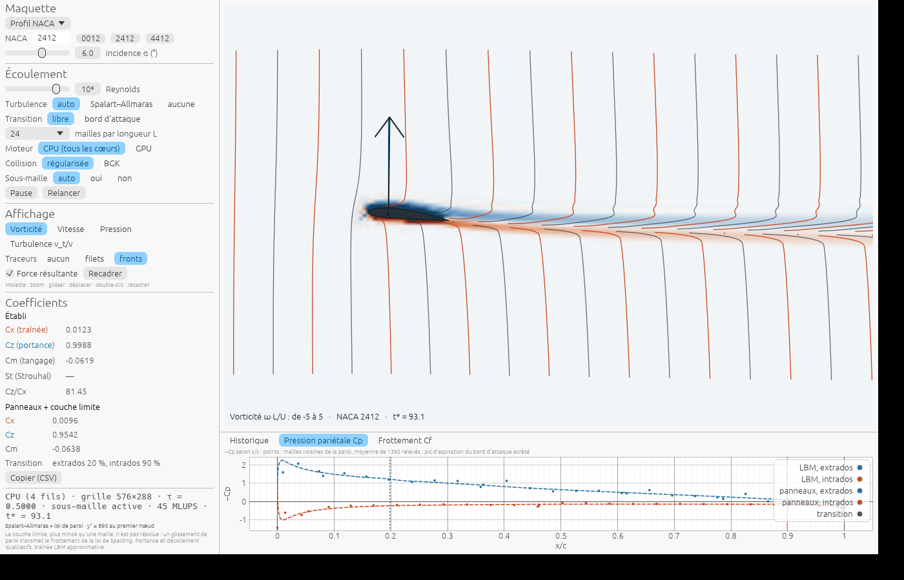

# Soufflerie de poche — version native (Rust)

Fork natif de l'application web [`soufflerie-lbm`](../soufflerie-lbm) : même
soufflerie numérique 2D Lattice Boltzmann (D2Q9), aile finie et soufflerie
3D (D3Q19 sur GPU), en Rust, pour ordinateur (Linux, Windows, macOS).
Interface graphique et ligne de commande.


## Pourquoi une version native ?

Le moteur processeur de l'application web tourne sur un seul cœur, en
JavaScript. Ici, la même boucle est compilée, vectorisée (SSE, AVX2,
AVX-512) et répartie sur tous les cœurs. Mesures sur le même cas (NACA 0012,
α = 4°, Re = 1000, 32 mailles par corde, grille 768 × 384), sur un serveur à
4 cœurs :

| Moteur | Millions de mailles par seconde | Rapport |
| --- | --- | --- |
| Application web, CPU (JavaScript, 1 cœur) | 16,5 | 1 |
| Rust, 1 fil | 78 | ×4,7 |
| Rust, 4 fils | 236 | ×14 |
| Rust, 1 fil, `-C target-cpu=native` (AVX-512) | 121 | ×7,3 |
| Rust, 4 fils, `-C target-cpu=native` | 309 | ×19 |

Sur un portable à 8 cœurs, compter de l'ordre de 400 à 800 millions de
mailles par seconde. La polaire (`soufflerie polar`) calcule en plus les
incidences en parallèle : 5 points (NACA 0012, Re = 1000, 16 mailles) en
11 s.

**Moteur GPU natif** (wgpu : Vulkan, Metal, DirectX 12) : mêmes équations, en
« compute shaders ». Il donne les mêmes efforts que le moteur processeur à
10⁻⁵ près (test `gpu`). Sur GPU, c'est la bande passante mémoire qui limite,
comme dans le navigateur : le gain attendu par rapport au moteur WebGL2 de
l'application web est modeste (×1,5 à 2, sans les limites mémoire du
navigateur). Je n'ai pu le mesurer que sur un GPU logiciel (SwiftShader),
sans signification pour la vitesse.

## Ce qui est porté

- D2Q9, collision régularisée récursive (Malaspinas 2015) ou BGK ;
  sous-maille de Smagorinsky amortie près de la paroi (Van Driest) ; entrée
  et sortie de Guo ; bandes absorbantes ; zone éponge ; mise en vitesse
  progressive ; paroi interpolée de Bouzidi, y compris les parois plus
  minces qu'une maille et la paroi mobile (cylindre tournant) ; efforts par
  échange de quantité de mouvement ; moyennes sur un nombre entier de
  périodes et Strouhal.
- Maquettes : cylindre (rotation), carré, ellipse, plaque, profil NACA à 4
  chiffres, triangle ; bord de fuite recalé sur le réseau.
- **Turbulence de Spalart–Allmaras et loi de paroi de Spalding** (Re de
  5·10⁴ à 10⁷), sur les deux moteurs : viscosité turbulente ajoutée au temps
  de relaxation, glissement de paroi qui transmet le frottement de la loi,
  ν̃ = κu_τy au premier nœud, sous-maille conservée loin de la paroi.
- **Méthode des panneaux et couche limite intégrale** (tourbillons
  linéaires, Thwaites, transition eᴺ, Head, Squire–Young, décrochage
  approché de Kirchhoff, correction de compressibilité) : référence Cz, Cx,
  Cm en écoulement attaché, et **couplage hybride** : en transition libre,
  la paroi du calcul LBM reste laminaire en amont de la transition prédite.
- **Distributions pariétales** Cp et Cf du calcul LBM, moyennées dans le
  temps, comparées aux panneaux (profils) ou à l'écoulement potentiel
  (cylindre).
- Interface : veine zoomable (molette, glisser, double-clic pour recadrer),
  vorticité, vitesse, pression ou viscosité turbulente, traceurs en filets
  ou en **fronts** (lignes de temps, couleurs alternées), force résultante,
  coefficients, référence « panneaux + couche limite », historique et
  distributions pariétales, copie CSV. Reynolds de 10 à 10⁷, résolutions
  jusqu'à 192 mailles par longueur (13 millions de mailles).



Validation (`cargo test --release`) : mêmes cas que l'application web, mêmes
valeurs à 10⁻³ près.

| Cas | Rust | Application web |
| --- | --- | --- |
| Cylindre, Re = 20, L = 16 | Cx = 2,373 | 2,373 |
| Cylindre, Re = 100, L = 16 | Cx = 1,496, St = 0,176, Cz' = 0,376 | 1,496, 0,176, 0,375 |
| NACA 0012, α = ±4°, Re = 500, L = 12 | Cz = ±0,1972 | ±0,1972 |
| NACA 0012, α = 0, Re = 1000, L = 16 | Cx = 0,1454 | 0,1454 |
| Cylindre tournant ΩR/U = 1, Re = 100 | Cz = 2,642 | 2,642 |
| SA, NACA 0012, Re = 10⁶, α = 4°, transition libre, L = 16 | Cz = 0,490, Cx = 0,0536 | 0,491, 0,0536 |
| SA, NACA 0012, Re = 10⁷, α = 8°, turbulent, L = 16 | Cz = 0,931 | 0,934 |
| SA, NACA 0012, Re = 10⁶, L = 32 : α = 0 turbulent / libre, α = 4° libre | Cx = 0,0126 / 0,0091, Cz = 0,505 | 0,0125 / 0,0091, 0,505 |
| Panneaux, NACA 0012 non visqueux, α = 4° | Cz = 0,4797 | 0,4797 |
| Panneaux + couche limite, Re = 6·10⁶ turbulent : α = 0, α = 10° | Cx = 0,00816 ; Cz = 1,168, Cx = 0,01285 | identiques |
| Cylindre, Re = 40 : Cp au point d'arrêt | 1,145 | (≈ 1,14 publié) |
| Aile finie A = 6, profil 2π, α = 4° | CL = 0,29376, e = 0,9955 | identiques |
| Aile NACA 2412, A = 8, λ = 0,5, Re = 10⁶, α = 4° / 12° / 16° | CL = 0,5056 / 1,1236 / 1,3659 | identiques |
| 3D, sphère Re = 100, D = 8 / 12 mailles | Cx = 1,259 / 1,175 | 1,26 / 1,18 |
| 3D, sphère Re = 100, D = 12, simple / demi-précision | Cx = 1,178 / 1,175 | écart 0,3 % |

Le moteur GPU donne les mêmes efforts que le processeur avec Spalart–Allmaras
(écart ≤ 7·10⁻⁵ sur un profil à Re = 10⁶ et un cylindre tournant à 10⁵).
Spalart–Allmaras coûte environ 45 % de la vitesse sur processeur (131 au lieu
de 239 millions de mailles par seconde sur 4 cœurs), un peu moins sur GPU.

Comme dans l'application web, la portance et le décollement sont
qualitatifs à ces résolutions, et la traînée LBM d'un profil mince reste
approximative : la référence « panneaux + couche limite » est la bonne
valeur de traînée en écoulement attaché. À Re = 10⁶, la traînée LBM d'un
NACA 0012 à 4° vaut 0,006 à L = 32 et 0,020 à L = 48 (0,008 attendu) : elle
dépend de la finesse du bord d'attaque, pas d'un défaut de convergence.

**Traînée retenue.** Elle ne converge pas non plus en affinant la grille
(NACA 2412, Re = 10⁶, α = 4°, panneaux : 0,0078) :

| L (mailles par corde) | 32 | 48 | 64 | 96 |
| --- | --- | --- | --- | --- |
| Cx LBM | 0,022 | 0,018 | 0,021 | 0,016 |

Le bilan de quantité de mouvement sur un volume de contrôle donne les mêmes
valeurs que l'échange aux parois : c'est l'écoulement calculé lui-même qui
porte cette traînée. Le bord d'attaque tient dans une maille, la loi de paroi
impose le frottement, et quelques dixièmes de degré d'erreur sur la direction
de la résultante basculent de la portance (Cz ≈ 1) dans une traînée de
l'ordre de 0,01. Pour un profil attaché sous loi de paroi, l'interface
affiche donc le Cx LBM comme non fiable et retient la traînée « panneaux +
couche limite » (lecture, Cz/Cx, polaire Cz(Cx), colonne `Cx_retenu` du
CSV). Dès que les panneaux prédisent un décollement, la traînée de pression
domine et le Cx LBM est de nouveau retenu.

**Ce qui porte l'excès.** En séparant frottement (∫Cf dx) et pression, la
loi de paroi donne le bon frottement (0,0050 contre 0,0053 pour la couche
limite intégrale) : l'excès est une traînée de pression, qui décroît quand
le bord d'attaque, le bord de fuite et la couche limite sont mieux résolus
(0,017 à L = 64, 0,007 à 128, 0,005 à 192 ; panneaux 0,0025).

**Raffinement local (GPU).** Plutôt que d'affiner toute la veine (coût en
L³), `--raff 1|2` (interface : « Près de la maquette ») ajoute autour de la
maquette une ou deux grilles imbriquées, chacune deux fois plus fine en
espace et en temps que la précédente (emprise : 0,9 corde en amont, 1,9 en
aval, ±0,75 ; puis 0,65, 1,5, ±0,58). Le couplage passe par les moments
(ρ, u, partie hors équilibre de Π remise à l'échelle de chaque grille) :
interpolation cubique le long du bord de la grille fine et linéaire en
temps, recopie filtrée sur 3 × 3 nœuds vers la grille parente (Lagrava
et al., 2012). ν̃ suit la même voie. Efforts et distributions pariétales
viennent de la grille la plus fine, l'affichage de la veine. NACA 2412,
Re = 10⁶, α = 4°, Cx moyen une fois le tourbillon de démarrage sorti :

| Près du corps | Grille | Cx | Calcul (34 t*) |
| --- | --- | --- | --- |
| 128 | L = 128 uniforme | 0,0121 | ≈ 3 min |
| 128 | L = 64 + ×2 | 0,0115 | 23 s |
| 128 | L = 32 + ×4 | 0,0115 | 8 s |
| 192 | L = 48 + ×4 | 0,0088 | 21 s |
| 256 | L = 128 + ×2 | 0,0108 | 241 s |
| 256 | L = 64 + ×4 | 0,0106 | 50 s |

À résolution égale près du corps, les grilles imbriquées retrouvent la
grille uniforme à quelques pour cent, 5 à 20 fois plus vite. La traînée
reste toutefois au-dessus des panneaux (0,0078) et ne décroît plus
au-delà de 192 : elle dépend de la viscosité de sous-maille près de la
paroi, nécessaire à la stabilité à τ ≈ 0,5 (une longueur d'amortissement
pariétal de 4 mailles au lieu de 2 la ramène à 0,008, mais le calcul
devient instable). Trois niveaux (×8) divergent de même dans la couche
limite laminaire, et ne sont pas proposés.

Le moteur GPU 2D choisit désormais Vulkan (ou Metal) avant DirectX 12, comme
la soufflerie 3D : sous DirectX 12 (pilote NVIDIA), il divergeait dès le
premier pas, ce qui touchait l'interface, dont la fenêtre est en DirectX 12.
`SOUFFLERIE_GPU2D=dx12|vulkan|gl` impose un pilote.

**Blocage de la veine.** La veine 2D ne fait que 12 longueurs de haut :
l'écoulement accélère autour de la maquette et de son sillage, ce qui
surestimait la traînée d'un cylindre de 14 % à Re = 20 et de 8 % à Re = 100,
quelle que soit la résolution. Les coefficients (interface, `run`, `polar`)
sont désormais corrigés par la méthode d'Allen et Vincenti (vitesse effective
U(1 + ε), ε = blocage de volume + blocage de sillage) ; `--paroi 0` ou la case
de l'interface rendent les valeurs brutes :

| Cylindre, L = 32 | brut | corrigé | référence (veine infinie) |
| --- | --- | --- | --- |
| Re = 20, Cx | 2,347 | 2,077 | 2,05 à 2,09 |
| Re = 100, Cx | 1,442 | 1,331 | 1,33 à 1,35 |
| Re = 100, St | 0,175 | 0,170 | 0,164 à 0,167 |

La soufflerie 3D n'a pas encore cette correction.

**Lecture des efforts sans attente.** Le moteur GPU relève les efforts par
copies asynchrones au lieu de vider la file de calcul à chaque relevé : un
calcul de cylindre à L = 32 passe de 750 à 1 630 millions de mailles par
seconde (GTX 1070), à résultats identiques.

L'aile finie (onglet « Aile finie », commande `wing`) reprend la surface
portante de Weissinger non linéaire de l'application web : polaires de
section par la méthode des panneaux au Reynolds local (emplanture et bout,
interpolées en log Re), décambrage, traînée induite dans le plan de Trefftz ;
flèche, dièdre, effilement et vrillage. Une polaire complète prend 0,3 s.

La soufflerie 3D (onglet « Soufflerie 3D », commande `run3d`) reprend le
solveur D3Q19 WebGPU de l'application web : le WGSL est engendré à
l'identique (propagation et collision fusionnées, collision régularisée,
populations en demi-précision, rebond de Bouzidi, efforts accumulés sur le
GPU) ; sphère, cube, cylindre, aile NACA 0012 d'allongement 4, de 8 à
32 mailles par longueur de référence. Sur une GTX 1070 non bridée : environ
850 millions de mailles par seconde (sphère, 0,75 M mailles), soit 30 t* en
5 s. Le calcul 3D préfère Vulkan (ou Metal) : sous DirectX 12, ce gros shader
est environ 100 fois plus lent ; `SOUFFLERIE_GPU3D=dx12|vulkan|gl` impose un
pilote. Les soumissions sont courtes (≈ 3·10⁷ mises à jour de maille) pour
ne pas déclencher la réinitialisation du pilote Windows (2 s). Affichage :
vue 3D orbitale calculée sur le GPU par lancer de rayons dans le champ
(maquette ombrée, plan de coupe en vitesse ou vorticité, isosurfaces du
critère Q translucides teintées par la vitesse, cadre de la veine), comme
la version web ; Q est annulé à moins de deux mailles du corps, où la
couche limite mal résolue donne des valeurs parasites. Une coupe « à plat »
(vitesse, vorticité, Q) reste disponible.

L'interface 2D a aussi la polaire automatique (balayage d'incidence ou de
rotation, stabilisation puis mesure adaptatives, onglet « Polaire », copie
CSV) et l'échelle physique (air ou eau, longueur de référence : vitesse,
durées, efforts par mètre d'envergure, alerte de Mach réel). Le moteur GPU
2D peut stocker ses populations en demi-précision (`--half 1`, ou
« Précision GPU » dans l'interface) : deux fois moins de mémoire, écarts de
0,1 à 0,2 % sur les efforts moyens (cylindre Re = 100, NACA 0012 Re = 10⁶
avec Spalart–Allmaras), 3 % sur l'amplitude de Cz'.

## Loi de paroi en 3D

Comme en 2D, la soufflerie 3D passe à Spalart–Allmaras avec loi de paroi dès
Re = 5·10⁴ (`--turb auto|sa|off`) : ν_t = ν̃ f_v1 s'ajoute à la viscosité
de la collision, ν̃ est transporté par une seconde passe (advection décentrée
amont, diffusion, production et destruction de Spalart–Allmaras, ν̃ = κ u_τ y
au premier nœud), et la paroi glisse : chaque maille pariétale tire u_τ de la
loi de Spalding à partir de sa vitesse tangentielle et de sa distance à la
paroi, puis le rebond de Bouzidi la traite en paroi mobile à la vitesse de
glissement (efforts avec le terme correspondant). Distance à la paroi :
exacte à moins de 3 mailles du corps (triangles ou formes analytiques),
propagée au-delà par une transformée de chanfrein ; normales par gradient de
la distance exacte. La couche limite est supposée turbulente dès l'avant
(pas de transition en 3D).

| L = 16 mailles, Re = 10⁶ | Sous-maille seule | Spalart–Allmaras + loi de paroi | Référence |
| --- | --- | --- | --- |
| Sphère, Cx | 0,594 | 0,254 | ≈ 0,2 (après la crise de traînée) |
| Aile NACA 0012, allongement 4, α = 8°, Cz | 0,153 | 0,494 | ≈ 0,56 (ligne portante) |

À Re = 10⁵, la sphère réelle a une couche limite laminaire (Cx ≈ 0,47) :
Spalart–Allmaras, turbulent partout, donne alors le régime d'après la crise
(0,28). Test `loi_de_paroi_3d`.

A320 (STL) en approche : 70 m/s au niveau de la mer, α = 8°, Re = 1,7·10⁸,
L = 48 mailles (0,75 m), coefficients rapportés à la surface alaire
(122,6 m²) : CL = 0,22 et CD = 0,54 sans modèle de paroi, CL = 0,72 et
CD = 0,31 avec (ordre de grandeur réel en lisse : CL ≈ 0,9, CD de quelques
centièmes, davantage train sorti). La traînée reste trop forte à cette
résolution, et la coupe de vorticité garde un bruit en damier à τ ≈ 0,5.
Avec la collision régularisée d'ordre 3, les bandes absorbantes et une
grille fine ×2 (L = 32 + ×2, soit 64 mailles près de l'avion, 3,5 min) :
CL = 0,63, CD = 0,27, champ sans bruit.

## Stabilité et raffinement local en 3D

**Collision et bords.** La collision D3Q19 est régularisée récursivement
(ordre 3, Malaspinas 2015 : moments d'ordre 3 tirés de ρ, u et de la partie
hors équilibre d'ordre 2), comme en 2D. Aux Reynolds de maille élevés
(sous-maille active), des bandes absorbantes rappellent l'écoulement vers
l'amont près des bords latéraux périodiques, de l'entrée et dans la zone
éponge de sortie : les ondes de pression de la mise en vitesse ne rebondissent
plus dans la veine. Sphère à Re = 10⁶ (D = 16, loi de paroi) : vorticité
résiduelle en amont 2,63 → 0,004 U/L, fluctuation rapide de Cx
0,014 → 0,0006, Cx 0,254 → 0,214. Sans loi de paroi, la sous-maille est
amortie près de la paroi (Van Driest, longueur 8 L/√Re bornée à [1, 4]
mailles, comme en 2D) ; avec elle, elle reste entière : c'est elle qui
stabilise les premiers nœuds à τ ≈ 0,5.

**Raffinement local** (`run3d --raff 1|2`, interface : « Près de la
maquette »). Une ou deux grilles imbriquées autour de la maquette, deux fois
plus fines en espace et en temps (emprise : 0,6 L en amont, 1,5 L en aval,
0,6 L de côté, puis 0,35 / 0,7 / 0,4 L), couplées comme en 2D : moments
(ρ, u, Π hors équilibre remis à l'échelle, ν̃) interpolés en cubique sur
l'enveloppe de mailles fantômes et en linéaire dans le temps, recopie vers
la veine sous la zone raffinée ; efforts de la grille la plus fine.

| Cas | Veine uniforme | Raffinée | Calcul |
| --- | --- | --- | --- |
| Sphère, Re = 100 : D = 16 contre D = 8 + ×2 | 1,1472 | 1,1504 (+0,3 %) | 31 s contre 3 s |
| Aile, Re = 300, α = 8° : L = 32 contre 16 + ×2 (même calage) | Cx 0,2620, Cz 0,2628 | 0,2618, 0,2634 | 74 s contre 30 s |
| Aile, Re = 10⁶ : idem | Cx 0,0858, Cz 0,5600 | 0,0858, 0,5444 | — |

« Même calage » : la maquette d'une grille fine tombe à une demi-maille près
d'un nœud là où la veine la place à un quart ; à L = 32, l'aile (4 mailles
d'épaisseur) y est sensible (Re = 10⁶ : Cx 0,057 ou 0,086 selon le calage),
ce qu'atténue justement le raffinement (×4 : Cx 0,056, Cz 0,600).

**Transition** (`run3d --xtr 0.3`, interface : curseur « transition (x/c) »
quand la loi de paroi est active). Couche limite laminaire du bord d'attaque
jusqu'à la fraction xtr de la corde locale, mesurée dans chaque tranche
d'envergure comme l'étendue en x du corps : frottement de Blasius
(0,664/√Re_x) à la paroi et pas de production de Spalart–Allmaras autour,
comme la zone laminaire du 2D. Aile d'allongement 4 à 8°, Re = 10⁶,
L = 16 : Cx 0,1163 turbulente, 0,1107 laminaire partout (écart de frottement
attendu ≈ 0,006, test `transition_3d`) ; sur une grille plus grossière, le
glissement laminaire réduit aussi la traînée de pression. Le décollement
laminaire des corps épais n'est pas capturé (sphère à Re = 10⁵ : 0,25
turbulente, 0,21 laminaire, au lieu de 0,47) : pour ce régime sous-critique,
couper la loi de paroi (« Paroi : sans », `--turb off`) donne une couche
limite épaisse qui décolle tôt (sphère à Re = 10⁶ : Cx = 0,46).

## Comparaison avec VSPAERO et la mesure

VSPAERO 7.2.2 (OpenVSP 3.56, NASA, méthodes des tourbillons et des
panneaux, traînée de profil estimée) sur deux ailes publiques, contre la
soufflerie 3D avec loi de paroi et raffinement local. Données complètes :
`validation/comparaison_vspaero.csv`. FlightStream (commercial) n'a pas pu
être utilisé.

**Aile NACA TR-1208** (Schneider, 1951 : flèche 45°, allongement 8,02,
effilement 0,45, NACA 63A012, Re = 4·10⁶ sur la corde moyenne ; géométrie
du tutoriel OpenVSP exportée en STL, `--unite in --lref 16.672
--sref 2024.35 --marge 0.4`, L = 8 + ×4, soit 32 mailles par corde moyenne) :

| α | Mesure (figure 2, ±0,01) | VSPAERO VLM | Soufflerie |
| --- | --- | --- | --- |
| 2° | CL 0,136 | 0,132 | 0,161 |
| 4° | CL 0,257, CD ≈ 0,011 | 0,266, CD 0,015 | 0,314, CD 0,042 |
| 6° | CL 0,378 | 0,399 | 0,460 |
| 8° | CL 0,499, CD ≈ 0,021 | 0,531, CD 0,026 | 0,575, CD 0,052 |

**Aile rectangulaire NACA 0012, allongement 4**, Re = 10⁶ (pas de mesure ;
ligne portante d'Helmbold : CL ≈ 0,27 à 4°) :

| α | VSPAERO VLM | VSPAERO panneaux | Soufflerie L = 16 + ×2 | + ×4 |
| --- | --- | --- | --- | --- |
| 4° | 0,251 (CD 0,021) | 0,265 | 0,306 (CD 0,059) | 0,306 (0,032) |
| 8° | 0,500 (0,039) | 0,529 | 0,545 (0,086) | 0,600 (0,056) |
| 12° | 0,747 (0,070) | 0,787 | 0,958 (0,143) | 0,839 (0,100) |

Ce que cela montre :

- VSPAERO suit la mesure de TR-1208 à 5 % près sur la pente de portance
  (0,066 contre 0,060 par degré, le surcroît habituel d'une méthode non
  visqueuse).
- La soufflerie porte trop : +20 à 30 % sur la pente, au-dessus même de la
  méthode non visqueuse. Ce n'est pas le confinement de la veine (même aile
  en STL : Cz = 0,295 dans une veine serrée, 0,306 dans une veine 2,5 fois
  plus large) ; c'est la loi de paroi : à y⁺ de l'ordre de 10³, le
  glissement de Spalding devient presque total et le bord de fuite tient mal
  la condition de Kutta (déjà +7 % sur le NACA 2412 en 2D). Piste : une loi
  de paroi qui impose la contrainte pariétale sans laisser glisser la paroi
  au bord de fuite.
- La traînée est 2 à 4 fois trop forte et dépend de la taille de la veine
  (0,042 ou 0,062 selon la marge) : en 3D, seule la portance se compare
  aujourd'hui, et la traînée reste qualitative.

## Suites de la comparaison

**Outils ajoutés.**

- `run3d --envergure fichier.csv` : répartition de la portance en
  envergure (c·cl/c_ref par tranche, efforts de la grille la plus fine sur
  deux temps convectifs de plus).
- Moment de tangage Cm des maquettes STL (et avec `--xref`), autour du
  point situé à xref longueur de référence de l'avant (quart de corde par
  défaut), positif à cabrer.
- `--sol <garde au sol>` : sol mobile (plancher qui défile à la vitesse
  amont, plafond glissant) pour les véhicules ; pas encore avec le
  raffinement local.
- `--marge` : veine resserrée autour d'une maquette très allongée.
- Raffinement 3D jusqu'à ×8 (`--raff 3`, interface « ×8 ») : aile
  d'allongement 4 à 4°, L = 8 + ×8 → Cz 0,298, Cx 0,032, contre L = 16 + ×4
  (même résolution près de l'aile) → 0,306, 0,032. À L = 16 + ×8 (128
  mailles par corde), le calcul dépasse 30 min sur une GTX 1070.
- `tools/comparaison_vspaero.sh` : construit l'aile de TR-1208 dans
  OpenVSP (`tools/vsp/`), lance VSPAERO, exporte le STL, lance la soufflerie
  à 0–8° et écrit le tableau mesure / VSPAERO / soufflerie.

**Répartition en envergure** (TR-1208, α = 4,7°,
`validation/tr1208_envergure.csv`) : l'excès de portance de la soufflerie
est réparti sur toute la mi-envergure (c·cl/(CL·c̄) ≈ 1,2 entre 25 et 50 %
de la demi-envergure, contre 1,1 mesuré et 1,07 pour VSPAERO), pas
concentré au saumon ni à l'emplanture. Les efforts par maille sont bruités
par l'escalier des bords : il faut des tranches d'environ 0,13 demi-envergure.

**Loi de paroi : ce qui a été essayé** (aile d'allongement 4, α = 4°,
référence ≈ 0,26 à 0,27) :

| Variante | Cz |
| --- | --- |
| Glissement de Spalding à la première maille (actuel) | 0,306 |
| Sans glissement dans les 2 ou 4 dernières mailles (bord de fuite) | 0,299 / 0,288 |
| Vitesse échantillonnée à 2 ou 3 mailles de la paroi | 0,391 / 0,345 |
| Sans glissement du tout (Spalart–Allmaras gardé) | 0,147 |

Le glissement encadre la bonne valeur mais en fait trop, et la cause n'est
ni le bord de fuite seul ni une rétroaction de la première maille. Une
paroi adhérente avec une force tangentielle qui rend au fluide l'excédent
de frottement du rebond diverge (la composante tangentielle des liens d'une
paroi en escalier mêle pression et frottement) ; plafonnée, elle donne
Cz 0,205 et une traînée de 0,17 : un réglage, pas un modèle. Aucune de ces
variantes n'est gardée.

Les efforts eux-mêmes sont justes : un bilan de quantité de mouvement sur
une boîte autour de l'aile (flux de ρuu + p à travers les faces, champ de
la veine) donne Cz 0,314 à 0,321 contre 0,308 par l'échange aux parois à
Re = 10⁶, et 0,212 à 0,216 contre 0,213 à Re = 1000 (`Gpu3D::macros`).
L'excès de portance est donc dans l'écoulement calculé ; il existe aussi
sans loi de paroi (Re = 1000, sous-maille seule : +19 % sur la correction
d'allongement), ce qui oriente vers la résolution du bord de fuite et du
sillage près de l'aile plutôt que vers la seule loi de paroi.

**Aile infinie : le 3D contre le 2D.** Une aile NACA 0012 qui occupe
toute la largeur périodique de la veine 3D (veine haute de 12 cordes,
L = 32, Re = 10⁶, α = 4°) porte Cz 0,547 contre 0,505 pour la soufflerie
2D au même maillage (panneaux et couche limite : 0,471). Avec la
sous-maille amortie près de la paroi comme en 2D, elle porte exactement
0,505. L'aile d'allongement 4 porte alors 0,321, soit 0,63 fois l'aile
infinie, le rapport de la ligne portante d'Helmbold (0,62) : le passage
du 2D au 3D est juste, et l'excès par rapport à VSPAERO et à la mesure
vient du profil lui-même, qui porte déjà 7 % de trop en 2D avec la loi de
paroi (épaisseur de couche limite et décambrage visqueux mal rendus par
le glissement). Cet amortissement n'est pas gardé par défaut : sans
plancher, il diverge (aile finie, L = 32, 8°) ; avec un plancher, il
augmente la portance de l'aile finie (0,621 → 0,655). Prochaine étape :
corriger la portance du profil en 2D (comparaison panneaux + couche limite
déjà en place), le 3D suivra. Dans ce montage, la traînée de l'aile
infinie (0,041 à 0°, contre 0,009 en 2D, une fois les bandes latérales
retirées) reste à comprendre.

**Traînée et taille de la veine.** Sur l'aile d'allongement 4, la traînée
est établie dès t* = 5 et ne bouge plus jusqu'à t* = 40, mais vaut 0,042
dans une veine serrée et 0,062 dans une veine 2,5 fois plus large : un biais
de domaine stable, à l'opposé d'un effet de blocage (la veine plus large
traîne plus). Expliqué depuis : c'est la place du bord de fuite dans la
maille (voir « Traînée 3D » ci-dessous).

**Sphère à travers la crise de traînée** (D = 16 + ×2) :

| Re | Loi de paroi | Sans loi de paroi | Achenbach (mesure) |
| --- | --- | --- | --- |
| 10⁵ | 0,151 | 0,334 | ≈ 0,47 |
| 3·10⁵ | 0,136 | 0,336 | ≈ 0,1 (crise) |
| 10⁶ | 0,123 | 0,334 | ≈ 0,13 |
| 3·10⁶ | 0,114 | 0,339 | ≈ 0,18 |

La loi de paroi donne le bon ordre de grandeur au-delà de la crise, mais
ni la crise ni la remontée ; sans elle, la sphère reste sous-critique.

**Corps d'Ahmed à 25° sur sol mobile** (60 m/s, Re = 4,3·10⁶, garde au sol
50 mm, sans pieds ; mesure : Cx = 0,285) : Cx 0,78 à L = 32 (garde au sol
d'une maille et demie : soubassement bouché, Cz = 1,5), 0,60 à L = 64
(Cz = 1,0, lâcher périodique). Hors de portée sans raffinement près du sol.
Une sphère à un diamètre du sol garde une portance faible (Cz = 0,03) :
la condition de sol elle-même est saine.

**Transition sur TR-1208** (α = 4°, laminaire jusqu'à 30 % de la corde) :
Cz 0,317 au lieu de 0,314, Cx 0,0396 au lieu de 0,0415 : effet faible,
l'excès de portance ne vient pas de là.

**Moment de tangage.** Le point par défaut (quart de la longueur de
référence depuis l'avant de la maquette) n'est pas le quart de la corde
moyenne d'une aile en flèche : pour comparer à une mesure, donner `--xref`
(TR-1208 à 4° : Cm = −0,58 autour de ce point par défaut, très en avant du
foyer).

**Non fait.** Ailes de Sivells : les géométries et mesures sont dans des
rapports NACA scannés, non extraits.

## Traînée 3D : placement et intégration sur la surface

**Placement dans la maille.** Sur l'aile d'allongement 4 (STL, L = 32 sans
raffinement, Re = 10⁶, α = 4°), déplacer la maquette d'une fraction de
maille en x fait varier Cz de 0,21 à 0,44 et Cx de 0,032 à 0,059, avec un
écoulement établi et stationnaire dans chaque cas. C'est l'erratique
« biais de domaine » noté plus haut : changer la longueur de la veine
déplaçait en fait la maquette dans la maille. L'effet est périodique d'une
maille, existe aussi à Re = 2000, sans loi de paroi, en simple précision,
sans parois minces et sur l'aile analytique : il vient de la place du bord
de fuite par rapport aux nœuds. Quand il tombe juste avant un nœud, deux
rangées de mailles pariétales disparaissent en envergure et la portance
chute d'un quart : à 32 mailles par corde, une marche d'une maille au
bord de fuite agit comme un volet Gurney. La portance est stable (plateau)
quand le bord de fuite est entre 0,4 et 0,8 maille après un nœud, et le
raffinement ×2 converge vers ce plateau. Le point le plus en aval des
maquettes (et le bord de fuite de l'aile analytique) est donc calé à
0,7 maille après un nœud, fraction qui reste dans le plateau sur les grilles
fines (×2 : 0,4 ; ×4 : 0,8 ; ×8 : 0,6). Même aile, veine allongée de 0,6 à
2 fois vers l'amont : Cz 0,300 à 0,303 au lieu de 0,21 à 0,44.
`MeshSetup::offset` (`run3d --decalage dx`) décale la maquette pour
mesurer cette sensibilité. Une aile en flèche ou effilée, dont le bord de
fuite coupe les nœuds à toutes les fractions, y est peu sensible.

**Efforts par intégration sur la surface.** L'échange de quantité de
mouvement aux parois surestime nettement la traînée avec la loi de paroi.
Sur l'aile AR 4 à 0° (L = 16 + ×2), il donne Cx = 0,064 alors que la
surface donne 0,018 ; relevé maille par maille, l'excès n'est pas réparti
le long de la corde mais concentré sur trois rangées en envergure, aux
marches de l'escalier, là où la surface coupe un plan de la grille sous un
angle rasant. Les liens presque parallèles à la paroi y renvoient la
pression et la quantité de mouvement longitudinale dans leur propre
direction : une marche d'une maille agit comme une petite rugosité, que
l'écoulement ressent réellement (le bilan de quantité de mouvement sur une
boîte donne la même traînée). L'excès décroît avec le raffinement (0,064,
0,041, 0,034 à ×2, ×4, ×8) sans disparaître. Pour les maquettes STL, les
efforts sont donc intégrés sur les triangles du maillage
(`Gpu3D::surface_forces`, grille la plus fine) : −p_p n dA, plus τ_p dA avec
τ_p = ρ u_τ² de la loi de Spalding sur la vitesse tangentielle relevée à
une maille le long de la normale. `run3d` en fait la moyenne sur la fenêtre
de moyenne (un relevé par demi-temps convectif), en tire aussi Cm et la
répartition en envergure (`--envergure`), et affiche l'échange pour
comparaison ; l'interface trace ces coefficients pour les maquettes STL.
Les formes analytiques gardent l'échange.

**Problèmes connus de la méthode et remèdes retenus.** La littérature sur
les lois de paroi en LBM sur grille cartésienne signale :
- *Le décalage de la zone logarithmique* (Kawai et Larsson, *Phys. Fluids*
  24, 2012) : au premier nœud, l'erreur numérique et de sous-maille fausse
  la vitesse qui alimente la loi de paroi. Remède retenu : la loi de paroi
  lit la vitesse une maille plus loin le long de la normale (interpolation
  trilinéaire, repli sur le nœud si un voisin est solide), comme le variant
  « ESG » d'Asmuth et al. (*Phys. Fluids* 33, 2021). Cz baisse de 4 à 5 %,
  vers la mesure.
- *La pression lue hors de la paroi* : relevée à une maille, la forte
  dépression du bord d'attaque est atténuée et sa succion manque. Remède
  retenu : p_p extrapolée linéairement depuis les relevés à une et deux
  mailles. La traînée baisse de 10 à 20 %.
- *L'incohérence entre la vitesse de glissement et la viscosité au premier
  nœud* : la vitesse de glissement suppose ν + κ u_τ y, alors que la maille
  y ajoute Spalart–Allmaras et Smagorinsky. Calculer le glissement avec la
  viscosité effective du nœud diverge (rétroaction entre glissement,
  cisaillement et sous-maille).
- *L'échange de quantité de mouvement inverse* (Asmuth et al. 2021), qui
  choisit la vitesse de paroi pour que l'effort tangentiel cédé par la
  maille vaille τ_p A (A = 6 Σ w_i |c_i·n|, aire exacte en moyenne pour un
  plan quelconque) : essayé, il ne réduit pas l'excès des marches, qui
  vient de la pression statique renvoyée par les liens rasants, et le
  compenser aussi exige des vitesses de paroi instables.
- *La reconstruction du premier nœud* (Malaspinas et Sagaut, *J. Comput.
  Phys.* 275, 2014 ; Degrigny et al., *Comput. Fluids* 227, 2021), qui
  impose vitesse et contrainte du modèle au nœud : essayée avec le rebond
  de Bouzidi gardé pour les liens, elle n'est pas conservative ici (le
  rebond retire à chaque pas la quantité de mouvement que le nœud remet) et
  fausse le champ de pression (Cx de pression négatif).

| Cas | Échange Cz / Cx | Surface Cz / Cx (pression + frottement) | Référence |
| --- | --- | --- | --- |
| Aile AR 4, 4°, L = 16 + ×2 | 0,309 / 0,062 | 0,263 / 0,030 (0,023 + 0,007) | VSPAERO 0,251 à 0,265 / 0,021 à 0,022 |
| Aile AR 4, 4°, L = 16 + ×4 | 0,314 / 0,044 | 0,289 / 0,030 (0,023 + 0,008) | id. |
| TR-1208, 4°, L = 8 + ×4 | 0,314 / 0,041 | 0,261 / 0,021 (0,016 + 0,006) | mesure 0,257 / 0,011 ; VSPAERO 0,266 / 0,015 |
| TR-1208, 8°, L = 8 + ×4 | 0,581 / 0,053 | 0,489 / 0,053 (0,048 + 0,005) | mesure 0,499 / 0,021 ; VSPAERO 0,531 / 0,026 |

Ces valeurs (pression relevée à une maille, loi de paroi alimentée au
premier nœud) sont celles de la première version. Avec la loi de paroi
alimentée une maille plus loin et la pression extrapolée à la paroi :

| Cas | Échange Cz / Cx | Surface Cz / Cx (pression + frottement) | Référence |
| --- | --- | --- | --- |
| Aile AR 4, 4°, L = 16 + ×4 | 0,308 / 0,048 | 0,288 / 0,024 (0,017 + 0,007) | VSPAERO 0,251 à 0,265 / 0,021 à 0,022 |
| TR-1208, 4°, L = 8 + ×4 | 0,304 / 0,045 | 0,275 / 0,018 (0,013 + 0,005) | mesure 0,257 / 0,011 ; VSPAERO 0,266 / 0,015 |
| TR-1208, 8°, L = 8 + ×4 | 0,551 / 0,056 | 0,506 / 0,047 (0,042 + 0,005) | mesure 0,499 / 0,021 ; VSPAERO 0,531 / 0,026 |
| TR-1208, 8°, L = 8 + ×8 | 0,593 / 0,043 | 0,570 / 0,041 (0,035 + 0,006) | id. |

La traînée baisse de 10 à 20 % et rejoint VSPAERO à 4° sur l'aile AR 4 ; la
portance reste à quelques pour cent de VSPAERO à ×4. Le frottement (0,005
à 0,008) a l'ordre de grandeur d'une plaque plane turbulente. Restent deux
écarts, qui sont dans l'écoulement calculé et non dans la mesure des
efforts (l'échange les porte aussi) :
- *Traînée de pression à 8°*, encore double de la mesure. Elle décroît
  avec le raffinement (0,042 à ×4, 0,035 à ×8) : le rayon du bord
  d'attaque ne couvre qu'une à deux mailles, et la succion qu'il porte
  (∝ CL²) n'est pas résolue.
- *Portance à 8° et ×8*, 14 % au-dessus de la mesure et au-dessus de
  VSPAERO non visqueux, et qui croît avec le raffinement. Cause trouvée et
  corrigée depuis : voir « Loi de paroi 3D : couche pariétale cohérente ».

Le moment de tangage et la répartition en envergure des maquettes STL
viennent aussi de l'intégration sur la surface (effort de chaque triangle).
Pour les formes analytiques, ils viennent de l'échange aux parois, dont les
efforts par maille retirent la part de la pression de référence (ρ₀ c_s²,
nulle en somme mais pas maille par maille), ce qui supprime les pics
parasites aux saumons.

## Loi de paroi 3D : couche pariétale cohérente

**Le défaut, vu en 2D.** NACA 0012, Re = 6·10⁶, α = 10°, couche limite
turbulente (référence NASA TMR : mesure de Ladson CL ≈ 1,08, Spalart–Allmaras
sur grille fine CL = 1,09, CD = 0,0123). Avec la loi de paroi d'origine, la
soufflerie 2D donne CL = 1,12 à 64 mailles par corde, 1,29 à 128 (au-dessus
de la solution non visqueuse, 1,19), puis un écoulement décollé et
instationnaire à 256 (CL ≈ 0,95, CD = 0,045) : la solution s'éloigne de la
référence quand la grille s'affine. Le Cp pariétal montre pourquoi : un pic
de pression suivi d'une dépression, à intervalles réguliers, là où la paroi
traverse une rangée de nœuds sous un angle rasant. Ce sont les marches de
l'échange de quantité de mouvement relevées plus haut en 3D ; sur
l'intrados, elles agissent comme de petits volets Gurney. Elles
disparaissent en laminaire (paroi adhérente) : elles viennent de la loi de
paroi.

**La cause.** Le glissement u_s = u_n − u_τ² y_n / (ν + κ u_τ y_n) vaut
u_n − u_τ/κ à peu près quelle que soit la distance y_n du nœud à la paroi :
deux nœuds pariétaux voisins, l'un à 0,05 maille et l'autre à 1 maille de
la paroi, en déduisent des vitesses de paroi qui diffèrent de tout l'écart
de vitesse résolu entre ces deux hauteurs (≈ u_τ ln(20)/κ). La vitesse
extrapolée à la paroi saute donc à chaque traversée d'une rangée de nœuds.

**Le remède retenu** (`gpu3d.rs`, shader de propagation) :
- la loi de paroi est alimentée par la vitesse relevée à une hauteur fixe
  h = 2 mailles au-dessus du pied de la normale (Kawai et Larsson 2012),
  avec repli sur le nœud si le relevé touche une maille solide ou ne tombe
  pas à la hauteur h de la paroi la plus proche (bords minces, coins) ;
- la couche [0, h] a la viscosité turbulente uniforme κ u_τ h : profil
  linéaire de pente τ_p / (ν + κ u_τ h), et chaque nœud glisse à
  u_n − pente · y_n. La vitesse extrapolée à la paroi ne dépend plus de la
  place du nœud dans la maille, et la contrainte transmise est τ_p partout ;
  le premier nœud reçoit la même viscosité (collision) et ν̃ = κ u_τ h
  (Spalart–Allmaras) ;
- le frottement intégré sur la surface est relevé à la même hauteur h.

**Stabilité.** Près de la paroi, ce glissement devient presque libre, et
une paroi qui suit la vitesse de son propre nœud n'a pas de rappel : le
calcul diverge à 64 mailles par corde. Trois mesures, sans effet sur les
efforts en régime établi :
- La vitesse de glissement est relaxée sur une dizaine de pas
  (u_w ← u_w + 0,1 (u_s − u_w)). En régime établi, sans effet : 0,1 ou
  0,02 donnent les mêmes efforts à 0,3 % près.
- Le glissement est borné par celui que donne aussi la vitesse relevée à h
  (u_s ≤ u_h − pente · h : profil monotone dans la couche pariétale). Les
  deux estimations coïncident quand le profil est établi ; sans la borne,
  un nœud du bord d'attaque de TR-1208 à 8° s'emballait lentement (vitesse
  maximale stable à 1,37 U jusqu'à t* = 6,5, puis multipliée par trois en
  3 t*).
- Aux arêtes (saumon plat, bord de fuite mince), la normale d'une maille
  n'est celle d'aucune des faces que touchent ses liens, et sa vitesse
  « tangentielle » traverse ces faces : la paroi soufflait. Chaque lien
  garde désormais la normale de la face qu'il touche (triangle du maillage,
  ou gradient de la distance juste devant la paroi pour les formes
  analytiques), et la vitesse de paroi est projetée dans le plan de cette
  face.

- Aux arêtes vives (faces touchées par les liens d'une maille à plus de
  60° l'une de l'autre : saumon plat, bord de fuite), l'écoulement décolle et
  la loi de paroi, faite pour une couche limite attachée le long d'une face,
  ne s'applique pas : la paroi y reste adhérente, avec la viscosité de
  Spalart–Allmaras et de la sous-maille. Sans cela, la vitesse de
  contournement de l'arête (singulière en non visqueux) croissait jusqu'à
  la divergence (aile AR 4 à 8°, coin bord d'attaque / saumon). Les facettes
  d'une surface lisse font quelques degrés entre elles, une arête vive 90° à
  165° : tout seuil entre 30° et 80° classe les mêmes mailles.

**Essayés et écartés.**
- Faire glisser la paroi à la vitesse relevée à h (u_h − u_τ/κ) : stable,
  mais la paroi entraîne alors le fluide plus vite que le nœud ne va
  (Cz 0,35 à 0,37 contre 0,30 en glissement libre sur l'aile AR 4).
- ν̃ du premier nœud non imposé (Spalart–Allmaras seul) : la turbulence ne
  s'établit pas sur ces grilles, la couche limite décolle. Plafonné par la
  valeur de Clauser 0,0168 U_e δ* : sans effet sur la portance.

**Contrôle non visqueux.** Paroi en glissement libre (vitesse du nœud), aile
analytique AR 4 à 4°, L = 16 + ×2, échange aux parois : Cz = 0,299 ; la
nouvelle loi de paroi donne 0,301 (+ ×2) et 0,310 (+ ×4) : elle n'ajoute
plus de portance au glissement libre (l'ancienne en ajoutait à mesure que la
grille s'affinait).

**Résultats** (efforts intégrés sur la surface ; « avant » : loi de paroi
de la section précédente) :

| Cas | Avant Cz / Cx | Couche pariétale cohérente Cz / Cx | Référence |
| --- | --- | --- | --- |
| Aile AR 4, 4°, L = 16 + ×2 | 0,263 / 0,030 | 0,235 / 0,023 | VSPAERO 0,251 à 0,265 / 0,021 à 0,022 |
| Aile AR 4, 4°, L = 16 + ×4 | 0,288 / 0,024 | 0,262 / 0,022 | id. |
| Aile AR 4, 8°, L = 16 + ×4 | 0,600 / 0,056 (aile analytique, échange) | 0,528 / 0,040 | VSPAERO 0,501 à 0,529 / 0,039 à 0,045 |
| TR-1208, 4°, L = 8 + ×4 | 0,275 / 0,018 | 0,258 / 0,015 | mesure 0,257 / 0,011 ; VSPAERO 0,266 / 0,015 |
| TR-1208, 4°, L = 8 + ×8 | — | 0,268 / 0,015 | id. |
| TR-1208, 8°, L = 8 + ×4 | 0,506 / 0,047 | 0,493 / 0,044 | mesure 0,499 / 0,021 ; VSPAERO 0,531 / 0,026 |
| TR-1208, 8°, L = 8 + ×8 | 0,570 / 0,041 | 0,526 / 0,036 | id. |

La portance de TR-1208 est à 1 % de la mesure à ×4 et à 4 à 5 % à ×8, au
niveau de VSPAERO non visqueux ; celle de l'aile AR 4 tombe dans la
fourchette VSPAERO (tourbillons / panneaux). Elle croît encore un peu avec
le raffinement (+4 à 7 % de ×4 à ×8, contre +13 % avant) : à 64 mailles par
corde, la couche limite du bord de fuite ne couvre qu'une à deux mailles, et
son décambrage visqueux (5 à 6 % ici : mesure contre VSPAERO) n'est pas
encore rendu. À ×2 (32 mailles par corde), le bord de fuite mince, couvert
de mailles d'arête adhérentes, décambre au contraire un peu trop (0,235).

La traînée est juste à 4° (0,015 : VSPAERO, et la mesure à 0,004 près, la
couche limite étant supposée turbulente dès le bord d'attaque) mais reste
trop forte à 8° (0,036 à ×8 contre 0,021 à 0,026). Le relevé de Cx par
tranche de corde (TR-1208, 8°, ×4) la situe : sur les 20 premiers pour cent,
la succion de l'extrados ne donne qu'une poussée de −0,015 (Cp ≈ −0,3 juste
derrière le bord d'attaque à mi-envergure, au lieu d'un pic de −2 à −3),
et l'arrière de l'extrados, qu'elle devrait compenser, ajoute +0,026. Le
rayon du bord d'attaque du NACA 63A012 (≈ 1 % de la corde) tient dans moins
d'une maille à ×8 : c'est une limite de résolution, qui décroît en affinant
(traînée de pression hors traînée induite : 0,028 à ×4, 0,019 à ×8), et non
plus un défaut de la loi de paroi.

**Correction.** Les portances de ce tableau sont sous-estimées de 5 à 10 % :
la pression pariétale y était relevée à une ou deux mailles de la paroi,
trop loin pour la dépression du bord d'attaque. Le bilan de quantité de
mouvement sur une boîte donne une portance plus forte de 6 à 12 % que les
références ; voir la section suivante.

La soufflerie 2D (processeur et GPU) garde pour l'instant la loi de paroi
d'origine, identique à celle de l'application web : le défaut décrit
ci-dessus y reste au-delà d'environ 64 mailles par corde. Un essai sur le
GPU 2D (u_τ et glissement tirés de la vitesse relevée à h) ramène le
NACA 0012 à 10° de CL = 1,29 à 1,12 (128 mailles par corde) et supprime le
décollement à 256 (CL = 1,13 à 1,17), mais c'est la variante qui entraîne
le fluide en 3D ; la formulation retenue en 3D (glissement depuis le nœud,
relaxé, arêtes adhérentes) reste à porter sur les deux moteurs 2D.

## Bord d'attaque, pression pariétale et bilans de quantité de mouvement

Cinq pistes pour la traînée trop forte à 8° (TR-1208), examinées une à une.

**Arêtes vives au bord d'attaque : non.** Une maille du bord d'attaque dont
les liens touchent des faces à plus de 60° l'une de l'autre perd la loi de
paroi (arête vive) ; avec un rayon de moins d'une maille, on pouvait le
craindre. Relevé : 1 maille sur 46 à ×4, aucune sur 57 à ×8 dans les
premiers 0,5 % de corde. Les mailles d'arête sont au bord de fuite.

**Demi-précision : non.** Le même calcul en simple précision (TR-1208, 8°,
×4) donne les mêmes Cp à 0,006 près et la même traînée par tranche de corde
à 0,0001 près.

**Pression pariétale : relevée trop loin.** Le champ contient la dépression
du bord d'attaque, mais près de la paroi : à 2 % de corde sur l'extrados,
Cp = −0,66 à un quart de maille et −0,27 à une maille (×4). L'intégration
sur la surface relevait la pression là où les huit nœuds voisins sont
fluides, soit à une à trois mailles. Elle extrapole désormais depuis ½ et
1 maille, interpolée sur les seuls nœuds fluides du côté de la paroi (pas
ceux de l'autre face d'une paroi mince). Le résultat dépend du choix des
hauteurs, et c'est la portance qui bouge le plus :

| TR-1208, 8°, Cz / Cx | ×4 | ×8 |
| --- | --- | --- |
| relevés à ½ et 1 maille (retenu) | 0,551 / 0,044 | 0,575 / 0,039 |
| ¾ et 1½ | 0,519 / 0,038 | 0,548 / 0,033 |
| 1 et 2 | 0,496 / 0,042 | 0,528 / 0,034 |
| ancien relevé (voisinage entièrement fluide) | 0,493 / 0,044 | 0,526 / 0,036 |
| bilan sur une boîte (ci-dessous) | 0,545 / 0,049 | 0,554 / — |

Essayée et écartée : la correction de courbure de l'équilibre normal
(dp/dn = ρ u_t² κ, κ courbure du maillage dans la direction de
l'écoulement, p_p = p(½) − ρ u_t² ln(1 + κ/2)). Elle ramène la portance à
0,510 quand le bilan sur une boîte donne 0,545 : le modèle d'écoulement
concentrique ne vaut pas quand le rayon tient dans une maille.

**Bilan sur une boîte : la portance de référence du calcul.**
`Gpu3D::box_forces_vol` intègre −∮ (ρ u u·n + p n) dA sur une boîte autour
de la maquette, dans la grille la plus fine qui l'entoure, indépendamment
du traitement des parois. La portance ne dépend ni de la taille de la boîte
(0,5446 à 0,5457 de 0,05 à 0,25 longueur de marge) ni du temps. La traînée
croît linéairement avec le volume de la boîte (0,058 à 0,064) : la veine a
un léger gradient de pression longitudinal qui pousse aussi le fluide de la
boîte. `run3d` affiche ce bilan pour deux boîtes (0,1 et 0,15 longueur) et
la traînée extrapolée à volume nul (0,048 contre 0,044 sur la surface à
×4, 8°).

**Raffinement du bord d'attaque (`--ba 1`).** Une grille deux fois plus
fine encore, limitée aux faces tournées vers l'amont (n_x < −0,5), avec 10 %
de longueur de référence vers l'aval. Les efforts de la surface viennent,
triangle par triangle, de la grille la plus fine qui l'entoure ; l'échange
aux parois combine les deux grilles. Sur TR-1208, 8°, ×4 : la traînée de
pression passe de 0,0387 à 0,0332, celle du raffinement complet ×8 (0,0335) :
la baisse de ×4 à ×8 vient du bord d'attaque. La portance (boîte) passe de
0,545 à 0,549. Une seule boîte alignée sur les axes couvre toutefois le
bord d'attaque d'une aile en flèche sur presque toute sa corde : 9,4 M
mailles à ×8 (la grille ×4 en a 2,5 M), 54 M à ×16, au-delà de la mémoire du
GPU ; `--ba` refuse au-delà de quatre fois la grille parente.

**Traînée en champ lointain (`--sillage 1`).** `Gpu3D::wake_drag` décompose
la traînée dans un plan transversal (Betz, Maskell) : perte de pression
totale dans le sillage visqueux (ν̃ > 10 ν), perte hors du sillage
(dissipation numérique de l'écoulement extérieur), énergie de l'écoulement
transversal (traînée induite). La pression totale de référence est la
médiane du même plan hors du sillage : les ondes de pression de la veine,
uniformes sur la section, s'annulent. Le bilan complet entre deux plans
n'est pas exploitable : les bandes absorbantes des bords latéraux, qui
ramènent l'écoulement vers l'amont, exercent leurs propres efforts (la
portance du plan ne vaut que 0,28 à 0,37 au lieu de 0,55). TR-1208, 8° :
traînée induite 0,011 à ×4, 0,015 à 0,019 à ×8 (CL²/(πA) = 0,012 pour un
allongement 8) ; profil (perte dans le sillage) 0,054 à ×4, 0,034 à 0,037 à
×8 ; hors sillage ±0,005, sans signe constant. Deux vérifications : la
même intégration sur la seule grille de la veine donne les mêmes
composantes à 0,005 près (le résultat ne vient pas du raccord des grilles) ;
avec la pression totale de référence prise dans le plan amont, la perte
« hors sillage » allait de 0 à +0,028 selon le plan et le calcul, et le
bilan complet de 0,03 à 0,14 d'un relevé à l'autre (ondes de pression de la
veine), d'où la référence prise dans le plan lui-même.

**Ce que disent les bilans.** Avec les trois mesures de la portance qui
s'accordent (boîte, échange aux parois, surface), le calcul porte 6 à 12 %
de plus que les références :

| Cas | Surface Cz / Cx | Échange Cz | Boîte Cz / Cx (volume nul) | Référence |
| --- | --- | --- | --- | --- |
| Aile AR 4, 4°, L = 16 + ×2 | 0,288 / 0,025 | 0,271 | 0,268 / 0,076 | VSPAERO 0,251 à 0,265 / 0,021 à 0,022 |
| Aile AR 4, 4°, L = 16 + ×4 | 0,274 / 0,033 | 0,276 | 0,272 / 0,044 | id. |
| Aile AR 4, 8°, L = 16 + ×4 | 0,545 / 0,046 | 0,569 | 0,563 / 0,059 | VSPAERO 0,501 à 0,529 / 0,039 à 0,045 |
| TR-1208, 4°, L = 8 + ×4 | 0,289 / 0,016 | 0,290 | 0,286 / 0,044 | mesure 0,257 / 0,011 ; VSPAERO 0,266 / 0,015 |
| TR-1208, 4°, L = 8 + ×8 | 0,299 / 0,018 | 0,291 | — | id. |
| TR-1208, 8°, L = 8 + ×4 | 0,551 / 0,044 | 0,550 | 0,545 / 0,049 | mesure 0,499 / 0,021 ; VSPAERO 0,531 / 0,026 |
| TR-1208, 8°, L = 8 + ×8 | 0,574 / 0,039 | 0,560 | 0,554 / — | id. |

(« — » : boîte trop grande pour la grille ×8 dans ces calculs ; `run3d`
utilise maintenant 0,1 et 0,15 longueur.) La portance dépasse VSPAERO non
visqueux : le décambrage visqueux de la couche limite (5 à 6 % ici) manque,
et un peu plus. La traînée reste mal déterminée : la surface et l'échange
donnent 0,016 à 0,046, la boîte 0,044 à 0,076, au-dessus des références dans
tous les cas. Hypothèse pour la suite : la loi de paroi, qui fait glisser
l'écoulement au premier nœud, rend une couche limite trop mince pour
décambrer le profil ; la résolution du bord d'attaque n'explique qu'une
partie de la traînée.

### D'où vient l'excès de portance

Trois pistes écartées, une confirmée.

- *Interférence de la veine : non.* Bords latéraux périodiques : la veine
  simule une rangée d'ailes, voisines à 2 envergures environ avec
  `--marge 0.4`. Une somme sur le réseau des tourbillons en fer à cheval
  images prévoit +4 % de portance sur l'aile AR 4 si rien ne les amortit.
  Calculée (AR 4, 4°, ×2) avec `--marge` 0,4, 0,8 et 1,2 (2, 13 et 39 M
  mailles), la portance du bilan vaut 0,2682, 0,2683 et 0,2693 : les bandes
  absorbantes effacent les images.
- *Écoulement amont : non.* Vitesse et masse volumique moyennes sur les
  sections de la veine à 0,2 % de l'entrée près (`freestream3d`). Le
  nombre de Mach du réseau (u = 0,1, Ma = 0,17) ajoute environ 1 % à la
  portance d'une aile d'allongement 4 (Prandtl–Glauert).
- *Résolution : non.* La portance croît encore de ×2 à ×4 (0,268, 0,272)
  et de ×4 à ×8 (TR-1208 8° : 0,545, 0,554).
- *Décambrage visqueux absent : oui.* En glissement libre, l'aile AR 4
  porte autant qu'avec la loi de paroi (0,299 et 0,301, échange, ×2) :
  la couche limite du calcul ne retire rien à la portance. Dans
  l'écoulement réel, elle lui retire 6 à 10 % (NACA 0012, Re = 6·10⁶,
  10° : Ladson 1,08 contre 1,19 non visqueux). À ces résolutions, la couche
  limite tient presque entière sous la hauteur de raccord de la loi de
  paroi (2 mailles, 3 % de la corde à ×8) : son épaisseur de déplacement,
  qui grandit vers le bord de fuite de l'extrados, n'existe pas dans le
  calcul. La loi de paroi locale ne peut pas la rendre : à hauteur fixe,
  son défaut de débit (∝ u_τ h) diminue vers le bord de fuite au lieu de
  croître.

Il faudrait un couplage visqueux–non visqueux : épaisseur de déplacement
tirée d'une couche limite intégrale le long de la surface, imposée par
transpiration (vitesse normale d(u_e δ*)/ds aux parois). La référence 2D
elle-même ne le fait pas assez : la méthode des panneaux + couche limite
(couplage par profil épaissi, refermé sur la position moyenne des deux
faces au bord de fuite) ne retire que 1 % de portance (`decamber2d` :
1,182 contre 1,193 à Re = 6·10⁶, 10°, 20 itérations ; le test garde
1,168 à une itération, valeur de l'application web). Essayé : couplage par
sources équivalentes sur le profil et le sillage (Lighthill, Lock), condition
de Kutta par égalité des vitesses au bord de fuite. Stable seulement avec la
vitesse de la couche limite figée au-delà de 95 % de corde (sinon la
décélération vers le bord de fuite fermé du contour fait diverger δ*), il
ne retire alors que 1,2 % (4°) et 1,7 % (10°) : la croissance de δ* sur les
derniers pour cent de l'extrados, qui fait l'essentiel du décambrage, est
perdue. Un couplage simultané (Newton, comme XFOIL) serait nécessaire ;
non conservé.

### Programmes de diagnostic

Les essais décrits dans ce document se refont avec les programmes de
`lbm/examples` (`cargo run --release -p lbm --example <nom> -- <arguments>`,
arguments en tête de chaque fichier) :

| Programme | Ce qu'il mesure |
| --- | --- |
| `cp3d` | Cp pariétal d'une tranche d'envergure, traînée par tranche de corde, profils de pression le long de la normale ; dernier argument 0 : simple précision |
| `edge3d` | mailles d'arête vive (loi de paroi coupée) par tranche de corde |
| `pwh3d` | portance et traînée de surface selon les hauteurs de relevé de la pression, contre le bilan sur une boîte |
| `box3d` | bilan sur des boîtes de tailles croissantes, traînée extrapolée à volume nul |
| `wake3d` | traînée en champ lointain dans cinq plans aval, relevé par relevé |
| `bilan3d` | bilan sur une boîte dans le champ de la veine (aile analytique) |
| `surface3d`, `trainee3d` | efforts intégrés sur la surface ; gradient de pression le long de la veine |
| `blow`, `probe` | où et quand un calcul 3D (STL) ou raffiné diverge |
| `te_map`, `voxel_check`, `wing_vox`, `wing_offset`, `link_sum` | voxelisation : bord de fuite, volume conservé, décalage d'une demi-maille, poussée de la pression de référence |
| `refine3d_check`, `sa3d_check`, `transition3d`, `noise3d`, `time_mesh` | raffinement contre grille uniforme, Spalart–Allmaras 3D, transition imposée, bruit, coût de mise en place |
| `cp2d`, `split` | 2D : Cp et Cf pariétaux, part frottement / pression, contre les panneaux |
| `freestream3d` | vitesse et masse volumique réellement vues par la maquette, le long de la veine et par section |
| `decamber2d` | décambrage visqueux de la méthode des panneaux + couche limite selon les itérations du couplage |

L'essai d'aile d'envergure infinie (section « Aile infinie ») reposait sur
une option de maquette retirée depuis ; son programme n'est pas conservé.

## Maquettes STL (3D)

Dans l'interface, onglet Soufflerie 3D : « Charger un STL… » (ou glisser le
fichier sur la fenêtre, ou `soufflerie --stl fichier.stl` au lancement). Les
mêmes réglages qu'en ligne de commande y figurent (axes, unité, incidence,
dérapage, références), avec les dimensions, le maître-couple et le blocage ;
« Échelle physique » fixe le Reynolds par la vitesse et donne les efforts
en newtons.

En ligne de commande :
`soufflerie run3d --stl fichier.stl --l 32 --re 5000` étudie une maquette
maillée (STL binaire ou ASCII, volume fermé). Mise en place :

| Option | Rôle | Défaut |
| --- | --- | --- |
| `--unite mm\|cm\|m\|in` | unité des coordonnées du fichier | mm |
| `--ecoulement +x` | axe du fichier dans le sens de l'écoulement (de l'avant vers l'arrière) | +x |
| `--haut +z` | axe du fichier vers le haut | +z |
| `--alpha 6` | incidence (°), avant vers le haut | 0 |
| `--beta 10` | dérapage (°), vent venant de la droite de la maquette | 0 |
| `--lref 250` | longueur de référence (unités du fichier) : `--l` mailles | longueur hors tout selon l'écoulement |
| `--sref 4.2e4` | surface de référence (unités du fichier²) | maître-couple calculé |
| `--vitesse 30` | vitesse (m/s) : fixe Re sur la longueur de référence, efforts en newtons | — |
| `--fluide air\|eau` | fluide de l'échelle physique | air |

La veine s'ajuste à la maquette : 3,5 M en amont, 7,5 M en aval et 2,5 M de
part et d'autre (M : la plus grande de L et des dimensions de la maquette),
au moins 6 L de large et de haut ; le blocage (maître-couple sur section de
veine) est affiché, avec un avertissement au-delà de 5 %. L'appartenance
d'une maille vient de la parité des traversées d'un rayon selon x, les
fractions de lien de Bouzidi d'une bisection, et l'affichage d'une distance
signée aux triangles. Une icosphère de 5 120 triangles donne la même
voxelisation que la sphère analytique et une traînée à 1 % près (test
`sphere_stl`) ; un même fuseau décrit avec d'autres axes (écoulement selon
−y, haut selon +x) donne des coefficients identiques.

**Parois minces.** Les liens du réseau qui traversent la surface du maillage
reçoivent une fraction de Bouzidi par intersection exacte avec les triangles,
y compris entre deux mailles fluides : une aile, une dérive ou une plaque plus
minces qu'une maille restent des parois (moins précises qu'à une résolution
qui les résout). Une plaque carrée face au vent de 0,08 maille d'épaisseur,
sans aucune maille solide, donne la traînée d'une plaque de 2 mailles
(Cx = 1,829 contre 1,831, test `paroi_mince_stl`) ; sur un A320 à 8°
(L = 32 mailles, Re = 2000), la portance passe de Cz = 0,10 à 0,24. À
l'affichage, les maillages sont épaissis de 0,6 pas de la grille de distance
pour que ces parois restent visibles.

**Voir le maillage.** Vue 3D, « Maquette » : *lisse* (forme exacte),
*grille* (forme exacte, grille du calcul tracée dessus), ou *mailles du
calcul* (ce que voit le solveur : mailles solides en cubes, et en orange les
mailles qui ne portent que des liens de paroi mince). En ligne de commande :
`--maquette lisse|grille|mailles` avec `--image`.

**Maillages imparfaits et gros fichiers.** À la lecture, les sommets sont
soudés (à 10⁻⁷ de la diagonale près), les triangles dégénérés et en double
retirés, et les arêtes comptées : trous (arêtes ouvertes), arêtes partagées
par plus de deux faces, orientations incohérentes. Un maillage ouvert est
signalé et l'appartenance y est votée à la majorité sur trois rayons (x, y,
z) au lieu de la parité d'un seul : une sphère privée d'un triangle sur 500
donne la même traînée que la sphère fermée (1,1470 contre 1,1472, D = 16
mailles). Quand plus de 20 % du volume du maillage disparaît à la
voxelisation (parties plus fines qu'une maille), un avertissement invite à
augmenter la résolution. Une sphère de 327 680 triangles se prépare en 4 s
(D = 16 mailles) ; dans l'interface, l'aperçu de mise en place d'un gros
maillage attend que le réglage soit stable.

## Validation 3D

Résultats bruts dans `validation/` ; `tools/validation3d.sh` refait les
calculs (GTX 1070, une pause entre deux calculs pour limiter l'échauffement).

**Sphère, traînée selon Re** (50 t*, moyenne sur les 20 derniers ; référence
de Schiller–Naumann et Clift) :

| Re | Cx, D = 12 mailles | Cx, D = 16 mailles | Référence | Écart à 16 mailles |
| --- | --- | --- | --- | --- |
| 20 | 2,848 | 2,838 | 2,610 | +8,7 % |
| 50 | 1,665 | 1,648 | 1,539 | +7,1 % |
| 100 | 1,168 | 1,145 | 1,094 | +4,7 % |
| 200 | 0,856 | 0,823 | 0,810 | +1,7 % |
| 300 | 0,739 | 0,695 | 0,691 | +0,5 % |
| 500 | 0,671 | 0,617 | 0,576 | +7,2 % |
| 1000 | 0,580 | 0,533 | 0,466 | +14 % |

(Avant la collision régularisée d'ordre 3 et l'amortissement pariétal de la
sous-maille : +18 % à Re = 500 et +32 % à Re = 1000.)

L'écart diminue partout quand la grille s'affine. Aux faibles Reynolds, il
vient surtout du confinement (veine de 6 D, bords périodiques), qui pèse
plus quand la zone d'influence visqueuse s'étend loin. Au-delà de Re = 300,
la couche limite n'a plus que 2 à 3 mailles à D = 16, et la sous-maille
(active dès τ < 0,51) ajoute de la traînée : il faut D = 24 à 32 pour ces
Reynolds. Au-delà de Re ≈ 210, la portance latérale apparaît comme attendu
(sillage oblique) ; le lâcher périodique à Re = 300 (St ≈ 0,13) n'est pas
encore détecté en 50 t*.

**Aile rectangulaire NACA 0012 d'allongement 4** : portance 3D (corde
16 mailles) comparée à la correction d'allongement de Helmbold appliquée à
la pente 2D du même profil, au même Reynolds, calculée par la soufflerie 2D
(`polar`, L = 16) :

| α | Re = 200, 3D | Helmbold + 2D | Re = 1000, 3D | Helmbold + 2D |
| --- | --- | --- | --- | --- |
| 4° | 0,103 | 0,149 | 0,111 | 0,101 |
| 8° | 0,249 | 0,289 | 0,214 | 0,180 |
| 12° | 0,383 | 0,415 | 0,330 | 0,350 |

À Re = 1000, l'aile 3D porte 10 à 19 % de plus que la correction
d'allongement (elle portait 1 à 7 % de moins avant l'amortissement pariétal
de la sous-maille, qui épaississait la couche limite) ; à 12°, le profil 2D
est déjà instationnaire et la comparaison ne tient plus. À Re = 200, l'aile
3D porte 10 à 30 % de moins que la correction d'allongement : la couche
limite épaisse et les tourbillons marginaux visqueux sortent du cadre de la
ligne portante. La surface portante alimentée par les panneaux n'est valable
qu'à partir de Re = 5·10⁴ (CL = 0,253 à 4°, deux fois et demie plus que
l'aile 3D à Re = 1000) : l'écart mesure l'effet du Reynolds, pas une erreur.
À incidence nulle, l'aile 3D garde un Cz de −0,03 à Re = 1000 (−0,007 à
Re = 200) alors qu'il devrait être nul : à examiner (décalage d'un quart de
maille de la maquette, ou sillage instationnaire).

## Installation

Installer Rust (<https://rustup.rs>), puis, dans ce dossier :

```sh
cargo run --release                     # interface graphique
cargo run --release -- --shape naca --naca 2412 --alpha 6 --re 1e6 --l 24 --graph cp   # interface réglée
cargo run --release -- run --shape naca --naca 2412 --alpha 6 --re 1000 --l 32
cargo run --release -- run --shape naca --naca 0012 --alpha 4 --re 1e6 --l 32 --turb sa
cargo run --release -- polar --shape naca --naca 0012 --re 2000 --l 24 --alpha -4:12:2 > polaire.csv
cargo run --release -- panel --naca 2412 --re 3e6 --alpha -4:18:1 > panneaux.csv   # instantané
cargo run --release -- wing --naca 2412 --ar 8 --taper 0.5 --re 1e6 --alpha -6:20:1 > aile.csv
cargo run --release -- wing --alpha 12 --span 1      # répartition en envergure
cargo run --release -- --tab wing       # interface, onglet aile finie
cargo run --release -- run3d --shape sphere --re 300 --l 16 --t 40 --coupe sillage.ppm --image vue.ppm
cargo run --release -- --tab 3d         # interface, onglet soufflerie 3D
cargo run --release -- bench --l 32     # vitesse des moteurs
cargo test --release                    # validation
```

Pour le processeur de la machine (AVX2, AVX-512) :
`RUSTFLAGS="-C target-cpu=native" cargo run --release`.

Options de calcul : `--shape cylinder|square|ellipse|plate|naca|triangle`,
`--naca 2412`, `--alpha 4`, `--re 1000`, `--l 32` (mailles par longueur),
`--t 40` (durée en temps convectifs), `--avg 15` (fenêtre de moyenne),
`--engine cpu|gpu`, `--threads 0` (tous les cœurs), `--spin 1`,
`--thickness 0.4`, `--collision rr|bgk`, `--les auto|on|off`, `--u 0.1`,
`--turb auto|sa|off` (auto : Spalart–Allmaras dès Re = 5·10⁴),
`--transition free|turb` (libre : position prédite par la couche limite
intégrale, paroi laminaire en amont ; turb : couche limite turbulente dès le
bord d'attaque). `panel` accepte aussi `--mach 0.5` (Prandtl–Glauert,
Kármán–Tsien, détection de la zone supersonique locale). Sans sous-commande,
les mêmes options règlent l'interface au démarrage, avec `--field
vorticity|speed|pressure|eddy` et `--graph history|cp|cf`.

`polar` ajoute les colonnes de la méthode des panneaux (Re ≥ 2·10⁴) ;
`panel` donne Cz, Cx, Cm (décrochage de Kirchhoff compris), le Cz attaché,
les transitions, le décollement et le Cp minimal, toutes incidences en
quelques millisecondes.

`wing` : `--naca`, `--ar` (allongement), `--taper` (effilement), `--sweep`
(flèche du quart de corde, °), `--dihedral`, `--twist` (vrillage en bout, °),
`--re` (rapporté à la corde moyenne), `--transition free|turb`, `--strips 40`
(bandes par demi-aile) ; CL, CD, CDi, CDp, Cm, Oswald e et finesse par
incidence, ou avec `--span 1` le Cl local, le Cl max et la charge le long de
l'envergure.

`run3d` : `--shape sphere|cube|cylinder|wing`, `--re` (10 à 2000 environ),
`--l 12` (mailles par longueur de référence), `--alpha` (cube, aile), `--t 40`
et `--avg 15` (temps convectifs), `--fp32 1` (simple précision), `--coupe
fichier.ppm` (vorticité ωy dans le plan de symétrie), `--image fichier.ppm`
(vue 3D 960 × 540 avec isosurfaces ; `--az 62 --el 24 --dist 6 --q 0.4`). Affiche Cx, Cz, Cy
(latéral), le Strouhal si l'écoulement est périodique, et la référence de
Schiller–Naumann pour la sphère.

Windows avec la chaîne GNU de Rust : si la compilation réclame `dlltool`,
mettre dans le PATH un dossier contenant `dlltool.exe` et `as.exe` de MinGW
(binutils), sans `gcc`, pour que Rust garde son propre éditeur de liens.

L'interface tourne dans un processus enfant surveillé : si un pilote
graphique la fait planter (souvent sans aucun message), le code d'erreur est
expliqué et un autre rendu est essayé (Windows : wgpu sur DirectX 12, puis
OpenGL, puis wgpu avec tous les pilotes ; ailleurs : wgpu puis OpenGL).
`--rendu glow|dx12|vulkan|wgpu` en impose un.

Linux : l'interface demande `libxkbcommon-x11` et un pilote Vulkan ou
OpenGL. Sans interface :
`cargo build --release --no-default-features --features gpu`.

## Structure

```
soufflerie-rs/
├── lbm/                bibliothèque de calcul
│   ├── src/d2q9.rs     réseau, équilibre, collision (RR, BGK, sous-maille)
│   ├── src/cpu.rs      moteur processeur (rayon, boucles vectorisées)
│   ├── src/gpu.rs      moteur GPU (wgpu) ; d2q9.wgsl, sa.wgsl, macros.wgsl
│   ├── src/sa.rs       Spalart–Allmaras, loi de paroi de Spalding
│   ├── src/panel.rs    méthode des panneaux, couche limite intégrale, Kirchhoff
│   ├── src/wall.rs     distributions pariétales Cp, Cf
│   ├── src/wing.rs     aile finie : surface portante non linéaire, Trefftz, polaires de section
│   ├── src/gpu3d.rs    soufflerie 3D : D3Q19 sur GPU (WGSL engendré), voxelisation, coupes, rendu 3D
│   ├── src/bodies3d.rs maquettes 3D (sphère, cube, cylindre, aile)
│   ├── src/geometry.rs mailles solides, liens de Bouzidi, distance et normale à la paroi
│   ├── src/shapes.rs   maquettes
│   ├── src/tunnel.rs   veine d'essai, mise en vitesse, turbulence, transition, coefficients
│   ├── src/stats.rs    moyennes, périodes, Strouhal
│   ├── examples/       programmes de diagnostic (voir « Programmes de diagnostic »)
│   └── tests/          validation, panneaux, aile finie, 3D, comparaison GPU/CPU
├── validation/         résultats de validation 3D (CSV)
├── tools/validation3d.sh  calculs de validation 3D
└── app/                application : interface (egui) et commandes
    ├── src/main.rs     ligne de commande (run, polar, panel, wing, run3d, bench)
    ├── src/gui.rs      interface graphique, onglets
    ├── src/wing_tab.rs onglet aile finie (vue 3D, envergure, polaire)
    ├── src/tab3d.rs    onglet soufflerie 3D (fil de calcul GPU, vue 3D, coupe, efforts)
    └── src/worker.rs   fil de calcul de l'interface (image, traceurs)
```

## Pistes

- Soufflerie 3D : rendu directement dans la fenêtre (texture partagée avec
  egui) plutôt que par relecture de l'image, pour les grandes fenêtres.
- Stockage en demi-précision et propagation en place sur GPU (deux à quatre
  fois moins de mémoire), raffinement local de maillage.
- Version mobile : egui fonctionne sur Android ; il faudrait l'empaqueter
  (cargo-apk / xbuild). Sur téléphone, l'application web reste la plus
  simple à installer.
