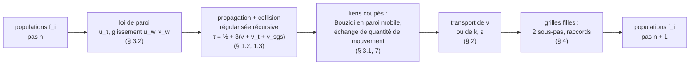
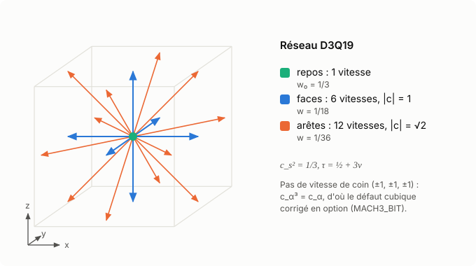
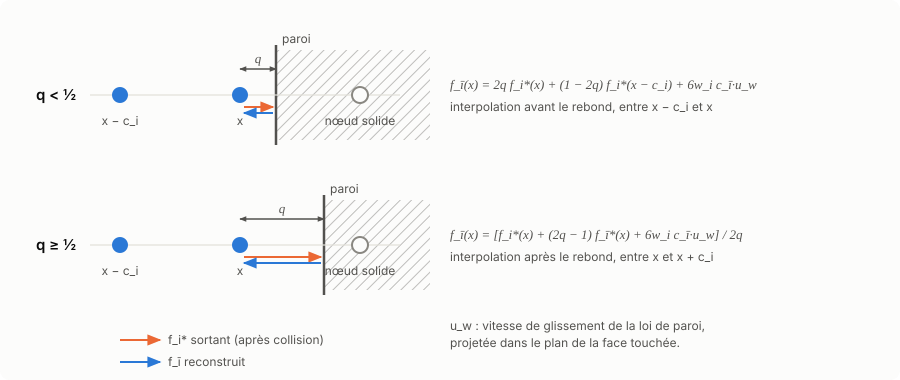
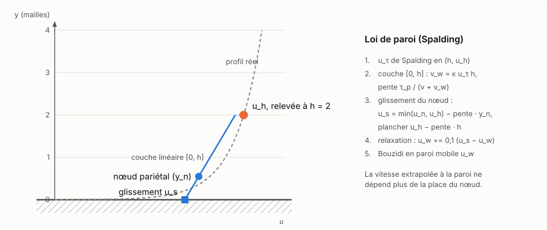
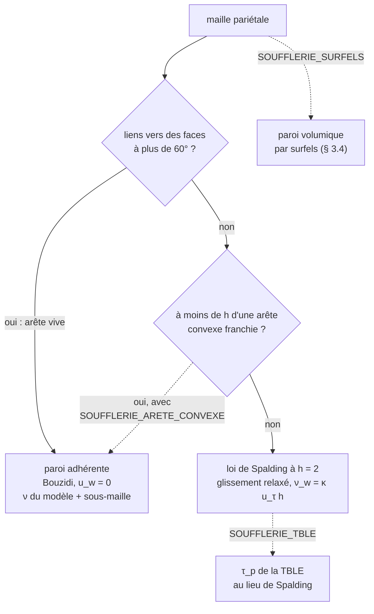
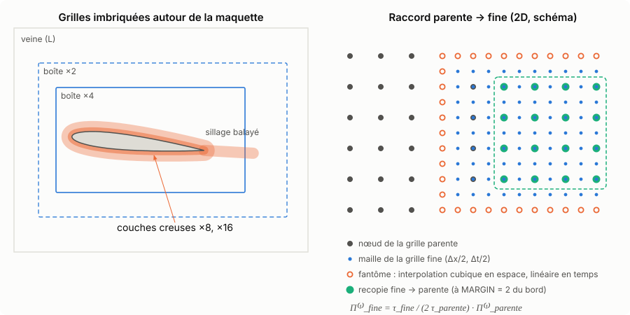
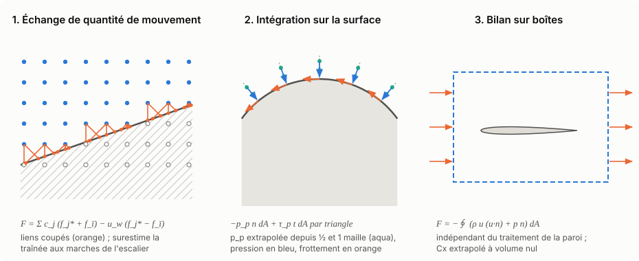
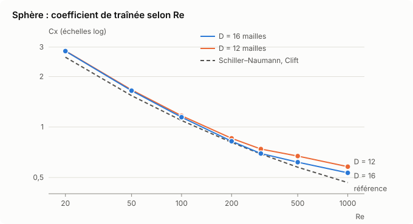
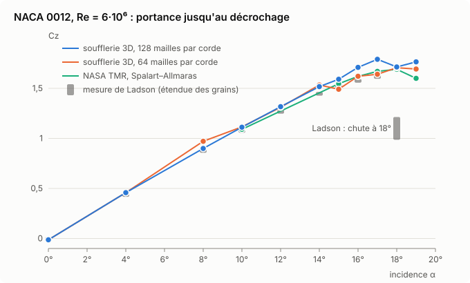

# Méthode de calcul de la soufflerie numérique `soufflerie-rs`

*Boltzmann sur réseau D3Q19 sur GPU, modèles de turbulence, lois de paroi
et raffinement imbriqué : formulation, validation et limites.*

[Présentation](presentation.md) · **Méthode scientifique** · [Fonctionnement technique](technique.md) · [README](../README.md)

> [!NOTE]
> Les chiffres viennent du [README](../README.md), dont les sections sont
> citées entre guillemets ; état du code au commit `aa75c67` (novembre
> 2026). L'implémentation est décrite dans le
> [fonctionnement technique](technique.md).

**Sommaire**

1. [Équation de Boltzmann sur réseau](#1-équation-de-boltzmann-sur-réseau)
2. [Modèles de turbulence](#2-modèles-de-turbulence)
3. [Conditions de paroi](#3-conditions-de-paroi)
4. [Raffinement local](#4-raffinement-local)
5. [Veine et conditions aux limites](#5-veine-et-conditions-aux-limites)
6. [Transition et décambrage visqueux](#6-transition-et-décambrage-visqueux)
7. [Mesure des efforts](#7-mesure-des-efforts)
8. [Mise en place de la géométrie](#8-mise-en-place-de-la-géométrie)
9. [Validation](#9-validation)
10. [Forces et limites](#10-forces-et-limites)
11. [Références](#références)

## Résumé

La soufflerie résout l'écoulement incompressible faiblement compressible
autour d'une maquette par la méthode de Boltzmann sur réseau, réseau D3Q19,
collision régularisée récursive, sur une grille cartésienne raffinée par
grilles et couches imbriquées (facteur 2 en espace et en temps par niveau,
×2 à ×16). Aux nombres de Reynolds élevés, la turbulence est modélisée par
Spalart–Allmaras (défaut), k-ε RNG ou une réduction VLES de ce dernier, et
la paroi par une loi de Spalding raccordée à deux mailles de la surface et
transmise par un rebond interpolé de Bouzidi en paroi mobile. Les efforts
sont mesurés de trois façons indépendantes (échange de quantité de
mouvement, intégration sur la surface, bilan sur des boîtes). Sur des ailes
en écoulement attaché, la portance est à quelques pour cent à 10 % des
mesures ; la traînée reste 1,3 à 3 fois trop forte, et le décollement sur
paroi lisse n'est pas capté. Aucun facteur de recalage n'est employé : les
constantes des modèles sont celles de leurs publications.

Enchaînement des modèles au cours d'un pas de temps d'une grille :

## 1. Équation de Boltzmann sur réseau

### 1.1 Réseau et unités

Le réseau D3Q19 comporte les vitesses discrètes $\mathbf c_i$ : le repos,
les six voisins de face et les douze voisins d'arête, de poids
$w_0 = 1/3$, $w_{1..6} = 1/18$, $w_{7..18} = 1/36$, et la vitesse du son
$c_s^2 = 1/3$. En unités du réseau ($\Delta x = \Delta t = 1$ sur la grille
de la veine), la vitesse amont vaut $U = 0{,}1$ (Ma = 0,17), la longueur de
référence $L$ mailles, et la viscosité $\nu = UL/\mathrm{Re}$ fixe le temps
de relaxation

$$\tau = \tfrac12 + \nu / c_s^2 = \tfrac12 + 3\nu .$$

Aux Reynolds visés (10⁵ à 10⁷), $\tau - \tfrac12$ vaut 10⁻⁵ à 10⁻³ : le
schéma n'est stable que par la collision régularisée, la viscosité de
sous-maille et le modèle de turbulence.

Un pas comprend la propagation (« pull » : chaque maille tire les
populations de ses voisines) et la collision, fusionnées :

$$f_i(\mathbf x, t+1) = f_i^{*}(\mathbf x - \mathbf c_i, t), \qquad
f_i^{*} = \text{collision}(f_i).$$

### 1.2 Collision régularisée récursive

La collision est régularisée récursivement à l'ordre 3 (Malaspinas 2015).
À partir des moments $\rho = \sum f_i$, $\rho\mathbf u = \sum f_i\mathbf c_i$
et de la partie hors équilibre du tenseur des contraintes

$$\Pi^{(1)}_{\alpha\beta} = \sum_i f_i c_{i\alpha}c_{i\beta}
- \rho\,(c_s^2\delta_{\alpha\beta} + u_\alpha u_\beta),$$

les populations après collision sont reconstruites sur la base des
polynômes d'Hermite :

$$f_i^{*} = w_i\Big[\rho + \frac{\rho\,\mathbf c_i\cdot\mathbf u}{c_s^2}
+ \frac{\mathcal H^{(2)}_i : (\rho\mathbf u\mathbf u + b)}{2c_s^4}
+ \sum_{(3)} \frac{\mathcal H^{(3)}_{i} \, a^{(3)}}{6c_s^6}\Big],
\qquad b = (1-\omega)\,\Pi^{(1)},\ \omega = 1/\tau .$$

Les moments d'ordre 3 sont tirés récursivement de ceux d'ordre 2,

$$a^{(3)}_{\alpha\beta\gamma} = \rho u_\alpha u_\beta u_\gamma
+ u_\alpha b_{\beta\gamma} + u_\beta b_{\alpha\gamma} + u_\gamma b_{\alpha\beta},$$

limités aux composantes mixtes que porte le D3Q19 ($xxy$, $xyy$, $xxz$,
$xzz$, $yyz$, $yzz$). Le BGK reste disponible en 2D (`--collision bgk`).

Sur la sphère, le passage à cette collision et l'amortissement pariétal de
la sous-maille ont ramené l'écart de traînée à Re = 1000 de +32 % à +14 %
(« Validation 3D »). Sur l'A320 de démonstration, il supprime le bruit en
damier de la vorticité à $\tau \approx 0{,}5$, avec les bandes absorbantes et une grille ×2
(« Loi de paroi en 3D »).

### 1.3 Sous-maille de Smagorinsky avec amortissement de Van Driest

Quand $\tau_0 < 0{,}51$, une viscosité de Smagorinsky ($C_s = 0{,}15$)
s'ajoute. Le temps de relaxation effectif est tiré localement de
$\Pi^{(1)}$ par la formule fermée de Hou et al. (1996) :

$$\tau_\text{eff} = \tfrac12\Big(\tau + \sqrt{\tau^2 + 18\,C_s^2 D^2\,
|\Pi^{(1)}|/\rho}\Big), \qquad |\Pi^{(1)}| = \sqrt{2\,\Pi^{(1)}:\Pi^{(1)}},$$

où $\tau = \tfrac12 + 3(\nu + \nu_t)$ inclut la viscosité turbulente du
modèle RANS. Sans loi de paroi, l'amortissement de Van Driest
$D = 1 - e^{-d/A}$, $A = 8L/\sqrt{\mathrm{Re}}$ borné à [1, 4] mailles
($d$ distance à la paroi), réduit la sous-maille près du corps. Avec la
loi de paroi, $D = 1$ : la sous-maille stabilise alors les premiers nœuds à
$\tau \approx 0{,}5$ (aile à Re = 10⁶, L = 32 : divergence sans elle).
Sans sous-maille, les calculs à Re élevé divergent ; sa constante divisée
par 2 ne retire que 15 % de la traînée (« Traînée : où est l'excès »).

### 1.4 Défaut cubique du D3Q19 et sa correction

Sur D3Q19, $c_{i\alpha}^3 = c_{i\alpha}$ : le moment $\sum f_i c_{i\alpha}^3$
vaut $\rho u_\alpha$ et le terme $\rho u_\alpha^3$ de l'équilibre de
Maxwell manque. Le développement de Chapman–Enskog donne une contrainte
normale $2\rho\nu\,\partial_\alpha u_\alpha (1 - 4{,}5\,u_\alpha^2)$, soit
une erreur de $1{,}5\,\mathrm{Ma}^2$ (4 % à Ma = 0,17). La correction
(option `MACH3_BIT`, « Domaine de Mach du D3Q19 ») ajoute au moment d'ordre 2
après collision le terme source de Dellar (2014) et Hosseini, Darabiha et
Thévenin (2020),

$$s_{\alpha\alpha} = -(1-\omega/2)\,\partial_\alpha(\rho u_\alpha^3)
\approx -(1-\omega/2)\,3\rho u_\alpha^2\,\partial_\alpha u_\alpha,
\qquad \partial_\alpha u_\alpha = -\frac{3\omega\,\Pi^{(1)}_{\alpha\alpha}}{2\rho},$$

le gradient étant tiré localement de la partie hors équilibre, comme la
correction galiléenne du cumulant (Geier et al. 2015) : ni voisin ni
tampon. Le terme $\partial_\gamma(\rho u_xu_yu_z)$ des contraintes de
cisaillement ($c_xc_yc_z = 0$ sur D3Q19) n'est pas corrigé.

Sur une onde de cisaillement oblique advectée (veine périodique 64 × 64 × 2,
$\tau = 0{,}8$), la viscosité apparente suit l'analyse $\nu(1 - 2{,}25U^2)$ à
1 % près sans correction ; la correction en retire 92 à 98 % :

| Ma | sans | avec | prévu sans |
| --- | --- | --- | --- |
| 0,1 | 0,9927 | 1,0002 | 0,9925 |
| 0,2 | 0,9704 | 0,9992 | 0,9700 |
| 0,3 | 0,9329 | 0,9946 | 0,9325 |

Domaine utilisable (contrainte visqueuse à 1 %) : Ma ≲ 0,08 avant, ≲ 0,3
après, tant que les trois composantes de la vitesse ne sont pas grandes à la
fois. Sur l'aile infinie à Re = 6·10⁶, l'effet est négligeable (Cz
0,4552 → 0,4556) : la contrainte visqueuse y compte peu. L'option reste
désactivée par défaut (code retiré du shader, défaut identique à l'octet).

## 2. Modèles de turbulence

### 2.1 Spalart–Allmaras (défaut)

Dès Re = 5·10⁴ (`--turb auto`), la viscosité turbulente
$\nu_t = \tilde\nu f_{v1}$, $f_{v1} = \chi^3/(\chi^3 + c_{v1}^3)$,
$\chi = \tilde\nu/\nu$, s'ajoute à la viscosité de la collision. $\tilde\nu$
est transporté par une seconde passe (Spalart et Allmaras 1992) :

$$\frac{D\tilde\nu}{Dt} = c_{b1}\tilde S\tilde\nu
+ \frac1\sigma\Big[\nabla\cdot\big((\nu+\tilde\nu)\nabla\tilde\nu\big)
+ c_{b2}|\nabla\tilde\nu|^2\Big] - c_{w1}f_w\Big(\frac{\tilde\nu}{d}\Big)^2,$$

$\tilde S = \max\big(\Omega + \tilde\nu f_{v2}/(\kappa^2d^2),\ 0{,}3\,\Omega\big)$,
constantes publiées : $c_{b1} = 0{,}1355$, $c_{b2} = 0{,}622$, $\sigma = 2/3$,
$\kappa = 0{,}41$, $c_{w2} = 0{,}3$, $c_{w3} = 2$, $c_{v1} = 7{,}1$, sans terme
de transition $f_{t2}$. Discrétisation explicite : advection décentrée amont
d'ordre un, diffusion conservative, destruction semi-implicite,
$\tilde\nu \le 0{,}15$ en unités du réseau. Distance à la paroi exacte à
moins de 3 mailles (triangles ou formes analytiques), propagée au-delà par
une transformée de chanfrein (1, √2, √3). Au premier nœud,
$\tilde\nu = \kappa u_\tau h$ (§ 3.2). Amont : $\tilde\nu = 3\nu$.

La couche limite est supposée turbulente dès le bord d'attaque, sauf
transition imposée (§ 6.1).

### 2.2 k-ε RNG

Second modèle (`Turbulence::KEpsRng`, `SOUFFLERIE_RANS=keps`), base du
modèle de PowerFLOW : k-ε RNG de Yakhot et Orszag (1986), sous la forme de
Yakhot et al. (1992),

$$\nu_t = C_\mu \frac{k^2}{\varepsilon},\quad
\frac{Dk}{Dt} = \nabla\cdot\Big(\big(\nu + \tfrac{\nu_t}{\sigma_k}\big)\nabla k\Big)
+ P - \varepsilon,\quad
\frac{D\varepsilon}{Dt} = \nabla\cdot\Big(\big(\nu + \tfrac{\nu_t}{\sigma_\varepsilon}\big)\nabla\varepsilon\Big)
+ C_{\varepsilon1}\frac{\varepsilon}{k}P - C^*_{\varepsilon2}\frac{\varepsilon^2}{k},$$

$P = \nu_t S^2$, $C^*_{\varepsilon2} = C_{\varepsilon2} + C_\mu\eta^3(1-\eta/\eta_0)/(1+\beta\eta^3)$,
$\eta = Sk/\varepsilon$ ; $C_\mu = 0{,}0845$, $\sigma_k = \sigma_\varepsilon = 0{,}7194$,
$C_{\varepsilon1} = 1{,}42$, $C_{\varepsilon2} = 1{,}68$, $\eta_0 = 4{,}38$,
$\beta = 0{,}012$. Même schéma que $\tilde\nu$. Au premier nœud, équilibre
logarithmique à la hauteur de raccord : $k = u_\tau^2/\sqrt{C_\mu}$,
$\varepsilon = u_\tau^3/(\kappa h)$, d'où $\nu_t = \kappa u_\tau h$. Amont :
Tu = 0,1 %, $\nu_t/\nu = 0{,}2$, avec les termes d'entretien de Spalart et
Rumsey (2007). Entre grilles, $k$ est inchangé et $\varepsilon$ double de la
grille fine à la parente (unités du réseau, $\Delta t \propto \Delta x$).

### 2.3 VLES

Réduction « très grandes échelles » dans l'esprit du VLES de PowerFLOW
(Chen et al. 2003, 2004 ; Fares 2006), `Turbulence::Vles` :

- filtre de maille de Johansen, Wu et Shyy (2004) :
  $F = \min(1, C_3\Delta\varepsilon/k^{3/2})$, $C_3 = 1$, $\Delta$ pas du
  réseau local ;
- protection de la couche limite par la fonction $f_d$ de la DDES
  (Spalart et al. 2006) : $r_d = (\nu_t + \nu)/(\kappa^2d^2\sqrt{U_{ij}U_{ij}})$,
  $f_d = 1 - \tanh\big((8r_d)^3\big)$ ;
- $\nu_t = C_\mu (k^2/\varepsilon)\,\big(1 - f_d(1-F)\big)$, dans la collision
  seulement ; $k$ et $\varepsilon$ suivent le k-ε RNG complet.

Sans protection, le filtre couperait la couche limite
($k^{3/2}/\varepsilon \approx 2{,}6\,y$ dépasse la maille dès $y \approx 0{,}4\Delta$).
Le terme de tourbillonnement de Chen et al. (2003) sous sa forme publiée
divise $\nu_t$ par 3,6 dans la zone logarithmique en équilibre : il n'est
pas retenu.

### 2.4 Comparaison des trois modèles

Même binaire (« VLES sur la base k-ε RNG ») :

| Cas | Spalart–Allmaras | k-ε RNG | VLES | Référence |
| --- | --- | --- | --- | --- |
| Aile infinie, 128 mailles, 4° : Cz / Cx | 0,462 / 0,0143 | 0,460 / 0,0153 | 0,467 / 0,0150 | Ladson 0,43–0,44 / 0,0081–0,0088 |
| idem, 8° | 0,899 / 0,0222 | 0,899 / 0,0230 | 0,899 / 0,0232 | 0,87–0,89 / 0,0099–0,0105 |
| Ahmed 25°, L = 96 : Cx surface / boîte | 0,395 / 0,429 | 0,362 / 0,399 | 0,412 / 0,405 | 0,285 |
| Ahmed 35°, L = 64 | 0,670 / 0,681 | 0,634 / 0,606 | 0,630 / 0,578 | ≈ 0,26 |
| Cylindre Re = 3900, D = 16 : Cd / Cl′ | 1,10 / 0 | 1,10 / 0 | 1,09 / 0 | 0,98 à 1,0 / lâcher St 0,21 |

En écoulement attaché, la loi de paroi fixe le premier nœud
($\nu_t = \kappa u_\tau h$ dans les trois cas) et les modèles se valent. Le
filtre VLES abaisse bien $\nu_t$ dans les sillages (0,21 fois le RANS
derrière le culot d'Ahmed) mais ne fait décoller aucune paroi lisse et
dégrade le coin entrée/sol mobile. Spalart–Allmaras reste le défaut.

## 3. Conditions de paroi

### 3.1 Rebond interpolé de Bouzidi

La paroi est un ensemble de liens coupés : pour chaque lien du réseau qui
traverse la surface, la fraction $q \in\, ]0, 1]$ de sa longueur côté fluide
est calculée par intersection exacte avec les triangles du maillage (ou la
forme analytique). La population qui revient de la paroi dans la direction
$\bar\imath$ (opposée à $i$) suit l'interpolation linéaire de Bouzidi,
Firdaouss et Lallemand (2001), en paroi mobile de vitesse $\mathbf u_w$ :

$$f_{\bar\imath}(\mathbf x, t+1) =
\begin{cases}
2q\,f_i^{*}(\mathbf x) + (1-2q)\,f_i^{*}(\mathbf x - \mathbf c_i) + 6w_i\,\mathbf c_{\bar\imath}\cdot\mathbf u_w, & q < \tfrac12,\\[4pt]
\dfrac{1}{2q}\Big[f_i^{*}(\mathbf x) + (2q-1)\,f_{\bar\imath}^{*}(\mathbf x) + 6w_i\,\mathbf c_{\bar\imath}\cdot\mathbf u_w\Big], & q \ge \tfrac12,
\end{cases}$$

avec repli sur le rebond simple quand le voisin amont est lui-même coupé.

Un lien qui coupe la surface entre deux mailles fluides reçoit aussi sa
fraction : une aile, une dérive ou une plaque plus minces qu'une maille
restent des parois (plaque de 0,08 maille : Cx 1,829 contre 1,831 pour une
plaque de 2 mailles, test `paroi_mince_stl`).

Chaque lien garde la normale de la face qu'il touche (normales lissées de
Phong par coin de triangle, sans traverser les arêtes vives de plus de 60°) ;
la vitesse de paroi est projetée dans le plan de cette face. Les normales
des nœuds viennent du gradient de la distance **signée** : prise sur la
distance non signée, la normale s'annulait à moins de 0,2 maille de la paroi
et y arrêtait le nœud (« Normale de paroi des nœuds posés sur la surface »).

### 3.2 Loi de paroi de Spalding à h = 2 mailles

Aux Reynolds de l'aéronautique, la couche limite tient dans une à quelques
mailles. La paroi glisse alors à une vitesse qui transmet le frottement de
la loi de Spalding (1961),

$$y^+ = u^+ + e^{-\kappa B}\Big[e^{\kappa u^+} - 1 - \kappa u^+
- \frac{(\kappa u^+)^2}{2} - \frac{(\kappa u^+)^3}{6}\Big],
\qquad \kappa = 0{,}41,\ e^{-\kappa B} = 0{,}1287,$$

résolue par Newton sur $u^+$. Formulation retenue (« Loi de paroi 3D :
couche pariétale cohérente », « Glissement des nœuds posés sur la paroi »),
dans une passe propre (`wall3d`) sur le champ du pas précédent :

1. **Relevé à hauteur fixe.** La loi est alimentée par la vitesse
   tangentielle $u_h$ relevée (interpolation trilinéaire) à $h = 2$ mailles
   au-dessus du pied de la normale (Kawai et Larsson 2012), avec repli sur
   le nœud si le relevé touche une maille solide ou ne tombe pas à la
   hauteur $h$ de la paroi la plus proche. $u_\tau$ vient de Spalding en
   $(h, u_h)$.
2. **Couche pariétale cohérente.** La couche $[0, h]$ a la viscosité
   turbulente uniforme $\nu_w = \kappa u_\tau h$ : profil linéaire de pente
   $\tau_p/(\nu + \nu_w)$. Chaque nœud pariétal, à la distance $y_n$, glisse
   à

   $$u_s = \max\Big(\min(u_n, u_h) - \frac{u_\tau^2\,y_n}{\nu + \nu_w},\;
   u_h - \frac{u_\tau^2\,h}{\nu + \nu_w}\Big),$$

   borne supérieure au nœud (profil monotone ; arrête un nœud qui
   s'emballe) et plancher ancré à $h$ (un nœud posé sur la paroi ne peut
   pas dériver vers zéro). Le premier nœud reçoit la viscosité $\nu_w$
   dans sa collision et $\tilde\nu = \kappa u_\tau h$. La vitesse extrapolée à
   la paroi ne dépend plus de la place du nœud dans la maille, et la
   contrainte transmise est $\tau_p$ partout.
3. **Relaxation.** $u_w \leftarrow u_w + 0{,}1\,(u_s - u_w)$ : sans effet en
   régime établi (0,1 ou 0,02 : mêmes efforts à 0,3 %), nécessaire à la
   stabilité d'une paroi presque glissante.
4. **Arêtes vives.** Aux mailles dont les liens touchent des faces à plus de
   60° l'une de l'autre (bord de fuite, saumon plat, arête de marche), la
   loi ne s'applique pas : paroi adhérente, avec la viscosité du modèle et
   de la sous-maille. Tout seuil entre 30° et 80° classe les mêmes mailles.

*La couche $[0, h]$ remplace la couche limite réelle, trop mince pour la
maille : le premier nœud ne voit qu'un profil linéaire et un glissement de
paroi qui transmettent la contrainte $\tau_p$ de la loi.*

Traitement retenu pour chaque maille pariétale (défaut en trait plein,
options en pointillé) :

La hauteur de 2 mailles s'est imposée contre la première version (relevé
au nœud) : le glissement $u_n - u_\tau^2 y_n/(\nu + \kappa u_\tau y_n)$ vaut
$u_n - u_\tau/\kappa$ quelle que soit $y_n$, et la vitesse extrapolée à la
paroi sautait à chaque traversée d'une rangée de nœuds ; sur le NACA 0012 à
10° (Re = 6·10⁶), CL s'éloignait de la référence en affinant (1,12, 1,29 puis
décollement à 64, 128, 256 mailles par corde).

Variantes essayées et écartées (« Problèmes connus de la méthode »,
« Gradient de pression dans la loi de paroi ») : échange de quantité de
mouvement inverse (Asmuth et al. 2021), reconstruction du premier nœud
(Malaspinas et Sagaut 2014 ; Degrigny et al. 2021), contrainte imposée comme
force, loi avec gradient de pression de Townsend (1961) et Mellor (1966),
y compris filtrée. Toutes dégradent l'écoulement attaché ou divergent ; le
détail est dans le README.

### 3.3 Loi de paroi hors équilibre (TBLE)

Option `SOUFFLERIE_TBLE=eq|gp|gpc` (Balaras, Cabot et Moin 1996 ; Kawai et
Larsson 2012 ; Park et Moin 2014). Sous chaque nœud pariétal, une grille 1D
de 33 points étirée entre la paroi et $h$ résout

$$\partial_t u + F = \partial_y\big[(\nu + \nu_t)\,\partial_y u\big],\quad
u(0) = 0,\ u(h) = u_h,\quad \nu_t = \kappa y u_\tau\big(1 - e^{-y^+/A}\big)^2,\ A = 17,$$

par un pas implicite (algorithme de Thomas) par pas de la grille ;
$\tau_p = \nu\,\partial_y u|_0$ remplace le $u_\tau$ de Spalding. $F = 0$
(`eq`), $(1/\rho)\,\partial_s p$ (`gp`), ou ce gradient plus la convection
au point relevé (`gpc`). À l'équilibre, $u_\tau$ TBLE/Spalding = 0,991 à
$y^+(h) = 245$, 1,000 à 6800. `eq` redonne Spalding (Cz à 0,5 %) ; `gp` et
`gpc` ne font pas décrocher l'aile infinie et dégradent l'attaché (Cz
±4 %, Cx −75 % ou +12 à +68 %). Raison : $h = 2$ mailles vaut ici
l'épaisseur de couche limite $\delta$ ou plus, et les termes sources
$u_h\partial_s u_h$ et $\partial_s p$, chacun une vingtaine de fois
$u_\tau^2/h$, se compensent presque ; leur reste est surtout la perte
numérique de pression totale du champ. Défaut inchangé.

### 3.4 Paroi volumique par surfels (option)

Condition limite volumique de Chen, Teixeira et Molvig (1998), celle de
PowerFLOW (`SOUFFLERIE_SURFELS=1`, « Paroi volumique par surfels sur
GPU »). Chaque triangle est découpé par les plans $i + \tfrac12$ de la grille
(Sutherland–Hodgman) en surfels d'un seul voxel. Pour chaque direction, le
parallélépipède balayé $P_i = |\mathbf c_i\cdot\mathbf n|A$ est réparti
exactement entre les voxels (poids $w$), et les fractions fluides $V$ des
voxels coupés sont exactes. Un pas :

- *rassemblement* : $\Gamma^\text{in} = \sum w f^{*}$ sur le parallélépipède ;
- *réflexion* : $\Gamma^\text{out} = \Gamma^\text{in}$ dans la direction
  opposée (masse et pression renvoyées exactement), plus une perturbation
  d'équilibre $\delta_j = P_j w_j(\lambda_0 + \boldsymbol\Lambda\cdot\mathbf c_j)$,
  sans masse ni quantité de mouvement normale, qui ramène l'effort
  tangentiel à l'effort visé ;
- *propagation* : $f_i(\mathbf x) = \big[T_i f^{*}_\text{amont}
  + \sum w\,\Gamma^\text{out}/\sum w\big]/D_i$, $T_i$ la part non
  interceptée, $D_i = T_i + \sum w$ ($= V_\mathbf x$ en géométrie exacte :
  masse $\sum Vf$ conservée).

**Ordre 2 en position de paroi.** L'effort tangentiel visé vient d'un
relevé de vitesse au-dessus de chaque surfel : moindres carrés du profil
$u = \eta(a + \mathbf d\cdot\boldsymbol\xi) + b\eta^2$ sur les nœuds
entièrement fluides à $\eta \in [0{,}5 ; 3]$ (7 en moyenne) ; effort
$\rho\nu aA$ en laminaire, $\rho u_\tau^2 A$ avec $u_\tau$ de Spalding à
$h = 2$ en turbulent. Convergence en laminaire (canal incliné, conduite
circulaire) :

| Cas | Ordre 1 (d'origine) : débit | Relevé : débit | Ordre mesuré | Bouzidi (débit) |
| --- | --- | --- | --- | --- |
| Canal incliné, H = 10,7 → 21,5 | 10 % → 5,1 % | 0,74 % → 0,20 % | 1,89 à 1,99 | — |
| Conduite, R = 10 → 20 | 7,4 % → 3,7 % | 1,2 % → 0,29 % | 1,97 à 2,01 | 5,5 % → 2,5 % |

Sphère à Re = 100 (D = 8) : Cx 1,248 contre 1,236 avec Bouzidi.

**Limite.** Avec le modèle de turbulence, une perte de pression totale naît
au point d'arrêt et au bord d'attaque : perte intégrée à $x/c = 0$ de
$0{,}050\,qc$ contre $0{,}011$ avec Bouzidi (aile à 4°), y compris en paroi
glissante. Le rassemblement et la dispersion sont uniformes sur chaque
parallélépipède : la distribution des populations reste d'ordre 1 là où le
gradient normal est fort. Conséquences : couche limite de la plaque deux fois
trop épaisse, Cx de l'aile infinie à 4° de 0,043 contre 0,016 (Bouzidi),
corps d'Ahmed dont les trois mesures d'efforts s'écartent. Option désactivée.

## 4. Raffinement local

### 4.1 Grilles imbriquées

Chaque grille fine est deux fois plus fine en espace et en temps que sa
parente ; en unités de chaque grille, $\nu$ et $\nu_t$ doublent d'un niveau
au suivant. Le couplage passe par les moments $(\rho, \mathbf u,
\Pi^{(1)}, \tilde\nu)$ (Lagrava et al. 2012) :

- **parente → fine** : une enveloppe de mailles fantômes de la grille fine
  est remplie par interpolation cubique dans le plan de chaque face
  (linéaire près d'une paroi) et linéaire en temps (deux sous-pas fins par
  pas parent). La partie hors équilibre est remise à l'échelle,

  $$\Pi^{(1)}_\text{fine} = \frac{\tau_\text{fine}}{2\,\tau_\text{parente}}\,\Pi^{(1)}_\text{parente},$$

  puis les populations sont reconstruites par la régularisation du § 1.2.
  Près d'une paroi, le tirage refait le pas pariétal de la grille parente
  (mêmes liens de Bouzidi, même glissement, même $\nu_w$) ;
- **fine → parente** : sous la zone raffinée, à $2$ mailles parentes du
  bord (MARGIN), la grille parente reçoit l'état de la grille fine, avec
  le facteur inverse appliqué aux populations après collision,
  $2(\tau_\text{parente} - 1)/\tau_\text{fine}$ ; une maille pariétale fine
  rend sa contrainte, pas un équilibre.

Ordre d'un pas : grille parente (loi de paroi, collision, $\tilde\nu$), puis
pour chaque grille fille tirage, deux pas fins (récursivement), recopie.
Les efforts viennent de la grille la plus fine qui entoure chaque
élément de surface.

*À gauche, les régions de chaque niveau ; à droite, le raccord : les
fantômes (orange) de la grille fine sont remplis depuis la parente, et les
nœuds parents sous la zone raffinée (aqua) reçoivent l'état de la grille
fine.*

Emprises par défaut des boîtes (`--raff 1..3`), en longueurs de
référence (amont, aval, côtés) : 0,6 / 1,5 / 0,6 ; 0,35 / 0,7 / 0,4 ;
0,2 / 0,4 / 0,25. Validation (« Stabilité et raffinement local en 3D ») :
sphère à Re = 100, D = 8 + ×2 contre D = 16 uniforme : Cx 1,1504 contre
1,1472 (+0,3 %), dix fois plus vite.

### 4.2 Couches pariétales creuses

Une grille deux fois plus fine sur une couche d'épaisseur $D$ (en mailles
fines) autour de toute la surface, comme les régions décalées de la paroi
des codes commerciaux : les faces de raccord sont parallèles à la paroi et
ne coupent jamais la maquette. Stockage par blocs de 8³ mailles (seuls les
blocs utiles sont gardés). Les couches s'imbriquent (`--bande 16,16,…`),
avec la règle $D_\text{parente} \ge D/2 + 2\,\text{MARGIN} + 3$ (sinon les
fantômes d'une couche sont remplies depuis des mailles que sa parente ne
calcule pas).

Une couche trop mince fait tomber le raccord dans la couche limite. Aile
AR 4, 4°, grille ×2 et couche ×4 contre ×4 complète : Cz (boîte) 0,257 à
$D = 8$, 0,2775 à 12, 0,2732 à 16, contre 0,2734 ; à $D = 16$, sept fois
plus vite. Règle retenue : au moins 16 mailles et 1/8 de la longueur de
référence (`--bande auto --bande-corde 0.125`), qui accorde la boîte et la
surface à 0,8 % près avec trois couches (×4, ×8, ×16).

### 4.3 Raffinement automatique

`--raff-auto N` (N mailles par longueur de référence à la paroi) remplace
`--raff` et `--bande` : le niveau $k$ couvre les points à moins de $d_k$ de
la surface, plus un sillage balayé vers l'aval sur $W_k = d_k$, avec

$$d_n = \max(16 \text{ mailles},\ 0{,}125\,L), \qquad
d_k = d_{k+1} + m \text{ mailles du niveau } k,\ m = 4 \text{ (boîte)},\ 7 \text{ (couche)},$$

règles tirées des essais précédents, sans réglage nouveau. Sur TR-1208, la
règle retrouve presque les emprises manuelles (« Raffinement automatique »).
Limite connue : avec `--raff-auto`, la grille entière la plus fine est une
boîte serrée dont les faces passent dans la couche pariétale, en partie
recopiée de la grille fine ; le bilan sur boîte y dépend de la marge et
n'est pas exploitable (Ahmed sans sol : 0,309 / 0,331 à 0,05 / 0,1 L).

### 4.4 Placement du bord de fuite

La portance dépend, à l'ordre un en maille, de la position du bord de fuite
par rapport aux nœuds : la condition de Kutta discrète reste attachée aux
nœuds. Sur l'aile AR 4 à 4° (L = 16), elle varie de ±8 % à ×2 et ±3 % à ×4
en décalant la maquette d'une fraction de maille (« Bord de fuite : une
erreur de placement d'ordre un »). Le point le plus en aval est calé à
0,7 maille après un nœud de la veine (`te_snap`), dans le plateau observé.
La moyenne sur quatre placements converge : 0,276, 0,271, 0,269 à ×2, ×4, ×8,
vers environ 0,267 (VSPAERO en panneaux épais : 0,265).

## 5. Veine et conditions aux limites

- **Entrée** : populations d'équilibre à la vitesse amont, avec une mise en
  vitesse progressive (rampe en demi-cosinus).
- **Sortie** : gradient nul et zone éponge sur les 15 % aval de la veine, où
  le temps de relaxation croît quadratiquement jusqu'à 0,8.
- **Bords latéraux** : périodiques. La veine s'ajuste à une maquette STL :
  3,5 M en amont, 7,5 M en aval, 2,5 M de côté (M la plus grande de L et des
  dimensions), au moins 6 L de large et de haut.
- **Bandes absorbantes** (quand la sous-maille est active) : rappel vers
  l'équilibre amont $f_i \leftarrow f_i - \sigma\,(f_i - f_i^\text{eq}(1, \mathbf U))$,
  $\sigma = 0{,}05\,s^2$, $s$ croissant linéairement vers le bord, sur un
  huitième de la hauteur et de la largeur, un vingt-quatrième de la
  longueur à l'entrée, et dans l'éponge. Sphère à Re = 10⁶ : vorticité
  résiduelle amont 2,63 → 0,004 U/L, Cx 0,254 → 0,214. Les images des
  bords périodiques sont effacées : la portance de l'aile AR 4 ne varie que
  de 0,4 % quand la veine passe de 2 à 39 M mailles.
- **Sol mobile** (`--sol`) : plancher qui défile à la vitesse amont,
  plafond glissant ; pas encore avec le raffinement local.

La soufflerie 3D n'a pas de correction de blocage (la 2D applique celle
d'Allen et Vincenti).

## 6. Transition et décambrage visqueux

### 6.1 Transition imposée (3D)

`--xtr 0.3` : couche limite laminaire du bord d'attaque jusqu'à la fraction
$x_{tr}$ de la corde locale (mesurée par tranche d'envergure) : frottement
de Blasius $0{,}664/\sqrt{\mathrm{Re}_x}$ à la paroi et production de
Spalart–Allmaras nulle autour. Aile AR 4 à 8°, Re = 10⁶ : Cx 0,1163
turbulente, 0,1107 laminaire partout (écart attendu ≈ 0,006). Le
décollement laminaire des corps épais n'est pas capté (sphère à Re = 10⁵ :
0,21 laminaire au lieu de 0,47).

### 6.2 Couplage visqueux–non visqueux en 2D (référence)

La référence 2D des profils est une méthode des panneaux (Kuethe et Chow)
couplée à une couche limite intégrale. Le couplage simultané
(`--couplage newton`, méthode de XFOIL : Drela et Giles 1987, Drela 1989)
résout par Newton les équations intégrales de quantité de mouvement et
d'énergie cinétique, avec transpiration $\sigma = d(u_e\delta^*)/ds$ sur le
profil et le sillage, fermetures de Drela et Giles (laminaire) et de Drela
(turbulent, retard de Green), transition $e^N$ ($N_\text{crit} = 9$).
NACA 0012 à Re = 6·10⁶, 10° : CL 1,0924 et CD 0,01222 contre 1,0912 et
0,01221–0,01222 pour la NASA TMR (Spalart–Allmaras) ; perte de portance
visqueuse de 8,5 %, à 0,1 % de TMR. Newton ne converge plus au-delà de 17,7°.

### 6.3 Transpiration en 3D : essayée, non retenue

`--transpiration 1` marche une couche limite intégrale sur le graphe des
triangles (Thwaites, Head, Ludwieg–Tillmann ; équations en lignes de
courant sans écoulement transversal) et impose
$v_n = \nabla\cdot(u_e\delta^*\hat{\mathbf e})$ (Lighthill 1958) comme
vitesse normale de la paroi mobile de Bouzidi. Elle diverge à ×4 et fait
monter la portance de TR-1208. Les profils de vitesse montrent pourquoi : le
champ contient déjà au bord de fuite une couche déficitaire de 4 à 6
mailles, d'épaisseur de déplacement 4 fois celle d'une couche limite réelle
(« Décambrage par transpiration »). L'option sert au diagnostic seulement.

## 7. Mesure des efforts

Trois mesures indépendantes, affichées ensemble par `run3d` et l'interface :

1. **Échange de quantité de mouvement** aux liens de paroi, accumulé sur le
   GPU, avec le terme de paroi mobile :

   $$\mathbf F = \sum_{\text{liens}} \Big[\mathbf c_j\,(f_j^{*} + f_{\bar\jmath})
   - \mathbf u_w\,(f_j^{*} - f_{\bar\jmath})\Big],$$

   $j$ dirigé vers la paroi. Avec la loi de paroi, il surestime la traînée :
   les liens rasants des marches de l'escalier renvoient pression et
   quantité de mouvement dans leur direction (aile AR 4 à 0°, ×2 : 0,064
   contre 0,018 par la surface).
2. **Intégration sur la surface** (maquettes STL) : sur chaque triangle,
   $-p_p\,\mathbf n\,dA + \tau_p\,\mathbf t\,dA$, $p_p$ extrapolée
   linéairement à la paroi depuis des relevés à ½ et 1 maille le long de la
   normale lisse, $\tau_p = \rho u_\tau^2$ de la loi relevée à $h$ ; un
   triangle plus grand qu'une maille est découpé en $m^2$ sous-triangles
   ($m \le 8$). Elle sous-estime la traînée aux faibles incidences (moitié
   de la boîte à 0° et 4° sur l'aile infinie).
3. **Bilan sur boîtes** :
   $\mathbf F = -\oint\big(\rho\,\mathbf u\,(\mathbf u\cdot\mathbf n) + p\,\mathbf n\big)\,dA$
   sur deux boîtes (0,1 et 0,15 L de marge) dans la grille la plus fine,
   traînée extrapolée à volume nul (la veine a un léger gradient de pression
   longitudinal). Indépendante du traitement de la paroi : c'est l'arbitre
   de la portance et la mesure retenue pour la traînée.

S'y ajoutent la décomposition de la traînée dans un plan aval (Betz,
Maskell : sillage visqueux, traînée induite, `--sillage 1`) et la
répartition en envergure par triangle. Sur TR-1208 à 8°, la traînée induite
du sillage vaut 0,011 à 0,012, soit $C_L^2/(\pi A)$ pour un allongement 8.

## 8. Mise en place de la géométrie

Lecture STL (soudure des sommets, triangles dégénérés retirés, maillages
ouverts votés sur trois rayons), appartenance par parité des traversées,
fractions de Bouzidi par bisection et intersection exacte, distance signée
aux triangles rangés par cases. Une icosphère de 5 120 triangles donne la
même traînée que la sphère analytique à 1 % près (test `sphere_stl`).
Prétraitements optionnels : facettes raffinées sur une surface de Phong
(`--lisser 1`), arêtes vives du maillage (`--aretes maillage`), format
`.sgeo` qui porte la mise en place. Le contrôle `soufflerie geom` chiffre ce
que voit le solveur : rayon du bord d'attaque en mailles, facettes, parois
minces. Sur TR-1208 (L = 8, ×4), le rayon du bord d'attaque vu par le
solveur est de 0,03 à 0,05 maille (≈ 0,2 à 0,4 pour la géométrie exacte).

## 9. Validation

Aucun facteur de recalage. « Boîte » : bilan sur boîtes ; « surface » :
intégration sur la surface.

### 9.1 Sphère

Traînée selon Re (50 t*, moyenne sur 20 ; Schiller–Naumann et Clift) :

| Re | D = 12 | D = 16 | Référence | Écart (D = 16) |
| --- | --- | --- | --- | --- |
| 20 | 2,848 | 2,838 | 2,610 | +8,7 % |
| 100 | 1,168 | 1,145 | 1,094 | +4,7 % |
| 300 | 0,739 | 0,695 | 0,691 | +0,5 % |
| 1000 | 0,580 | 0,533 | 0,466 | +14 % |

L'écart diminue en affinant. Aux faibles Re, il vient du confinement (veine
de 6 D) ; au-delà de Re = 300, la couche limite n'a plus que 2 à 3 mailles à
D = 16. À travers la crise de traînée (D = 16 + ×2, loi de paroi) : Cx 0,151,
0,136, 0,123, 0,114 à Re = 10⁵, 3·10⁵, 10⁶, 3·10⁶, contre ≈ 0,47, 0,1, 0,13,
0,18 (Achenbach) : bon ordre de grandeur au-delà de la crise, ni la crise ni
la remontée.

### 9.2 Aile rectangulaire NACA 0012, allongement 4 (Re = 10⁶)

Références : VSPAERO 7.2.2 (tourbillons 0,251, panneaux 0,265 à 4°), ligne
portante à polaires visqueuses 0,251. Pas de mesure.

| Cas | Cz | Cx boîte (surface) |
| --- | --- | --- |
| 4°, L = 16 + ×4 (« Comparaison aux références : état actuel ») | 0,2898 | 0,015 (0,016) |
| 4°, moyenne sur 4 placements du bord de fuite : ×2 / ×4 / ×8 | 0,276 / 0,271 / 0,269 | — |
| 4°, ×2 + couches ×4, ×8, ×16 (19, 23, 32 mailles ; « Couche pariétale fine ») | 0,2724 | 0,023 (0,030) |

La portance moyenne sur le placement converge vers celle de VSPAERO en
panneaux épais ; un placement unique porte ±3 % à ×4. La loi de paroi
retire 6 à 8 % de portance au glissement libre, l'ordre du décambrage
visqueux réel. À bas Reynolds (Re = 1000, sous-maille seule), l'aile porte
10 à 19 % de plus que la correction de Helmbold appliquée au profil 2D.

### 9.3 Aile en flèche NACA TR-1208 (Re = 4·10⁶)

Schneider (1951) : flèche 45°, allongement 8,02, effilement 0,45, NACA
63A012. Mesure lue sur la figure à ±0,01. L = 8, STL lissé.

| Cas | Cz | Cx boîte (surface) | Mesure Cz / Cx | VSPAERO Cz / Cx |
| --- | --- | --- | --- | --- |
| 4°, ×4 | 0,2794 | 0,018 (0,008) | 0,257 / 0,011 | 0,266 / 0,015 |
| 4°, ×4 + couche ×8 | 0,2824 | 0,015 (0,009) | id. | id. |
| 8°, ×4 | 0,5336 | 0,031 (0,036) | 0,499 / 0,021 | 0,531 / 0,026 |
| 8°, ×4 + couche ×8 | 0,5457 | 0,026 (0,030) | id. | id. |

La portance dépasse la mesure de 9 à 10 % et VSPAERO de 3 à 6 % ; elle
ne se résorbe pas avec la résolution près de la paroi, contrairement à
l'aile AR 4 (série antérieure à la correction de la normale : 0,545 à ×4,
0,562 à ×8 + couche ×16, « Couche pariétale fine »). Ni le
blocage (+0,4 % dans une veine 2,5 fois plus large), ni la loi de paroi, ni
le Mach du réseau (≈ +1 %) ne l'expliquent seuls. La traînée de la boîte
est 1,3 fois la mesure, celle d'une couche limite supposée turbulente dès le
bord d'attaque.

### 9.4 Aile d'envergure infinie NACA 0012 (Re = 6·10⁶)

Veine périodique en envergure, sans traînée induite ; références Ladson
(NASA TM-4074) et TMR. Bilan sur boîte de la tranche centrale, ny = 60
(« Glissement des nœuds posés sur la paroi ») :

| α | 64 mailles Cz / Cx | 128 mailles Cz / Cx | Ladson Cz / Cx |
| --- | --- | --- | --- |
| 0° | −0,013 / 0,0145 | −0,013 / 0,0138 | 0 / 0,0081 |
| 4° | 0,458 / 0,0157 | 0,458 / 0,0140 | 0,43 à 0,44 / 0,0081 à 0,0088 |
| 8° | 0,971 / 0,0286 | 0,898 / 0,0224 | 0,87 à 0,89 / 0,0099 à 0,0105 |

Avec une couche ×16 à la paroi (256 mailles par corde) sur 128 de base :
Cz 0,442 et Cx 0,0122 à 4° (dans la fourchette de Ladson pour la première
fois), 0,897 et 0,0198 à 8° (« Raffinement de paroi par zones »). La
traînée reste 1,6 à 2,2 fois la mesure à 128 mailles. Le glissement libre,
sans aucun frottement, en a déjà 1,5 à 2 fois : l'essentiel de l'excès est
une perte numérique de l'écoulement non visqueux près de la paroi, acquise
au bord d'attaque.

### 9.5 Décrochage (NACA 0012, Re = 6·10⁶)

Ladson : Cz max 1,61 à 1,63 à 17,1–17,2°, chute à 1,0–1,2 à 18°. TMR
(Spalart–Allmaras) : 1,69 vers 18°.

| α | 2D Newton | 3D, 64 mailles | 3D, 128 mailles | Ladson | TMR SA |
| --- | --- | --- | --- | --- | --- |
| 10° | 1,0924 | 1,115 | 1,112 | 1,07–1,08 | 1,091 |
| 15° | 1,5526 | 1,491 | 1,591 ± 0,006 | 1,51–1,53 | 1,546 |
| 17° | 1,6466 | 1,641 ± 0,014 | 1,790 ± 0,020 | 1,61–1,63 | 1,67 |
| 18° | — (Newton diverge > 17,7°) | 1,706 ± 0,031 | 1,714 ± 0,016 | 1,0–1,2 | 1,69 |
| 19° | — | 1,693 ± 0,018 | 1,765 ± 0,009 | — | 1,60 |

La 2D suit TMR/SA à −1,5 à +0,5 % jusqu'à 17,7°. La soufflerie 3D ne
décroche pas : Cz plafonne à 1,7–1,8, aucun point de décollement n'est
relevé jusqu'à 19° (à la paroi comme le long de la normale), divergence à
20°, pas de convergence en maillage au voisinage du maximum. Doubler la
résolution à la paroi (couche ×16) n'y change rien. Cm n'est pas
exploitable (TMR +0,0068 à 10°, ici −0,012).

### 9.6 Plaque plane turbulente

`plaque3d`, Re_L = 10⁶, $x = 0{,}5L$, épaisseurs en mailles de la veine ;
théorie : $\delta^* = 0{,}046\,x\,\mathrm{Re}_x^{-0{,}2}$,
$\theta = 0{,}036\,x\,\mathrm{Re}_x^{-0{,}2}$,
$C_f = 0{,}026\,\mathrm{Re}_x^{-1/7}$ (« Couche limite de la plaque
plane », borne au nœud) :

| L | δ* / θ calcul | δ* / θ théorie |
| --- | --- | --- |
| 32 | 0,314 / 0,250 | 0,053 / 0,042 |
| 64 | 0,245 / 0,192 | 0,107 / 0,083 |
| 128 | 0,304 / 0,232 | 0,213 / 0,167 |

Le facteur de forme (H ≈ 1,27) et le frottement (Cf de la loi à 10 % de la
théorie, frottement transmis égal à $\rho u_\tau^2$) sont justes ; la
couche lente couvre 3 à 4 mailles de la grille la plus fine quelle que soit
la résolution, d'où une épaisseur 1,4 à 6 fois trop forte. L'excès naît au
nez, là où commence la loi de paroi : le premier nœud doit garder la
viscosité $\kappa u_\tau h$ pour que le rebond transmette $\rho u_\tau^2$,
et cette viscosité fait passer le frottement aux nœuds 2 à 4.

### 9.7 Marche descendante de Driver et Seegmiller (1985)

Canal extrudé d'envergure périodique, expansion 1,125, Re_h ≈ 36 000 ;
recollement par changement de signe de $u$ au premier nœud et du frottement
(« Décollement aux arêtes vives ») :

| h (mailles) | H amont | x_r/h (u, 1er nœud) | x_r/h (frottement) | Durée |
| --- | --- | --- | --- | --- |
| 8 | 1,82 | 5,14 | 6,63 | 18 s |
| 16 | 1,72 | 5,45 | 6,54 | 130 s |
| 32 | 1,58 | 5,76 | 6,79 | 20 min |
| mesure | ≈ 1,3 | 6,26 ± 0,10 | | |

L'arête à 90° est traitée en arête vive (paroi adhérente) : le décollement
y est fixé et x_r est à 8 % de la mesure, encadré par les deux relevés. La
couche amont est trop pleine (couche lente de la plaque plane). **En aval
du recollement, le frottement (Cf ≈ 0,004 à 0,007 de 10 à 20 h) est 2 à
3 fois celui d'une couche limite qui se reconstruit** (≈ 0,002 chez Driver et
Seegmiller) et 10 à 20 fois celui de la loi : la contrainte que reçoit le
premier nœud vient de la viscosité de Spalart–Allmaras de la couche
cisaillée advectée, non de la loi. Comparaison limitée à x_r (données
Cf(x), Cp(x) de la TMR non récupérées).

### 9.8 Corps d'Ahmed

Maquette de 1044 × 389 × 288 mm avec pieds, garde au sol 50 mm, U = 40 m/s,
Re = 2,78·10⁶ (Lienhart et Becker), sol mobile (les essais ont un plancher
fixe), blocage 3,3 %. Décomposition d'Ahmed, Ramm et Faltin (1984) : avant
C_K, lunette C_S, culot C_B, reste C_R.

| Cas | L | Cx boîte | Cx surface | C_K | C_S | C_B |
| --- | --- | --- | --- | --- | --- | --- |
| 25° | 64 | 0,454 | 0,512 | 0,113 | 0,134 | 0,226 |
| 25° | 136 | 0,340 | 0,373 | 0,028 | 0,128 | 0,165 |
| 25°, mesure | | 0,285 | | 0,020 | 0,140 | 0,070 |
| 35° | 136 | 0,613 | 0,588 | 0,029 | 0,415 | 0,087 |
| 35°, mesure | | ≈ 0,26 | | 0,016 | — | — |

À 25°, la lunette est juste et l'avant le devient en affinant (garde au
sol de 3 à 6 mailles) ; l'excès est au culot (×2,4), la lunette restant
attachée là où l'essai montre un décollement partiel. **À 35°, le régime est
faux** : la lunette reste attachée (U ≈ 35 m/s à 5 mm de la paroi contre
−3 m/s mesurés), C_S vaut 0,41 à toutes les grilles.

Cause isolée : le glissement de la loi de paroi sur les deux ou trois mailles
qui suivent l'arête du toit, dont le relevé à $h$ voit l'écoulement rapide du
toit. L'option `SOUFFLERIE_ARETE_CONVEXE=1` rend la paroi adhérente à moins
de $h$ d'une arête saillante franchie par l'écoulement (angle entre faces
≥ 20°) :

| Cas | L | Cx surface avant / après | C_S avant / après | Lunette |
| --- | --- | --- | --- | --- |
| 35° | 96 | 0,664 / 0,476 | 0,393 / 0,217 | collée → décollée |
| 25° | 96 | 0,385 / 0,448 | 0,124 / 0,158 | collée → bulle d'arête, recollée |

Le régime de 35° devient le bon (Cx −28 %, encore 1,8 fois la mesure), mais
Cx monte de 16 % à 25°. L'option n'est pas activée par défaut tant que 25°
n'est pas jugé à L = 136.

### 9.9 Autres cas

- **Cylindre 2D, aéroacoustique** (Re = 150, M = 0,2) : St 0,1843, Cl′
  0,533 (D = 24) contre 0,183 et 0,520 (Inoue et Hatakeyama 2002) ;
  rayonnement en $r^{-1/2}$ (pente −0,518) ; Curle et Ffowcs Williams–Hawkings
  (surface de 0,75 D) à 1 % du rayonnement direct en moyenne quadratique.
- **Cylindre 3D à Re = 3900** : non obtenu (divergence sans loi de paroi,
  sillage stationnaire avec).

## 10. Forces et limites

> [!IMPORTANT]
> Tous les écarts ci-dessous sont obtenus sans facteur de recalage ; les
> options qui ne passent pas la validation restent désactivées par défaut.

### Forces

- Portance en écoulement attaché à quelques pour cent à 10 % des mesures,
  avec trois mesures d'efforts indépendantes qui s'accordent à 1 % près
  (boîte et surface, aile AR 4 avec couches).
- Passage du 2D au 3D juste : l'aile AR 4 porte 0,63 fois l'aile infinie
  au même maillage, le rapport de la ligne portante de Helmbold (0,62)
  (essai avec la sous-maille amortie près de la paroi, « Suites de la
  comparaison »).
- Traînée induite juste ; frottement de l'ordre de la plaque plane.
- Décollement aux arêtes vives à 90° capté (marche : x_r à 8 %).
- Raffinement : grilles et couches imbriquées jusqu'à ×16, cohérentes avec
  la grille uniforme équivalente à quelques dixièmes de pour cent, 5 à 10
  fois moins chères.
- Calcul reproductible au bit près, conservation et ordre 2 vérifiés pour
  les surfels en laminaire, domaine de Mach étendu à 0,3 (option).

### Limites

- **Traînée trop forte** : 1,3 fois la mesure sur TR-1208, 1,6 à 2,2 fois
  sur l'aile infinie à 128 mailles. Elle existe sans frottement : perte de
  pression totale numérique au bord d'attaque et là où la paroi croise une
  rangée de nœuds, puis couche lente de 3 à 4 mailles. Elle décroît en
  affinant.
- **Pas de décollement sur paroi lisse** : ni décrochage de bord de fuite
  (Cz plafonne à 1,7–1,8), ni lunette d'Ahmed à 35° par défaut. La hauteur
  de raccord $h = 2$ mailles vaut $\delta$ ou plus sur l'essentiel d'une
  aile ($y^+(h) \approx 2000$ à 5000) ; le critère
  $\beta_h = h\,(dp/ds)^+/\tau_p$ vaut 4 à 26 sur l'extrados dès 4° : la
  loi d'équilibre y est fausse, et la couche $[0, h]$ devient un filet
  presque glissant que le gradient adverse n'arrête pas. Il faudrait une
  dizaine de mailles dans la couche limite au bord de fuite (de l'ordre de
  500 mailles par corde), soit 3 à 6 niveaux de plus. Aucune loi essayée
  (Townsend–Mellor, TBLE) ne corrige ce défaut sans dégrader l'attaché.
- **Cf de la marche 2 à 3 fois trop élevé en aval du recollement**
  (viscosité de Spalart–Allmaras de la couche cisaillée).
- **Corps d'Ahmed** : régime faux à 35° par défaut ; culot 2,4 fois trop
  aspirant à 25° ; option d'arête convexe non validée à L = 136.
- **Surfels** : pertes de pression totale au point d'arrêt et au bord
  d'attaque avec le modèle de turbulence ; option désactivée.
- **Placement** : la portance varie de ±3 % à ×4 selon la position du bord
  de fuite dans la maille ; à moyenner sur plusieurs `--decalage`.
- **Raccords** : une grille qui coupe la maquette fausse l'écoulement
  (couplage par les moments non conservatif, −23 % de portance sur
  TR-1208 avec les grilles du bord d'attaque) ; le bilan sur boîte n'est pas
  exploitable avec `--raff-auto`. La troisième couche pariétale (×16) n'est
  sûre qu'avec l'épaisseur de 1/8 de corde.
- **Physique absente** : transition libre en 3D, décollement laminaire,
  correction de blocage 3D, sol mobile avec raffinement, compressibilité
  (modèle isotherme, Ma ≲ 0,3 avec correction).
- **Damier au calage ½** : mode pair–impair au premier nœud quand la paroi
  est à mi-chemin entre deux rangées de nœuds ; non corrigé.

## Références

Références citées dans le code ou le README.

- Achenbach E. (1972), traînée de la sphère à travers la crise.
- Ahmed S.R., Ramm G., Faltin G. (1984), *Some salient features of the
  time-averaged ground vehicle wake*, SAE 840300.
- Asmuth H. et al. (2021), *Phys. Fluids* 33 — lois de paroi en LBM.
- Balaras E., Cabot W., Moin P. (1996), *AIAA J.* 34 — modèle de paroi TBLE.
- Bouzidi M., Firdaouss M., Lallemand P. (2001), *Phys. Fluids* 13 — rebond
  interpolé.
- Chen H., Teixeira C., Molvig K. (1998) — paroi volumique par surfels.
- Chen H. et al. (2003), *Science* 301 ; Chen H. et al. (2004) — VLES.
- Degrigny J. et al. (2021), *Comput. Fluids* 227 — reconstruction pariétale.
- Dellar P.J. (2014) — correction du défaut cubique.
- Drela M., Giles M.B. (1987), *AIAA J.* 25 ; Drela M. (1989) — XFOIL.
- Driver D.M., Seegmiller H.L. (1985), *AIAA J.* 23 — marche descendante.
- Fares E. (2006) — PowerFLOW.
- Geier M. et al. (2015) — collision par cumulants.
- Hickel S. et al. (2013) ; Larsson J. et al. (2016), *Mech. Eng. Rev.* 3 —
  lois de paroi pour la simulation des grandes échelles.
- Hosseini S.A., Darabiha N., Thévenin D. (2020) — défaut cubique.
- Hou S., Sterling J., Chen S., Doolen G.D. (1996) — sous-maille en LBM.
- Inoue O., Hatakeyama N. (2002) — bruit du cylindre.
- Johansen S.T., Wu J., Shyy W. (2004), *Int. J. Heat Fluid Flow* 25 —
  filtre de maille.
- Kawai S., Larsson J. (2012), *Phys. Fluids* 24 — relevé de la loi de paroi.
- Ladson C.L. (1988), NASA TM-4074 — NACA 0012.
- Lagrava D. et al. (2012) — raffinement multi-domaines en LBM.
- Lienhart H., Becker S. (2003) ; Lienhart et Schenk — profils LDA du
  corps d'Ahmed (ERCOFTAC AC1-05).
- Lighthill M.J. (1958) — transpiration.
- Malaspinas O. (2015) — régularisation récursive.
- Malaspinas O., Sagaut P. (2014), *J. Comput. Phys.* 275 — lois de paroi.
- Mellor G.L. (1966) ; Townsend A.A. (1961) — couche interne avec gradient.
- NASA Turbulence Modeling Resource (TMR), NACA 0012.
- Park G.I., Moin P. (2014) — modèle de paroi hors équilibre.
- Schiller L., Naumann A. ; Clift R. et al. — traînée de la sphère.
- Schneider (1951), NACA TR-1208 — aile en flèche de 45°, allongement 8,02.
- Spalart P.R., Allmaras S.R. (1992) — modèle à une équation.
- Spalart P.R. et al. (2006) — DDES.
- Spalart P.R., Rumsey C.L. (2007) — termes d'entretien.
- Spalding D.B. (1961) — loi de paroi.
- Yakhot V., Orszag S.A. (1986) ; Yakhot V. et al. (1992) — k-ε RNG.

---

[← Présentation](presentation.md) · **Méthode scientifique** · [Fonctionnement technique →](technique.md)
