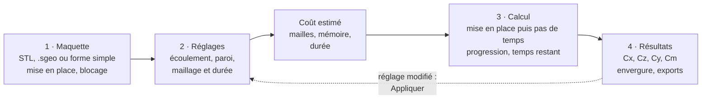
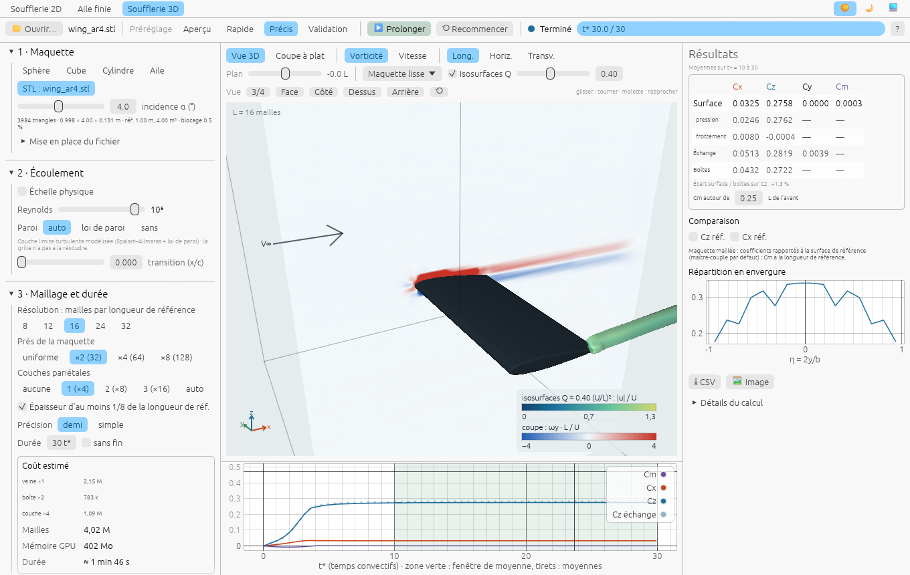
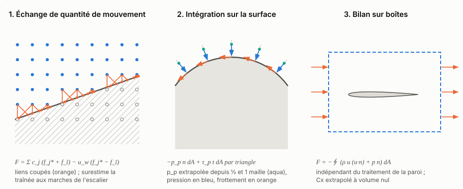
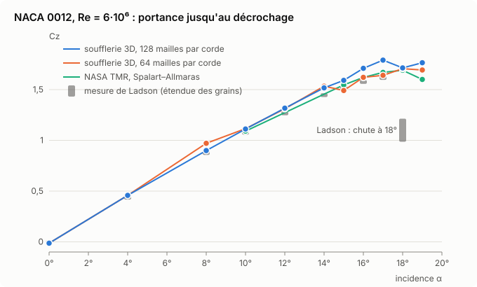

# Soufflerie numérique `soufflerie-rs` — présentation

**Présentation** · [Méthode scientifique](methode_scientifique.md) · [Fonctionnement technique](technique.md) · [README](../README.md)

| Document | Pour qui | Contenu |
| --- | --- | --- |
| **Présentation** (ce document) | utilisateur | ce que fait l'outil, comment s'en servir, ce qui est validé |
| [Méthode scientifique](methode_scientifique.md) | numéricien, aérodynamicien | équations, modèles, validation chiffrée, forces et limites |
| [Fonctionnement technique](technique.md) | développeur | code, GPU, stockage, mise en place, raffinement, tests, compilation |

> [!NOTE]
> Le [README](../README.md) reste le journal détaillé des essais. Chaque
> chiffre de cette documentation y est repris d'une section précise, citée
> entre guillemets (« Corps d'Ahmed », « Décrochage »…).

**Sommaire** — [1. Ce que fait l'outil](#1-ce-que-fait-loutil) ·
[2. Interface 3D](#2-interface-3d) · [3. Ligne de commande](#3-ligne-de-commande) ·
[4. Ce qui est validé](#4-ce-qui-est-validé) · [5. Matériel](#5-matériel)

## 1. Ce que fait l'outil

`soufflerie-rs` est une soufflerie numérique fondée sur la méthode de
Boltzmann sur réseau (LBM). Elle calcule l'écoulement d'air ou d'eau autour
d'une maquette et en tire les efforts (traînée, portance, dérive, moment de
tangage), leur répartition en envergure et le champ (vitesse, vorticité,
critère Q).

Elle réunit plusieurs outils dans une même application, en Rust, pour
Windows, Linux et macOS :

| Outil | Méthode | Usage |
| --- | --- | --- |
| Soufflerie 3D | LBM D3Q19 sur GPU (wgpu : Vulkan, Metal, DirectX 12) | maquettes STL ou formes simples, de Re = 10 à plus de 10⁶ |
| Soufflerie 2D | LBM D2Q9 sur processeur (tous les cœurs) ou GPU | profils, cylindres, plaques |
| Panneaux + couche limite | panneaux tourbillons, couche limite intégrale, couplage faible ou simultané (Newton, à la XFOIL) | référence rapide des profils en écoulement attaché |
| Aile finie | surface portante de Weissinger non linéaire, polaires de section par panneaux | polaire d'une aile en 0,3 s |

Ce document porte surtout sur la soufflerie 3D, qui vise la catégorie des
logiciels Boltzmann commerciaux (PowerFLOW). Elle en reprend plusieurs
choix : réseau cartésien, grilles imbriquées et couches pariétales décalées
de la surface, loi de paroi, modèle k-ε RNG et filtre VLES, paroi
volumique par surfels (en option). Elle en est encore loin sur les
écoulements décollés (section 4).

L'application est un fork natif de l'application web `soufflerie-lbm`
(même moteur 2D, même WGSL 3D), plus rapide et sans les limites de mémoire
du navigateur.

## 2. Interface 3D

Lancement : `cargo run --release -- --tab 3d`, ou directement avec une
maquette (`--stl fichier.stl`). L'onglet « Soufflerie 3D » suit le
déroulement d'un essai :





*Onglet « Soufflerie 3D » : réglages à gauche, vue au centre, résultats à
droite, convergence en bas.*

**Maquette.** « Ouvrir… » (Ctrl+O) ou glisser un `.stl` ou un `.sgeo` sur la
fenêtre. Formes analytiques aussi : sphère, cube, cylindre, aile NACA 0012
d'allongement 4. La mise en place du fichier règle les axes, l'unité,
l'incidence, le dérapage, les longueur et surface de référence, la marge de
la veine, le lissage des facettes et les arêtes vives. Le blocage
(maître-couple sur section de veine) est affiché, avec un avertissement
au-delà de 5 %.

**Réglages** (à gauche, trois groupes repliables) :

1. *Maquette* : forme ou STL, mise en place, diagnostic du maillage.
2. *Écoulement* : Reynolds ou échelle physique (vitesse, air ou eau),
   paroi (loi de paroi ou non), transition imposée. Une ligne dit si la
   couche limite est résolue ou modélisée.
3. *Maillage et durée* : résolution L (mailles par longueur de
   référence), grilles imbriquées ×2 à ×8, couches pariétales, précision
   des nombres, durée en temps convectifs t* = tU/L.

Sous les réglages, le **coût estimé** : mailles de chaque grille, mémoire du
GPU, durée de la mise en place et du calcul. Au-delà de 40 M mailles en
demi-précision (20 M en simple) ou de 6,5 Go, le lancement demande
confirmation.

**Préréglages** (coûts mesurés sur l'aile AR 4 du banc, GTX 1070) :

| Préréglage | Maillage | Durée | Coût |
| --- | --- | --- | --- |
| Aperçu | L = 12, uniforme | 15 t* | quelques secondes |
| Rapide | L = 16, grille ×2 | 25 t* | 2,9 M mailles, 24 s |
| Précis | L = 16, ×2 et une couche ×4 (au moins 1/8 de corde) | 30 t* | 4,3 M mailles, 100 s |
| Validation | L = 16, ×2 et couches automatiques | 40 t* | 36 M mailles, une heure et plus |

**Calcul.** Il ne démarre pas tout seul : le GPU est souvent partagé.
▶ Lancer (Espace), Pause, Prolonger (moitié de la durée en plus),
Recommencer (Ctrl+R). Un réglage physique modifié après un calcul attend
« Appliquer » (Ctrl+Entrée) : un résultat n'est jamais perdu par un clic.
Pendant la mise en place, la barre d'état montre l'étape en cours
(voxelisation, couches, tampons du GPU, compilation des calculs, raccords)
et le temps restant estimé ; pendant le calcul, t* atteint, le reste estimé
et la vitesse.

**Vue** (au centre) : vue 3D orbitale calculée sur le GPU par lancer de
rayons (maquette ombrée, plan de coupe en vitesse ou vorticité, isosurfaces
du critère Q), ou coupe à plat ; vues prédéfinies (touches 1 à 5) ;
maquette lisse, avec la grille, ou en mailles du calcul (ce que voit le
solveur).

**Résultats** (à droite) : Cx, Cz, Cy et Cm selon trois mesures
indépendantes — intégration sur la surface (pression et frottement),
échange de quantité de mouvement aux parois, bilan sur deux boîtes autour
de la maquette — et leur écart ; répartition de la portance en envergure ;
comparaison à des valeurs saisies (mesure, VSPAERO) ; efforts en newtons à
l'échelle physique ; exports CSV (Ctrl+E) et PNG (Ctrl+S). En bas, la
convergence de Cx, Cz et Cm avec la fenêtre de moyenne.



*Les trois mesures des efforts. Le bilan sur boîtes, qui ne dépend pas du
traitement de la paroi, sert d'arbitre ; détails dans la
[méthode](methode_scientifique.md#7-mesure-des-efforts).*

Raccourcis : F1. Captures et essais sans souris par variables
d'environnement (`SOUFFLERIE_CAPTURE`, `SOUFFLERIE_TOUCHES`, voir
[technique](technique.md#9-variables-denvironnement)).

## 3. Ligne de commande

La commande `soufflerie` (`cargo run --release -- <sous-commande>`) donne
les mêmes calculs sans interface :

| Sous-commande | Rôle |
| --- | --- |
| `run`, `polar` | soufflerie 2D : un calcul, une polaire (incidences en parallèle) |
| `panel` | panneaux + couche limite, polaire en quelques millisecondes |
| `wing` | aile finie |
| `run3d` | soufflerie 3D : efforts moyens, répartition en envergure, images |
| `geom` | contrôle géométrique d'une maquette STL, export `.sgeo` |
| `bench` | vitesse des moteurs 2D |

Exemple de calcul 3D d'une aile en flèche (NACA TR-1208), maillage
automatique de 64 mailles par corde moyenne à la paroi :

```sh
soufflerie geom  --stl TR1208.stl --unite in --lref 16.672 --sref 2024.35 --alpha 4 --exporter TR1208.sgeo
soufflerie run3d --stl TR1208.sgeo --l 8 --raff-auto 64 --re 4e6 --marge 0.4 --t 20 --avg 8
```

Options principales de `run3d` :

| Option | Rôle |
| --- | --- |
| `--l 16` | mailles par longueur de référence (veine) |
| `--re 1e6`, `--vitesse 30 --fluide air` | Reynolds, ou échelle physique |
| `--raff 1..3` | 1 à 3 grilles imbriquées (×2 à ×8) autour de la maquette |
| `--bande 16,16` ou `auto`, `--bande-corde 0.125` | couches pariétales creuses, chacune deux fois plus fine |
| `--raff-auto N` | raffinement automatique : N mailles par longueur de référence à la paroi |
| `--turb auto\|sa\|off`, `--xtr 0.3` | turbulence et loi de paroi ; transition imposée |
| `--t 40 --avg 15` | durée et fenêtre de moyenne (temps convectifs) |
| `--envergure f.csv`, `--xref` | répartition en envergure ; point du moment de tangage |
| `--sol h` | sol mobile (véhicules ; pas encore avec le raffinement) |
| `--fp32 1` | simple précision (demi-précision par défaut) |
| `--image vue.ppm`, `--coupe c.ppm` | vue 3D, coupe de vorticité |

La liste complète est dans le README (« Maquettes STL (3D) »,
« Installation »).

**Bancs et programmes de diagnostic.** `lbm/examples` contient une
quarantaine de programmes (`cargo run --release -p lbm --example <nom>`).
Les principaux :

- `banc3d` : banc de vitesse et de non-régression (cas `sphere`, `ar4`,
  `ar4b`, `ar4c3`, `ahmed`, `aile`…), durées par passe, efforts à temps
  fixé, comparaison maille par maille à une référence ;
- `aile_infinie` : NACA 0012 d'envergure infinie à Re = 6·10⁶ contre les
  mesures de Ladson et la NASA TMR, avec de nombreux relevés ;
- `ahmed` : corps d'Ahmed 25° et 35° sur sol mobile ;
- `marche` : marche descendante de Driver et Seegmiller ;
- `plaque3d` : couche limite turbulente d'une plaque plane ;
- `decrochage2d`, `decamber2d` : balayages 2D par couplage Newton.

Les scripts de `tools/` (`validation3d.sh`, `decrochage.sh`,
`comparaison_vspaero.sh`…) refont les séries de validation.

## 4. Ce qui est validé

Résumé ; chiffres, conditions et références dans la
[méthode scientifique](methode_scientifique.md#9-validation).

**Tests automatiques** (`cargo test --release`, environ 90 tests) :
cas 2D identiques à l'application web à 10⁻³ près, accord des moteurs
processeur et GPU (10⁻⁵), sphère 3D, maquettes STL et parois minces,
conservation et ordre de convergence des surfels, correction du défaut
cubique du D3Q19, couche limite intégrale, géométrie.

**Cas de référence 3D et écarts aux mesures** (état actuel, sans facteur de
recalage) :

| Cas | Résultat | Lecture |
| --- | --- | --- |
| Sphère, Re = 20 à 1000 | Cx à +0,5 à +14 % de Schiller–Naumann (D = 16) | correct à modéré ; l'écart décroît en affinant |
| Aile NACA TR-1208 (flèche 45°), Re = 4·10⁶ | Cz +9 à 10 % sur la mesure, +3 à 6 % sur VSPAERO ; Cx boîte 1,3 fois la mesure | portance correcte, traînée trop forte |
| Aile rectangulaire AR 4, Re = 10⁶ | portance moyenne sur le placement 0,269 à ×8 (VSPAERO 0,265) | correct |
| Aile infinie NACA 0012, Re = 6·10⁶ | Cz à 0–5 % de Ladson de 0 à 8° ; Cx 1,6 à 2,2 fois la mesure | traînée trop forte |
| Décrochage du NACA 0012 | pas de décrochage : Cz plafonne à 1,7–1,8 | faux |
| Plaque plane turbulente | frottement à 10 % de la théorie ; couche limite 1,4 à 6 fois trop épaisse selon la résolution | partiel |
| Marche de Driver et Seegmiller | recollement à 8 % de la mesure ; Cf aval 2 à 3 fois trop élevé | partiel |
| Corps d'Ahmed 25° (L = 136) | Cx boîte 0,340 contre 0,285 (+19 %) | culot trop aspirant |
| Corps d'Ahmed 35° | lunette collée, Cx 0,61 contre 0,26 ; une option corrige le régime (Cx 0,48 à L = 96), non validée | faux par défaut |



*Le défaut principal en une figure : jusqu'à 14°, la portance suit la
mesure de Ladson et le calcul de référence de la NASA (TMR) ; au-delà, elle
plafonne au lieu de chuter à 18°.*

> [!TIP]
> **Fiable** : la portance en écoulement attaché, à quelques pour cent à
> 10 % des références, et les tendances. Le décollement aux arêtes vives à
> 90° est capté (marche).

> [!WARNING]
> **À utiliser avec prudence**
> - La traînée reste 1,3 à 3 fois trop forte selon les cas : une perte
>   numérique près de la paroi, qui décroît en affinant.
> - Les écoulements décollés sur paroi lisse (décrochage de bord de fuite,
>   lunette d'Ahmed à 35°) ne sont pas captés.

> [!NOTE]
> Plusieurs options (surfels, TBLE, k-ε RNG, VLES, arêtes convexes) sont
> disponibles mais désactivées par défaut : elles n'ont pas passé la
> validation.

## 5. Matériel

Mise au point sur une NVIDIA GTX 1070 (8 Go) de portable. La plus grande
grille utilisée (corps d'Ahmed, L = 136) fait 43 M mailles et 5,7 Go ; le
calcul par défaut est en demi-précision (≈ 100 octets par maille avec
toutes les grilles). Sur cette carte, les collisions atteignent la bande
passante mémoire mesurée (≈ 200 Go/s), soit environ 900 à 1 700 millions de
mises à jour de maille par seconde selon le cas.

Installation, compilation sous Windows (chaîne GNU) et organisation du code :
[technique](technique.md).

---

**Présentation** · [Méthode scientifique →](methode_scientifique.md) · [Fonctionnement technique →](technique.md)
