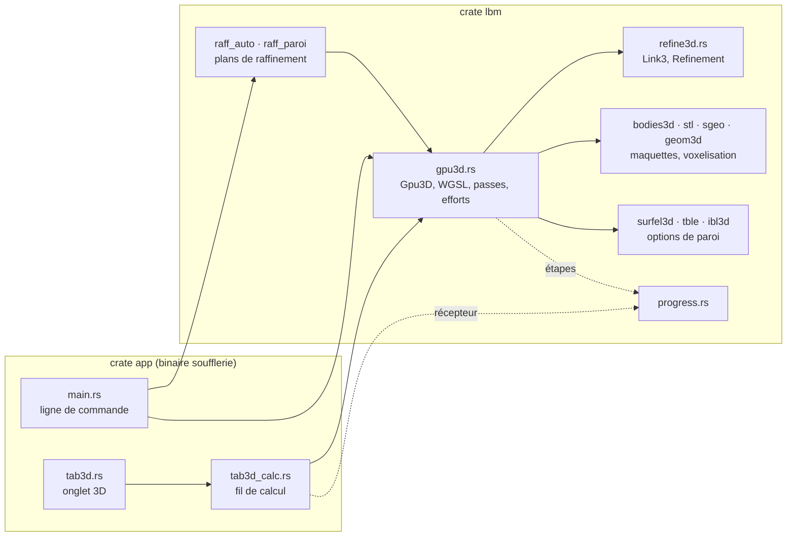
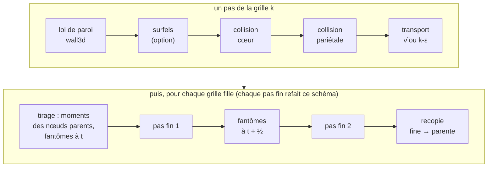
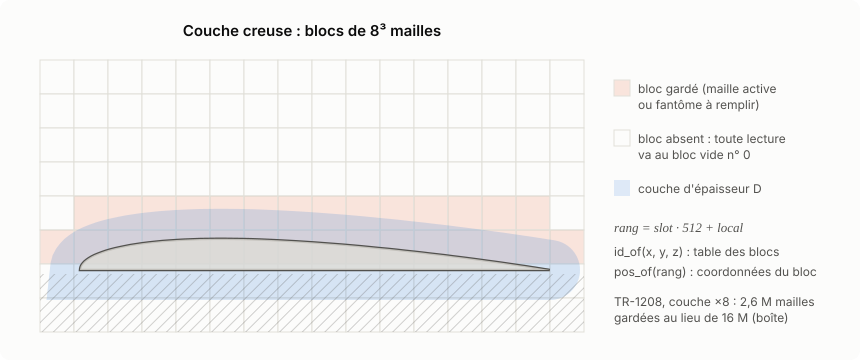
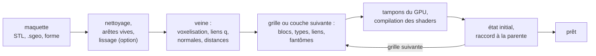
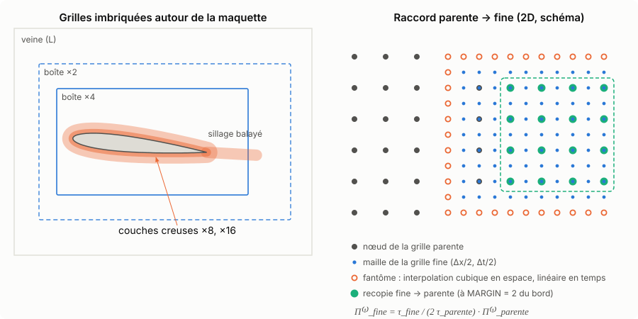
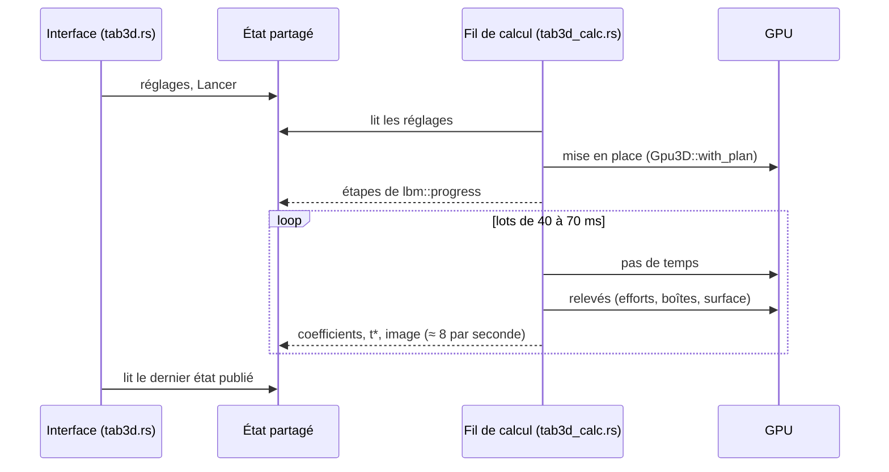

# Fonctionnement technique de `soufflerie-rs`

Algorithmes et implémentation de la soufflerie 3D : organisation du code,
calcul sur GPU, stockage, mise en place, raffinement, interface, tests.

[Présentation](presentation.md) · [Méthode scientifique](methode_scientifique.md) · **Fonctionnement technique** · [README](../README.md)

> [!NOTE]
> Les équations et la validation chiffrée sont dans la
> [méthode scientifique](methode_scientifique.md). Les sections du
> [README](../README.md) sont citées entre guillemets. État du code au
> commit `aa75c67` (novembre 2026).

**Sommaire**

1. [Organisation](#1-organisation)
2. [Le solveur 3D sur GPU](#2-le-solveur-3d-sur-gpu)
3. [Stockage](#3-stockage)
4. [Mise en place](#4-mise-en-place)
5. [Raffinement](#5-raffinement-refine3drs)
6. [Efforts et relevés](#6-efforts-et-relevés)
7. [Variantes et diagnostics](#7-variantes-et-diagnostics-dans-le-solveur)
8. [Interface egui](#8-interface-egui)
9. [Variables d'environnement](#9-variables-denvironnement)
10. [Tests et bancs](#10-tests-et-bancs)
11. [Compilation](#11-compilation)

## 1. Organisation

Espace de travail Cargo à deux crates (Rust 2021, licence MIT) :

```
soufflerie-rs/
├── lbm/        bibliothèque de calcul (crate `lbm`, option `gpu` : wgpu 30)
│   ├── src/        modules (ci-dessous)
│   ├── examples/   ≈ 40 programmes de diagnostic et bancs
│   └── tests/      tests d'intégration
├── app/        application `soufflerie` : ligne de commande et interface egui
├── banc/       banc de vitesse 3D : maquette, références, scripts de comparaison
├── tools/      scripts des séries de validation (validation3d.sh, decrochage.sh…)
├── validation/ résultats de validation (CSV)
└── docs/       cette documentation
```

Profil `release` : `opt-level = 3`, `codegen-units = 1`, LTO léger. Les
tests tournent aussi optimisés (`profile.test`, `opt-level = 3`).

Dépendances entre les principaux modules de la soufflerie 3D :



### 1.1 Crate `lbm`

| Module | Rôle |
| --- | --- |
| `gpu3d.rs` (≈ 7 200 lignes) | soufflerie 3D : `Gpu3D`, génération du WGSL, passes, efforts, coupes et rendu 3D |
| `refine3d.rs` | raffinement 3D : `Link3` (raccord parent–enfant), `Refinement`, ordonnancement des pas |
| `raff_auto.rs`, `raff_paroi.rs` | plans de raffinement automatiques (`--raff-auto`) et par zones du critère β |
| `bodies3d.rs` | maquettes 3D (`Body3D` : formes analytiques, maillages), voxelisation, distance à la paroi, corps d'Ahmed |
| `stl.rs`, `sgeo.rs`, `geom3d.rs` | lecture et nettoyage STL, format `.sgeo`, prétraitement (arêtes vives, lissage, contrôle par tranche) |
| `surfel.rs`, `surfel3d.rs` | surfels : géométrie exacte (processeur), tables du GPU |
| `tble.rs`, `ibl3d.rs` | loi de paroi TBLE ; couche limite intégrale sur maillage (transpiration) |
| `progress.rs` | avancement de la mise en place, pour l'interface |
| `d2q9.rs`, `cpu.rs`, `gpu.rs`, `refine.rs`, `*.wgsl` | soufflerie 2D : réseau, moteur processeur, moteur GPU, raffinement 2D |
| `sa.rs`, `wall.rs`, `tunnel.rs`, `geometry.rs`, `shapes.rs`, `stats.rs` | 2D : Spalart–Allmaras et Spalding, relevés pariétaux, veine, géométrie, moyennes |
| `panel.rs`, `vii.rs`, `wing.rs` | panneaux et couche limite intégrale, couplage Newton, aile finie |
| `fwh.rs` | Ffowcs Williams–Hawkings 2D, Curle |

Les modules GPU (`gpu`, `gpu3d`, `refine`, `refine3d`, `raff_auto`,
`raff_paroi`) n'existent qu'avec l'option `gpu` (par défaut).

### 1.2 Crate `app` (binaire `soufflerie`)

| Fichier | Rôle |
| --- | --- |
| `main.rs` | ligne de commande : `run`, `polar`, `panel`, `wing`, `run3d`, `geom`, `bench` ; sans sous-commande, l'interface |
| `launch.rs` | lancement surveillé de l'interface dans un processus enfant, repli sur un autre rendu si le pilote plante |
| `gui.rs`, `theme.rs` | fenêtre, onglets, thème clair ou sombre |
| `tab3d.rs` | onglet « Soufflerie 3D » : réglages, coût estimé, vue, résultats, exports |
| `tab3d_calc.rs` | fil de calcul de l'onglet 3D : construction de la veine, lots de pas, relevés |
| `wing_tab.rs`, `sweep.rs`, `worker.rs` | onglets aile finie et polaire ; fil de calcul 2D (image, traceurs) |
| `capture.rs` | captures PNG et essais au clavier sans souris |

Options de compilation : `gui` (eframe 0.37 avec rendus glow et wgpu,
egui_plot, rfd, png) et `gpu`. Sans interface :
`cargo build --release --no-default-features --features gpu`.

## 2. Le solveur 3D sur GPU

### 2.1 wgpu et WGSL engendré

Le calcul passe par wgpu (Vulkan, Metal, DirectX 12, OpenGL), en *compute
shaders* WGSL. Le WGSL n'est pas écrit à la main mais **engendré depuis
Rust** (`format!` sur des gabarits de `gpu3d.rs` et `refine3d.rs`) :

- les 19 directions sont déroulées à la génération (propagation, collision,
  liens de Bouzidi, bandes absorbantes), coefficients en littéraux ;
- chaque grille a sa collision **spécialisée** : modèle de turbulence,
  sous-maille, bords, stockage et diagnostics sont des constantes du shader,
  et les pipelines sont recompilés s'ils changent (−2 à −7 %) ;
- les options désactivées sont retirées du texte (marqueurs `/*M3[*/ …
  /*]M3*/` de la correction de Mach, bits de `set_essai`) : le défaut reste
  identique à l'octet (test `collision_par_defaut_sans_correction`) ;
- les shaders sont créés sans les contrôles d'exécution de wgpu
  (`create_shader_module_trusted`, `ShaderRuntimeChecks::unchecked()`) ;
  `SOUFFLERIE_CONTROLES=1` les rétablit.

`SOUFFLERIE_WGSL=dossier` écrit chaque shader engendré dans le dossier, ou
le relit s'il y est déjà : essais de shaders sans recompiler
(`banc/ab.sh`). Le pilote est choisi dans l'ordre Vulkan, Metal, puis
DirectX 12 (sous DirectX 12, le gros shader de collision est environ 100
fois plus lent) ; `SOUFFLERIE_GPU3D=dx12|vulkan|gl` en impose un.

### 2.2 Un pas de temps

Une grille fait, à chaque pas, les passes suivantes (`refine3d::encode`) :

| Passe | Mailles | Rôle |
| --- | --- | --- |
| loi de paroi (`wall3d`) | pariétales | sur le champ du pas précédent : relevé à h = 2 mailles, u_τ de Spalding (ou TBLE), glissement relaxé, ν de la couche pariétale |
| surfels (option) | surfels | rassemblement et réflexion |
| collision | cœur (sans lien de paroi) | propagation « pull » et collision régularisée fusionnées |
| collision pariétale | pariétales (liste `wcell`) | même collision, plus les liens de Bouzidi et l'échange de quantité de mouvement |
| ν̃ (`sa3d`) ou k-ε (`ke3d`) | toutes | transport explicite du modèle de turbulence |

puis, pour chaque grille fille, les **raccords** : tirage (moments des nœuds
parents, interpolation, remplissage des fantômes), deux pas de la grille
fille (récursivement), remplissage du second demi-pas, recopie vers la
parente (§ 5).



La loi de paroi a sa propre passe parce que, fusionnée à la collision, elle
lisait des vitesses voisines que la même passe réécrivait : les calculs
avec loi de paroi n'étaient pas reproductibles (10⁻⁵ à 10⁻³ d'écart relatif
sur les efforts d'un lancement à l'autre). Ils le sont désormais au bit
près.

Les mailles des grilles parentes recopiées de la grille fine, et dont les
six voisines le sont aussi (`COVERED`, `mark_covered`), sautent la collision
et ν̃ (`SOUFFLERIE_RECOUVERT=0` pour comparer).

### 2.3 Soumissions

Les pas sont encodés par lots dans une même passe de calcul ; les paramètres
de chaque pas (vitesse d'entrée et accélération de la mise en vitesse)
sont écrits dans un tampon uniforme à décalage dynamique (créneaux de
256 octets, 64 par lot). Un lot vise ≈ 3·10⁷ mises à jour de maille, pour
ne pas déclencher la réinitialisation du pilote Windows (2 s). Au plus
8 soumissions sont en vol (`EN_VOL_MAX`) : sans cette borne, tous les pas de
la mise en vitesse s'empilaient côté hôte (7 à 9 Go au-delà de 1,5·10⁷
mailles) ; avec elle, le corps d'Ahmed passe de 15 à 43 M mailles.

### 2.4 Efficacité

Bande passante atteignable mesurée sur la GTX 1070 (exemple
`bande_passante`) : 200 Go/s en lecture et écriture, 78 % des 256 Go/s
annoncés. Profil `banc3d ar4c3 --profil 1` (« Vitesse de calcul 3D ») :

| Passe | Octets par maille | Part de 200 Go/s |
| --- | --- | --- |
| collision, couche ×16 (15,5 M mailles) | ≈ 96 | ≈ 100 % |
| collision, veine d'Ahmed (4,48 M) | ≈ 96 | 82 % |
| transport de ν̃, couche ×16 | ≈ 32 | 92 % |
| collision pariétale, couche ×16 (0,61 M) | ≈ 250 | 39 % |
| raccords | — | faible |

Collisions et transport (≈ 60 % du pas) sont limités par la mémoire : seule
une baisse des octets les accélérerait. La marge est dans les raccords
(≈ 34 %) et la collision pariétale (≈ 9 %), aux accès dispersés. Les
optimisations faites et écartées, avec leurs gains mesurés, sont listées
dans le README ; toutes sauf deux rendent des champs identiques au bit.

## 3. Stockage

### 3.1 Populations

Les populations sont rangées décalées de leur poids, $g_i = f_i - w_i$
(meilleure précision relative près de l'équilibre), en **demi-précision**
par défaut (`--fp32 1` : simple précision), avec deux jeux (lecture et
écriture alternées d'un pas à l'autre). Deux rangements, choisis grille par
grille :

- **grilles boîtes** : une population par case de 16 bits (`array<u16>`,
  `enable wgpu_int16`, VK_KHR_16bit_storage), plan de N cases par
  direction. Chaque population tirée d'un voisin est une lecture de
  2 octets contiguë d'un fil à l'autre (−10 à −16 % sur la collision).
  `SOUFFLERIE_U16=0` revient aux mots ;
- **couches creuses** : deux populations par mot de 32 bits
  (`pack2x16float`), directions appariées selon la rangée x d'où elles
  sont tirées ((+x, −x), (+x+y, −x+y)…, constante `HS`) : le mot sert à deux
  fils voisins. Les cases de 16 bits y étaient 12 % plus lentes.
  `SOUFFLERIE_PAIRES=0` rend l'ordre des directions.

La conversion utilise l'unité de conversion du GPU (`unpack2x16float`). Le
même calcul en simple précision donne les mêmes Cp à 0,006 près sur TR-1208
(« Bord d'attaque, pression pariétale… ») ; sphère à Re = 100 : 1,178 en
simple, 1,175 en demi.

### 3.2 Autres tampons

| Tampon | Contenu | Taille |
| --- | --- | --- |
| populations | deux jeux de 19 valeurs de 16 bits | 76 à 80 octets par maille |
| `macroBuf` | (u, ρ) en `vec4<f32>` | 16 octets par maille |
| `wall` | type de maille : fluide, solide (`0xffffffff`), fantôme (`0xfffffffe`), recouverte (`0xfffffffd`), ou rang pariétal | 4 octets |
| `plain` | masque d'un bit des mailles fluides ordinaires | 1 bit |
| ν̃, ou k et ε par paires, plus ν_t filtré en VLES | modèle de turbulence | k-ε : 8 octets de plus que SA ; VLES : 4 de plus |
| `qa`, `ca` | 18 fractions de Bouzidi et 18 normales codées (octaèdre) par maille pariétale | 144 octets par maille pariétale |
| `utau` | u_τ, vitesse de glissement (3), vitesse de transpiration, ν de la couche pariétale | 24 octets par maille pariétale |
| `force` | échange de quantité de mouvement par maille pariétale | 16 octets |

Ordre de grandeur, toutes grilles : ≈ 100 octets par maille en
demi-précision (`bytes_per_cell`). Limites pratiques sur 8 Go : 40 M
mailles en demi-précision, 20 M en simple (le corps d'Ahmed à L = 136 fait
43 M mailles et 5,7 Go).

### 3.3 Grilles creuses par blocs



Les couches pariétales sont rangées par blocs de 8³ mailles (`SparseMap`,
`SB = 8`) : seuls les blocs qui contiennent une maille active ou une
fantôme à remplir sont gardés. Le rang d'une maille est `slot · 512 +
local` ; le bloc de rang 0 est un bloc vide de fantômes qui reçoit toute
lecture hors des blocs. Les shaders passent par deux fonctions engendrées :
`id_of(x, y, z)` (table des blocs) et `pos_of(rang)` (coordonnées du bloc).
La collision des couches ne lance que les mailles à calculer (liste
`wcell` : pariétales d'abord, puis cœur), sans lire leur type. Exemple :
TR-1208 à 8°, couche ×8, 2,6 M mailles gardées au lieu de 16 M dans la
boîte, mêmes efforts (Cz 0,5582 contre 0,5583).

La mise en place d'une couche s'arrête en erreur si une maille active a une
voisine hors des blocs (défaut corrigé du sillage balayé, « Raffinement de
paroi par zones »).

## 4. Mise en place

`Gpu3D::with_plan(body, nu, u, fp16, turbulence, plan)` construit la veine
puis chaque grille du plan (`RefinePlan` : boîtes, couches `LayerSpec`,
grilles des bords, zones).



*Chaque flèche est une étape signalée à `lbm::progress` (§ 4.3).*

### 4.1 Géométrie

- **Lecture STL** (`stl.rs`) : sommets soudés à 10⁻⁷ de la diagonale,
  triangles dégénérés et doubles retirés, arêtes comptées (trous, arêtes non
  manifold, orientations incohérentes). Triangles rangés par cases de la
  longueur médiane des arêtes pour les recherches de distance.
- **Appartenance** : parité des traversées d'un rayon selon x ; maillage
  ouvert : vote à la majorité sur trois rayons (x, y, z).
- **Liens de paroi** : pour chaque maille fluide, les liens qui coupent la
  surface reçoivent leur fraction q (intersection exacte avec les
  triangles, ou bisection sur une forme analytique), y compris entre deux
  mailles fluides (parois minces), et la normale de la face touchée (Phong,
  codée sur l'octaèdre). Liens cherchés seulement à moins de 1,5 maille de la
  surface.
- **Distance à la paroi** (Spalart–Allmaras, VLES) : exacte à moins de
  3 mailles, transformée de chanfrein (1, √2, √3) au-delà dans une boîte de
  1,5 L autour de la maquette. Pour les couches : distance par coques
  croissantes, bornée par celle du centre du bloc.
- **Mailles d'arête vive** : liens touchant des faces à plus de 60° (ou
  arêtes du maillage avec `--aretes maillage`) ; arêtes convexes franchies
  avec `SOUFFLERIE_ARETE_CONVEXE`.
- **Bord de fuite** : `te_snap` cale le point le plus en aval à 0,7 maille
  après un nœud de la veine.

Le processeur fait la mise en place en parallèle (rayon). Coût mesuré :
0,3 s plus 0,4 s par million de mailles sur la GTX 1070 (sphère 1,8 M :
0,75 s ; `ar4c3`, 24 M : 9,2 s).

### 4.2 Couches

Les blocs d'une couche sont choisis par la distance de leur centre au
maillage, puis classés maille par maille : solide, active (à moins de D de
la paroi), fantôme. `band_fill` liste les fantômes voisines d'une maille
active (à remplir depuis la parente) ; `band_deep` les mailles actives à
plus de 2 MARGIN + 1 de toute fantôme (recopiées vers la parente).
`nested_bands` impose $D_\text{parente} \ge D/2 + 2\,\text{MARGIN} + 3$.
`--bande auto` choisit le nombre de couches d'après le plus petit rayon de
bord d'attaque des coupes (au moins 2 mailles, au plus 4 couches) ; au-delà
de 40 M mailles en tout, la mise en place s'arrête.

### 4.3 Avancement (`lbm::progress`)

La mise en place signale ses étapes (préparation de la maquette, ouverture
du GPU, puis par grille : voxelisation et liens, couche, tampons du GPU,
compilation des calculs, état initial, raccord à la grille parente) et la
part faite, au jugé (grilles de poids égaux). Le fil qui construit la veine
installe un récepteur (`progress::set_sink`) ; sans récepteur (ligne de
commande, bancs), l'appel ne fait rien. Les étapes sont signalées aux mêmes
points que les durées de `SOUFFLERIE_TEMPS=1`. Coût : une vingtaine d'appels
par grille, aucun effet sur le calcul.

## 5. Raffinement (`refine3d.rs`)

### 5.1 Structure

`Refinement` tient les grilles fines (`levels`, chacune un `Gpu3D`), leur
parent (`parent`), leur niveau (`depth`, facteur 2^depth) et leurs
raccords (`links`). Les grilles forment un arbre : plusieurs grilles sœurs
au même niveau sont possibles (grilles des bords). Chaque grille ne compte,
pour les efforts, que dans son domaine propre (`core`), sans double compte.

### 5.2 Raccord `Link3`



Un `Link3` relie une grille fine à sa parente :

- **enveloppe de fantômes** de la grille fine, remplie depuis la parente.
  Passe de **tirage** en deux temps : moments de chaque nœud parent une
  seule fois (un nœud sert jusqu'à 64 fantômes), puis interpolation
  cubique (pochoir ±2, linéaire près d'une paroi) par groupes de
  128 fantômes consécutifs touchant au plus 256 nœuds parents, dont les
  moments sont lus une fois dans la mémoire partagée du groupe (12 ko) ;
  remise à l'échelle de $\Pi^{(1)}$ et reconstruction régularisée.
  Interpolation linéaire en temps : le premier demi-pas est rempli avec le
  tirage, le second (`fill_at`) entre les deux pas fins ;
- **raccord qui coupe la paroi** : le tirage refait le pas pariétal de la
  grille parente (liens de Bouzidi, glissement, viscosité pariétale) pour
  les fantômes voisines de la paroi (`SOUFFLERIE_RACCORD_PAROI=0` : ancien
  tirage par rebond simple) ;
- **recopie** : les mailles de la parente sous la zone raffinée, à
  MARGIN = 2 mailles parentes du bord, reçoivent l'état de la grille fine,
  parcourues dans l'ordre de stockage de la parente. Pour une couche, la
  liste est `band_deep`, limitée à la bande pariétale (pas au sillage).

$\tilde\nu$ (ou k, ε) suit la même voie. Profil par passe :
`Gpu3D::profile_passes` (« tirage, moments des nœuds », « tirage,
interpolation et remplissage », « remplissage », « recopie »).

### 5.3 Plans automatiques

`raff_auto::auto_plan` traduit `--raff-auto N` en plan : enveloppes exactes
des régions (maquette ± d_k, sillage balayé) pour les niveaux
intermédiaires (boîtes), couche creuse avec sillage (`LayerSpec::wake`) au
niveau de la paroi. `raff_paroi::zones` construit les zones du critère β
(`aile_infinie --raff-paroi n`) à partir d'un premier calcul moyenné.

## 6. Efforts et relevés

- **Échange de quantité de mouvement** : accumulé par maille pariétale dans
  la collision pariétale (tampon `force`), lu par `take_forces` ; par grille,
  hors des grilles plus fines.
- **Surface** (`Gpu3D::surface_forces`, maquettes STL) : sur le processeur,
  à partir du champ de la grille la plus fine qui entoure chaque triangle ;
  pression extrapolée depuis ½ et 1 maille (`SOUFFLERIE_PWH="h1,h2"` les
  change), frottement de la loi à h, triangles découpés au-delà d'une maille.
- **Boîtes** (`box_forces_vol`) : bilan de flux sur la grille entière la
  plus fine, plusieurs marges, extrapolation à volume nul.
- **Sillage** (`wake_drag`), **envergure** (`span_distribution`), **Cm**.

`run3d` moyenne ces mesures sur la fenêtre `--avg`, un relevé par demi-temps
convectif.

## 7. Variantes et diagnostics dans le solveur

`Gpu3D::set_essai(bits, nu_cap)` active des variantes de diagnostic,
compilées comme constantes de la collision (bits à 0 : code identique). Les
bits sont documentés dans `gpu3d.rs` (commentaires de `set_essai`) et dans
le README, essai par essai (glissement libre 16, contrainte imposée 16384,
Townsend–Mellor 8388608, `MACH3_BIT` = 2²⁸…). `ahmed --essai` et
`aile_infinie` les passent en argument.

Modèle de turbulence : `Turbulence::{Laminar, Sa, KEpsRng, Vles}` à la
construction ; `Turbulence::rans_from_env()` lit `SOUFFLERIE_RANS` pour les
bancs.

## 8. Interface egui

**`tab3d.rs`** : l'onglet « Soufflerie 3D » (≈ 2 300 lignes). Réglages en
trois groupes, préréglages, estimation du coût avant lancement (grilles
boîtes reprises de `Gpu3D::with_refinement_edges`, test
`estimation_des_grilles` ; couches estimées par la surface mouillée à
±25 %), état « Réglages modifiés » (Appliquer / Annuler), vue 3D et coupe,
résultats, exports CSV et PNG, raccourcis.



**`tab3d_calc.rs`** : le fil de calcul. Il construit la veine (avec le
récepteur de `lbm::progress`), avance par lots dont la durée est ajustée
entre 40 et 70 ms, relève les efforts (les mêmes que `run3d` : surface,
échange, deux boîtes, Cm, envergure) et publie l'état et l'image.
L'interface ne fait que lire le dernier état publié. L'image n'est refaite
qu'environ 8 fois par seconde pendant le calcul (tout de suite si la vue
change). La vue 3D est rendue sur le GPU par lancer de rayons dans le champ
(passe `RENDER_WGSL`), puis relue.

**`launch.rs`** : l'interface tourne dans un processus enfant surveillé ;
si un pilote la fait planter, le code d'erreur est expliqué et un autre
rendu est essayé (Windows : wgpu sur DirectX 12, puis OpenGL, puis wgpu
avec tous les pilotes). `--rendu glow|dx12|vulkan|wgpu` en impose un.

**`capture.rs`** : captures et essais sans souris (§ 9).

## 9. Variables d'environnement

Aucune n'est nécessaire au calcul par défaut. Principales :

| Variable | Effet |
| --- | --- |
| `SOUFFLERIE_GPU3D`, `SOUFFLERIE_GPU2D` | pilote du calcul (`dx12`, `vulkan`, `gl`) |
| `SOUFFLERIE_RENDU` | rendu de l'interface (`glow`, `wgpu`) |
| `SOUFFLERIE_TEMPS=1` | durées de chaque étape de la mise en place |
| `SOUFFLERIE_WGSL=dossier` | écrit ou relit les shaders engendrés |
| `SOUFFLERIE_CONTROLES=1` | rétablit les contrôles d'exécution des shaders |
| `SOUFFLERIE_WG` | taille des groupes de la collision (64 par défaut) |
| `SOUFFLERIE_U16=0`, `SOUFFLERIE_PAIRES=0` | anciens rangements des populations |
| `SOUFFLERIE_RECOUVERT=0` | calcule aussi les mailles recouvertes |
| `SOUFFLERIE_RACCORD_PAROI=0` | ancien tirage des fantômes près d'une paroi |
| `SOUFFLERIE_RANS=sa\|keps\|vles\|laminaire` | modèle des bancs (`aile_infinie`, `plaque3d`, `ahmed`, `cylindre3d`) |
| `SOUFFLERIE_TBLE=eq\|gp\|gpc` | loi de paroi TBLE (bancs) |
| `SOUFFLERIE_SURFELS=1`, `SOUFFLERIE_SURFELS_O1=1` | paroi par surfels ; schéma d'ordre 1 d'origine |
| `SOUFFLERIE_ARETE_CONVEXE=1` (ou un angle) | paroi adhérente près des arêtes convexes franchies |
| `SOUFFLERIE_ARETE_DEG`, `SOUFFLERIE_SANS_LOI`, `SOUFFLERIE_SANS_LOI_BOITE` | diagnostics du décollement (`ahmed`) |
| `SOUFFLERIE_BOITE_ENTIERE=1` | grille des bords remplacée par une boîte entière (contrôle) |
| `SOUFFLERIE_PWH="h1,h2"` | hauteurs des relevés de pression pariétale |
| `SOUFFLERIE_CAPTURE=f.png`, `SOUFFLERIE_CAPTURE_T` | capture de la fenêtre puis fermeture |
| `SOUFFLERIE_TOUCHES="3:espace;8:v"` | touches pressées à ces instants |
| `SOUFFLERIE_THEME=clair\|sombre` | thème imposé |

Les bancs ont leurs propres variables (`AILE_*` pour `aile_infinie`,
`PLAQUE_*` pour `plaque3d`), décrites dans « Programmes de diagnostic ».

## 10. Tests et bancs

### 10.1 Tests

`cargo test --release` (environ 90 tests ; ceux du GPU demandent une
carte) :

| Fichier | Contenu |
| --- | --- |
| `lbm/tests/validate.rs` | 2D contre l'application web : cylindre Re = 20 et 100, NACA 0012, effet Magnus, Spalart–Allmaras |
| `lbm/tests/gpu.rs` | moteur GPU 2D contre processeur, demi-précision, raffinement local |
| `lbm/tests/gpu3d.rs` | sphère Re = 100, sphère STL, paroi mince, loi de paroi 3D, raffinement 3D, transition |
| `lbm/tests/mach3d.rs` | onde de cisaillement advectée, tourbillon convecté, défaut identique sans correction |
| `lbm/tests/surfels.rs` | masse, Poiseuille incliné, sphère, convergence en maillage |
| `lbm/tests/panel.rs`, `wing.rs` | panneaux, couche limite, couplage Newton, aile finie |
| tests unitaires des modules | `stl`, `sgeo`, `geom3d`, `bodies3d`, `surfel`, `surfel3d`, `tble`, `ibl3d`, `raff_auto`, `fwh`… ; `app` : estimation des grilles |

### 10.2 Bancs

`banc3d` (`lbm/examples/banc3d.rs`) reprend la boucle de `run3d` sur des
cas fixes : `sphere`, `ar4`, `ar4b`, `ar4n`, `ar4r2`, `ar4c3` (aile AR 4 du
STL `banc/wing_ar4.stl`, du maillage uniforme à trois couches), `ahmed`,
`ahmedr`, `aile`, `ailer`. Il donne les durées de mise en place, de calcul
et de relevé, les mises à jour de maille par seconde, les efforts à temps
fixé et des sommes de contrôle du champ ; `--champs f.bin --champs-ref
g.bin` compare le champ maille par maille, `--profil 1` mesure chaque passe.

```sh
cargo run --release -p lbm --example banc3d -- ar4b --t 6 --profil 1
```

`banc/compare.py` rapporte les écarts à la dispersion de plusieurs
références (`banc/ref`), `banc/ab.sh` compare deux jeux de shaders,
`banc/vitesse.sh avant.exe apres.exe n` deux binaires en alternance
(`PAUSE=10` laisse refroidir la carte, dont la fréquence baisse en charge).

Règle de travail : une optimisation doit rendre un champ identique au bit,
ou des efforts moyens dans la dispersion de la version précédente. Le coût
de chaque modification est consigné dans le README (« Coût de calcul des
modifications »).

> [!WARNING]
> La GTX 1070 de développement est partagée : vérifier `nvidia-smi` avant
> toute mesure ou tout calcul, et ne jamais arrêter les calculs des autres.
> Les durées mesurées sur un GPU chargé varient de ±30 %.

## 11. Compilation

```sh
cargo run --release                  # interface
cargo test --release                 # validation
RUSTFLAGS="-C target-cpu=native" cargo run --release   # processeur de la machine (moteur 2D)
```

**Windows, chaîne GNU** (`stable-x86_64-pc-windows-gnu`). Un dossier
`target` neuf échoue sur les crates `windows-*` ou `parking_lot_core` avec
« error calling dlltool 'dlltool.exe': program not found ». Mettre dans le
PATH, **à la fin**, un dossier qui ne contient que `dlltool.exe` (et
`libwinpthread-1.dll`, tous deux dans
`~/.rustup/toolchains/stable-x86_64-pc-windows-gnu/lib/rustlib/x86_64-pc-windows-gnu/bin/self-contained/`)
et `as.exe` de MinGW (binutils), sans `gcc` : sinon rustc prend un autre
éditeur de liens et l'édition échoue (crt, libpthread manquants). Le
dossier `target/release/build` d'une copie déjà compilée peut être recopié
pour éviter de recompiler les dépendances.

**Linux** : l'interface demande `libxkbcommon-x11` et un pilote Vulkan ou
OpenGL.

---

[← Présentation](presentation.md) · [← Méthode scientifique](methode_scientifique.md) · **Fonctionnement technique**
